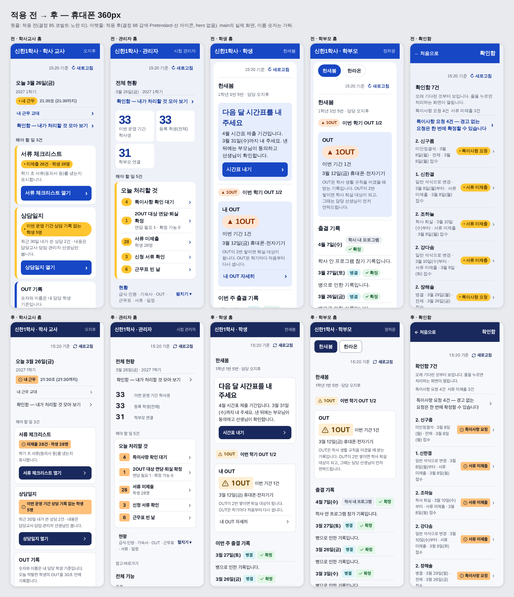
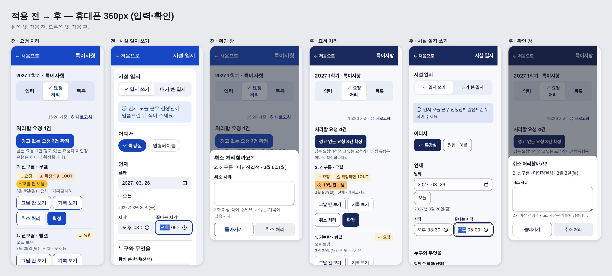
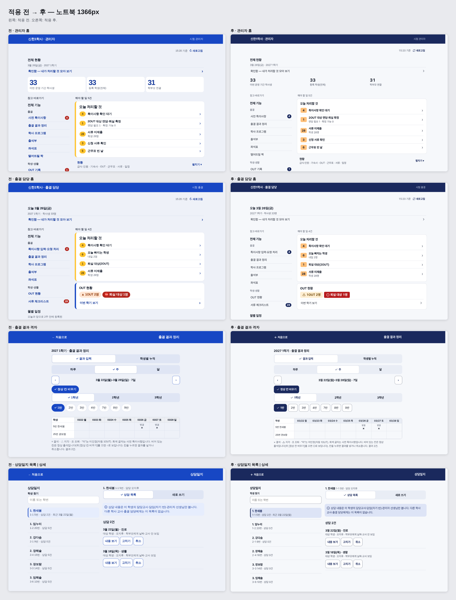

# 결정 88 적용 — 감색 면(1차 ③) · hero 없음 · Pretendard 웹폰트

> 선생님 결정(2026-11-22): **"1차 3"**, **"Hero 넣지 말고 웹폰트 써도 돼."**
> 시안이 아니라 **실제 화면에 적용한 것**입니다. 바꾼 곳은 `src/ui/Styles.html` 한 파일(토큰과 공통 규칙)이고, 화면 파일·서버 코드·문구는 건드리지 않았습니다.
> 사진은 main의 실제 화면을 가짜 서버에 띄워 찍었습니다(이름·숫자는 가짜, 가짜 오늘 2027-03-26 15:20).

## 전 → 후

## 무엇이 바뀌었나

| | 전(결정 85) | 후(결정 88) |
| --- | --- | --- |
| 주색 | 코발트 `#1747c4`(채도 0.20) | 감색 `#1a295d`(채도 0.095) |
| 강조 | 노란 띠 + 노란 숫자 알약, 빨간 건수 배지 | 살구색 `#ffc07a`은 **처리할 건수에만**. 건수 배지는 감색 |
| 할 일·중요 카드 | 왼쪽 8px 색 띠 + 그림자 | 흰 판 + 가는 테두리 하나(띠·그림자 없음) |
| 줄 링크·전체 기능 목록 | 굵은 파란 글자 | 본문색 보통 굵기 + 끝에 화살표 아이콘 |
| 상태 표시 앞의 기호 | 글자 기호(✓ … ⊘ ▲ ⛔ ●, ⚠ ⓘ ↻ ›) | Lucide 선 아이콘(낱말은 그대로 함께) |
| 글꼴 | 기기 기본 | **Pretendard 웹폰트**(못 받으면 기기 기본) |
| 굵기·자간 | 400·700·800, 음수 자간 | 400·700 두 단계, 자간 0 |
| 입력칸 테두리 | `#c4cbe0`(흰 바탕과 1.62:1) | `#747a8a`(4.29:1) |
| 학생·학부모 화면 | 따로 흰 판 하나 + 연파랑 상자 | 교사 화면과 같은 안 |
| 숫자 칸(현황) | 흰 상자 세 개, 큰 파란 숫자 | 상자 없이 숫자 + 설명 한 줄 |
| 홈 구조 | 기준 시각 → 오늘 처리할 것 → 참고 | **그대로**(hero 없음) |

지키던 것은 그대로입니다: 누르는 칸 48px, 색만으로 알리지 않기(아이콘 + 낱말), 360px·글자 150% 넘침 0, 결정 85의 구조(할 일·참고 나누기, 넓은 화면 두 칸).

## 선생님이 확인하실 것

1. 감색과 살구색이 고르신 1차 ③ 그림과 같은 느낌인지 (hero가 빠져 살구색은 "오늘 처리할 것"의 숫자 칩과 할 일 꼬리표에만 남았습니다)
2. 굵은 파란 글자가 없어진 목록이 누를 수 있는 줄로 보이는지 (끝의 화살표로 알립니다)
3. 학생·학부모 화면이 교사 화면과 같은 모양이어도 괜찮은지 (결정 88의 총괄 가정)
4. 실제 학교 망에서 글꼴이 늦게 뜨지 않는지 — **이것은 배포해서 봐야 합니다.** 못 받으면 기기 기본 글꼴로 보이니 화면이 깨지지는 않습니다.

## 건너뛴 것 · 확인 못 한 것

- **학교 망에서의 글꼴 로딩 시간은 재지 못했습니다.** 미리보기 환경은 글꼴 주소(jsDelivr)가 막혀 있어, 내려받은 같은 파일을 가짜로 내려 주며 찍었습니다(시안 측정으로는 화면당 200~330KB).
- 머리줄의 "← 처음으로"는 글자 화살표 그대로입니다(화면 파일을 고쳐야 해서 이번에는 두었습니다). "펼치기 ▾ / 접기 ▴"도 그대로입니다.
- 화면 파일 안에 따로 적힌 작은 글자(달력 칸·결과 격자 .72~.85rem)와 화면별 `<style>`은 손대지 않았습니다. 토큰을 쓰는 곳은 새 색을 따라옵니다.
- 출석부 인쇄물(흑백)은 이 색을 쓰지 않으므로 바뀌지 않습니다.
- 다크 모드는 범위 밖입니다.
