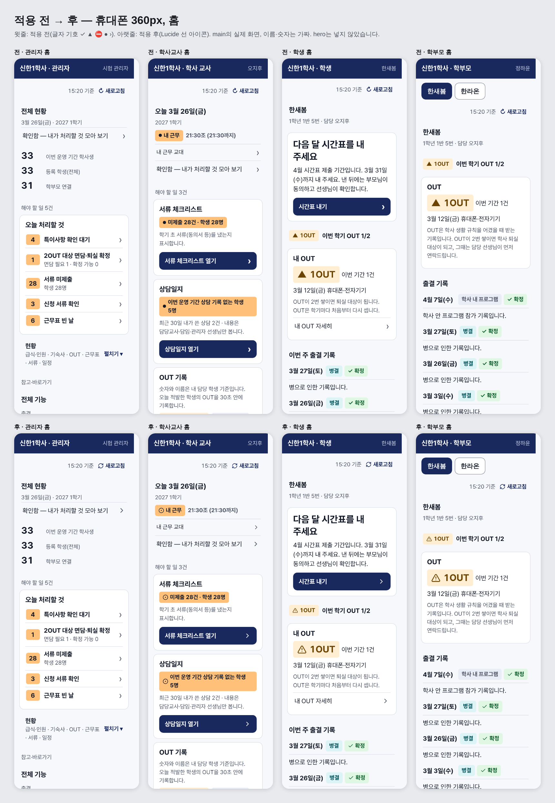
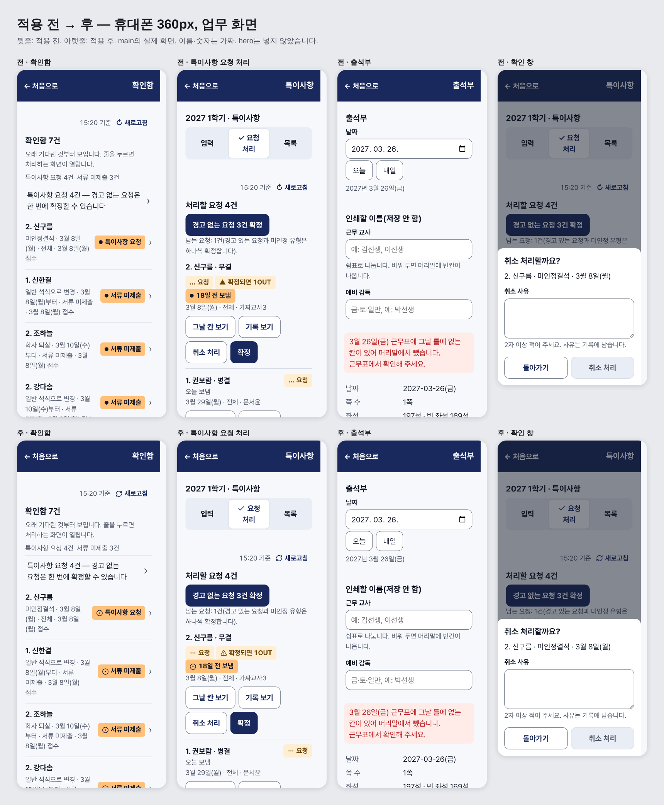
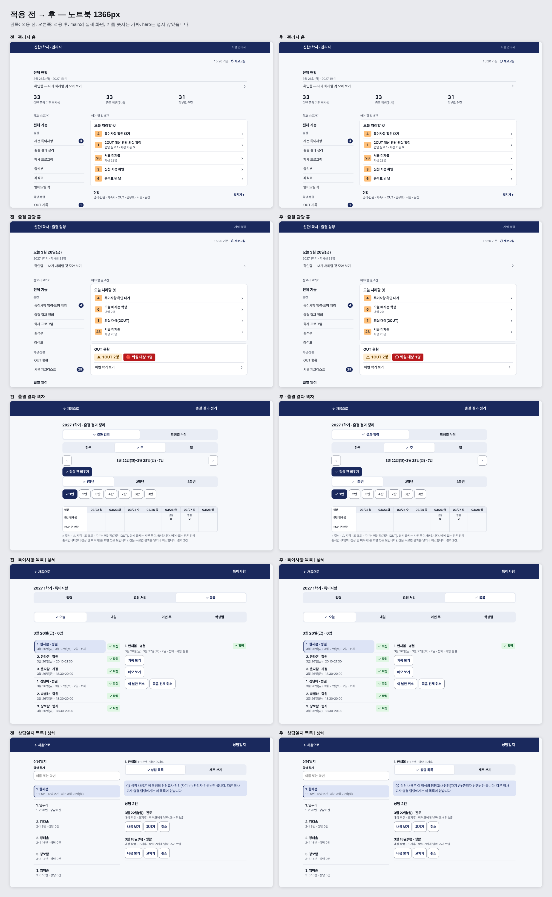
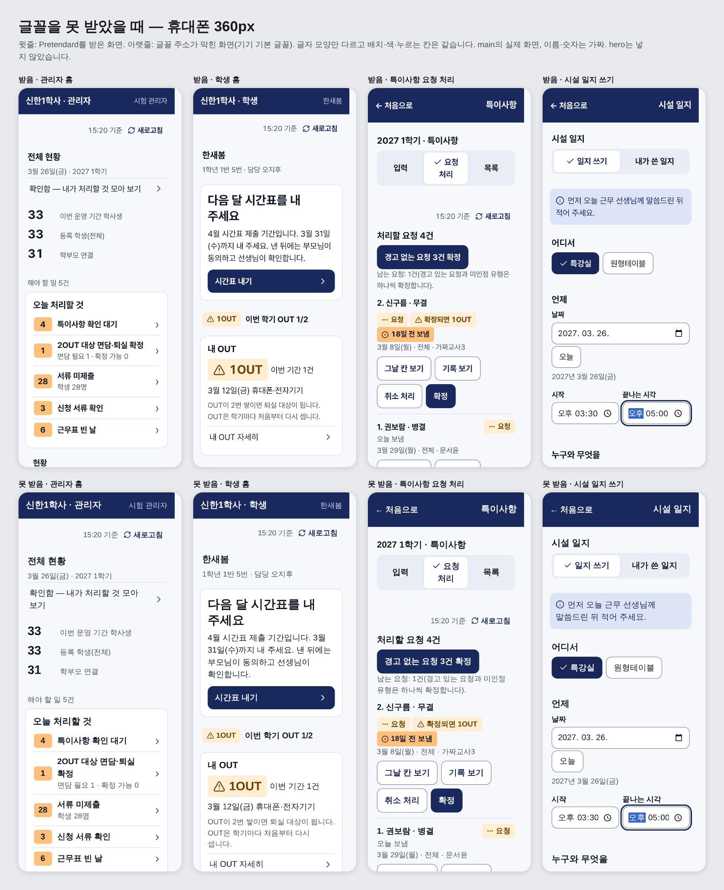

# 결정 88 적용 (나) — 글자 기호를 선 아이콘으로

> 결정 88의 나머지 절반입니다. 색·글꼴은 (가)(PR #304)에서 들어갔고, 여기서는 상태 표시 앞의 **글자 기호(✓ … ⊘ ▲ ⛔ ● ⚠ ⓘ ↻ ›)를 Lucide 선 아이콘으로** 바꿉니다.
> 실제 화면에 적용한 것입니다. 사진은 main의 실제 화면을 가짜 서버에 띄워 찍었습니다(이름·숫자는 가짜, 가짜 오늘 2027-03-26 15:20).

## 전 → 후

## 무엇이 바뀌었나

| 자리 | 전(글자) | 후(아이콘) |
| --- | --- | --- |
| 확정 꼬리표 · 확인 안내 · 고른 칩·탭 · 고른 좌석 | ✓ | 체크 |
| 요청 꼬리표 | … | 점 셋 |
| 취소 꼬리표 | ⊘ | 금지 |
| 1OUT 꼬리표 · 오류·경고 안내 | ▲ · ⚠ | 세모 경고 |
| 퇴실 대상 꼬리표 | ⛔ | 팔각 경고 |
| 할 일 꼬리표 | ● | 점(동그라미 안의 점) |
| 정보 안내 | ⓘ | 정보 |
| 새로고침 | ↻ | 새로고침 |
| 줄 링크·"열기"의 끝 | › | 오른쪽 화살표 |

**낱말은 그대로입니다.** 아이콘은 예전 '앞 글자' 자리를 그대로 잇습니다 — 여섯 가지 상태가 서로 다른 그림이고(검사가 확인), 색은 글자색을 따르며, 뜻은 옆의 낱말(확정·요청·1OUT…)이 전합니다. 색이나 그림만으로 상태를 알리는 곳은 없습니다.

## 넣은 방식

| | |
| --- | --- |
| 어디에 | `src/ui/Styles.html`의 `:root`에 CSS 변수(`--i-check` 등) 9개. 바깥 요청 없음 |
| 무게 | SVG 9개 합쳐 약 3.5KB(가장 큰 것 0.6KB) |
| 그리는 법 | 꼬리표·안내의 `::before`/`::after`에 `mask`로. 색은 `currentColor`(글자색)라 대비가 글자와 같음 |
| 화면 읽기 프로그램 | CSS로 그린 꾸밈 그림이라 읽지 않습니다(HTML에 `<svg>`를 넣지 않았으므로 `aria-hidden`을 붙일 요소가 없습니다). 낱말은 그대로 읽습니다 — 예전에는 "✓"·"▲" 같은 글자를 기호 이름으로 읽기도 했습니다 |
| 출처 표기 | Lucide Icons — ISC License, © Lucide Contributors. `Styles.html`의 아이콘 변수 위 주석과 `design/preview/concepts2/icons/LICENSE`(전문) |
| 화면 파일 | `screen_docs.html` 한 줄만(아래 '함께 고친 것') |

## 함께 고친 것

- **서류 체크리스트의 넘침**: 아이콘으로 꼬리표가 조금 넓어져, 글꼴을 못 받은 경우 글자 150%에서 "못 받은 서류 1건 + 열기" 줄이 11px 넘쳤습니다. 그 줄이 줄을 바꿀 수 있게 `screen_docs.html`의 한 줄을 고쳤습니다(글꼴을 받은 경우·못 받은 경우 모두 통과).
- **`.stats` 선언 두 줄을 한 줄로**(총괄 요청): 앞 줄을 바로 다음 줄이 덮던 것을 합쳤습니다. 모양은 그대로입니다.

## 그대로 둔 것

- **좌석·결과 격자의 '규칙 위반 칸'은 ⚠ 글자 그대로**입니다. "위반 표시는 ⚠ 글자 + 굵은 테두리"라는 기존 약속을 검사(`tests/design/docs.test.js`)가 지키고 있어 바꾸지 않았습니다.
- 머리줄 "← 처음으로", 접힌 '현황'의 "펼치기 ▾ / 접기 ▴", 날짜 넘기기 "‹ ›"는 화면 파일의 글자라 그대로입니다.

## 글꼴을 못 받았을 때

아이콘은 글꼴과 상관없이 같은 그림으로 나옵니다(글꼴 파일이 아니라 SVG라서).
