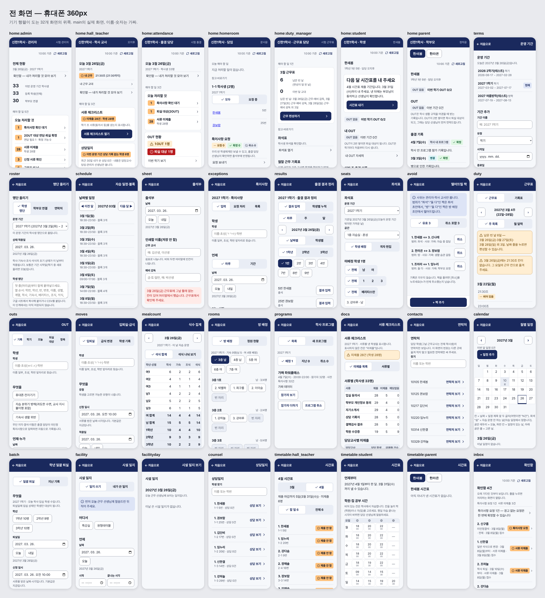
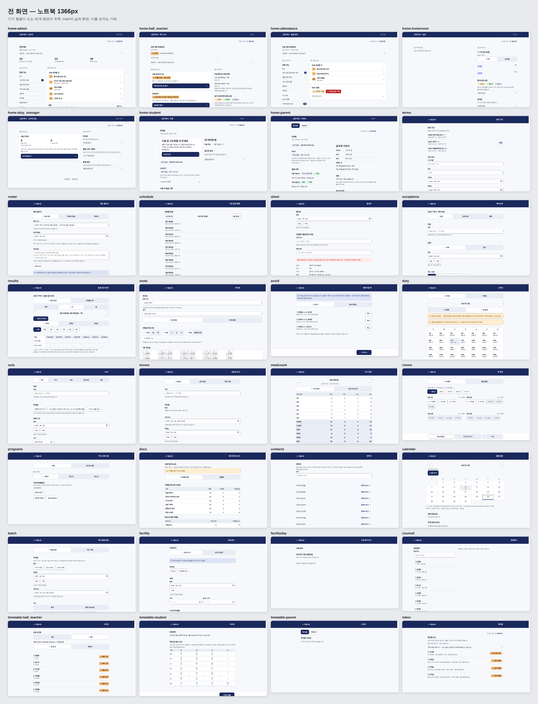
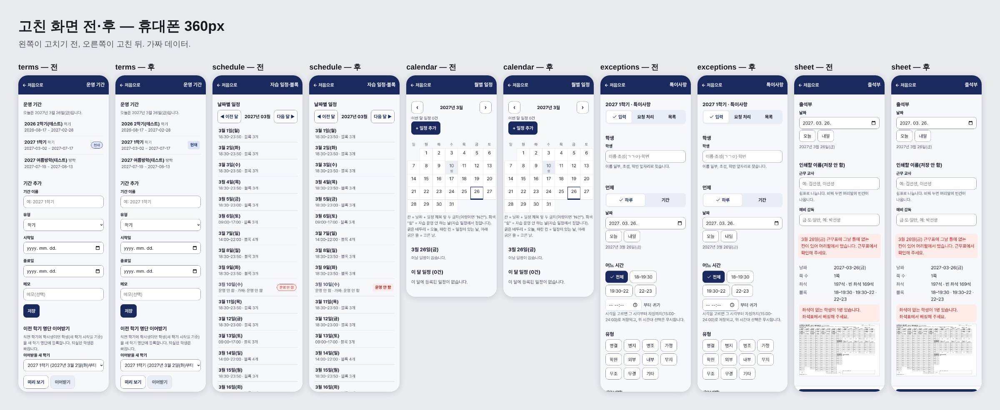

# 결정 88 적용 뒤 전체 화면 훑기 (D23)

감색 면 + 살구 신호(결정 88)를 공통 스타일에 넣은 뒤, 화면마다 따로 적어 둔 스타일이 새 안과 어긋나는 곳을 찾아 고쳤다.
화면 문구·구조·기능, 출석부 인쇄(`src/print`), 서버 코드는 건드리지 않았다. 사진의 이름·숫자는 모두 가짜 데이터다.

## 전 화면 보드 (고친 뒤)

기기 행렬이 도는 32개 화면의 위쪽. `node design/preview/all-screens.js` 로 다시 찍는다.

## 고친 화면 전·후

## 어긋난 곳

| 화면 | 무엇이 | 왜 어긋나는가 | 처리 |
|---|---|---|---|
| 운영 기간(terms) | "현재" 꼬리표가 둥근 알약 + 테두리 | 공통 꼬리표(`.pill`)는 모서리 6px, 테두리 없음 | 고침 |
| 운영 기간(terms) | 경고 상자 모서리 10px, 안쪽 여백 10px | 모서리는 토큰, 간격은 4px 눈금 | 고침 |
| 자습 일정(schedule) | "운영 안 함"·"변경" 꼬리표가 둥근 알약 + 테두리 | 위와 같음 | 고침 |
| 자습 일정(schedule) | 블록 시각 입력 칸 테두리가 옅은 선(`--line`), 모서리 10px | 입력 칸 테두리는 3:1이 되는 `--field-line` | 고침 |
| 자습 일정(schedule)·출석부(sheet) | 경고 상자 모서리 10px | 모서리 토큰 | 고침 |
| 월별 일정(calendar) | 운영 안 하는 날 바탕색을 16진수로 직접 씀 | 색은 토큰만 | 고침(`--muted-weak`) |
| 월별 일정(calendar) | 일정 종류 꼬리표가 살구색 | 살구색은 처리할 일에만 | 고침(회색) |
| 홈 5곳(관리자·학사 교사·출결·담임·근무표) | 오늘 일정의 "오늘" 꼬리표가 살구색 | 알림이지 처리할 일이 아니다 | 고침(회색) |
| 근무표(duty) | 주 목록의 "내 근무" 꼬리표가 살구색 | 내 줄 표시이지 처리할 일이 아니다 | 고침(회색) |
| OUT(outs) 항목 탭 | "즉시 퇴실" 꼬리표가 살구색 | 항목의 성질이지 처리할 일이 아니다 | 고침(회색) |
| 서류(docs) | 고른 버튼 글자색 `#fff` 직접 씀 | 감색 위 글자는 `--on-accent` | 고침 |
| 특이사항(exceptions) | 미리 보기 상자 바탕이 없는 토큰 + rgba | 색은 토큰만 | 고침(`--muted-weak`) |
| 특이사항(exceptions) | 시각 입력 칸 테두리가 옅은 선 | 입력 칸 테두리 3:1 | 고침 |
| 출결 결과(results)·시설 일지 보기 | 표 머리 굵기 600 | 굵기는 400·700 두 단계 | 고침 |
| 학년 일괄 퇴실(batch)·프로그램(programs) | 명단 상자 모서리 8px | 모서리 토큰 | 고침 |
| 학사 교사 홈 | 오늘 카드의 "내 근무" 살구 꼬리표 | 오늘 내가 할 근무라 처리할 일로 본다(승인된 시안) | 둠 |
| 출결 결과(results) | "미인정" 꼬리표가 살구색 | 결과 값이지 할 일은 아닐 수 있다. 뜻이 바뀌는 문제라 총괄 판단이 필요 | 둠 |
| 출석부(sheet) | 미리보기 바탕 `#fff` | 인쇄 종이는 흰색이어야 한다 | 둠(검사 예외로 등록) |
| 좌석(seats) 격자 편집 | 칸 모서리 6px | 48px 격자 칸이라 12px면 칸이 알약처럼 보인다 | 둠 |
| 방 배정(rooms) | 규칙 위반 방 테두리 3px 빨강 | 위반 표시이고 글자 설명이 함께 나온다 | 둠 |
| 인쇄 방식 시험(printspike) | 미리보기 바탕 `#fff` | 개발용 화면, 종이 | 둠 |

학생·학부모 화면(홈·시간표)은 흰 판을 뺀 뒤에도 간격·구분이 어긋난 곳을 찾지 못했다.

## 새 검사

`tests/design/screen-colors.test.js`: `src/ui`의 `screen_*.html`, `home_*.html`, `Portal.html` 의 `<style>` 안에 16진수·rgb()·색 이름을 직접 쓰면 실패한다. 예외는 출석부 미리보기 종이 흰색 하나이고 이유를 적어 두었다.
