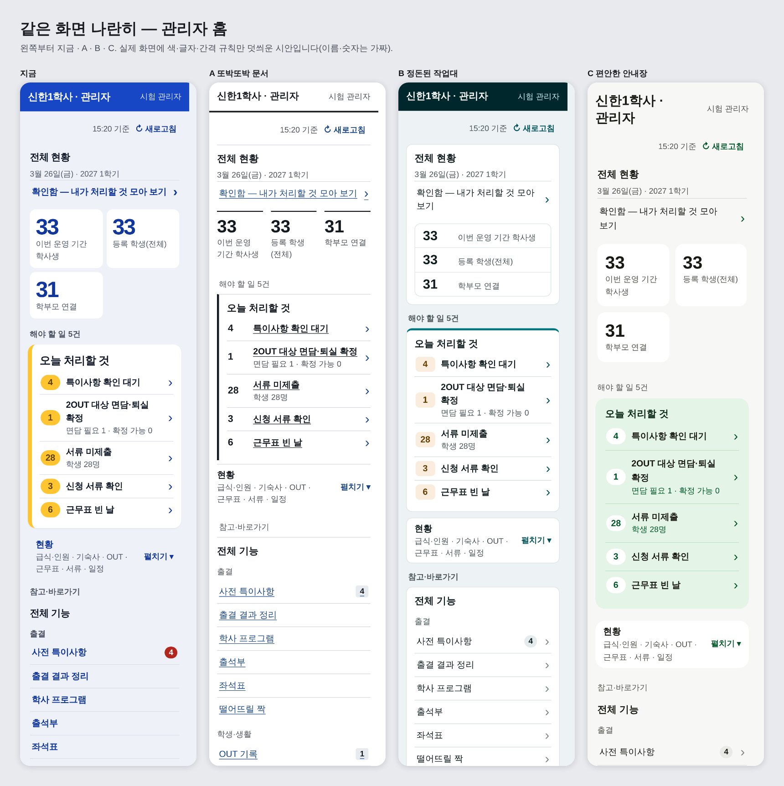
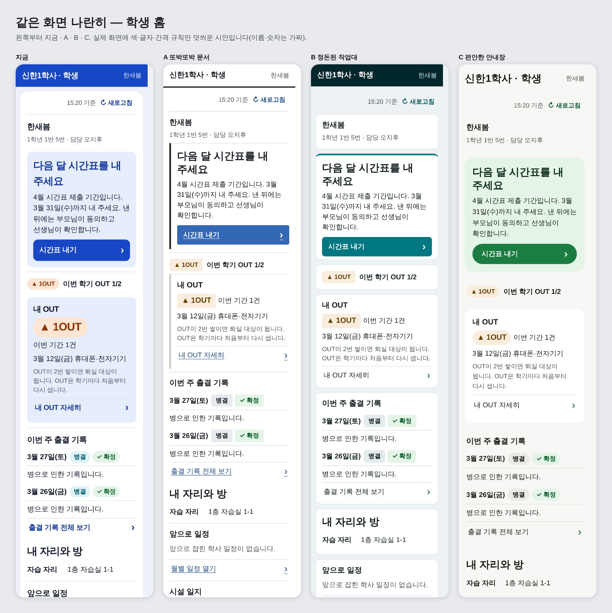
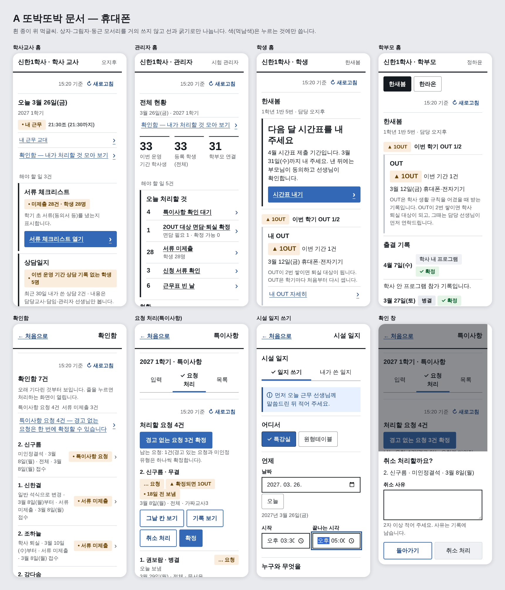
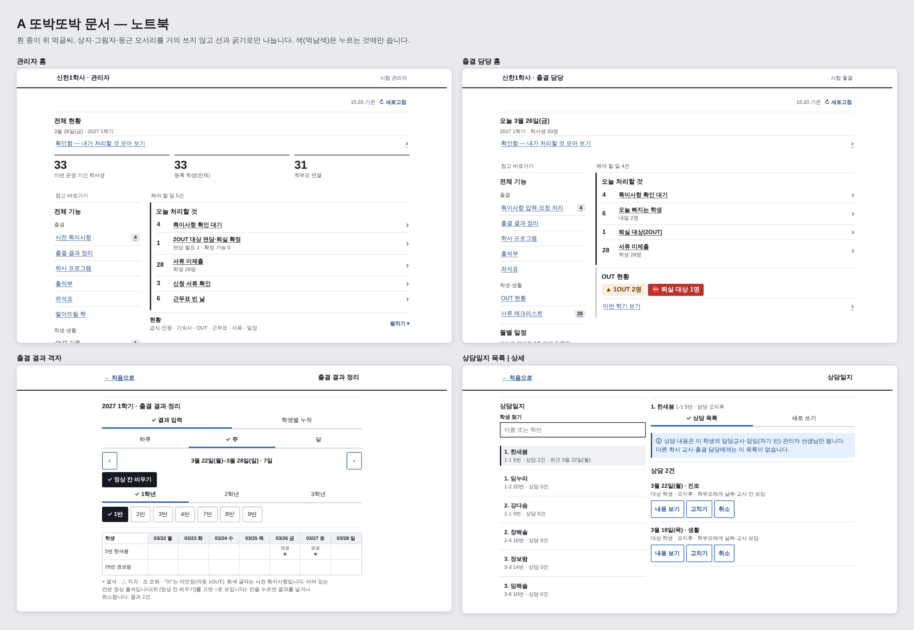
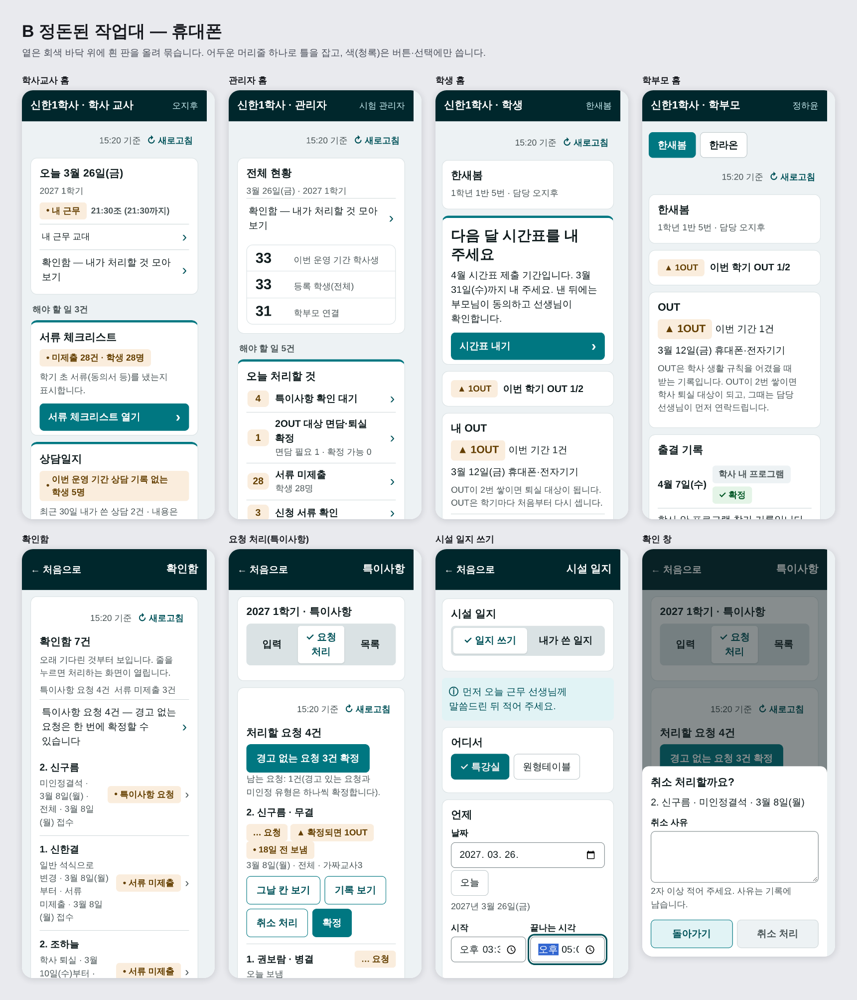
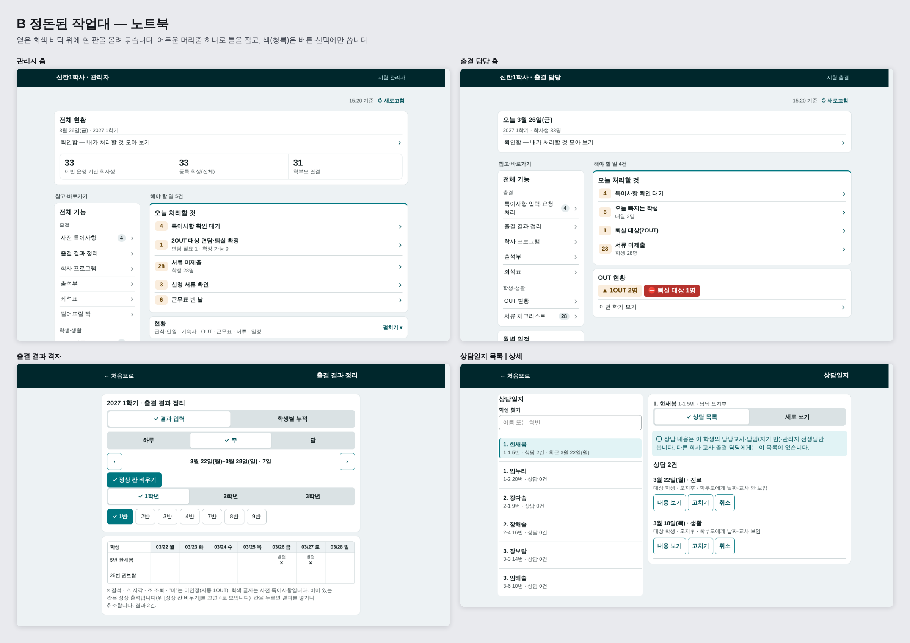
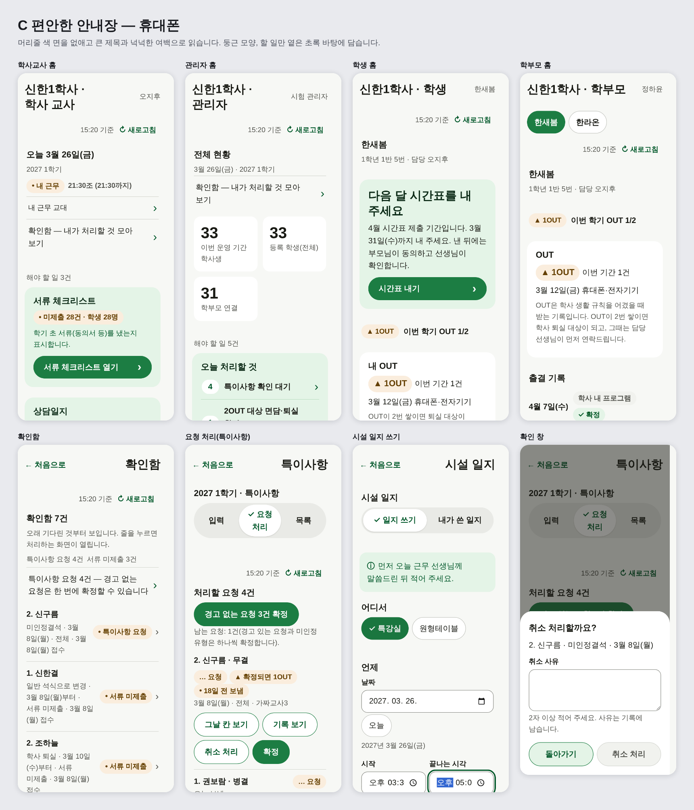
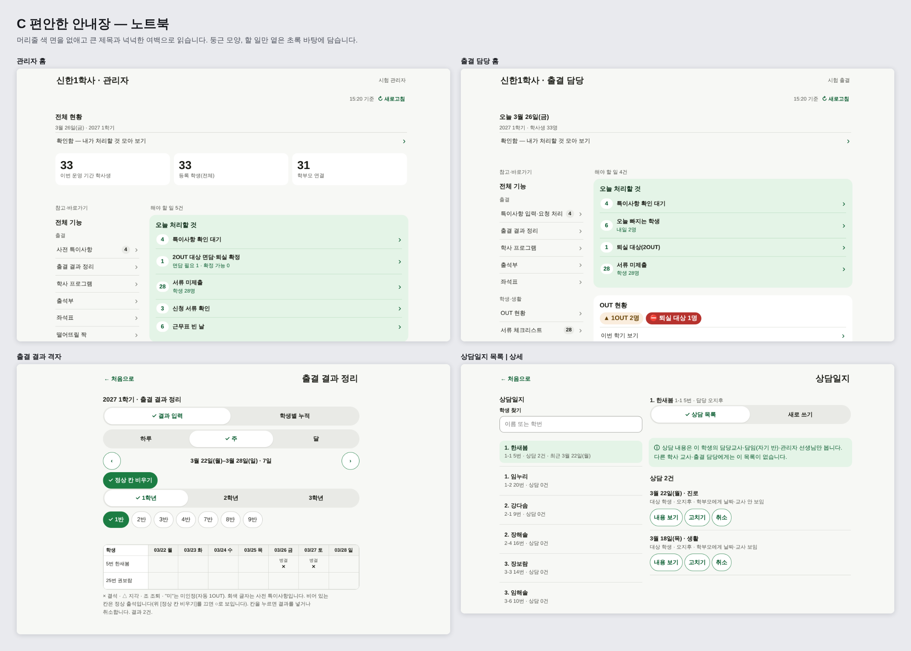

# 디자인 컨셉 A · B · C — 고르실 시안 (D19 2단계, 코드 병합 없음)

> 선생님 말씀: "디자인 시안 전체적인 컨셉 ABC 안으로 만들어서 보여줘 주요화면들을 묶어서 시안별로 보여줘".
> 사진은 그림이 아니라 **main의 실제 화면**(`src/ui`, 가짜 서버)에 CSS만 덧씌워 찍은 것입니다. 이름·숫자는 모두 가짜 데이터, 가짜 오늘은 2027-03-26 15:20입니다. `src/`는 바꾸지 않았습니다.
> 세 안 모두 [`principles.md`](../principles.md)의 같은 규칙(12단계 팔레트, 굵기 두 단계, 자간 0, 간격 4의 배수, 주의 색 하나로 통합)을 따릅니다. 다른 것은 **모양과 분위기**입니다.

## 1. 한눈에 — 같은 화면을 지금 · A · B · C로

## 2. 세 안

| | **A 또박또박 문서** | **B 정돈된 작업대** | **C 편안한 안내장** |
| --- | --- | --- | --- |
| 한 줄 | 흰 종이 위 먹글씨. 선과 굵기로만 나눈다 | 회색 바닥 위에 흰 판을 올려 묶는다 | 큰 제목과 넉넉한 여백, 둥근 모양 |
| 주색 | 먹남색 `#3268b5` | 청록 `#007781` | 숲초록 `#1c7d43` |
| 바탕 | 흰색 | 옅은 찬 회색 | 옅은 따뜻한 회색 |
| 머리줄 | 흰 바탕 + 아래 굵은 먹줄 | 어두운 면(주색 12단계) + 흰 글자 | 색 면 없음, 제목을 크게(27px) |
| 구역 나누기 | 가는 선. 상자 없음 | 모든 구역이 흰 판(선 1px) | 여백. 할 일·중요만 둥근 판 |
| 할 일 강조 | 왼쪽 굵은 먹줄 + 큰 숫자 | 판 위쪽 청록 줄 | 옅은 초록 바탕 판 |
| 줄 링크 | 밑줄 친 색 글자 | 진한 글자 + 끝의 › | 진한 글자 + 끝의 ›, 줄 높이 넉넉 |
| 버튼·칩·알약 | 각짐(4px) | 조금 둥긂(8px) | 알약 모양(완전히 둥긂) |
| 입력칸 | 굵은 검정 테두리, 각짐 | 가는 회색 테두리 | 가는 회색 테두리, 둥긂 |
| 구간 선택(탭) | 밑줄 탭 | 회색 홈 + 흰 단추 | 둥근 홈 + 흰 단추 |
| 그림자 | 없음 | 없음(아래 고정 바만) | 없음 |
| 밀도 | 빽빽(한 화면에 가장 많이 보임) | 보통 | 넉넉(누르는 칸 52px, 줄 간격 1.6) |
| 원칙과의 관계 | H3 "테두리 줄이기"를 끝까지 — 상자 0개 | H4 "묶을 이유가 있을 때 판" — 바탕 한 단계 차로 구분 | S2 "묶음 사이를 두 배로" — 여백이 구분선 |

### A 또박또박 문서

- 좋은 점: 가장 조용하고 글이 잘 읽힌다. 한 화면에 많이 보인다. 인쇄물·공문서와 닮아 교사에게 익숙하다.
- 아쉬운 점: 밑줄 링크가 많은 화면(전체 기능 목록)은 줄이 많아 보인다. 학생·학부모에게는 딱딱할 수 있다.
- 걸리는 점: 묶음의 경계가 선뿐이라, 긴 화면에서 "여기부터 다른 구역"이 B·C보다 약하다.

### B 정돈된 작업대

- 좋은 점: 구역이 판으로 딱 나뉘어 **어디가 한 묶음인지** 가장 분명하다. 노트북 두 열 배치에서 특히 정돈돼 보인다. 어두운 머리줄이 "신한1학사" 틀을 잡아 준다.
- 아쉬운 점: 판 안쪽 여백만큼 휴대폰에서 글 폭이 좁아져 줄바꿈이 조금 늘어난다(확인함 화면).
- 걸리는 점: 판이 많아 세 안 가운데 가장 "업무 프로그램"처럼 보인다.

### C 편안한 안내장

- 좋은 점: 가장 부드럽고 친근하다. 학생·학부모 화면에 잘 맞는다. 할 일이 초록 판 하나로 바로 눈에 들어온다.
- 아쉬운 점: 여백이 넉넉해 화면이 길어진다(관리자 홈에서 할 일 목록이 한 화면 아래로 밀림). 큰 제목이 휴대폰에서 두 줄이 된다.
- 걸리는 점: 주색 초록이 "확정 ✓"의 초록과 같은 색이라, 색만으로는 둘이 구분되지 않는다(글자·기호로는 구분됨).

## 3. 추천: **B 정돈된 작업대**

- 이 앱을 가장 많이, 가장 급하게 쓰는 사람은 **저녁 자습 중인 교사**다. B는 "오늘 처리할 것" 판이 다른 정보와 가장 또렷하게 갈린다.
- 휴대폰과 노트북 **양쪽에서 모양이 무너지지 않는다**(A는 노트북에서 조금 허전하고, C는 휴대폰에서 길어진다).
- 지금 화면에서 가장 거슬리던 것(센 파랑·노랑·빨강)이 없어지면서도, 머리줄이 있어 **지금과 쓰는 법이 같다**. 바꾸는 값이 토큰과 공통 규칙에 모여 있어 3단계 적용이 가장 안전하다.
- 섞어 쓸 수도 있다: 결정 85처럼 **교사 화면 B + 학생·학부모 화면 C**. 다만 색이 두 가지(청록·초록)가 되므로, 섞는다면 주색은 한 가지로 맞추는 것을 권한다.

고르실 때 여쭐 것:
1. A·B·C 가운데 어느 안인가요? (또는 교사 B + 학생·학부모 C 같은 조합)
2. 주색을 다른 안의 색으로 바꾸고 싶으신가요? (모양과 색은 따로 고를 수 있습니다. 예: B 모양 + A의 먹남색)
3. 학·가·병 알약을 회색으로 둔 것(세 안 공통)이 괜찮으신가요? 출석 격자에서 색이 있어야 훑어보기 편하시면 말씀해 주세요.

## 4. 기준 측정 — 세 안 모두 통과

실제 화면 12개(휴대폰 8 · 노트북 4)를 안마다 띄워 잰 값입니다(`node design/preview/concepts.js`).

| 기준 | A | B | C |
| --- | --- | --- | --- |
| 360px 가로 넘침 | 0 | 0 | 0 |
| 360px + 기기 글자 150% 가로 넘침 | 0 | 0 | 0 |
| 누르는 칸 48px 미만(보통 글자 / 150%) | 0 / 0 | 0 / 0 | 0 / 0 |
| 화면에 보이는 글자의 최저 대비(4.5:1 이상이어야 함) | 5.55:1 | 5.31:1 | 4.53:1 |
| 색만으로 상태 알리기 | 없음 — 알약의 앞 글자(✓ … ▲ ⛔ ●)와 낱말은 그대로 | 같음 | 같음 |

C의 4.53:1은 초록 판 위에 놓인 브라우저 기본 색 링크 한 줄(확인함 미리보기)입니다. 통과선은 넘지만 3단계에서 그 링크를 역할 토큰 색으로 바꿉니다.

### 색 짝 대비 (WCAG 2 비율, 괄호는 APCA Lc)

| 글자 / 바탕 | 통과선 | A | B | C |
| --- | --- | --- | --- | --- |
| 본문 글자(회색12) / 바탕(회색2) | 4.5 | 16.44 (100) | 16.39 (100) | 16.43 (100) |
| 보조 글자(회색11) / 바탕(회색2) | 4.5 | 7.30 (83) | 7.25 (83) | 7.29 (83) |
| 보조 글자 / 회색3 | 4.5 | 6.86 (79) | 6.82 (78) | 6.91 (79) |
| 색 글자(주색11) / 흰 판 | 4.5 | 9.30 (91) | 8.93 (90) | 8.77 (89) |
| 색 글자(주색11) / 주색3 | 4.5 | 8.08 (82) | 7.80 (81) | 7.68 (80) |
| 흰 글자 / 주 버튼(주색9) | 4.5 | 5.55 (83) | 5.31 (81) | 5.17 (81) |
| 흰 글자 / 주색12(B의 머리줄) | 4.5 | 16.12 (106) | 15.83 (105) | 15.66 (105) |
| 성공 글자 / 성공3 | 4.5 | 7.69 (80) | 7.69 (80) | 7.69 (80) |
| 주의 글자 / 주의3 | 4.5 | 8.09 (82) | 8.09 (82) | 8.09 (82) |
| 위험 글자 / 위험3 | 4.5 | 8.57 (82) | 8.57 (82) | 8.57 (82) |
| 흰 글자 / 위험9(퇴실 대상·위험 버튼) | 4.5 | 6.03 (84) | 6.03 (84) | 6.03 (84) |
| 입력칸 테두리(회색8) / 흰 판 | 3 | 3.65 | 3.64 | 3.64 |
| 초점 링(주색11) / 바탕 | 3 | 8.74 | 8.41 | 8.22 |

지금 화면과 비교: 입력칸 테두리가 1.62:1 → 3.64:1로 기준(3:1)을 넘고, 주색 채도는 0.201 → A 0.135 · B 0.105 · C 0.125로 내려갑니다.

## 5. 색 체계 (세 안 공통 구조)

OKLCH에서 만든 12단계입니다. **같은 단계는 색이 달라도 밝기가 같습니다**(1단계 0.992 … 9단계 0.52 … 12단계 0.25). 계산은 `design/preview/concepts/palette.js`.

| 단계 | 쓰임 | A 주색 | B 주색 | C 주색 |
| --- | --- | --- | --- | --- |
| 1 · 2 | 바탕 | `#fbfcfe` `#f3f7fe` | `#f9fdfe` `#eff9fa` | `#f9fefa` `#f1faf3` |
| 3 · 4 · 5 | 옅은 부품 바탕(보통·올림·눌림) | `#e6f0fe` `#d9e8ff` `#cbe0ff` | `#e1f3f5` `#d2edf0` `#c2e6ea` | `#e4f4e7` `#d7eedc` `#c9e7d0` |
| 6 · 7 · 8 | 테두리 | `#b9d4fb` `#9fc1f4` `#74a0e1` | `#addbe1` `#8fccd3` `#58aeb7` | `#b7ddbf` `#9bcea8` `#6db07f` |
| 9 · 10 | 채운 면(주 버튼·선택) | `#3268b5` `#2659a3` | `#007781` `#026770` | `#1c7d43` `#066d36` |
| 11 · 12 | 색 글자 / 어두운 면 | `#1a4685` `#0f213c` | `#005259` `#00272c` | `#005729` `#0a2915` |

| 회색(주색 기운) | 1 · 2 · 3 바탕 | 6 구분선 | 8 입력칸 테두리 | 11 보조 글자 | 12 본문 글자 |
| --- | --- | --- | --- | --- | --- |
| A | `#fbfcfe` `#f6f8fb` `#eff1f5` | `#d1d5db` | `#82868e` | `#4e5359` | `#151a20` |
| B | `#fafdfe` `#f4f9fa` `#edf2f4` | `#ced7d9` | `#7d888b` | `#4a5557` | `#101c1e` |
| C | `#fcfdfb` `#f7f8f5` `#f1f2ee` | `#d4d6d0` | `#858780` | `#52534d` | `#191a14` |

| 의미 색(세 안 공통) | 3 옅은 바탕 | 9 채운 면 | 11 글자 | 쓰는 곳 |
| --- | --- | --- | --- | --- |
| 성공 | `#e4f4e7` | `#1d7d3e` | `#015725` | 확정 ✓, 안내(확인) |
| 주의 | `#faeddd` | `#905c01` | `#643f00` | 할 일 ●, 요청 …, 1OUT ▲ (지금의 노랑·호박·주황 세 가지를 하나로) |
| 위험 | `#feeae7` | `#b6322d` | `#851515` | 오류, 퇴실 대상 ⛔, 위험 버튼 |
| 정보 | 주색 3 | 주색 9 | 주색 11 | 안내 ⓘ, 선택됨 |

역할 토큰(지금 이름 그대로, 값만 단계에서 가져옴): `--bg` = 회색 2(A는 흰색, B는 회색 3) · `--text` = 회색 12 · `--muted` = 회색 11 · `--line` = 회색 6 · `--accent` = 주색 9 · `--accent-weak` = 주색 3 · `--accent-ink` = 주색 11 · `--signal`/`--caution-weak`/`--out1-weak` = 주의 3 · `--signal-ink`/`--caution-ink`/`--out1-ink` = 주의 11 · `--warn` = 위험 11 · `--warn-weak` = 위험 3 · `--out2` = 위험 9 · `--ok-weak`/`--ok-ink` = 성공 3/11 · 학·가·병 = 회색 4 + 회색 12. 새로 필요한 토큰은 `--field-line`(입력칸 테두리 = 회색 8) 하나입니다.

## 6. 파일

- 시안 CSS: `design/preview/concepts/common.css`(세 안 공통 규칙) + `a.css` · `b.css` · `c.css`(모양), 팔레트 계산 `palette.js`
- 찍는 도구: `node design/preview/concepts.js [now a b c] [--font150] [--boards]`
- 선택하신 뒤(3단계): 고른 안의 값을 `src/ui/Styles.html`의 토큰·공통 규칙으로 옮기고, `npm run devices -- --strict`와 `npm test`로 확인한 뒤 전/후 사진과 함께 올립니다.
