# 디자인 시안 2차본 — 선생님이 지정한 레퍼런스 원문 기준 (D21, 코드 병합 없음)

> 선생님 말씀: "너무 클로드로 만든 티가 난다" → 강의 "함흥 hero와 평양 UI로 남들과 다른 UI 만들기"를 "보고 배워라" → "이 사이트들 참고하고" + `github.com/jnsahaj/tweakcn`.
> 강의에서 짚은 곳(선생님이 주신 목록): **21st.dev**(함흥 Hero, 16:04~) · **shadcn/ui**(평양 UI, 35:46~) · **Material 3**(앱 UI의 기준, 41:01) · **tweakcn**(테마만 통째로 바꾸기, 41:40~) · **눈누**(상업용 무료 한글 웹폰트, 48:32~) · Google Flow·Higgsfield(영상 히어로, 53:06~).
> 2차본은 이 사이트들을 **직접 열어 보고** 만들었습니다. 색·모서리·그림자는 **tweakcn 프리셋 값 그대로**이고, 부품은 shadcn/ui 규격, hero는 21st.dev의 실제 히어로 두 개의 구조, 글꼴은 눈누에서 라이선스를 확인한 것입니다.
> 사진은 main의 실제 화면에 CSS와 글꼴을 덧씌워 찍었습니다(이름·숫자는 가짜, 가짜 오늘 2027-03-26 15:20). `src/`는 바꾸지 않았습니다.
> 1차본(사이트를 보기 전, 색 값을 직접 지은 것) 설명은 [`concepts2-v1.md`](concepts2-v1.md)에 그대로 있습니다.

## 1. 한눈에 — 1차 대 2차

윗줄은 지금 화면과 1차본 세 안, 아랫줄은 2차본 네 안입니다.

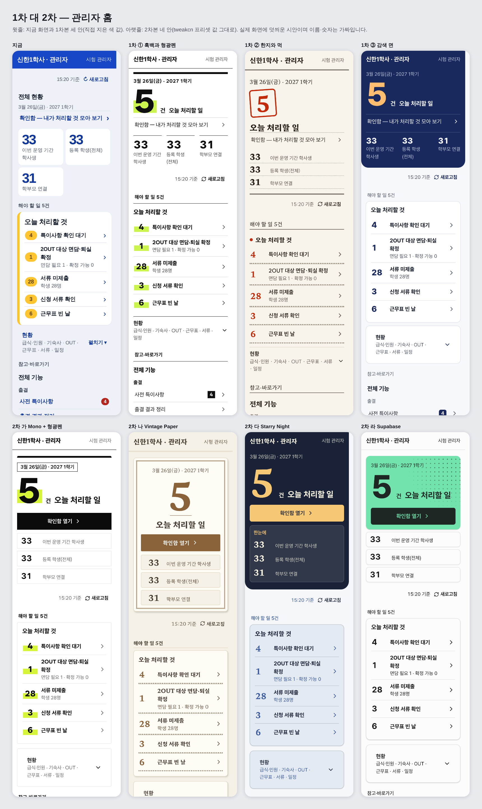

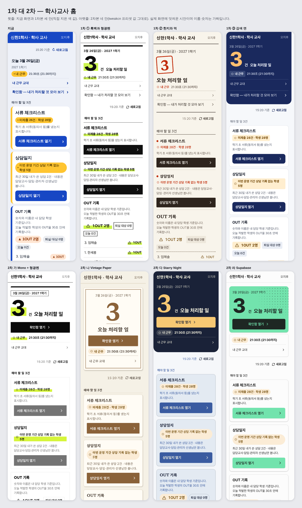

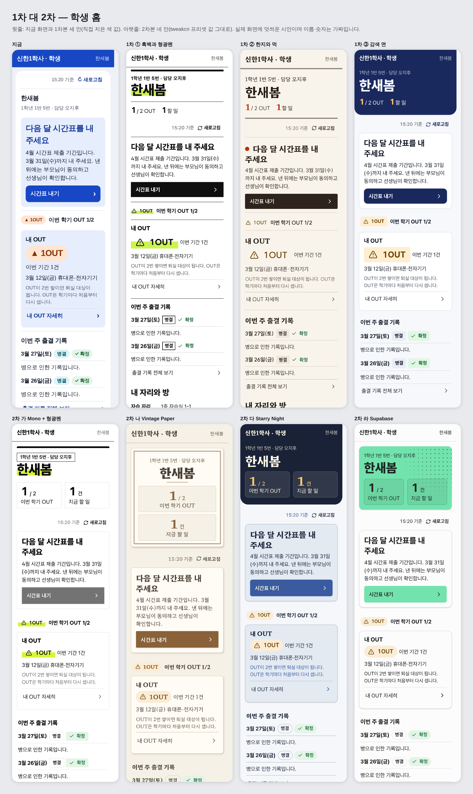

## 2. 2차본 네 안이 어디서 왔는지

| | **가 Mono + 형광펜** | **나 Vintage Paper** | **다 Starry Night** | **라 Supabase** |
| --- | --- | --- | --- | --- |
| tweakcn 프리셋 | `mono` | `vintage-paper` | `starry-night` | `supabase` — 강의가 "깔끔한 실무용"으로 꼽은 것 |
| 이어받은 1차 안 | ① 흑백과 형광펜 | ② 한지와 먹 | ③ 감색 면 | (새로 넣음) |
| 성격 | 흰 바탕·검은 글씨·회색 버튼, 모서리 0, 그림자 없음 + 형광펜 | 누런 종이·갈색 잉크, 옆으로 떨어지는 그림자, 모서리 4px | 감색 주색 + 호박색 보조색, 모서리 8px | 거의 흰 바탕 + 민트 한 색, 모서리 8px |
| 프리셋 글꼴 → 눈누 한글 글꼴 | Geist Mono → **Wanted Sans** | Libre Baskerville → **함렛**(명조) | Libre Baskerville → **함렛**(제목·숫자) + **Pretendard**(본문) | Outfit → **Pretendard** |
| hero 구조의 출처 | 21st.dev "Hero Section 01"(MIT): 작은 딱지 → 밑줄 그은 큰 제목 → 버튼 하나 | 책 속표지식 가운데 정렬(21st.dev "Centered Hero" 유형) | 21st.dev "Facts Hero"(MIT): 어두운 면 + 명조 큰 제목 + 버튼 + 숫자를 모은 "한눈에" 카드 | 벤토 그리드(강의 용어): 큰 칸 + 작은 칸 |
| 화면당 글꼴 무게(시안) | 156~267KB | 341~609KB | 390~666KB | 204~333KB |

부품(버튼·입력칸·카드·배지·탭·시트)은 네 안이 **같은 CSS 한 벌**입니다. 테마 변수만 바뀝니다 — 강의가 tweakcn을 "핵심"이라고 한 방식 그대로입니다.

### 가 Mono + 형광펜

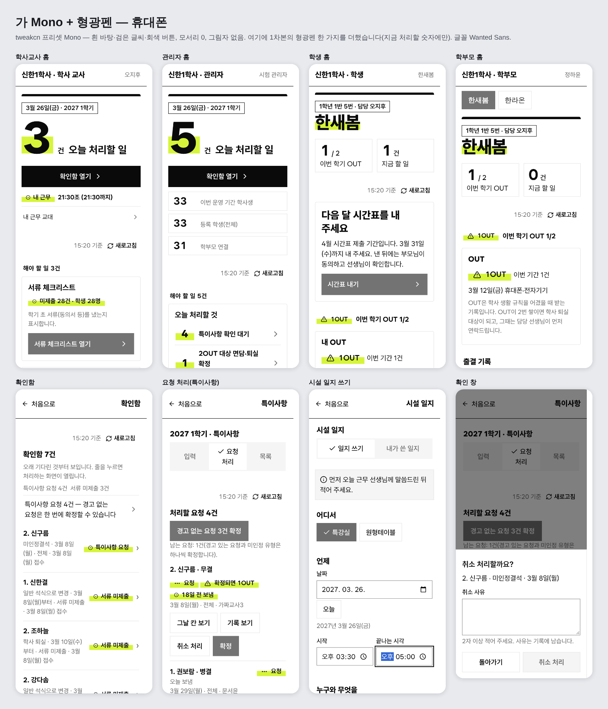
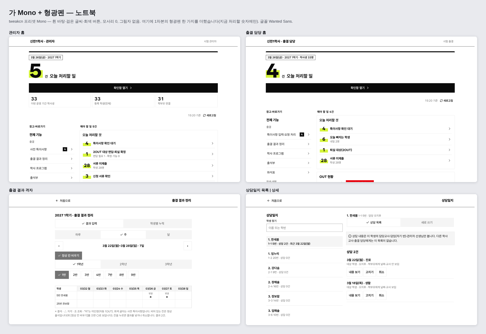

- 좋은 점: 가장 가볍고 또렷하다. 흑백 출력물(출석부)과 말투가 같다. "지금 볼 숫자"가 형광펜 하나로 바로 보인다.
- 아쉬운 점: 프리셋의 주 버튼이 회색(`#737373`)이라 버튼이 약해 보인다(hero의 버튼만 검정). 차갑다.
- 걸리는 점: 형광펜은 프리셋에 없는 값이라 우리가 더한 것입니다(5절에 표시). 형광 연두는 호불호가 갈립니다.

### 나 Vintage Paper

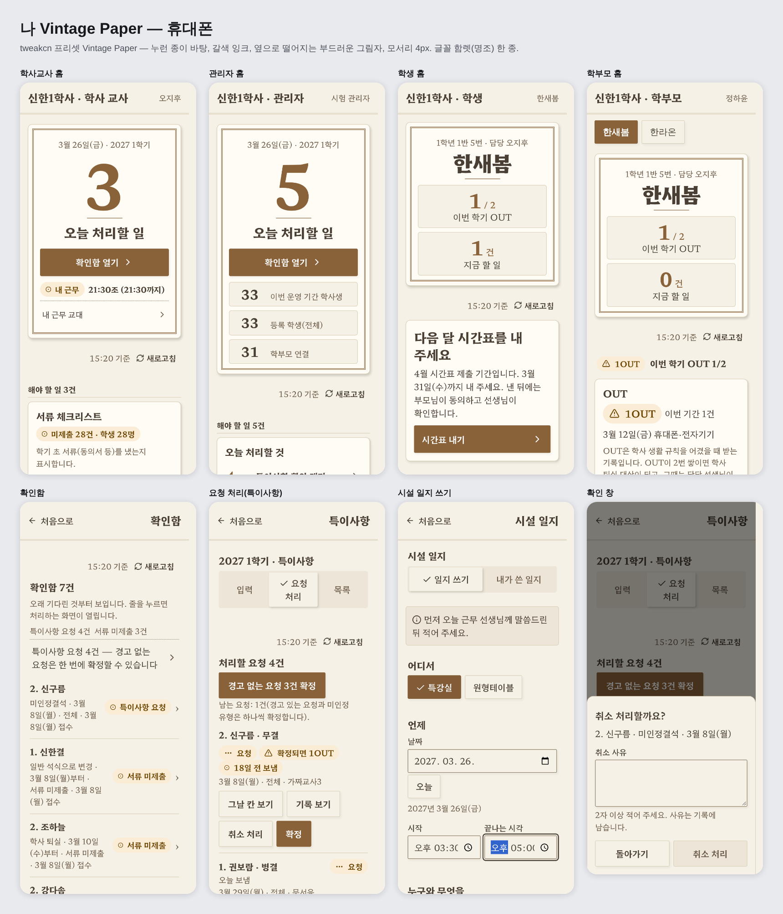
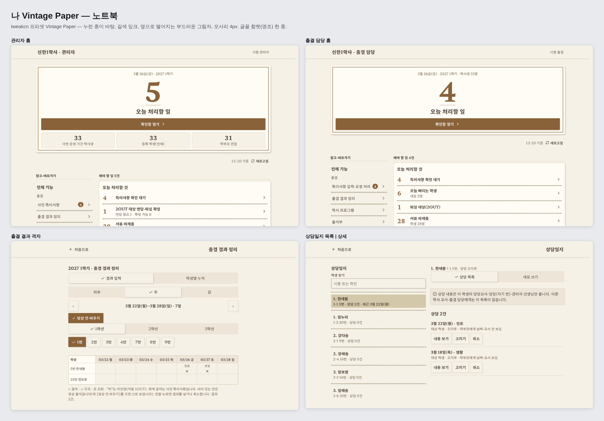

- 좋은 점: 가장 차분하고 학교 일지 같은 분위기. 다른 앱과 가장 덜 닮았다.
- 아쉬운 점: 본문까지 명조라 작은 글자·빽빽한 표에서 고딕보다 읽기 어렵다. 해상도 낮은 노트북에서 더 그렇다.
- 걸리는 점: 1차 ②의 붉은 도장은 프리셋에 없는 색이라 뺐습니다. 넣으려면 "더한 값"으로 다시 넣을 수 있습니다.

### 다 Starry Night

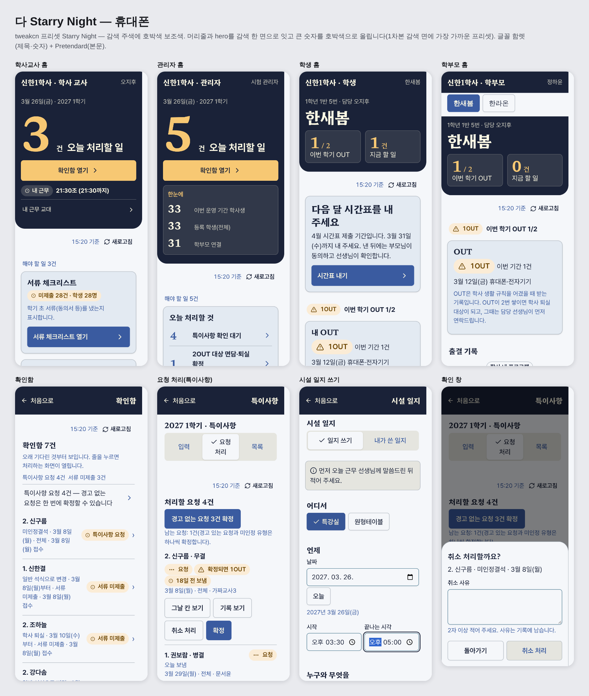
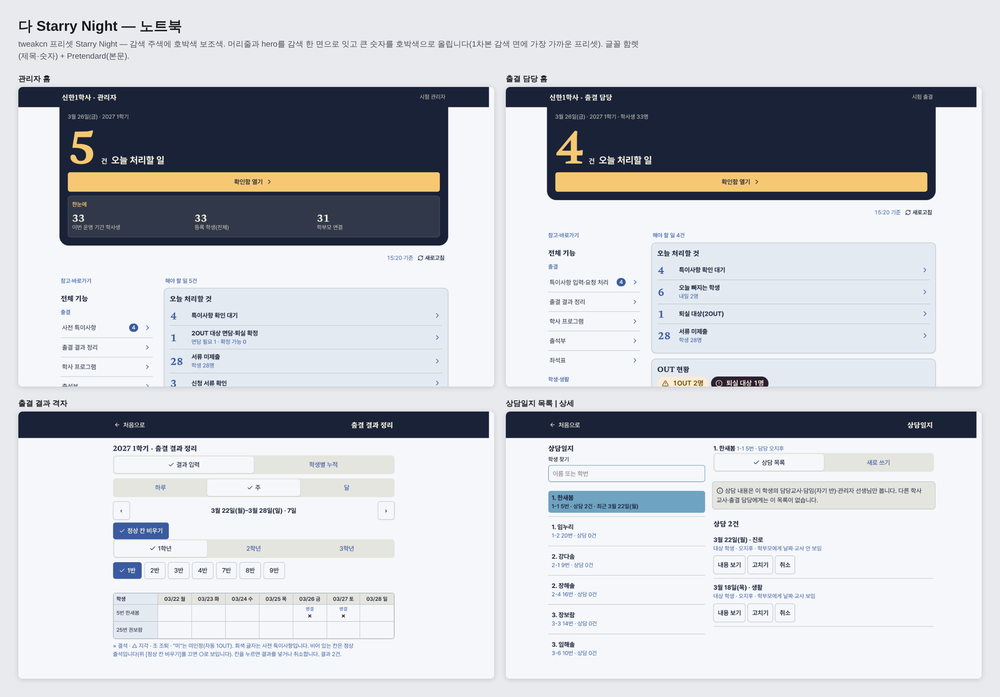

- 좋은 점: 첫 화면의 인상이 가장 강하다(감색 면 + 호박색 숫자 + "한눈에" 카드). 아래는 조용하다.
- 아쉬운 점: 글꼴이 두 종이라 가장 무겁다. 프리셋이 보조 글자를 파랑(`#3a5ba0`)으로 정해 설명 글이 파랗다.
- 걸리는 점: 지금의 코발트 머리줄을 싫어하신 것과 겹칠 수 있다(이쪽은 훨씬 어둡고 노랑 띠 대신 호박색 숫자 하나).

### 라 Supabase

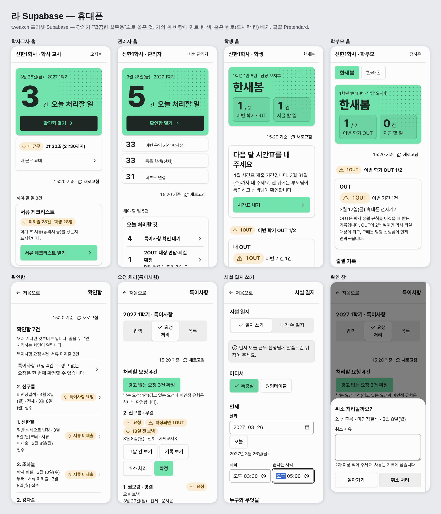
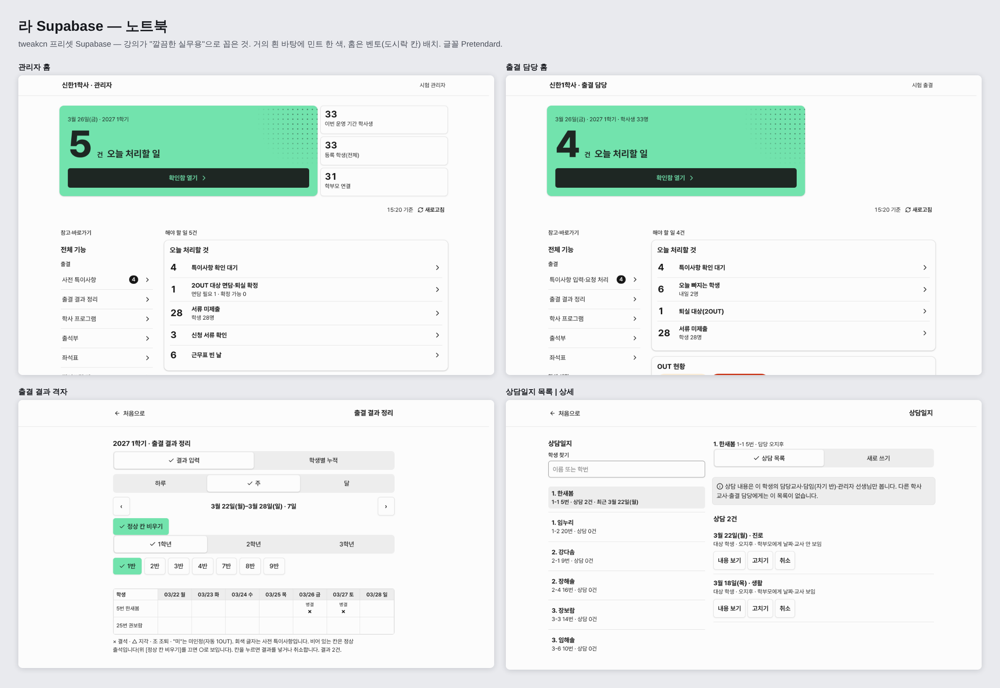

- 좋은 점: 가장 정돈되고 실무에 무리가 없다. 노트북에서 벤토 배치가 잘 산다.
- 아쉬운 점: 네 안 가운데 "잘 만든 흔한 앱"에 가장 가깝다.
- 걸리는 점: 민트는 글자색으로 쓸 수 없어(흰 바탕과 1.54:1) 링크는 검정 + 밑줄로 했다.

## 3. 추천: **가 Mono + 형광펜**

- 1차에서 반응이 좋았던 ①의 성격을 그대로 두고 값만 프리셋으로 바꾼 안입니다. 색을 거의 버리고 장치 하나만 남겨 **평균값에서 가장 멉니다**.
- 글꼴이 한 종이라 **가장 가볍고**(화면당 156~267KB), 상태 색(확정 초록·주의·위험)이 다른 색과 섞이지 않습니다.
- 회색 버튼이 약한 것은 프리셋 값이라 그대로 뒀습니다. 고르신다면 "주 버튼을 검정으로"를 손본 값에 하나 더하는 것을 권합니다.
- 실무 쪽으로 무난하게는 라 Supabase, 분위기는 나 Vintage Paper(본문을 고딕으로 바꾸는 변형 권장), 첫인상은 다 Starry Night입니다.

## 4. 1차본과 달라진 점

| | 1차본(#300) | 2차본 |
| --- | --- | --- |
| 색·모서리·그림자 값 | 직접 지음(OKLCH) | tweakcn 프리셋 값 그대로, 바꾼 곳만 표로(5절) |
| 부품 모양 | 안마다 따로 그림 | shadcn/ui 규격 한 벌, 테마 변수만 바뀜 |
| hero | 직접 구성 | 21st.dev의 MIT 히어로 두 개의 구조 + 벤토 |
| 글꼴 라이선스 | npm 패키지 파일로만 | 눈누 원문에서 임베딩 허용까지 확인(8절) |
| 안 개수 | 3 | 4(1차 세 안에 가까운 프리셋 셋 + Supabase) |
| 빠진 것 | — | ②의 붉은 도장, ①의 "카드 0개"(shadcn 카드 규격을 따름), ②의 SUIT(624KB 한 파일) |
| 그대로인 것 | hero에 큰 숫자 하나, Lucide 아이콘, 형광펜(가 안), 감색 면(다 안) | |

## 5. 프리셋에서 바꾼 값 — 한글과 대비 때문에 손본 곳만

출처: `github.com/jnsahaj/tweakcn`(Apache-2.0), `utils/theme-presets.ts`, 커밋 `a3b47b3`, 각 프리셋의 `light`. 아래 표에 없는 값(바탕·글자·카드·주색·보조색·테두리·차트 색·모서리·그림자)은 **그대로**입니다.

| 안 | 변수 | 프리셋 값 | 바꾼 값 | 이유 |
| --- | --- | --- | --- | --- |
| 가 | `muted-foreground` | `#717171` | `#6b6b6b` | 옅은 바탕 위 보조 글자 4.48:1 → 4.89:1 |
| 가 | `destructive-foreground` | `#f5f5f5` | `#ffffff` | 위험 버튼 위 글자 4.38:1 → 4.77:1 |
| 가 | 입력칸 테두리 | `input` `#e5e5e5` | `#8a8a8a` | 1.26:1 → 3.5:1(기준 3:1) |
| 가 | **더한 값** `--point` | (없음) | `#d6f53a` | 형광펜. 건수·hero 숫자 뒤에만(검은 글자와 16:1) |
| 나 | `primary` · `ring` | `#a67c52` | `#8a6239` | 버튼 위 흰 글자 3.73:1 → 5.40:1 |
| 나 | `muted-foreground` | `#7d6b56` | `#6b5a47` | 보조 글자 4.53:1 → 5.85:1 |
| 나 | 입력칸 테두리 | `input` `#dbd0ba` | `#8c7a62` | 1.49:1 → 4.04:1 |
| 다 | `accent-foreground` | `#fffbe6` | `#1a2238` | 하늘색 위 크림색 글자 2.63:1 → 5.77:1 |
| 다 | 입력칸 테두리 | `input` `#6ea3c1` | `#47778f` | 2.55:1 → 4.55:1 |
| 다 | 그림자 | (프리셋에 값 없음) | tweakcn 기본값 | 검정 10%, 1px 3px |
| 다 | hero 면 | — | 프리셋의 `foreground` `#1a2238` | 주색 `#3a5ba0` 위 호박색 숫자가 4.23:1이라 더 짙은 감색을 면으로 |
| 라 | 입력칸 테두리 | `input` `#f6f6f6` | `#8a8a8a` | 1.07:1 → 3.36:1 |
| 모두 | 초점 링 | 프리셋 `ring` | 본문색 바깥선 + 프리셋 링 3px | 링 색만으로는 3:1이 안 되는 프리셋이 있음 |
| 모두 | 자간 | 프리셋 값(0~0.025em) | 0 | 한글 본문은 자간 0 |
| 모두 | **더한 값** | (shadcn에 없음) | `--success` `--warning`과 옅은 바탕 | 확정·주의 상태 색(`principles.md` C5) |

## 6. 부품 규격 — shadcn/ui 원문과 우리가 다르게 둔 것

shadcn/ui 저장소(`github.com/shadcn-ui/ui`, MIT)의 `new-york-v4` 부품 소스에서 읽은 규격을 CSS로 옮겼습니다(React 없음). 문서 사이트(ui.shadcn.com)는 열리지만 수치는 소스 쪽이 정확해 소스를 기준으로 했습니다.

| 부품 | shadcn 규격 | 우리 시안 | 다른 점 |
| --- | --- | --- | --- |
| Button | 높이 36px, `rounded-md`, 글자 14px 중간 굵기, 테두리 버튼은 `shadow-xs` | 모서리·그림자·색 같음 | **높이 48px**, 글자 18px(rules 1절) |
| Input | 높이 36px, `rounded-md`, `border-input`, `shadow-xs`, 안쪽 12px | 같음 | **높이 48px**, 글자 18px, 테두리 색은 3:1 값 |
| Card | `rounded-xl`, 테두리, `shadow-sm`, 안쪽 24px | 같음 | 휴대폰 안쪽 16px. **카드는 할 일·중요에만**(결정 85 구조) |
| Badge | `rounded-full`, 안쪽 8px·2px, 글자 12px | 같음 | **글자 16px**, 앞에 아이콘 + 낱말 |
| Tabs | 묶음 `bg-muted` `rounded-lg` 안쪽 3px, 고른 탭 `bg-background` `shadow-sm` | 같음 | 탭 높이 48px |
| Dialog | `rounded-lg`, 테두리, `shadow-lg`, 안쪽 24px, 뒤 가림 검정 50% | 같음(노트북) | 휴대폰은 아래 시트 |
| 초점 링 | 3px, 링 색 50% | 같음 | 본문색 바깥선 2px을 더함 |
| 반경 단계 | sm = r−4, md = r−2, lg = r, xl = r+4 | 같음 | |

## 7. hero — 21st.dev에서 본 것과 옮긴 구조

[Heroes 목록](https://21st.dev/community/components/s/hero)에는 히어로가 1.3천 개 있고, 라이선스는 각 부품 쪽 아래에 적혀 있습니다(강의 절차대로 확인).

| 21st.dev 부품 | 라이선스 | 구조(부품 쪽 설명에서) | 우리가 옮긴 것 |
| --- | --- | --- | --- |
| Hero Section 01 (@clevision) | MIT | 붙박이 머리줄, 작은 딱지, **밑줄 그은 큰 제목**, 버튼, 폭 가득 그림 | 가 안: 날짜 딱지 → 형광펜 그은 큰 숫자 → 버튼 하나("확인함 열기") |
| Facts Hero (@sajad) | MIT | **어두운 면**, 밝은 명조 제목, 버튼 둘, 큰 사진 위 **"at a glance" 숫자 카드** | 다 안: 감색 면 + 명조 숫자 + 버튼 하나 + "한눈에" 카드(학사생·등록·연결 수) |
| Hero Modern (@brijr) | **표기 없음** | — | 쓰지 않음(강의·`ui-vocabulary.md` 5절: 표기 없는 것은 쓰지 않는다) |

가져온 것은 **구조뿐**입니다. 코드·문구·사진·움직임(숫자 굴리기, 차례로 올라오기)은 가져오지 않았습니다. 우리 hero는 큰 숫자 하나 + 시각 요소 하나 + 버튼 하나이고, 숫자는 지금 화면에 이미 있는 값입니다(교사 "오늘 처리할 N건", 학생·학부모 "이번 학기 OUT n/2 · 지금 할 일 n건").

## 8. 글꼴 — 눈누 원문에서 확인한 라이선스

눈누 각 글꼴 쪽의 "라이선스 요약표"를 읽었습니다. 일곱 종 모두 인쇄·웹사이트·포장지·영상·**임베딩**·BI/CI가 "사용 가능"이고 OFL 표시가 있습니다. 눈누는 "정확한 사용 범위는 저작권자에게 확인"하라고 적어 두었습니다.

| 글꼴 | 눈누 쪽 | 제작 | 라이선스 본문(눈누) | 임베딩 | 쓰는 안 |
| --- | --- | --- | --- | --- | --- |
| 프리텐다드 | [694](https://noonnu.cc/font_page/694) | 길형진 | SIL OFL — 글꼴 단독 판매를 뺀 모든 상업적 행위·수정·재배포 가능 | 사용 가능 | 다(본문) · 라 |
| Wanted Sans | [1269](https://noonnu.cc/font_page/1269) | 원티드랩 | SIL OFL — 단독 판매·라이선스 변경을 뺀 모든 상업적 행위 가능 | 사용 가능 | 가 |
| 함렛 | [757](https://noonnu.cc/font_page/757) | Hypertype | SIL OFL 1.1 | 사용 가능 | 나 · 다(제목) |
| 검은고딕 | [106](https://noonnu.cc/font_page/106) | ZESSTYPE | SIL OFL 1.1 | 사용 가능 | (후보, 이번에 안 씀) |
| 수트 SUIT | [845](https://noonnu.cc/font_page/845) | SUNN YOUN | SIL OFL — 자유롭게 사용·수정·재배포 | 사용 가능 | (한 파일 624KB라 뺌) |
| 페이퍼로지 | [1456](https://noonnu.cc/font_page/1456) | 이주임 X 김도균 | SIL OFL — 단독 판매·라이선스 변경 제외 | 사용 가능 | (후보 — 파일을 받을 길이 없어 그려 보지 못함) |
| G마켓 산스 | [366](https://noonnu.cc/font_page/366) | G마켓 | "누구나 제약 없이 자유롭게 수정하고 재배포" | 사용 가능 | (후보 — 같은 이유로 그려 보지 못함) |

- 두꺼운 제목용 후보는 페이퍼로지(굵기 9단계)·검은고딕·G마켓 산스입니다. 페이퍼로지와 G마켓 산스는 눈누가 알려 주는 주소(jsDelivr)가 이 작업 환경에서 막혀 있어 **화면에 입혀 보지 못했습니다** — 원하시면 그 주소를 허용한 뒤 한 안에 입혀 다시 찍겠습니다.
- 받는 방법: Apps Script 웹앱은 글꼴 파일을 직접 내려 주기 어려워, 눈누가 알려 주는 공개 주소(jsDelivr)에서 받는 길뿐입니다 — 화면마다 외부 요청이 생깁니다. 못 받으면 기기 기본 글꼴로 내려갑니다(화면은 깨지지 않음).
- 무게는 **시안에서 로컬 파일을 내려 준 바이트 수**입니다. 학교 망에서의 실제 시간은 재지 못했습니다.

## 9. Material 3 — 앱 화면 규칙으로 가져올 것

m3.material.io의 규격 쪽은 자바스크립트로만 그려져 **글자를 읽지 못했습니다.** 아래는 널리 알려진 M3 규칙을 기억으로 적은 것이라, 적용 전에 원문 수치를 선생님 화면에서 한 번 확인해야 합니다.

1. **목록 줄 높이**: 한 줄 56 · 두 줄 72 · 세 줄 88. 우리 줄(48px 이상)은 두 줄짜리가 많아 56~72로 맞춤(시안 반영).
2. **목록 줄 구성**: 앞(아이콘·숫자) · 가운데(제목 + 보조 글) · 끝(상태 또는 화살표 하나). 우리 "오늘 처리할 것" 줄이 이 모양(시안 반영).
3. **아래 시트**: 위 모서리만 크게 둥글리고(28), 뒤는 어둡게 가림. 넓은 화면에서는 가운데 대화창(시안 반영).
4. **내비게이션**: 좁은 화면은 아래 바(3~5개), 넓은 화면은 옆 메뉴(레일). 우리는 휴대폰에 아래 내비가 없고 홈에서 들어가는 구조라 **옆 메뉴만** 해당(지금 구조 그대로).
5. **누르는 칸 48**: 우리 규칙과 같음.
6. **주 버튼 하나**: 화면마다 가장 중요한 동작 하나만 채운 버튼, 나머지는 테두리·글자 버튼(우리 규칙과 같음).
7. **상태는 색 + 아이콘 + 글자**(우리 규칙과 같음).

## 10. 강의 레퍼런스 → 우리가 가져온 것

| 강의 레퍼런스 | 직접 확인한 것 | 가져온 것 | 가져오지 않은 것 |
| --- | --- | --- | --- |
| 21st.dev (함흥 Hero) | Heroes 목록과 부품 쪽 3개(라이선스·설명) | MIT 두 개의 **구조**(7절) | 코드, 사진, 움직임, 표기 없는 부품 |
| shadcn/ui (평양 UI) | 저장소의 부품 소스 7개 | 치수·반경·테두리·그림자·초점 링(6절), 변수 이름 | 라이브러리(React·Tailwind) |
| tweakcn | 저장소 프리셋 42개, 그림자 계산식. 편집기도 열림 | 프리셋 4개의 값(5절) | Claude · Vercel 프리셋 |
| 눈누 | 글꼴 쪽 7개의 라이선스 요약표 | 임베딩 허용이 확인된 글꼴 3종 | — |
| Material 3 | **읽지 못함**(자바스크립트 전용) | 일반 규칙 7줄(9절, 기억 기준) | 정확한 수치 |
| Google Flow · Higgsfield | — | 없음 | 우리 앱은 영상·움직임을 쓰지 않음 |
| 용어(벤토·히어로·CTA) | `ui-vocabulary.md` | 라 안의 벤토 배치, hero의 버튼 하나 | |

출처 표기: tweakcn 프리셋 값은 Apache-2.0(가져온 파일 `v2/themes.js` 머리에 출처·바꾼 곳 표기), Lucide 아이콘은 ISC(`icons/LICENSE`), shadcn/ui는 MIT(코드를 복사하지 않고 규격만).

## 11. 기준 측정 — 네 안 모두 통과

실제 화면 12개(휴대폰 8 · 노트북 4)를 안마다 띄워 잰 값(`node design/preview/concepts2-v2.js`). 1차본과 같은 표입니다.

| 기준 | 가 | 나 | 다 | 라 | (1차 ① / ② / ③) |
| --- | --- | --- | --- | --- | --- |
| 360px 가로 넘침 | 0 | 0 | 0 | 0 | 0 / 0 / 0 |
| 360px + 기기 글자 150% 넘침(휴대폰 8화면) | 0 | 0 | 0 | 0 | 0 / 0 / 0 |
| 누르는 칸 48px 미만(보통 / 150%) | 0 / 0 | 0 / 0 | 0 / 0 | 0 / 0 | 0 / 0 |
| 화면 글자의 최저 대비(4.5:1 이상) | 4.54:1 | 4.79:1 | 5.22:1 | 5.17:1 | 6.63 / 5.29 / 6.36 |
| 색만으로 상태 알리기 | 없음 | 없음 | 없음 | 없음 | 없음 |
| 움직임 | 없음 | 없음 | 없음 | 없음 | 없음 |
| 화면당 글꼴 내려받기 | 156~267KB | 341~609KB | 390~666KB | 204~333KB | 156~267 / 774~951 / 204~333 |

가 안의 4.54:1은 프리셋의 회색 버튼(`#737373`) 위 글자입니다. 통과선은 넘지만 여유가 가장 적습니다.

## 12. 선생님 결정이 필요한 것 — 적용하려면 바꿔야 하는 규칙

| # | 지금 규칙 | 바꿔야 하는 것 | 영향 |
| --- | --- | --- | --- |
| 1 | **글꼴 파일을 내려받지 않는다**(결정 85, rules 3절) | 웹폰트를 쓰기로 | 화면마다 외부 요청(jsDelivr), 첫 화면에서 0.2~0.7MB. **시험 배포로 학교 망 속도를 먼저 재기**를 권합니다 |
| 2 | **새 외부 라이브러리는 넣지 않는다**(CLAUDE.md) | 해석: 글꼴 파일·아이콘 SVG·테마 값은 자료로 볼지 | shadcn/ui·tweakcn 자체는 넣지 않습니다 |
| 3 | **히어로를 쓰지 않는다**(ui-vocabulary 1절) | 홈 맨 위에 hero | 새 부품 `UI.hero`(계약 변경). 숫자는 지금 있는 값만 |
| 4 | 상태 알약의 앞 글자 규칙(rules 4절, `styles.test.js`) | 앞 글자를 아이콘으로 | 검사 코드와 rules 4절을 함께 고침 |
| 5 | 토큰 이름(rules 3절) | shadcn `--accent`·`--muted`가 우리 `--accent`(주색)·`--muted`(보조 글자색)와 **이름이 겹침** | 시안은 shadcn 쪽에 `-sh`를 붙임. 적용은 **값만 바꾸는 쪽이 안전** |
| 6 | 결정 87(교사 B + 학생·학부모 C) | 이번 안 가운데 하나로 바꿀지 | 87 시안은 그대로 있습니다 |

여쭐 것은 세 가지입니다.
1. 가·나·다·라 가운데 어느 안인가요? (1차 ①②③이나 결정 87, 다른 tweakcn 프리셋도 됩니다 — 프리셋은 값만 바꾸면 금방 다시 찍습니다)
2. 웹폰트를 써도 될까요?
3. 홈 맨 위 hero를 넣어도 될까요?

## 13. 파일

- 2차본: 테마 값 `design/preview/concepts2/v2/themes.js`(프리셋 원본 + 바꾼 곳), 부품 규격 `v2/base.css`(네 안 공통), hero `v2/m.css` · `p.css` · `n.css` · `s.css`, 찍는 도구 `design/preview/concepts2-v2.js`
- 1차본(그대로): `design/preview/concepts2.js`, `concepts2/themes.js` · `base.css` · `t1~t3.css`, 사진 `board-t*.png` · `summary-*.png`, 설명 `concepts2-v1.md`
- 글꼴 파일은 저장소에 넣지 않았습니다(`npm i pretendard wanted-sans @fontsource-variable/hahmlet`로 받아 `FONT_DIR`로 넘김).
- hero는 찍는 도구가 지금 화면의 첫 카드를 바꿔 만든 것입니다. 실제 부품은 아직 없습니다.
