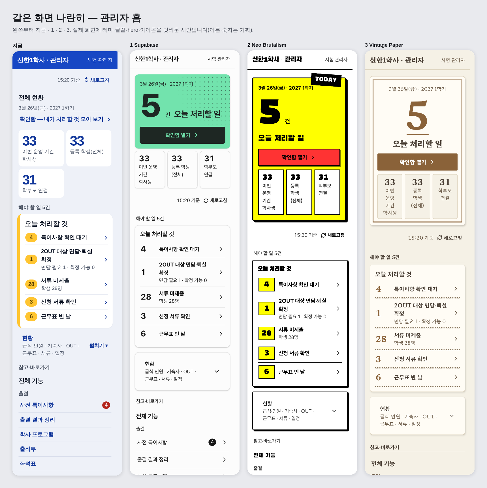
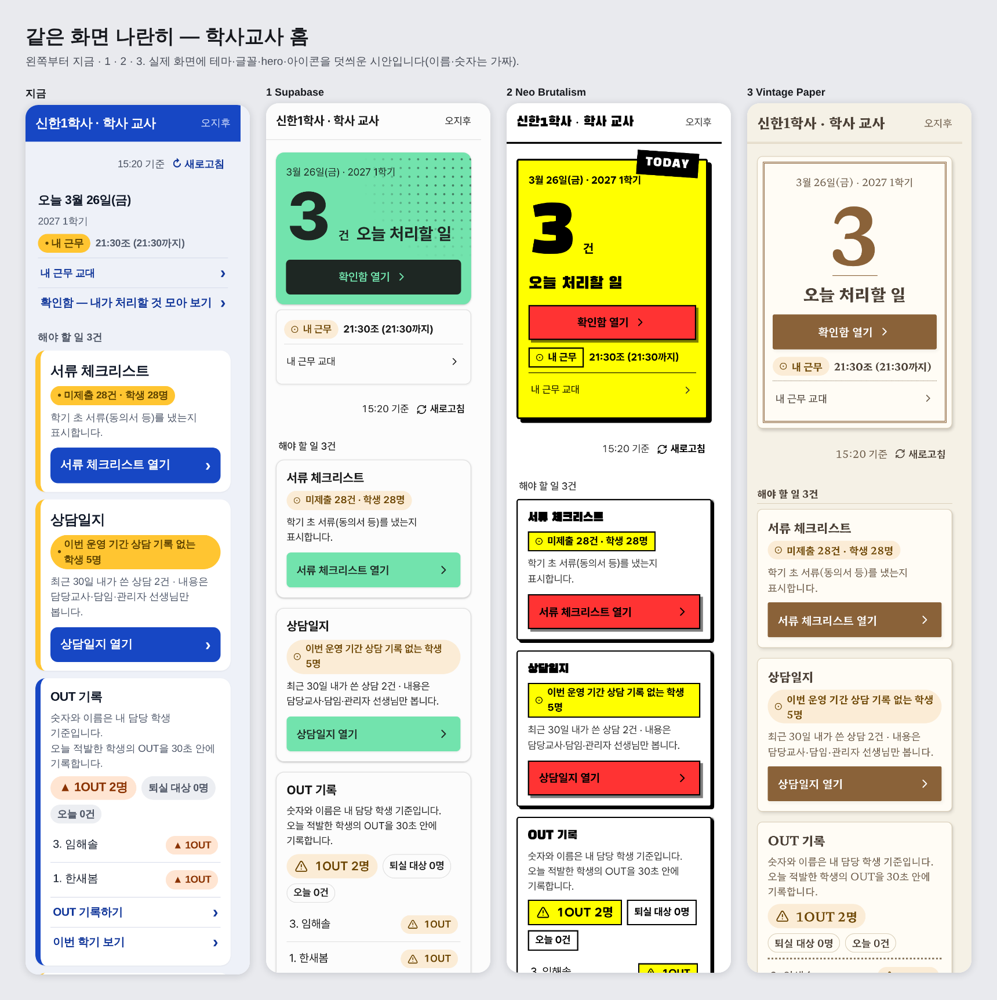
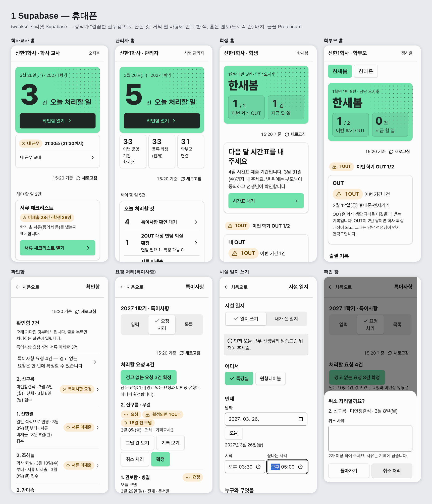
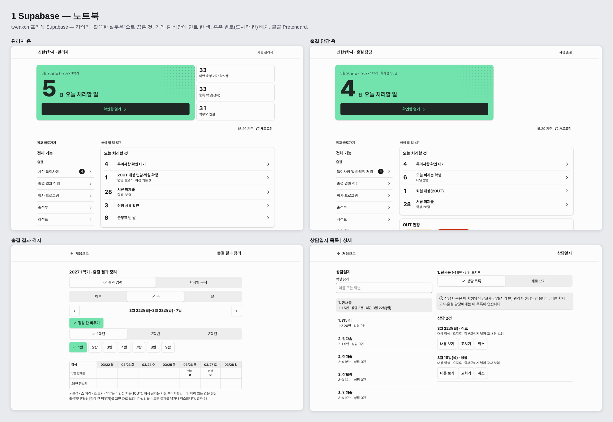
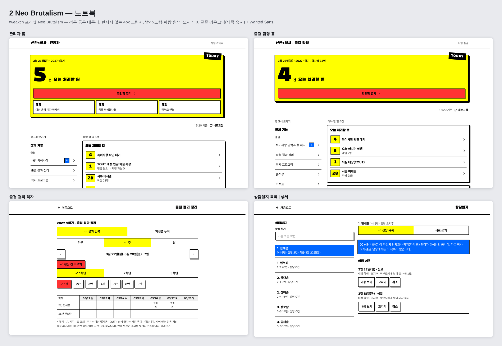

# 디자인 시안 2차 — 강의 방식으로: tweakcn 테마 · shadcn 부품 · hero · 한글 웹폰트 (D20, 코드 병합 없음)

> 선생님 말씀: "너무 클로드로 만든 티가 난다", 강의 "함흥 hero와 평양 UI로 남들과 다른 UI 만들기"를 "보고 배워라", "이 사이트들 참고하고" + `github.com/jnsahaj/tweakcn`.
> 이번 세 안의 색·모서리·그림자는 **제가 지은 값이 아니라 tweakcn 프리셋의 값 그대로**입니다. 부품 모양은 shadcn/ui 기본 규격, 홈 맨 위는 21st.dev식 hero, 글꼴은 한글 웹폰트, 아이콘은 Lucide입니다.
> 사진은 main의 실제 화면에 CSS와 글꼴을 덧씌워 찍었습니다(이름·숫자는 가짜, 가짜 오늘 2027-03-26 15:20). `src/`는 바꾸지 않았습니다. 1차 시안(결정 87의 B+C)은 [`../concepts/concepts.md`](../concepts/concepts.md)에 그대로 있습니다.

## 1. 한눈에 — 같은 화면을 지금 · 1 · 2 · 3으로

## 2. 세 안이 어디서 왔는지

| | **1 Supabase** | **2 Neo Brutalism** | **3 Vintage Paper** |
| --- | --- | --- | --- |
| tweakcn 프리셋 | `supabase` — 강의가 "깔끔한 실무용"으로 꼽은 것 | `neo-brutalism` | `vintage-paper` |
| 성격 | 거의 흰 바탕 + 민트 한 색, 옅은 그림자, 모서리 8px | 검은 굵은 테두리, 번지지 않는 4px 그림자, 빨강·노랑·파랑, 모서리 0 | 누런 종이 + 갈색 잉크, 옆으로 떨어지는 그림자, 모서리 4px |
| 프리셋의 글꼴 → 바꾼 한글 글꼴 | Outfit → **Pretendard** | DM Sans · Space Mono → **검은고딕**(제목·숫자) + **Wanted Sans**(본문) | Libre Baskerville → **함렛**(명조, 한 종) |
| hero 방식(21st.dev: 큰 글자 + 시각 요소 하나 + 버튼 하나) | **벤토(도시락 칸)**: 민트 큰 칸(숫자·버튼) + 작은 칸들. 시각 요소 = 점 격자 | 노란 면에 7rem 숫자, 시각 요소 = 기울인 "TODAY" 딱지 | 가운데 정렬 7rem 명조 숫자, 시각 요소 = 안쪽 이중 테두리 |
| 화면당 글꼴 무게(시안) | 204~333KB | 342~453KB | 341~609KB |

부품(버튼·입력칸·카드·배지·탭·시트)은 세 안이 **같은 CSS**입니다. 테마 변수만 바뀝니다 — 강의에서 tweakcn을 "핵심"이라고 한 바로 그 방식입니다.

### 1 Supabase

- 좋은 점: 가장 정돈되고 가볍다. 노트북에서 벤토 배치가 잘 산다. 민트는 다른 학교 앱에서 보기 드문 색이다.
- 아쉬운 점: 세 안 가운데 가장 "잘 만든 흔한 앱"에 가깝다.
- 걸리는 점: 민트는 글자색으로 쓸 수 없어(흰 바탕과 1.54:1) 링크·강조 글자는 검정 + 밑줄로 했다.

### 2 Neo Brutalism

- 좋은 점: 한 번 보면 잊히지 않는다 — "남들과 다른 UI"에 가장 가깝다. 테두리가 굵어 누를 곳이 가장 분명하다.
- 아쉬운 점: 빨강·노랑·파랑 원색이 모두 나온다. 처음에 지적하신 "색감"과 같은 불편이 다시 올 수 있다(이번에는 의도한 양식이지만).
- 걸리는 점: 매일 쓰는 업무 화면으로는 시끄러울 수 있다. 검은고딕은 굵기가 하나뿐이라 제목 위계를 크기로만 만든다.

### 3 Vintage Paper

- 좋은 점: 가장 차분하고 학교 일지·장부 같은 분위기. 다른 앱과 가장 덜 닮았다.
- 아쉬운 점: 본문까지 명조라 작은 글자·빽빽한 표(출결 격자)에서 고딕보다 읽기 어렵다. 해상도 낮은 학교 노트북에서 더 그렇다. 글꼴이 가장 무겁다.
- 걸리는 점: 갈색 한 색이라 상태 색(확정 초록·주의·위험)이 상대적으로 튄다.

## 3. 추천: **1 Supabase**

- 강의가 실무용으로 꼽은 프리셋이고, 세 안 가운데 **매일 쓰는 업무 화면에 가장 무리가 없다**. 글꼴이 한 종이라 가장 가볍다.
- "클로드 티"를 벗기는 것은 이번에 넣은 네 가지(프리셋 테마 · 웹폰트 · hero · 선 아이콘)가 함께 하는 일이라, 1안에서도 지금 화면·1차 시안과는 분명히 다르다.
- 더 세게 가고 싶으시면 2안입니다. 다만 원색이 많아 사진으로 꼭 확인해 주세요. 3안은 분위기는 가장 좋지만 명조 본문의 읽기 문제를 먼저 봐야 합니다(제목만 명조, 본문은 고딕으로 바꾸는 변형이 가능합니다).

## 4. "AI가 만든 티" 목록과 이번에 한 일

| AI가 만든 티 | 이번 세 안에서 |
| --- | --- |
| 기기 기본 글꼴 | 안마다 한글 웹폰트 |
| ▲ ● ✓ … ⛔ 같은 글자 기호를 아이콘으로 | Lucide 선 아이콘(SVG) |
| 카드 위·왼쪽의 색 띠 | 없음 |
| 채도 낮춘 청록·초록 주색, 어디에나 어울리는 무난한 색 | 프리셋 값 그대로(선명한 민트 / 원색 / 갈색) |
| 모든 것을 둥근 흰 카드에 넣기 | 카드는 할 일·중요에만(결정 85의 구조 유지), 참고 구역은 상자 없이 |
| 굵은 제목 + 회색 설명이 같은 크기로 줄줄이 | 홈 맨 위 hero — 6~7rem 숫자 하나가 첫눈에 들어옴 |
| 주색 글자 링크가 화면 가득 | 줄 글자는 본문색, 화살표 아이콘만 |
| 지어낸 팔레트 | tweakcn 프리셋에서 가져오고 바꾼 곳만 표로(5절) |

## 5. 프리셋에서 바꾼 값 — 한글과 대비 기준 때문에 손본 곳만

출처: `github.com/jnsahaj/tweakcn`(Apache-2.0), `utils/theme-presets.ts`, 커밋 `a3b47b3`, 각 프리셋의 `light` 값. 아래 표에 없는 값(바탕·글자·카드·보조·테두리·차트 색·모서리·그림자)은 **그대로**입니다.

| 안 | 변수 | 프리셋 값 | 바꾼 값 | 이유 |
| --- | --- | --- | --- | --- |
| 1 | 입력칸 테두리(새 변수 `--field-border`) | `input` `#f6f6f6` | `#8a8a8a` | 흰 바탕과 1.07:1 → 3.36:1(기준 3:1) |
| 1 | 초점 링 | `ring` `#72e3ad` | 검은 바깥선 + 민트 3px | 민트만으로는 1.54:1 |
| 1 | 자간 | `0.025em` | `0` | 한글 본문은 자간 0 |
| 2 | `primary-foreground` | `#ffffff` | `#000000` | 빨강 버튼 위 흰 글자 3.64:1 → 검정 5.77:1(빨강은 그대로) |
| 2 | 초점 링 | `ring` `#ff3333` | 검은 바깥선 + 프리셋의 파랑 3px | 주 버튼과 같은 빨강이라 구분이 안 됨 |
| 3 | `primary` · `ring` | `#a67c52` | `#8a6239` | 버튼 위 흰 글자 3.73:1 → 5.40:1 |
| 3 | `muted-foreground` | `#7d6b56` | `#6b5a47` | 보조 글자 4.53:1(옅은 바탕 위에서는 미달) → 5.85:1 |
| 3 | 입력칸 테두리 | `input` `#dbd0ba` | `#8c7a62` | 1.49:1 → 4.04:1 |
| 모두 | 더한 변수 | (shadcn에 없음) | `--success` `--warning`과 옅은 바탕 | 확정·주의 상태 색 — `principles.md` C5 |
| 모두 | 글꼴 | 라틴 글꼴 | 한글 글꼴(2절) | 프리셋 글꼴에 한글이 없음 |

shadcn/ui 규격(`github.com/shadcn-ui/ui`, MIT, `new-york-v4`)에서 옮긴 것: 버튼 `rounded-md`·테두리 버튼 `shadow-xs`, 입력칸 `rounded-md border shadow-xs`, 카드 `rounded-xl border shadow-sm`, 배지 `rounded-full`, 탭 묶음 `bg-muted rounded-lg p-[3px]` + 고른 탭 `bg-background shadow-sm`, 대화창 `rounded-lg border shadow-lg`·뒤 가림 검정 50%, 초점 링 3px, 반경 단계(sm = r−4, md = r−2, lg = r, xl = r+4). 그림자는 tweakcn의 계산식(`utils/shadows.ts`) 그대로.
**shadcn과 다르게 둔 것 둘**: 누르는 칸 높이 48px(shadcn은 36px), 가장 작은 글자 16px(shadcn 배지는 12px) — 우리 규칙(rules 1절)이 앞섭니다.

## 6. 기준 측정 — 세 안 모두 통과

실제 화면 12개(휴대폰 8 · 노트북 4)를 안마다 띄워 잰 값(`node design/preview/concepts2.js`).

| 기준 | 1 | 2 | 3 |
| --- | --- | --- | --- |
| 360px 가로 넘침 | 0 | 0 | 0 |
| 360px + 기기 글자 150% 가로 넘침(휴대폰 8화면) | 0 | 0 | 0 |
| 누르는 칸 48px 미만(보통 / 150%) | 0 / 0 | 0 / 0 | 0 / 0 |
| 화면 글자의 최저 대비(4.5:1 이상) | 5.17:1 | 4.83:1 | 4.79:1 |
| 색만으로 상태 알리기 | 없음(아이콘 + 낱말) | 없음 | 없음 |
| 움직임(애니메이션) | 없음 | 없음(딱지는 멈춘 기울임) | 없음 |
| 화면당 글꼴 내려받기 | 204~333KB | 342~453KB | 341~609KB |

글꼴 KB는 **시안에서 로컬 파일을 내려 준 바이트 수**입니다. 학교 망에서의 실제 시간은 재지 못했습니다(배포해서 재야 함).

## 7. 강의 레퍼런스 표 — 무엇을 보았고 무엇을 가져왔나

| 강의 레퍼런스 | 이번에 직접 확인한 것 | 가져온 것 | 가져오지 않은 것 |
| --- | --- | --- | --- |
| **21st.dev** (함흥 Hero) — [Heroes](https://21st.dev/community/components/s/hero) | 목록 쪽을 열어 봄: 히어로 1.3천 개, "Centered Hero", "Split Hero With Image Cards", "Facts Hero", "Editorial Collage Hero", "Hero with … two buttons" 같은 유형. 목록에는 라이선스가 안 보임(부품 쪽에서 확인하라는 강의 절차 그대로) | **방식만**: 큰 글자 + 시각 요소 하나 + 버튼 하나. "Facts Hero"처럼 숫자를 주인공으로 | 부품 코드(React·Tailwind), 영상·움직임 |
| **shadcn/ui** (평양 UI) — [부품](https://ui.shadcn.com/docs/components) | GitHub 저장소의 부품 소스(`new-york-v4`)에서 치수·반경·테두리·그림자·초점 링을 읽음(MIT) | 규격을 CSS로 옮김(5절), 변수 이름 | 라이브러리 자체(React) |
| **tweakcn** — [편집기](https://tweakcn.com/editor/theme), 저장소 `jnsahaj/tweakcn` | 저장소를 받아 프리셋 42개를 확인(Apache-2.0). 편집기 쪽도 열림 | 프리셋 3개의 값(5절) | Claude · Vercel · Mono 프리셋(지시대로 제외) |
| **눈누** — [noonnu.cc](https://noonnu.cc/) | **열지 못함**: 접속은 허용됐지만 사이트가 자동 요청을 막아(응답 429) 글꼴 쪽을 읽지 못했습니다. 우회하지 않았습니다 | 글꼴은 npm 패키지로 받아 썼고, 라이선스는 패키지 안 파일로 확인(8절) | 눈누 쪽의 "임베딩 허용" 표시 확인 — **미확인**, 선생님이 눈누에서 한 번 봐 주시면 됩니다 |
| **Material 3** — [m3.material.io](https://m3.material.io/get-started) | **읽지 못함**: 규격 쪽이 자바스크립트로만 그려져 글자가 오지 않음 | 일반 원칙만: 목록 줄을 넉넉히(한 줄 56px), 아래 시트는 위 모서리만 크게, 넓은 화면은 옆 메뉴 | 수치는 원문 확인 전이라 "기억 기준"입니다 |
| Google Flow · Higgsfield (영상 히어로) | — | 없음 | 우리 앱은 영상·움직임을 쓰지 않음(rules 1절) |
| 용어(벤토 그리드·히어로·CTA …) | `ui-vocabulary.md` | 1안 홈을 벤토 배치로, hero에 CTA 하나 | |

## 8. 글꼴 — 라이선스와 무게

| 글꼴 | 쓰는 안 | 라이선스(패키지 안 파일 기준) | 웹 임베딩 | 나눠 받기 | 눈누 쪽 확인 |
| --- | --- | --- | --- | --- | --- |
| Pretendard | 1 | SIL OFL 1.1 | OFL 조문상 허용(묶기·임베딩 가능, 글꼴만 따로 팔기 금지) | 92조각 | 미확인 |
| Wanted Sans | 2 본문 | SIL OFL 1.1 | 허용 | 92조각 | 미확인 |
| 검은고딕 Black Han Sans | 2 제목 | SIL OFL 1.1 | 허용 | 조각 있음 | 미확인 |
| 함렛 Hahmlet | 3 | SIL OFL 1.1 | 허용 | 92조각 | 미확인 |
| SUIT | (쓰지 않음) | SIL OFL 1.1 | 허용 | 없음 — 한 파일 624KB라 뺌 | 미확인 |
| Paperlogy · Gmarket Sans | (시험 못 함) | **미확인** | **미확인** | npm 패키지를 찾지 못함 | 미확인 |

받는 방법: Apps Script 웹앱은 글꼴 파일을 직접 내려 주기 어려워(`HtmlService`는 HTML만) 공개 CDN에서 조각 파일을 받는 길뿐입니다 — 화면마다 외부 요청이 생깁니다. 못 받으면 기기 기본 글꼴로 내려가도록 해 두었습니다(화면은 깨지지 않음).

## 9. 아이콘과 출처 표기

- 아이콘: Lucide(ISC) 선 아이콘 13개를 SVG로 넣음(외부 요청 없음). 파일과 라이선스 전문은 `design/preview/concepts2/icons/`. 적용할 때는 아이콘을 넣는 파일 맨 위에 `Lucide Icons (ISC) — https://lucide.dev`와 저작권 줄을 적습니다. 낱말은 그대로 함께 씁니다.
- tweakcn 프리셋 값: Apache-2.0. 가져온 파일(`themes.js`) 머리에 출처·라이선스·바꾼 곳을 적었습니다. 적용할 때도 `Styles.html`의 테마 부분에 같은 고지를 둡니다.
- shadcn/ui: MIT. 코드를 복사하지 않고 규격(치수·이름)만 옮겼습니다. 변수 이름을 쓰는 것에는 고지 의무가 없지만 출처는 문서에 남깁니다.

## 10. 선생님 결정이 필요한 것 — 적용하려면 바꿔야 하는 규칙

| # | 지금 규칙 | 바꿔야 하는 것 | 영향 |
| --- | --- | --- | --- |
| 1 | **글꼴 파일을 내려받지 않는다**(결정 85, rules 3절) | 웹폰트를 쓰기로 정하기 | 화면마다 외부 요청, 첫 화면에서 0.2~0.6MB를 더 받음. **시험 배포로 학교 망 속도를 먼저 재기**를 권합니다 |
| 2 | **새 외부 라이브러리는 넣지 않는다**(CLAUDE.md) | 해석 정하기: 글꼴 파일·아이콘 SVG·테마 값은 "실행되는 코드"가 아닌 자료로 볼지 | shadcn/ui·tweakcn 자체는 넣지 않습니다(변수 이름과 값만) |
| 3 | **히어로를 쓰지 않는다**(ui-vocabulary 1절) | 홈 맨 위에 hero | 새 부품 `UI.hero`(계약 변경). 숫자는 지금 화면에 있는 값만 |
| 4 | 상태 알약의 앞 글자 규칙(rules 4절, `styles.test.js`) | 앞 글자를 아이콘으로 | 검사 코드와 rules 4절을 함께 고침 |
| 5 | 토큰 이름(rules 3절) | **이름 충돌 둘**: shadcn `--accent`(옅은 강조 바탕)·`--muted`(옅은 바탕)가 우리 앱의 `--accent`(주색)·`--muted`(보조 글자색)와 같은 이름 | 시안에서는 shadcn 쪽에 `-sh`를 붙였습니다. 앱 이름을 shadcn식으로 바꾸면 화면 파일 전체 수정 — **값만 바꾸는 쪽이 안전** |
| 6 | 결정 87(교사 B + 학생·학부모 C) | 이번 세 안 가운데 하나로 바꿀지 | 87 시안은 그대로 있어 비교할 수 있습니다 |

여쭐 것은 세 가지입니다.
1. 1·2·3 가운데 어느 안인가요? (또는 결정 87 유지, 또는 다른 tweakcn 프리셋 — 값만 바꾸면 되니 금방 다시 찍을 수 있습니다)
2. 웹폰트를 써도 될까요?
3. 홈 맨 위 hero를 넣어도 될까요?

## 11. 파일

- 테마 값(프리셋 원본 + 바꾼 곳) `design/preview/concepts2/themes.js`, 부품 규격 `base.css`(세 안 공통), hero 그림 `t1.css` · `t2.css` · `t3.css`, 아이콘 `icons/`
- 찍는 도구: `FONT_DIR=<글꼴을 받아 둔 폴더> node design/preview/concepts2.js [t1 t2 t3] [--font150] [--boards]` — 글꼴 파일은 저장소에 넣지 않았습니다(`npm i pretendard wanted-sans @fontsource-variable/hahmlet @fontsource/black-han-sans`).
- hero는 찍는 도구가 지금 화면의 첫 카드를 바꿔 만든 것입니다(화면에 이미 있는 숫자만 옮기고, "확인함" 줄을 버튼으로). 실제 부품은 아직 없습니다.
