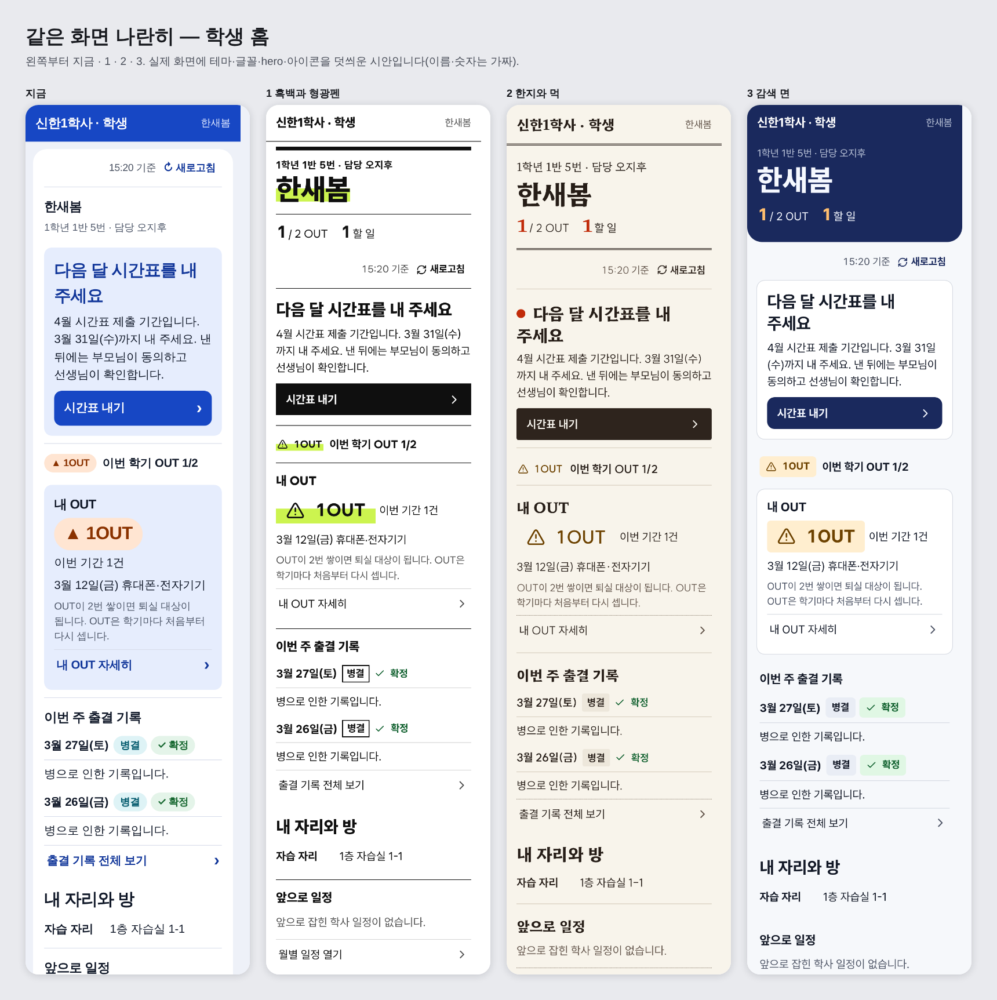
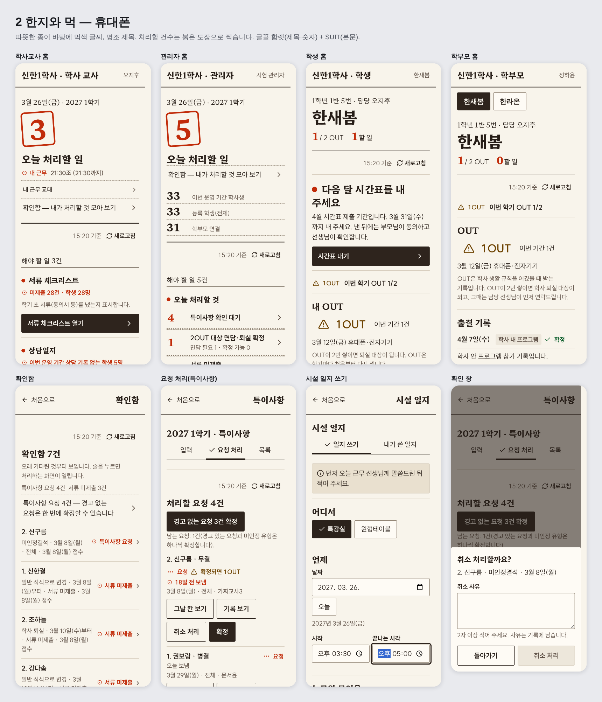
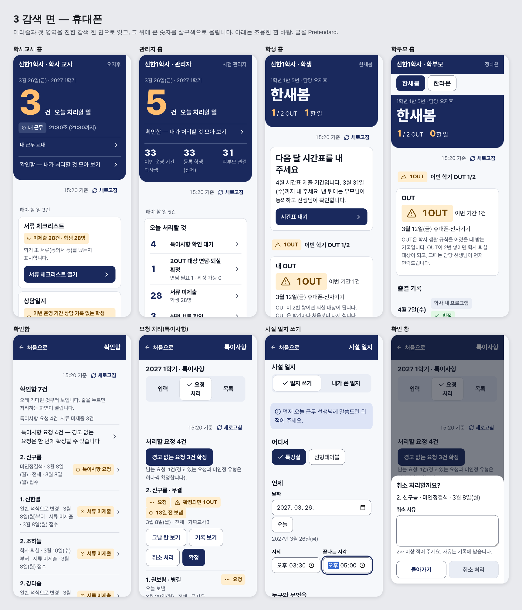

# 디자인 시안 2차 — 테마 · 글꼴 · hero · 아이콘을 한 벌로 (D20, 코드 병합 없음)

> 선생님 말씀: "너무 클로드로 만든 티가 난다" + 강의 "함흥 hero와 평양 UI로 남들과 다른 UI 만들기"를 "보고 배워라".
> 강의 영상 본문은 이 환경에서 열 수 없어, 저장소의 검토 메모(`docs/design/ui-vocabulary.md` 1·4·5절)를 근거로 했습니다. 그 메모에서 우리가 **"가져오지 않는다"고 적은 세 가지가 바로 강의의 요점**이었습니다: ① 부품·테마 변수 체계(shadcn/ui + tweakcn) ② 첫 화면의 눈에 띄는 영역(hero) ③ 한글 웹폰트. 이번 시안은 그 셋을 넣고 아이콘을 더해 **완성된 세 안**으로 만들었습니다.
> 사진은 main의 실제 화면에 CSS와 글꼴을 덧씌워 찍었습니다(이름·숫자는 가짜, 가짜 오늘 2027-03-26 15:20). `src/`는 바꾸지 않았습니다. 1차 시안(A·B·C, 결정 87의 B+C)은 [`../concepts/concepts.md`](../concepts/concepts.md)에 그대로 있습니다.

## 1. 먼저 — "AI가 만든 티" 목록과 이번에 한 일

| AI가 만든 티 | 1차 시안(B+C)에 있었나 | 이번 세 안에서 |
| --- | --- | --- |
| 모든 것을 둥근 흰 카드에 넣기 | B가 그랬음 | 1·2안은 카드 0개(선으로만). 3안은 할 일·중요 두 가지만 |
| 카드 위쪽·왼쪽의 색 띠 | B의 청록 줄 | 없음 |
| 알약 배지 남발 | 있었음 | 1·2안은 바탕 없는 글자 + 아이콘. 면은 '퇴실 대상' 하나뿐 |
| 채도 낮춘 청록·초록 주색 | B 청록, C 초록 | 없음 — 검정 / 먹색 / 감색 |
| ▲ ● ✓ … ⛔ 같은 글자 기호를 아이콘으로 | 있었음 | Lucide 선 아이콘(SVG)으로 교체 |
| 기기 기본 글꼴 | 있었음 | 안마다 웹폰트(Wanted Sans / 함렛+SUIT / Pretendard) |
| 굵은 제목 + 회색 설명의 반복, 같은 크기의 구역이 줄줄이 | 있었음 | 홈 맨 위에 hero(큰 숫자 하나) — 크기 차이로 첫눈에 갈림 |
| 어디에나 어울리는 무난한 평균값 | 그랬음 | 안마다 한 가지 강한 장치: 형광펜 / 붉은 도장 / 감색 면 |

## 2. 한눈에 — 같은 화면을 지금 · 1 · 2 · 3으로

## 3. 세 안

| | **1 흑백과 형광펜** | **2 한지와 먹** | **3 감색 면** |
| --- | --- | --- | --- |
| 한 줄 | 흰 종이에 검은 글씨, 각진 선. 색은 형광펜 한 가지 | 따뜻한 종이에 먹색 글씨, 명조 제목. 건수는 붉은 도장 | 머리줄과 hero를 감색 한 면으로. 큰 숫자는 살구색 |
| 글꼴 | Wanted Sans(제목·본문) | 함렛(제목·숫자, 명조) + SUIT(본문) | Pretendard(제목·본문) |
| hero | 6rem 숫자에 형광펜을 그음. 위에 굵은 검은 줄 | 숫자를 붉은 도장처럼(살짝 기울임) + 명조 제목 | 화면 폭 전체 감색 면에 6rem 살구색 숫자 |
| 주 버튼 | 검정, 각짐 | 먹색, 모서리 3px | 감색, 모서리 12px |
| 구역 나누기 | 검은 가는 선 | 가는 선 + 점선 줄, 이중선 | 여백. 할 일·중요만 흰 판 |
| 상태 표시 | 글자 + 아이콘, 주의는 형광펜 밑줄 | 글자 + 아이콘, 주의는 붉은 글자 | 옅은 바탕의 작은 꼬리표 + 아이콘 |
| 건수 | 형광펜 그은 굵은 숫자 | 붉은 명조 숫자 | 감색 굵은 숫자 |
| 구간 선택 | 검은 테두리 칸, 고른 칸은 검정 | 밑줄 탭 | 회색 홈 + 흰 단추 |
| 학생·학부모 hero | 이름에 형광펜 | 큰 명조 이름 | 감색 면 위 흰 이름 |

### 1 흑백과 형광펜

- 좋은 점: 가장 또렷하고 가장 가볍다(글꼴 한 종, 화면당 156~267KB). 흑백 인쇄물과 같은 말투라 출석부·근무표와 잘 이어진다. "지금 볼 숫자"가 형광펜 하나로 바로 보인다.
- 아쉬운 점: 차갑고 세다. 학부모 화면에는 딱딱할 수 있다.
- 걸리는 점: 형광 연두는 호불호가 갈린다(색만 바꿀 수 있음 — 형광 노랑·주황).

### 2 한지와 먹

- 좋은 점: 세 안 가운데 가장 "우리 것" 같고 다른 앱과 닮지 않았다. 학교·기숙사의 일지·장부 느낌. 긴 글이 편하게 읽힌다.
- 아쉬운 점: **가장 무겁다**(화면당 774~951KB). SUIT가 한 파일 624KB로만 배포돼서다 — 쓰려면 우리가 쓰는 글자만 남긴 파일을 따로 만들어야 한다(6절).
- 걸리는 점: 도장의 붉은색과 '퇴실 대상'의 붉은색이 같은 계열이다(도장은 테두리, 퇴실 대상은 채운 면 + 아이콘 + 낱말로 구분). 명조 숫자는 빽빽한 표(출결 격자)에서는 본문 글꼴로 둔다.

### 3 감색 면

- 좋은 점: 첫 화면의 인상이 가장 강하다 — 강의가 말한 hero에 가장 가깝다. 감색 면 아래는 조용해서 업무 화면으로도 무리가 없다. 지금 화면(머리줄 색 면)과 쓰는 법이 같아 옮기기 쉽다.
- 아쉬운 점: 세 안 가운데 "흔한 앱"에 가장 가깝다. hero가 화면 위쪽을 많이 차지한다(휴대폰 관리자 홈에서 할 일 목록이 한 화면 아래로 밀림).
- 걸리는 점: 지금의 코발트 머리줄을 싫어하신 것과 겹칠 수 있다(채도는 0.201 → 0.095로 절반, 노랑 띠 없음).

## 4. 추천: **1 흑백과 형광펜** (교사 화면) — 학생·학부모는 같은 안에서 hero만 이름으로

- "클로드 티"의 정체는 **무난함**이다. 1안은 색을 거의 다 버리고 장치 하나(형광펜)만 남겨서, 세 안 가운데 평균값에서 가장 멀다.
- 저녁 자습 중 휴대폰으로 볼 때 **검정/흰색 대비가 가장 높고**(화면 글자 최저 6.63:1), 글꼴이 한 종이라 **가장 가볍다**.
- 색이 없으니 상태 색(확정 초록·주의·위험)이 섞이지 않고 뜻대로 읽힌다.
- 2안이 마음에 드시면 그것도 좋은 선택이다 — 다만 글꼴 무게를 먼저 해결해야 한다. 3안은 가장 안전하지만 가장 덜 새롭다.

## 5. 기준 측정 — 세 안 모두 통과

실제 화면 12개(휴대폰 8 · 노트북 4)를 안마다 띄워 잰 값(`node design/preview/concepts2.js`).

| 기준 | 1 | 2 | 3 |
| --- | --- | --- | --- |
| 360px 가로 넘침 | 0 | 0 | 0 |
| 360px + 기기 글자 150% 가로 넘침(휴대폰 8화면) | 0 | 0 | 0 |
| 누르는 칸 48px 미만(보통 / 150%) | 0 / 0 | 0 / 0 | 0 / 0 |
| 화면 글자의 최저 대비(4.5:1 이상) | 6.63:1 | 5.29:1 | 6.36:1 |
| 색만으로 상태 알리기 | 없음(아이콘 + 낱말) | 없음 | 없음 |
| 움직임(애니메이션) | 없음 | 없음(도장은 멈춘 기울임) | 없음 |
| 화면당 글꼴 내려받기 | 156~267KB · 7~13개 | 774~951KB · 5~9개 | 204~333KB · 8~13개 |

- 대비 측정은 단색 바탕 위 글자만 잽니다. 1안의 형광펜 위 글자(검정/형광 연두)는 그라데이션 바탕이라 자동 측정에서 빠졌습니다 — 색 값으로 따로 계산하면 약 15:1입니다.
- 글꼴 KB는 **시안에서 로컬 파일을 내려 준 바이트 수**입니다. 학교 망에서의 실제 시간은 재지 못했습니다(배포해서 재야 함).

## 6. 글꼴 — 후보와 라이선스

| 글꼴 | 성격 | 라이선스 | 웹 임베딩 | 나눠 받기(subset) | 화면당 무게(시안) |
| --- | --- | --- | --- | --- | --- |
| Wanted Sans (1안) | 단단한 고딕, 숫자가 또렷 | SIL OFL 1.1 | 허용(OFL: 묶기·임베딩 가능, 글꼴만 따로 팔기 금지) | 패키지에 92조각(쓰는 글자 조각만 받음) | 156~267KB |
| Pretendard (3안) | 가장 널리 쓰이는 중립 고딕 | SIL OFL 1.1 | 허용 | 패키지에 92조각 | 204~333KB |
| 함렛 Hahmlet (2안 제목) | 현대적 명조 | SIL OFL 1.1 | 허용 | 92조각 | 2안 합계의 일부(약 150~330KB) |
| SUIT (2안 본문) | 부드러운 고딕 | SIL OFL 1.1 | 허용 | **없음 — 한 파일 624KB** | 624KB |
| Gowun Dodum · Gowun Batang | 손글씨 느낌 고딕·명조 | SIL OFL 1.1 | 허용 | 조각 있음 | 이번에 쓰지 않음(굵기가 한 가지뿐) |
| Paperlogy · Gmarket Sans | — | **미확인** | **미확인** | npm 패키지를 찾지 못함 | 시험 못 함 |

- 라이선스는 내려받은 npm 패키지에 든 LICENSE·OFL 파일로 확인했습니다. OFL은 글꼴 이름 예약(Reserved Font Name)이 있어, **글자를 줄인 파일을 새로 만들면 글꼴 이름을 바꿔야 할 수 있습니다** — SUIT를 줄여 쓰려면 이 점을 먼저 확인합니다.
- 조합 제안: 제목과 본문을 **한 종으로**(1·3안) 하는 것이 가볍고 안전합니다. 두 종(2안)은 분위기는 좋지만 무게가 3배입니다.
- 받는 방법은 두 가지입니다. (가) 공개 CDN(jsDelivr 등)에서 조각 파일을 받기 — 외부 요청이 생김. (나) Apps Script 웹앱에서는 글꼴 파일을 직접 내려 주기 어려워(`HtmlService`는 HTML만), 사실상 (가)뿐입니다. 못 받으면 기기 기본 글꼴로 내려가도록 해 두었습니다(화면은 깨지지 않음).

## 7. 변수 체계 — shadcn/ui 이름으로

라이브러리는 넣지 않고 **CSS 변수 이름만** shadcn/ui 것을 씁니다(tweakcn이 내보내는 것과 같은 꼴). 값은 `design/preview/concepts2/themes.js`.

| 변수 | 쓰임 | 1 | 2 | 3 |
| --- | --- | --- | --- | --- |
| `--background` / `--foreground` | 바탕 / 본문 글자 | 흰색 / 검정 | 종이색 / 먹색 | 옅은 회색 / 짙은 감색 |
| `--card` | 판 | 흰색 | 밝은 종이색 | 흰색 |
| `--primary` / `--primary-foreground` | 주 버튼·선택 / 그 위 글자 | 검정 / 흰색 | 먹색 / 종이색 | 감색 / 흰색 |
| `--secondary` · `--muted` / `--muted-foreground` | 옅은 바탕 / 보조 글자 | 회색 | 따뜻한 회색 | 푸른 회색 |
| `--destructive` | 위험(퇴실 대상·위험 버튼) | 빨강 | 짙은 빨강 | 빨강 |
| `--border` / `--input` / `--ring` | 구분선 / 입력칸 테두리(3:1) / 초점 링 | | | |
| `--radius` | 모서리 | 0 | 3px | 12px |
| `--chart-1`…`--chart-5` | 표·그림 색 | 정해 둠(지금 화면에는 차트 없음) | | |
| 더한 것: `--point` / `--success` / `--warning` (+ `-soft`) | 강조 장치 색 / 확정 / 주의 | 형광 연두 | 도장 빨강 | 살구 |

- **이름 충돌 하나:** shadcn의 `--accent`(옅은 강조 바탕)와 우리 앱의 `--accent`(주색)가 같은 이름입니다. 시안에서는 shadcn 쪽을 `--accent-sh`로 두었고, 적용하려면 앱의 `--accent`를 `--primary`로 바꿔야 합니다(화면 파일 전체에 닿는 계약 변경).
- `principles.md`의 규칙은 검증용으로 그대로 씁니다: 대비 4.5:1·테두리 3:1, 굵기와 간격 단계, 의미 색은 옅은 바탕(L 0.955) + 글자(L 0.42) 한 가지 뼈대.

## 8. 아이콘

- Lucide(ISC 라이선스)의 선 아이콘 13개를 **SVG 그대로** 넣었습니다(외부 요청 없음, 합쳐서 수 KB). 파일과 라이선스 전문은 `design/preview/concepts2/icons/`.
- 표기 방법: ISC는 저작권·허가 고지를 함께 두면 됩니다. 적용할 때는 아이콘을 넣는 파일 맨 위 주석에 `Lucide Icons (ISC) — https://lucide.dev`와 저작권 줄을 적고, 저장소에 LICENSE 사본을 둡니다.
- 바꾼 것: ✓(확정) … (요청) ⊘(취소) ▲(1OUT) ⛔(퇴실 대상) ●(할 일) ⚠ ⓘ ↻ › ←. **낱말은 그대로 함께 씁니다**(색·아이콘만으로 알리지 않음).

## 9. 선생님 결정이 필요한 것 — 적용하려면 바꿔야 하는 규칙

| # | 지금 규칙 | 바꿔야 하는 것 | 영향 |
| --- | --- | --- | --- |
| 1 | **글꼴 파일을 내려받지 않는다**(결정 85, rules 3절) | 웹폰트를 쓰기로 정하기. 어느 글꼴인지, 어디서 받는지(공개 CDN) | 화면마다 외부 요청이 생김. 첫 화면에서 0.2~0.9MB를 더 받음(그 뒤는 브라우저가 기억). 학교 망에서 느리면 글꼴이 늦게 바뀌어 보임 — **배포해서 시간을 재 본 뒤 확정**을 권합니다 |
| 2 | **새 외부 라이브러리는 넣지 않는다**(CLAUDE.md) | 해석을 정하기: 글꼴 파일과 아이콘 SVG는 "실행되는 코드"가 아니라 자료로 보고 허용할지 | shadcn/ui 자체(React)는 넣지 않습니다 — 변수 이름만 빌립니다. 아이콘은 SVG 13개를 저장소에 넣음 |
| 3 | **히어로를 쓰지 않는다**(ui-vocabulary 1절) | 홈 맨 위에 hero를 두기로 | 새 부품 `UI.hero`가 필요(계약 변경, 코딩 세션과 조율). 숫자는 지금 화면에 이미 있는 값만 씀 |
| 4 | **상태 알약: 앞 글자(✓ … ▲)로 구분**(rules 4절, `styles.test.js`가 검사) | 앞 글자를 아이콘으로, 1·2안은 알약 바탕도 없앰 | 검사 코드와 rules 4절을 함께 고쳐야 함 |
| 5 | 토큰 이름(`--accent` 등, rules 3절) | shadcn 이름으로 바꿀지, 지금 이름을 두고 값만 바꿀지 | 이름까지 바꾸면 화면 파일 전체 수정. **값만 바꾸는 쪽이 안전**합니다 |
| 6 | 결정 87(교사 B + 학생·학부모 C) | 이번 세 안 가운데 하나로 바꿀지, 87을 유지할지 | 87 시안은 그대로 있어 언제든 비교할 수 있습니다 |
| 7 | 굵기 400·700 두 단계(principles T3) | 웹폰트를 쓰면 hero·제목에 800을 허용 | 기기 기본 글꼴로 내려갈 때는 700으로 보임 |

여쭐 것은 세 가지입니다.
1. 1·2·3 가운데 어느 안인가요? (또는 결정 87 유지)
2. 웹폰트를 써도 될까요? (9절 1번 — 쓴다면 시험 배포로 속도를 먼저 재겠습니다)
3. 홈 맨 위 hero를 넣어도 될까요? (9절 3번)

## 10. 파일

- 테마 값 `design/preview/concepts2/themes.js`, 공통 규칙 `base.css`, 안별 모양 `t1.css` · `t2.css` · `t3.css`, 아이콘 `icons/`
- 찍는 도구: `FONT_DIR=<글꼴을 받아 둔 폴더> node design/preview/concepts2.js [t1 t2 t3] [--font150] [--boards]` — 글꼴 파일은 저장소에 넣지 않았습니다(`npm i pretendard @sun-typeface/suit wanted-sans @fontsource-variable/hahmlet`로 받음).
- hero는 시안에서 찍는 도구가 지금 화면의 첫 카드를 바꿔 만든 것입니다(화면에 이미 있는 숫자만 옮김). 실제 부품은 아직 없습니다.
