# hero 없이 — 2차본 네 안 다시 (2026-11-22)

> 선생님 결정: **"Hero 넣지 말고, 웹폰트 써도 돼."**
> 그래서 홈 맨 위 hero를 빼고, **지금 화면 구조 그대로**에 테마(tweakcn 프리셋) · 한글 웹폰트 · 아이콘만 입혀 다시 찍었습니다. 네 안의 값·글꼴·출처는 [`concepts2.md`](concepts2.md)와 같습니다. `src/`는 바꾸지 않았습니다(이름·숫자는 가짜).

## 한눈에 — 지금 · 가 · 나 · 다 · 라

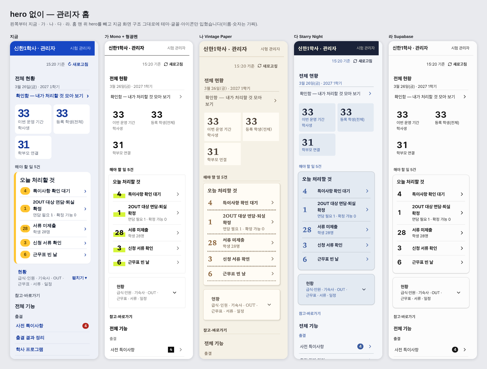

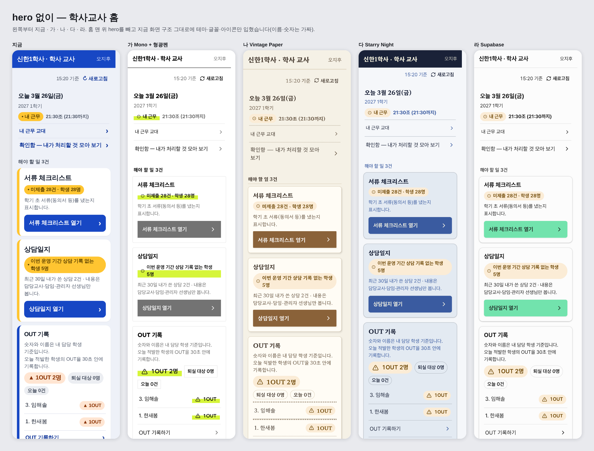

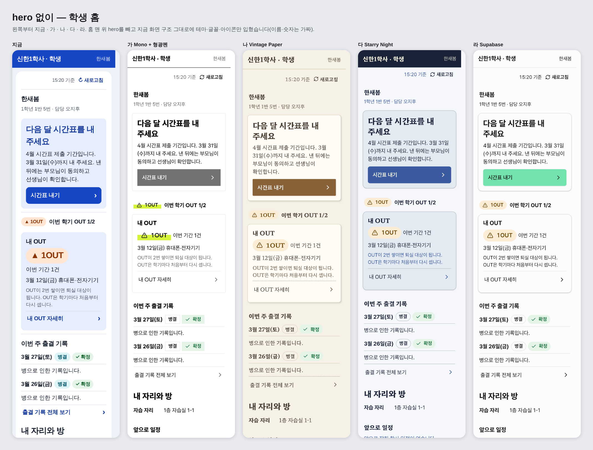

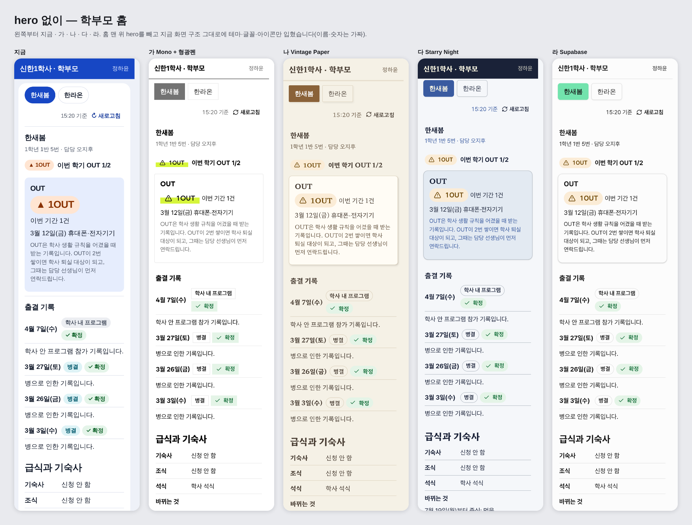

## hero를 빼니 달라지는 점

| 안 | hero 없이 남는 인상 | 눈에 띄는 점 |
| --- | --- | --- |
| 가 Mono + 형광펜 | 흑백 + 각진 모양, 형광펜은 처리할 건수와 주의 표시에만 | 주 버튼이 회색(프리셋 값)이라 약하다 — 고르시면 검정으로 바꾸기를 권합니다 |
| 나 Vintage Paper | 종이색 바탕과 명조 글꼴이 그대로 살아 있음 | hero가 없어도 네 안 가운데 가장 달라 보인다. 명조 본문의 읽기 문제는 그대로 |
| 다 Starry Night | 감색 면은 머리줄에만 남음 | 설명 글이 파랑(프리셋 값), 카드가 푸른 회색 |
| 라 Supabase | 흰 바탕에 민트 버튼 | 가장 무난. 민트가 버튼에만 남아 조용하다 |

## 안별 보드

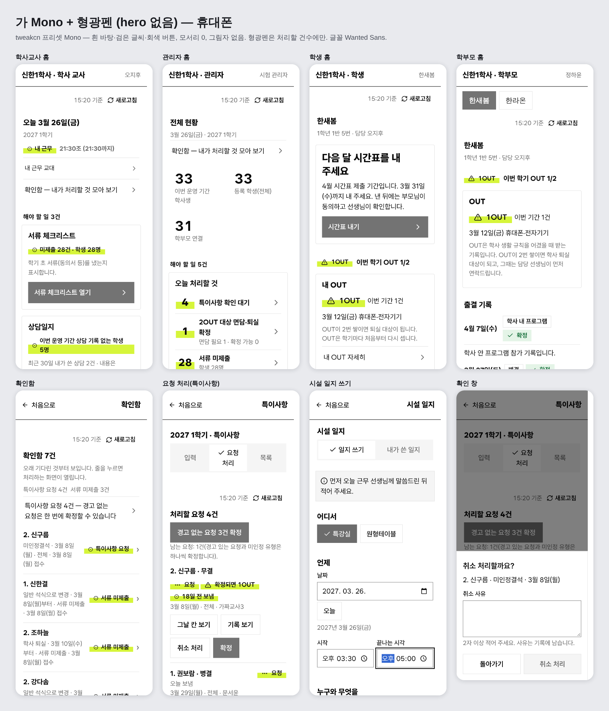
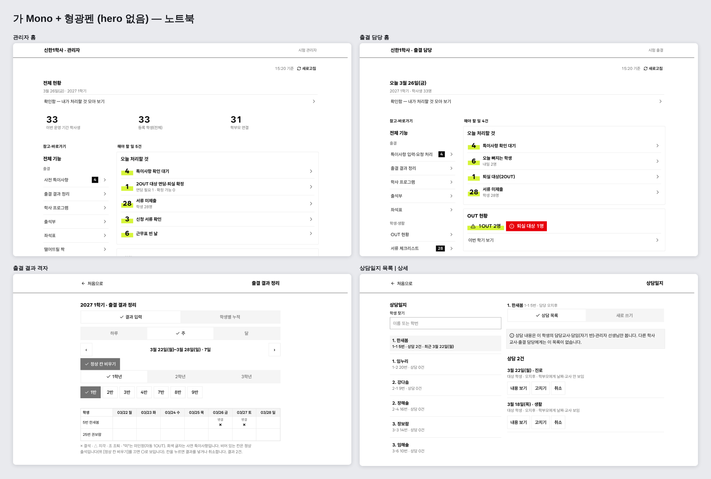
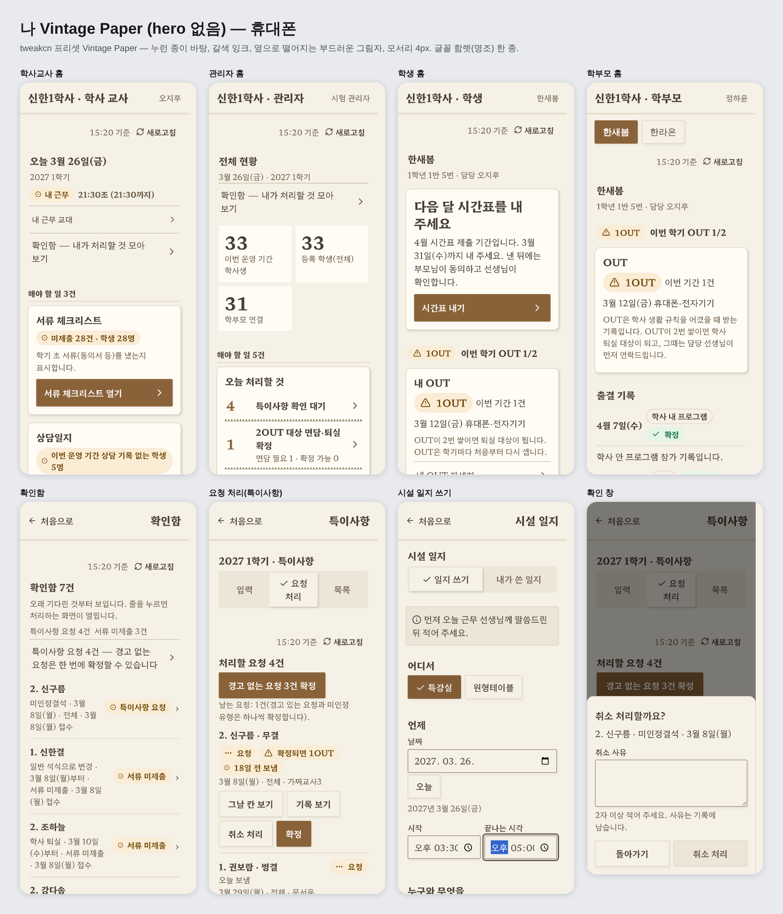
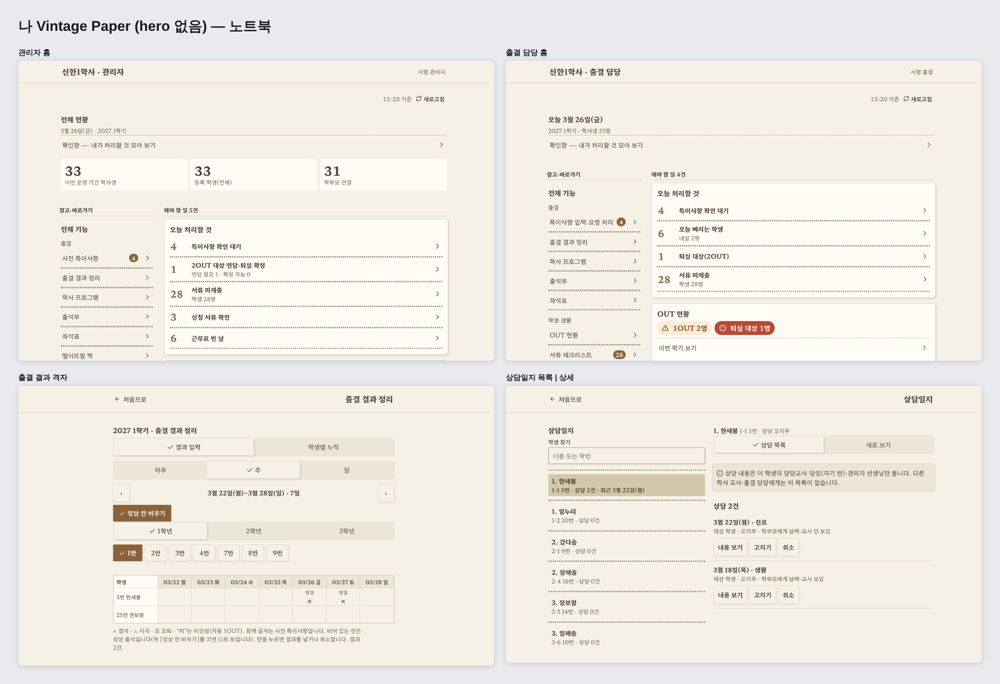
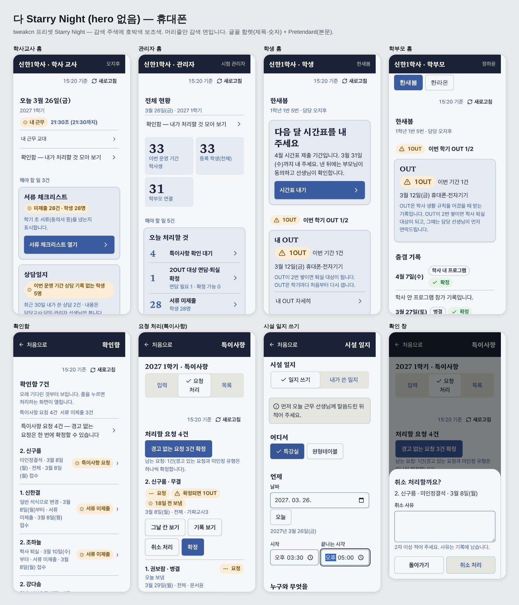
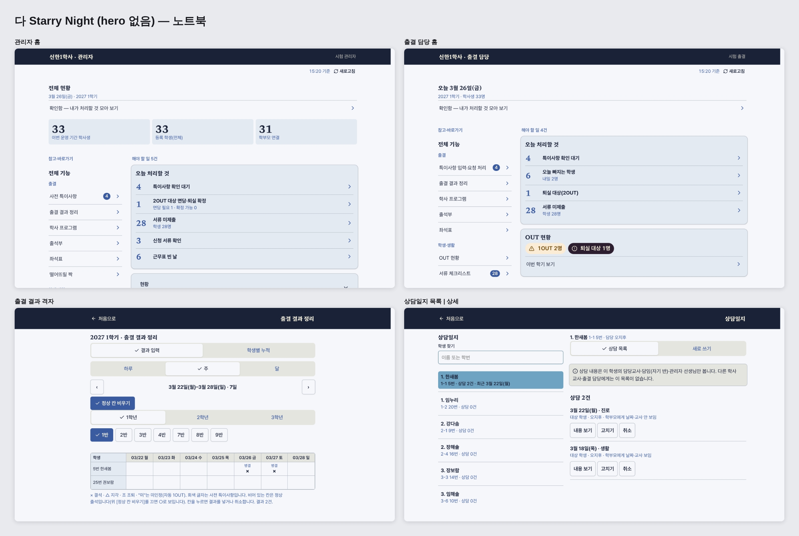
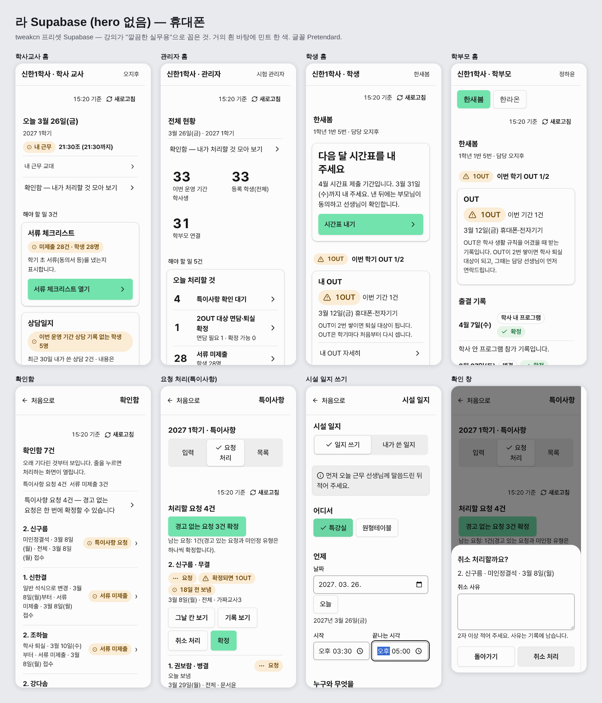
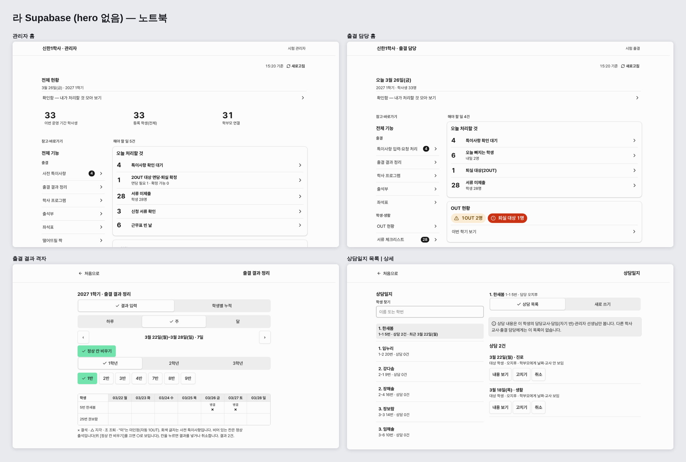

## 기준 측정 (실제 화면 12개 × 네 안, hero 없음)

| 기준 | 가 | 나 | 다 | 라 |
| --- | --- | --- | --- | --- |
| 360px 가로 넘침 | 0 | 0 | 0 | 0 |
| 360px + 기기 글자 150% 넘침(휴대폰 8화면) | 0 | 0 | 0 | 0 |
| 누르는 칸 48px 미만(보통 / 150%) | 0 / 0 | 0 / 0 | 0 / 0 | 0 / 0 |
| 화면 글자의 최저 대비(4.5:1 이상) | 4.54:1 | 5.26:1 | 5.22:1 | 5.17:1 |

찍는 법: `FONT_DIR=<글꼴 폴더> node design/preview/concepts2-v2.js m p n s --nohero`
