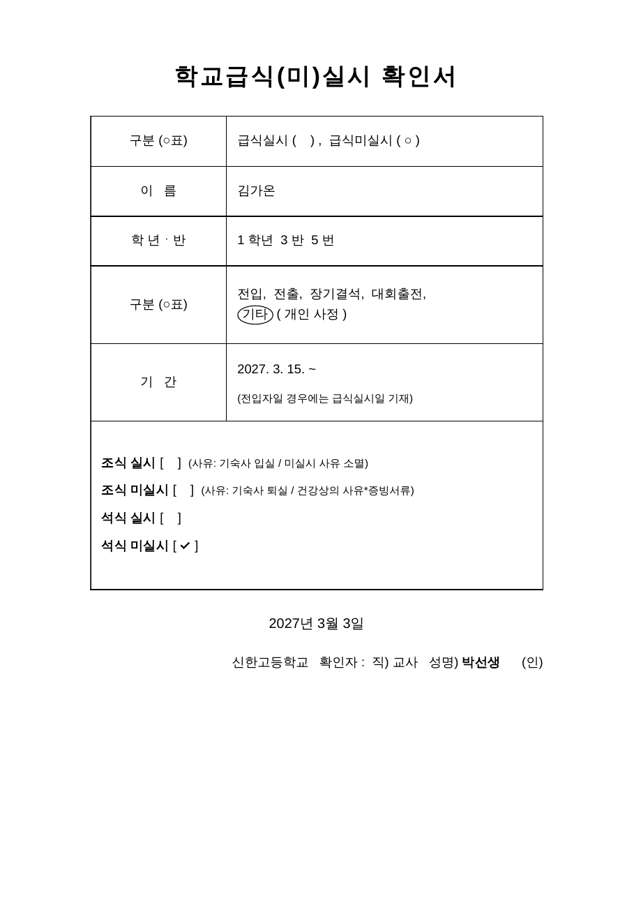
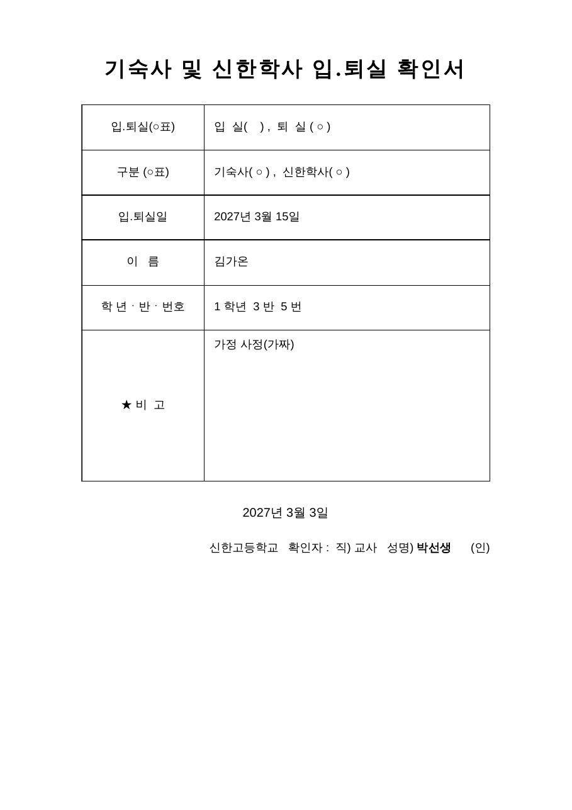

# 확인서 두 종 렌더러 모델 (D9, 결정 68 — C19b·C6b와 맞출 것)

`printRenderMealConfirm_(model, opts)`(학교급식(미)실시 확인서)와 `printRenderMoveConfirm_(model, opts)`(기숙사 및 신한학사 입․퇴실 확인서)가 받는 모양이다(`src/print/ConfirmFormsHtml.gs`). 둘 다 **순수 함수**라 Apps Script 서비스·현재 시각을 쓰지 않고, 결과는 A4 세로 한 장 HTML이다(PDF 변환은 C0 방식). 칸·문구·여백은 선생님이 준 2025판 양식 그대로이고(`docs/reference/meal-confirm-form.md`), 확인서는 **화면에서만 내려받고 Drive에 남기지 않는다**(학생 이름이 들어가므로, 결정 68). 틀린 값은 조용히 넘기지 않고 오류를 던진다 — 틀린 서류를 내지 않는다.



## 1. 종이

- A4 세로, 여백 **위 20mm · 아래 15mm · 좌우 30mm**(`@page`) → 인쇄 폭 150mm = 425.2pt라 내용 폭은 **425pt**.
- 제목(가운데 22pt 굵게) → 2열 표(왼쪽 30% 항목·가운데, 오른쪽 70% 내용·왼쪽) → 날짜(가운데) → 확인자 줄(오른쪽). 표 글자 12pt, 합친 큰 칸 높이 약 51mm(145pt).
- 고른 항목은 괄호 안 **○**, 글자 동그라미(손으로 친 듯한 둥근 테두리), 체크칸 **✓** — 흑백 인쇄에서도 보인다(색을 쓰지 않는다).

## 2. 급식(미)실시 확인서

**모델은 서버·디자인 계약 `docs/contracts/confirm-forms.md`가 기준이다**(`foodMealConfirmModel_`가 만든다). 렌더러는 그 평평한 모양을 그대로 받는다:

```
{ form:'meal', kind:'실시'|'미실시', name, grade, classNo, number,
  reasonKind:''|'전입'|'전출'|'장기결석'|'대회출전'|'기타', reasonText:'',
  periodFrom:'yyyy-MM-dd', breakfast:{on,off,reason:''}, dinner:{on,off}, date:'yyyy-MM-dd', teacher:'교사 이름' }
```

| 칸 | 채우는 규칙 |
| --- | --- |
| 구분(○표) | `kind`: `실시`면 급식실시 ○, `미실시`면 급식미실시 ○(체크칸에서 따로 계산하지 않는다) |
| 이름 / 학년ㆍ반 | `name` / `1 학년 3 반 5 번`(학년·반·번호는 숫자 또는 숫자 문자열, 비면 빈칸, 숫자가 아니면 오류) |
| 구분(사유) | `reasonKind`: 전입·전출·장기결석·대회출전은 글자에 동그라미, `기타`는 `기타 ( reasonText )`. `''`이면 아무것도 동그라미 치지 않는다 |
| 기간 | `periodFrom` → `2027. 3. 15. ~`(끝나는 날은 비워 둔다). 아래에 `(전입자일 경우에는 급식실시일 기재)` 그대로 |
| 합친 칸 | 체크칸 `조식 실시 [ ]`·`조식 미실시 [ ]`·`석식 실시 [ ]`·`석식 미실시 [ ]`에 `breakfast.on/off`·`dinner.on/off`가 true인 칸만 ✓(신청 하나는 한 항목이라 보통 하나). 네 칸이 모두 false면 오류. 조식 사유(`breakfast.reason` = 기숙사 입실·미실시 사유 소멸·기숙사 퇴실·건강상의 사유)는 **지금 서버가 늘 `''`**라 종이에 손으로 ○하고, 값이 있으면 그 사유에 동그라미 |
| 날짜 | `date`(신청 일시의 날짜) |
| 확인자 | `신한고등학교 확인자 : 직) 교사 성명) teacher (인)` — `teacher`가 비면 밑줄 빈칸, (인) 자리는 늘 빈칸 |

## 3. 기숙사 및 신한학사 입․퇴실 확인서

```
{ form:'move', direction:'입실'|'퇴실', hall:bool, dorm:bool, effectiveDate:'yyyy-MM-dd',
  name, grade, classNo, number, remark:'', date:'yyyy-MM-dd', teacher:'교사 이름' }      // inoutConfirmModel_ (계약)
```

| 칸 | 채우는 규칙 |
| --- | --- |
| 입․퇴실(○표) | `direction`: `입 실( ○ ) , 퇴 실 ( )` 또는 반대 |
| 구분(○표) | `기숙사( ○ ) , 신한학사( ○ )` — `dorm`·`hall`이 true인 것에만 ○. **학사 및 기숙사 퇴실이면 둘 다 ○**. 둘 다 false면 오류 |
| 입․퇴실일 | `effectiveDate` → `2027년 3월 15일`(비면 빈칸) |
| 이름 / 학년ㆍ반ㆍ번호 | 위와 같다 |
| ★ 비고 | `remark`(사유). **2OUT 퇴실이면 서버가 비운다**(행정실에 내는 종이에 징계 사유를 적지 않는다). 칸 높이 약 51mm. ASSUMPTION: 양식의 "★ 비 고 (두 칸 합침)"을 항목 칸·내용 칸 모두 51mm 높이로 읽었다 — 종이와 나란히 봐 달라 |
| 날짜 / 확인자 | `date`(신청일) / `teacher` |



## 4. 앱의 값 → 모델 (서버가 이미 한다)

- 급식 확인서는 **실시·미실시가 바뀌는 급식 변경 신청에만**(학사 석식 ↔ 일반 석식만 바뀌면 서버가 거부, 결정 68). 사유 구분은 서버가 `reason` 글 앞에 `[전입] `처럼 붙여 저장해 두었다가 `reasonKind`·`reasonText`로 나눈다.
- 기간 = 적용일, 날짜 = 신청 일시의 날짜, 확인자 = 그 학생의 담당교사 이름.
- **모르는 값은 조용히 넘기지 않고 오류를 던진다**(구분·끼니·사유·날짜·학생 숫자·다른 양식의 모델 `form`). 서버는 그때 확인서를 내려주지 않는다.
- 학생 이름은 모델에만 있고 파일 이름·`audit_log`·목록 화면에 쓰지 않는다.

## 5. 미리보기·시험

- `node design/preview/confirm-forms.js` → `design/preview/out/confirm-*.pdf·png`(가짜 학생, 크로미움 PDF **1쪽**과 내용 폭 425.2pt 이내를 확인). 가짜 모델: `design/preview/confirm-forms-fixture.js`.
- 시험: `tests/design/confirm-forms.test.js`(여백·문구·○·✓ 위치·오류·이스케이프·순수), `tests/features/confirm_forms_render.test.js`(서버가 만든 진짜 모델을 이 렌더러에 넣어 종이 모양이 나오는지).
- 종이로 나란히 보는 확인표: `docs/design/print-check.md` 11절(67~82번).
