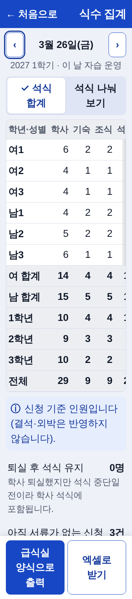
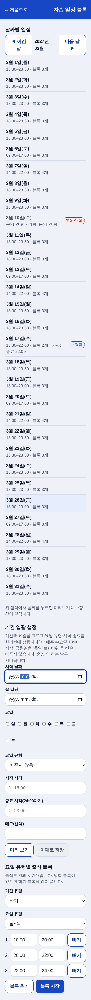

# 기기 행렬 점검 기준선(T8, 결정 85 화면 새 단장 전)

> 2026-11-20 테스트 세션. **기준: main `e01b1ed`(D15 2단계 ② #265 적용 뒤)**. 앞 기준선(#266, D15 ① 뒤)과 비교: 나빠진 칸 0, 좋아진 칸 9(출석부 미리보기 iframe 포커스 표시, 모든 기기). 그 앞(#264, D15 전)과 비교하면 좋아진 칸 24가 더 있다.
> 이 표가 **D15 전후를 같은 잣대로 재는 기준선**이다. D15 PR마다 `npm run devices -- --base=docs/design/devices-baseline.json`으로 다시 돌려 '나빠진 칸'이 0인지 본다.

## 1. 무엇을 어떻게 재나
- 도구: `npm run devices`(`design/preview/devices.js`). 실제 `src/ui` 화면을 가짜 서버(gas-fakes)에 이어 붙여 띄운다(`design/preview/real-screens.js`). 가짜 데이터만.
- 화면 31개: 역할별 홈 7(관리자·학사 교사·출결·담임·근무표 담당·학생·학부모) + `SCREENS`의 모든 화면(시간표는 학생·학부모·교사 셋).
- 기기 9칸: 360×800(안드로이드), 390×844·375×667(아이폰 크기), 360px 글자 150%(html 27px), 768×1024(태블릿), 1093×615(1366 노트북 + 윈도우 배율 125%)·1366×768·1536×864(윈도우 노트북), 1920×1080. 휴대폰·태블릿 칸은 isMobile·hasTouch로 흉내.
- **브라우저는 Chromium 하나뿐**이다. 아이폰 칸은 아이폰 화면 크기를 흉내 낸 Chromium이지 Safari가 아니다(이 환경에 WebKit이 없다). 실제 Safari 등은 4절에서 사람이 본다.
- 판정 여덟 가지: 넘침(가로 스크롤) · 작은칸(휴대폰에서 누르는 요소 48px 미만) · 입력글자(휴대폰 입력 16px 미만 → 아이폰 확대) · 가림(아래 고정 바가 내용·버튼을 가림) · 잘림(overflow 숨김 글) · 포커스(Tab으로 갈 때 안 보이는 곳·포커스 표시 없음·tabindex>0) · 콘솔(오류) · 줄길이(노트북·데스크톱에서 글 덩어리 p·li·.muted 등의 실제로 그려진 가장 긴 한 줄이 45em·760px 중 작은 값을 넘음, 표·격자 제외 — `design/preview/line-length.js`).
- 도구 자체 점검: 돌 때마다 먼저 여덟 가지를 일부러 심은 페이지에서 모두 잡고 깨끗한 페이지에서는 하나도 안 잡는지 본다. 같은 main을 두 번 돌려 칸마다 같은 결과(나빠짐 0·좋아짐 0)인 것도 확인했다.
- 걸린 시간: 약 2분 20초(279칸). 느려서 `npm test`에는 넣지 않는다.
- 하네스 고친 점: 서버가 `addMetaTag`로 붙이는 viewport 태그를 미리보기에서도 넣는다. 전에는 빠져 있어 휴대폰 흉내에서 980px 화면이 됐다(사진만 찍을 때는 드러나지 않았음).

## 2. 결과 표
| 화면 | android-360 | iphone-390 | iphone-375 | android-360-font150 | tablet-768 | laptop-1093 | laptop-1366 | laptop-1536 | desktop-1920 |
| --- | --- | --- | --- | --- | --- | --- | --- | --- | --- |
| home:admin | 통과 | 통과 | 통과 | 통과 | 통과 | 통과 | 통과 | 통과 | 통과 |
| home:hall_teacher | 통과 | 통과 | 통과 | 통과 | 통과 | 통과 | 통과 | 통과 | 통과 |
| home:attendance | 통과 | 통과 | 통과 | 통과 | 통과 | 통과 | 통과 | 통과 | 통과 |
| home:homeroom | 작은칸(2) | 작은칸(2) | 작은칸(2) | 작은칸(2) | 통과 | 통과 | 통과 | 통과 | 통과 |
| home:duty_manager | 통과 | 통과 | 통과 | 통과 | 통과 | 통과 | 통과 | 통과 | 통과 |
| home:student | 통과 | 통과 | 통과 | 통과 | 통과 | 통과 | 통과 | 통과 | 통과 |
| home:parent | 통과 | 통과 | 통과 | 통과 | 통과 | 통과 | 통과 | 통과 | 통과 |
| terms | 통과 | 통과 | 통과 | 통과 | 통과 | 통과 | 통과 | 통과 | 통과 |
| roster | 통과 | 통과 | 통과 | 통과 | 통과 | 통과 | 통과 | 통과 | 통과 |
| schedule | 작은칸(7) | 작은칸(7) | 작은칸(7) | 통과 | 통과 | 통과 | 통과 | 통과 | 통과 |
| sheet | 통과 | 통과 | 통과 | 통과 | 통과 | 통과 | 통과 | 통과 | 통과 |
| exceptions | 통과 | 통과 | 통과 | 통과 | 통과 | 통과 | 통과 | 통과 | 통과 |
| results | 통과 | 통과 | 통과 | 통과 | 통과 | 통과 | 통과 | 통과 | 통과 |
| seats | 작은칸(5) | 작은칸(5) | 작은칸(5) | 작은칸(3) | 통과 | 통과 | 통과 | 통과 | 통과 |
| avoid | 통과 | 통과 | 통과 | 통과 | 통과 | 통과 | 통과 | 통과 | 통과 |
| duty | 통과 | 통과 | 통과 | 통과 | 통과 | 통과 | 통과 | 통과 | 통과 |
| outs | 통과 | 통과 | 통과 | 통과 | 통과 | 통과 | 통과 | 통과 | 통과 |
| moves | 통과 | 통과 | 통과 | 가림(1) | 통과 | 통과 | 통과 | 통과 | 통과 |
| mealcount | 작은칸(1) | 작은칸(1) | 작은칸(1) | 작은칸(1) 가림(2) | 통과 | 통과 | 통과 | 통과 | 통과 |
| rooms | 통과 | 통과 | 통과 | 통과 | 통과 | 통과 | 통과 | 통과 | 통과 |
| programs | 통과 | 통과 | 통과 | 통과 | 통과 | 통과 | 통과 | 통과 | 통과 |
| docs | 통과 | 통과 | 통과 | 통과 | 통과 | 통과 | 통과 | 통과 | 통과 |
| contacts | 통과 | 통과 | 통과 | 통과 | 통과 | 통과 | 통과 | 통과 | 통과 |
| calendar | 통과 | 통과 | 통과 | 통과 | 통과 | 통과 | 통과 | 통과 | 통과 |
| batch | 통과 | 통과 | 통과 | 가림(1) | 통과 | 통과 | 통과 | 통과 | 통과 |
| facility | 통과 | 통과 | 통과 | 통과 | 통과 | 통과 | 통과 | 통과 | 통과 |
| facilityday | 통과 | 통과 | 통과 | 통과 | 통과 | 통과 | 통과 | 통과 | 통과 |
| counsel | 통과 | 통과 | 통과 | 통과 | 통과 | 통과 | 통과 | 통과 | 통과 |
| timetable:hall_teacher | 통과 | 통과 | 통과 | 통과 | 통과 | 통과 | 통과 | 통과 | 통과 |
| timetable:student | 통과 | 통과 | 통과 | 통과 | 통과 | 통과 | 통과 | 통과 | 통과 |
| timetable:parent | 통과 | 통과 | 통과 | 통과 | 통과 | 통과 | 통과 | 통과 | 통과 |

합계: 279칸 중 통과 262칸. 이유별 실패 칸: 작은칸 15, 가림 3

자세한 실패(요소 이름·크기)는 `npm run devices` 뒤 `design/preview/out/devices/report.md`, 칸별 원자료는 `docs/design/devices-baseline.json`.

## 3. 눈에 띄는 것(남은 실패, D15 다음 단계에서 볼 곳)
| 무엇 | 어디 | 사진 |
| --- | --- | --- |
| **글자 150%에서 아래 바가 가림** | 식수 집계(마지막 카드 '서류 미제출 3건' 링크가 바 아래, 63px), 입퇴실·학년 일괄 퇴실(마지막 줄 23px) |  |
| 휴대폰에서 작은 누를 곳 | 일정 요일 체크(40×54), 좌석표 층·성별 버튼(34~42×48), 식수 집계 '서류 미제출' 링크(140×44), 담임 홈 학생 이름 링크(53×27) |  |
| 해결됨(#263·#265) | 역할별 홈의 '처음으로'·'접속 진단' 작은 링크, 학사 교사 홈(+81px)·학부모 홈(+27px)의 글자 150% 넘침(#263), 출석부 미리보기 iframe 포커스 표시(#265) | — |
| 통과 | 줄길이(노트북 4칸)·입력 글자(16px)·잘림·콘솔은 모든 칸 통과. 노트북·데스크톱 4칸은 모든 화면 통과. 포커스도 모든 칸 통과 | — |

## 4. 실기기 확인 목록(0단계 진단 체크리스트에 넣을 것)
Chromium으로는 못 재는 것만 적는다. 한 번씩 실제 기기로 열어 본다.
1. **아이폰 Safari**(iOS 최신·한 단계 전): 로그인 후 홈이 열리는지, 입력 칸을 눌러도 화면이 확대되지 않는지, 아래 고정 바가 홈 표시줄(안전 영역)에 겹치지 않는지, 날짜 고르기(input type=date) 모양.
2. **아이폰 글자 크게(설정 → 디스플레이 → 텍스트 크기, 손쉬운 사용 큰 텍스트)**: 학생·학부모 홈·시간표·시설 일지가 가로로 넘치지 않는지(우리 150%는 html 글자만 키운 흉내).
3. **안드로이드 삼성 인터넷**: 홈·시간표 제출·시설 일지 저장, 아래 바, 다크 모드 강제(삼성 인터넷 '다크 모드')에서 글이 읽히는지.
4. **안드로이드 크롬 글꼴 크기(설정 → 접근성 → 글꼴 크기)**와 기기 글꼴 크기 최대.
5. **카카오톡 인앱 브라우저**(링크를 카톡으로 받았을 때): 구글 로그인 창이 막히지 않는지(인앱에서 구글 로그인이 거부될 수 있음 — 외부 브라우저로 열기 안내가 필요한지), 출력물(PDF) 내려받기.
6. **네이버 앱 인앱 브라우저**: 5와 같은 것.
7. **윈도우 노트북 크롬 배율 125%·150%**(디스플레이 배율): 1536·1280폭에서 표 화면(출석부·식수 집계·결과 정리)과 인쇄 미리보기.
8. **윈도우 엣지**: 홈과 출석부 인쇄 한 번.
9. 실제 터치: 휴대폰에서 작은칸으로 잡힌 곳(요일 체크, 좌석 층 버튼)을 손가락으로 눌러 옆 칸이 눌리지 않는지.
10. 화면 회전(휴대폰 가로)에서 아래 바·표.
