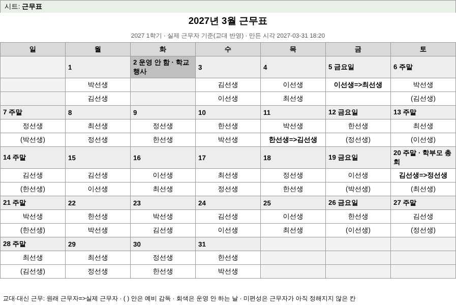
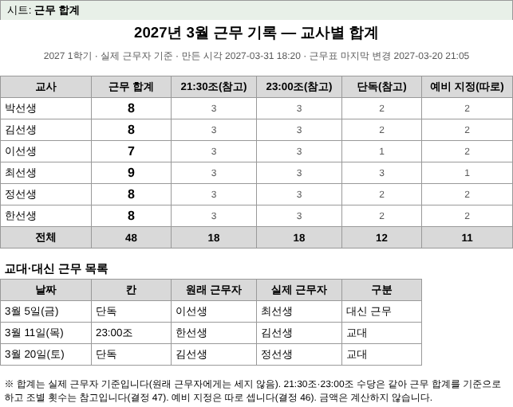

# 월말 근무 기록표 xlsx — 두 시트의 칸 배치 (D9, 결정 67·48·47·46)

> 코딩A(C14b)가 이 문서대로 xlsx를 만든다. **근거:** 결정 67 ② — 선생님이 준 파일이 학교 양식의 전부이고(따로 된 근무 수당 양식은 없다), 첫 시트는 운영 파일의 **월별 근무표 모양**(일~토 달력, 평일 2명, 주말 1명 + 괄호 예비, 교대는 `원래=>바뀐`, `docs/reference/real-layout-2025.md` 4.5절), 둘째 시트는 **교사별 합계(결정 47)와 교대 목록**이다. xlsx는 Apps Script `Utilities.zip`으로 직접 만들고 권한을 더하지 않으며 Drive에 임시 파일을 만들지 않는다. **학생 이름은 어디에도 넣지 않는다**(교사 이름만).
> 입력 모델은 `docs/design/duty-record-model.md`(D7, R8 `dutyRecord_` 결과)와 같고 선택 필드 `dayMemos`만 더한다(아래 5절). 기준 구현(칸 배치 계산)은 `design/preview/duty-xlsx.js`의 `dutyXlsxGrid(model)`이고 같은 모델에서 아래 사진이 나왔다(가짜 교사·2027년 3월).

## 1. 시트 1 "근무표" (월별 근무표 달력)

- **열 A~G = 일·월·화·수·목·금·토**(폭 17자). 한 주는 **3줄**이다: 날짜 줄 / 근무자 줄 1 / 근무자 줄 2. 달력은 달의 1일이 든 주부터 마지막 날이 든 주까지(4~6주).
- 위 세 줄: 1줄 제목 `2027년 3월 근무표`(A1:G1 병합, 가운데, 굵게 14pt), 2줄 `2027 1학기 · 실제 근무자 기준(교대 반영) · 만든 시각 2027-03-31 18:20`(A2:G2 병합, 9pt 회색), 3줄 요일 머리(일~토, 굵게, 회색 바탕).
- 그 달이 아닌 날(앞뒤 빈 칸)은 글자 없이 연한 회색 바탕.

### 칸 채우는 규칙

| 날 | 날짜 줄 | 근무자 줄 1 | 근무자 줄 2 |
| --- | --- | --- | --- |
| 월~목 | `1` (날짜 숫자) | 21:30조 근무자 | 23:00조 근무자 |
| 금 | `5 금요일` | 그날 근무자(단독) | `(예비 감독)` 괄호 |
| 토·일 | `6 주말` | 그날 근무자(단독) | `(예비 감독)` 괄호 |
| 운영 안 함 | `2 운영 안 함`(진한 회색 바탕) | 빈 칸(연한 회색) | 빈 칸(연한 회색) |

- **교대·대신 근무**는 그 칸에 `원래 근무자=>실제 근무자`로 쓰고 **굵게**(예 `이선생=>최선생`). 예비 칸을 바꾼 교대는 `(원래=>실제)`. 실제 근무자 기준이라 합계(시트 2)는 실제 근무자에게 센다.
- 대신 근무로 예비가 그날 근무하면 그 사람은 예비 칸에서 빠진다(R8이 `standby`에서 뺀다, 결정 46) — 줄 2가 빌 수 있다.
- 예비가 2명이면 괄호 안에 `, `로 잇는다(`(김선생, 박선생)`). 같은 칸에 근무자가 둘이면(드묾) `, `로 잇는다.
- **미편성**(근무자가 없는 운영일 칸)은 `미편성`을 굵게 쓴다(빈 칸으로 두면 비운 것인지 빠뜨린 것인지 모른다).
- 날짜 줄에 그날 메모(`dayMemos`, 학교 행사·대청소 등)가 있으면 ` · 학교 행사`를 덧붙인다. 글이 길면 줄 바꿈(행 높이는 지정하지 않아 엑셀이 맞춘다).
- 달력 아래 한 줄 띄고 **범례**(A:G 병합, 9pt): `교대·대신 근무: 원래 근무자=>실제 근무자 · ( ) 안은 예비 감독 · 회색은 운영 안 하는 날 · 미편성은 근무자가 아직 정해지지 않은 칸`. 모델 `warnings`는 그 아래 줄마다 `※ …`.
- **방학 평일 1명**(예비 없음, 근무계획 2025-2월): 같은 틀에서 평일의 줄 2가 비는 모양이다. 방학 틀은 D7·F3의 "운영 기간 유형별 근무 칸"(handover D7)이 정해진 뒤 맞춘다 — 지금은 학기 틀만.

## 2. 시트 2 "근무 합계" (교사별 합계 + 교대 목록)

- **열 A~F**(폭 15·13·14·14·13·15자). 1줄 제목 `2027년 3월 근무 기록 — 교사별 합계`(A1:F1 병합), 2줄 `2027 1학기 · 실제 근무자 기준 · 만든 시각 … · 근무표 마지막 변경 …`(A2:F2, 9pt 회색), 3줄 빈 줄.
- **합계 표(4줄째부터)**: 머리 `교사 | 근무 합계 | 21:30조(참고) | 23:00조(참고) | 단독(참고) | 예비 지정(따로)`.
  - 교사마다 한 줄(모델의 `teachers` 순서). **근무 합계는 크게**(굵게 12pt) 쓰고, 조별 횟수는 **작게**(9pt 회색, 참고) — 21:30조·23:00조 수당이 같아 근무 합계가 기준이다(결정 47). 금액은 계산하지 않는다.
  - 근무 합계 = 21:30조 + 23:00조 + 단독(합계 칸은 **값**이다, 수식 없음). 예비 지정은 근무와 따로 센다(결정 46).
  - 마지막 줄 `전체`(굵게, 회색 바탕): 각 열의 합.
- **교대·대신 근무 목록**: 합계 표 아래 한 줄 띄고 소제목 `교대·대신 근무 목록`(굵게, A:F 병합), 머리 `날짜 | 칸 | 원래 근무자 | 실제 근무자 | 구분`(A~E).
  - 날짜 오름차순, 같은 날은 칸 순서(21:30조·23:00조·단독·예비). 날짜는 `3월 5일(금)`. 구분은 R8 `swaps[].kind`(`교대`·`대신 근무`) 그대로(없으면 `교대`).
  - 교대가 없으면 한 줄 `이 달 교대가 없습니다.`.
- 맨 아래 주석(A:F 병합, 9pt): `※ 합계는 실제 근무자 기준입니다(원래 근무자에게는 세지 않음). 21:30조·23:00조 수당은 같아 근무 합계를 기준으로 하고 조별 횟수는 참고입니다(결정 47). 예비 지정은 따로 셉니다(결정 46). 금액은 계산하지 않습니다.` 모델 `warnings`가 있으면 그 아래 `※ …`.

## 3. 서식(스타일) 표

글꼴은 맑은 고딕(없으면 엑셀 기본). 흑백으로 인쇄해도 구분되게 **굵기·회색 농도**만 쓴다(색 글자 없음).

| 이름 | 쓰는 곳 | 글자 | 바탕 | 테두리·정렬 |
| --- | --- | --- | --- | --- |
| title | 두 시트 1줄 | 굵게 14pt | 없음 | 테두리 없음, 가운데 |
| sub | 2줄 | 9pt, 회색(#595959) | 없음 | 테두리 없음, 가운데 |
| head | 시트 1 요일 머리, 시트 2 표 머리 | 굵게 10pt | #D9D9D9 | 가는 테두리, 가운데 |
| date | 시트 1 날짜 줄 | 굵게 10pt | #EDEDED | 가는 테두리, 왼쪽, 줄 바꿈 |
| dateOff | 운영 안 함 날짜 줄 | 굵게 10pt | #BFBFBF | 가는 테두리, 왼쪽, 줄 바꿈 |
| name | 시트 1 근무자 칸 | 10pt | 없음 | 가는 테두리, 가운데 |
| nameBold | 교대·미편성 칸 | 굵게 10pt | 없음 | 가는 테두리, 가운데 |
| nameOff, other | 운영 안 함 근무자 칸, 그 달 아닌 날 | — | #F2F2F2 | 가는 테두리 |
| listName, list | 시트 2 교사 이름·교대 목록 칸 | 10pt | 없음 | 가는 테두리, 왼쪽 |
| sumBig | 근무 합계 칸 | 굵게 12pt | 없음 | 가는 테두리, 가운데 |
| numSmall | 조별 횟수·예비 칸 | 9pt, 회색(#595959) | 없음 | 가는 테두리, 가운데 |
| totalName, totalNum | `전체` 줄 | 굵게 10pt | #D9D9D9 | 가는 테두리, 가운데 |
| sectionTitle | `교대·대신 근무 목록` | 굵게 11pt | 없음 | 테두리 없음, 왼쪽 |
| note | 범례·주석·경고 | 9pt | 없음 | 테두리 없음, 왼쪽, 줄 바꿈 |

## 4. xlsx 만들기 메모 (C14b)

- 파일 이름: `근무기록표_2027-03.xlsx`. 시트 이름은 정확히 `근무표`, `근무 합계`(이 순서).
- 필요한 부품(최소 OOXML): `[Content_Types].xml`, `_rels/.rels`, `xl/workbook.xml`, `xl/_rels/workbook.xml.rels`, `xl/styles.xml`(위 3절 표를 `cellXfs`로), `xl/worksheets/sheet1.xml`·`sheet2.xml`. 글자는 `sharedStrings` 대신 **인라인 문자열**(`<c t="inlineStr"><is><t>…</t></is></c>`)로 넣으면 부품이 줄어든다. 숫자는 `<c><v>8</v></c>`. 글자 안의 `& < >`는 이스케이프한다.
- 병합은 `<mergeCells>`로(제목·부제·범례·주석·소제목). 열 폭은 `<cols>`로.
- 쪽 설정: 시트 1 **A4 가로**, 시트 2 **A4 세로**, 둘 다 `fitToWidth=1`·`fitToHeight=0`(폭에 맞춤)·여백 좁게. 머리글·바닥글 없음.
- **수식 없음, 외부 링크 없음, 매크로 없음**(교사가 열었을 때 경고가 뜨지 않게). 학생 이름 없음.
- 만든 뒤 시험: ① 합계(전체 근무·예비)가 `dutyRecord_` 결과 합과 같은지 ② 시트 1의 근무자 칸 이름을 모두 세면 합계와 같은지(교대 칸 `원래=>실제`는 실제에 센다) ③ 운영 안 함 날 칸이 비었는지 ④ `Utilities.zip`으로 만든 파일을 엑셀에서 열 때 복구 안내가 뜨지 않는지(선생님 확인, `stage2-teacher-checks.md` E1 뒤 새 단계로).

## 5. 입력 모델과 맞출 것

- 입력은 D7 모델 그대로다(`month`, `termName`, `closedDates`, `teachers[]`(`name`·`cells`·`standby`), `swaps[]`, `generatedAt`, `lastChangedAt`, `warnings`). 칸 코드는 `'21:30조'`·`'23:00조'`·`'단독'`(옛 표기 `'단'`은 단독).
- **새 선택 필드 `dayMemos: {'2027-03-05': '학교 행사'}`**: 날짜 줄에 덧붙일 메모(`day_schedules.memo`). 없으면 덧붙이지 않는다. C14b가 이미 쓰는 일정 읽기로 채울 수 있다.
- 시트 1의 날짜별 슬롯은 모델에서 뽑는다: 그날 `cells`에 그 칸 코드가 있는 교사 이름. 같은 날 같은 칸의 `swaps`가 있으면 `from=>to`로 바꾼다. 예비는 `teachers[].standby`에 그 날짜가 있는 교사 이름.
- **알려진 한계(ASSUMPTION):** 모델은 "원래 예비였지만 대신 근무로 빠진 사람"을 따로 주지 않으므로(R8이 `standby`에서 뺀다) 그날 줄 2는 비어 보인다. 필요하면 R8이 `swaps[].kind '대신 근무'`의 `to`를 이미 주므로 범례로 충분하다고 본다.
- 이 모양이 D7 PDF(`printRenderDutyRecord_`)와 다른 점: PDF는 교사 × 날짜 표(확인용)이고, xlsx는 학교 근무표 모양 달력 + 합계 시트다. 합계 숫자는 같아야 한다(근무 48·예비 11, 가짜 픽스처).

## 6. 건너뛴 것·확인 못 한 것

- 실제 xlsx 파일은 만들지 않았다(칸 배치 문서 + 미리보기 그림). 엑셀에서 열어 본 것이 아니라 HTML로 그린 모양이다.
- 운영 파일의 실제 글꼴·열 폭·테두리 두께는 모른다(이름을 가린 구조만 있다). 선생님이 사진을 보고 다르면 알려 주신다.
- 방학 평일 1명 틀, 입학홍보근무표 탭은 다루지 않았다.
