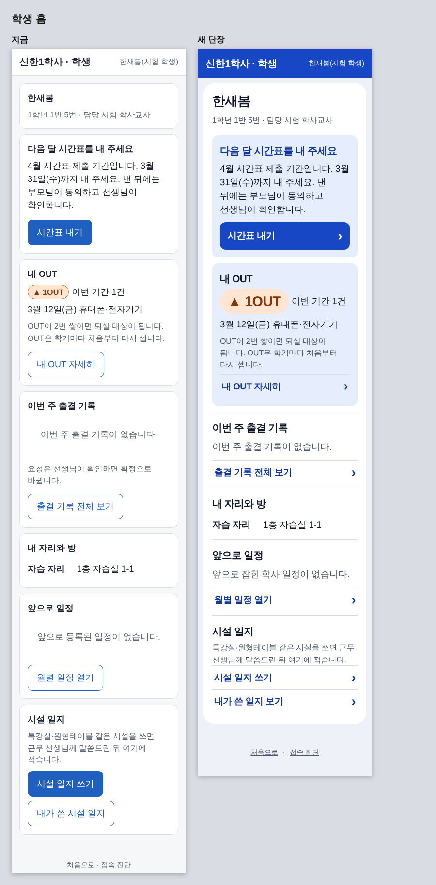
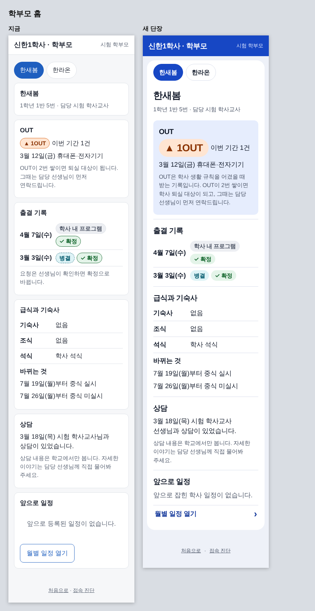
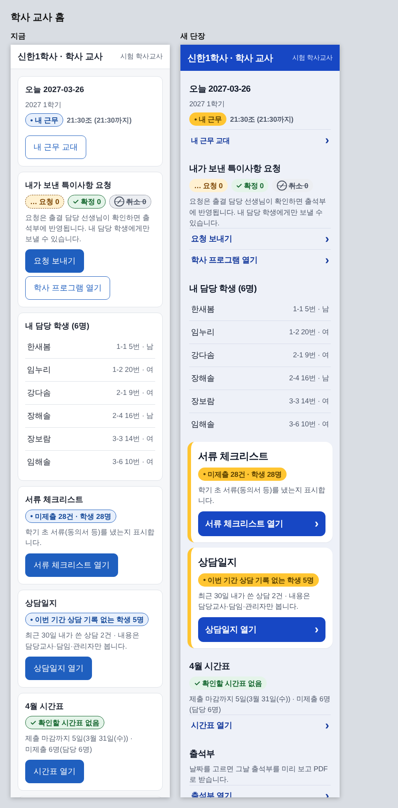
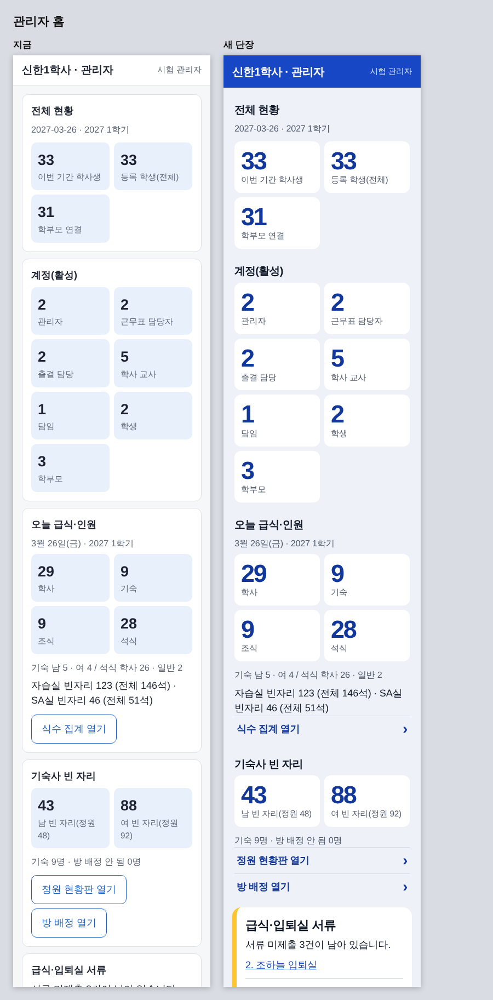
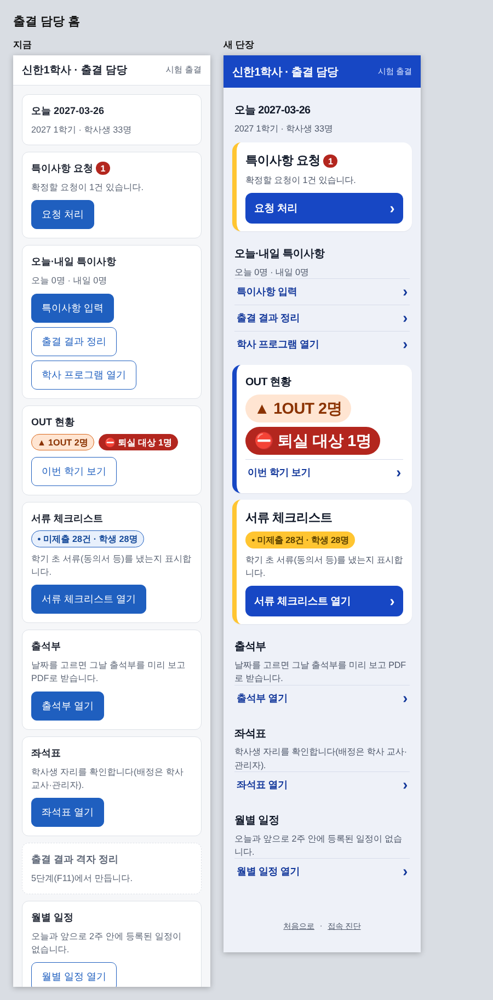
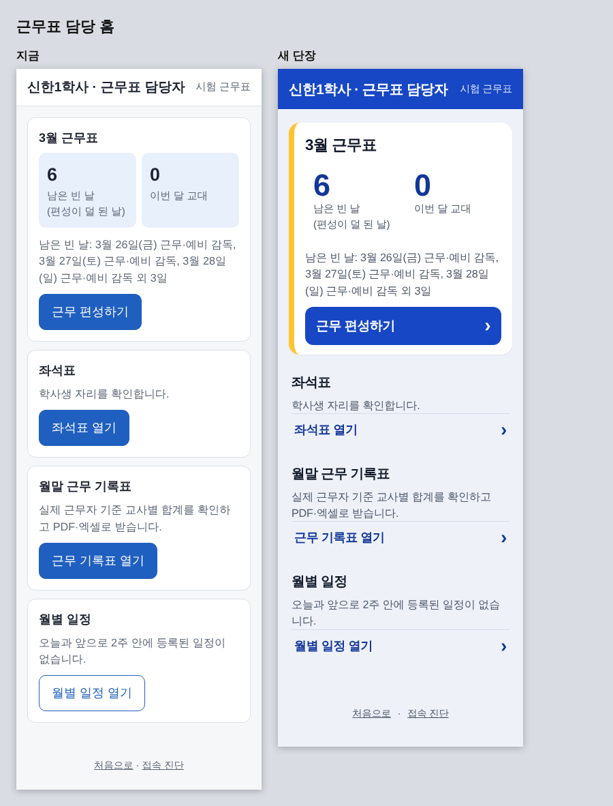
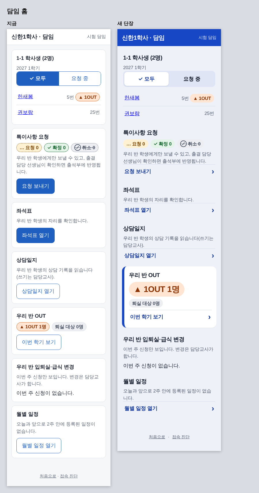
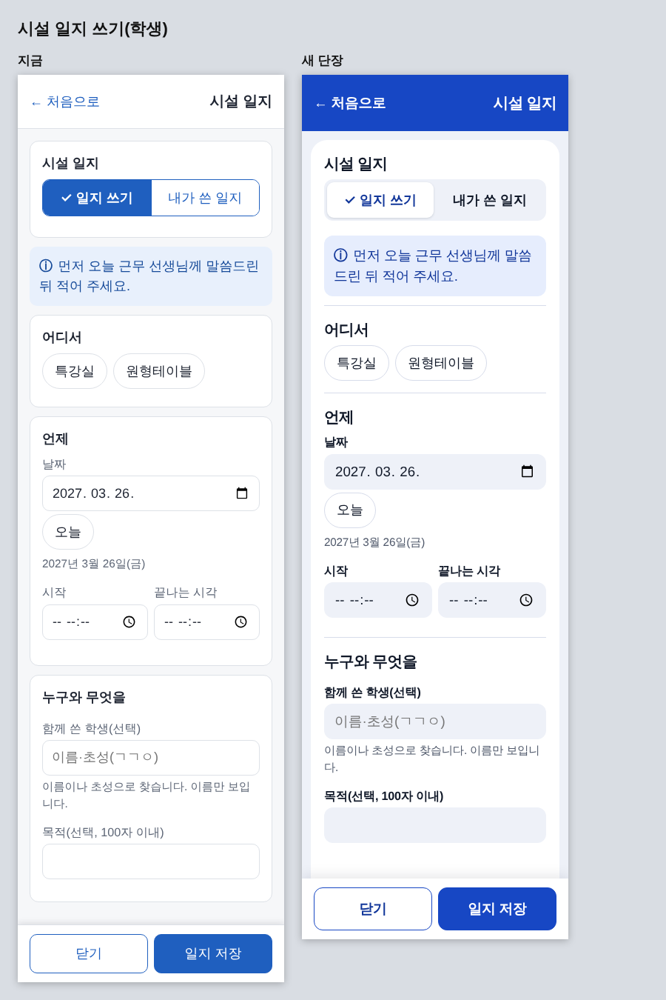
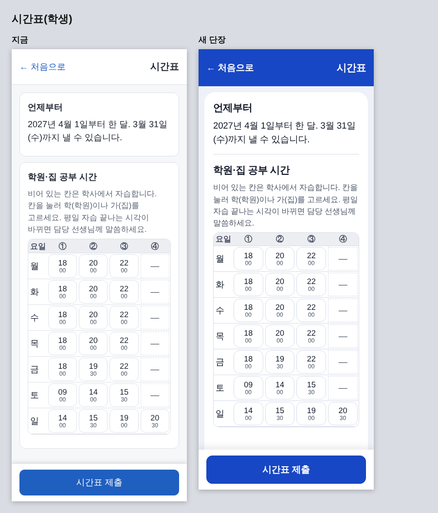
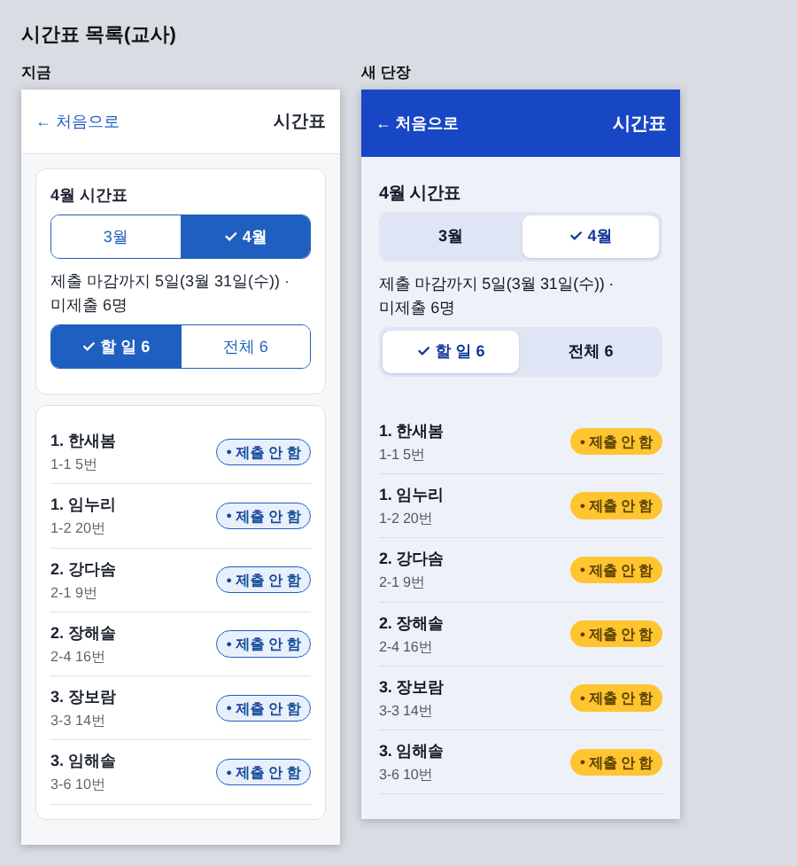

# D15 2단계 ① — 새 단장을 코드에 넣기 (토큰·부품·홈 7개)

> 선생님 선택(결정 85): **교사 화면은 B(또렷한 브랜드색), 학생·학부모 화면은 C(부드러운 묶음)를 같은 코발트 계열로.** 글꼴은 기기 기본(Pretendard 안 씀).
> 이 PR은 **공통 스타일·부품·홈 화면 7개·규칙 문서**까지입니다. 나머지 화면(`screen_*`)을 하나씩 점검하는 일은 PR ②로 나눕니다.
> 사진은 실제 `src/ui` 화면을 가짜 서버에 띄워 360px로 찍었습니다(`node design/preview/refresh-apply.js before|after`). **왼쪽이 지금(고치기 전 main), 오른쪽이 새 단장.** 이름·숫자는 모두 가짜, 가짜 오늘 2027-03-26.

## 1. 무엇을 바꿨나

| 곳 | 바꾼 것 |
| --- | --- |
| `Styles.html` 토큰 | 코발트 `--accent #1747c4`, 강조 노랑 `--signal #ffc531`(글자 `--signal-ink`), 바탕 연한 푸른 회색, 반경 16/12. 상태 색(초록·노랑·주황·빨강)은 그대로 |
| 머리줄 | 코발트 면 + 흰 글자(앱 이름이 한눈에). 뒤로 가기·제목도 흰색 |
| 카드 | **기본은 상자 없음**(줄로만 나눔). 상자는 `card todo`(노란 띠, 진짜 할 일)와 `card key`(코발트 띠, OUT 같은 중요한 것)뿐 |
| 버튼 | 다른 화면으로 가는 것은 **`UI.rowLink`("열기 ›" 한 줄, 48px)**. 할 일 카드의 **첫 줄 링크만** 폭 가득 주 버튼. 저장·확정은 그대로 `.btn` |
| 알약 | 모양 하나(테두리 없음). 구분은 앞 글자·낱말·색. 긴 낱말은 알약 안에서 줄을 바꿈 |
| 빈 상태 | 왼쪽 정렬 한 줄 |
| 숫자 | OUT 알약(중요 카드) 1.6rem, 숫자 칸 2.5rem |
| 학생·학부모 | `body.tone-soft` 한 클래스: 흰 판 하나, 큰 글씨, 둥근 모서리(같은 코발트). 학생·학부모 홈과 시설 일지·학생/학부모 시간표에 붙음 |
| 부품 | `UI.rowLink`, `UI.cardClass` 추가(`components.md`) |
| 홈 7개 | 모든 "열기" 버튼을 줄 링크로. **노란 띠는 진짜 할 일(마감·미처리 건수 > 0)에만**, 0건이면 띠 없이 줄. OUT은 `key` |
| 문구(홈 카드 설명문·빈 상태만, `writing.md` 기준 '상') | 요청 안내는 요청이 있을 때만, 학부모 OUT 설명에 OUT이 무엇인지, 자리와 방 빈 상태, "앞으로 잡힌 학사 일정", 관리자 명단 설명(잘못된 "저장은 다음 단계" 삭제), 출결 담당 홈의 이미 있는 기능 "5단계에서 만듭니다" 카드 삭제, "내가 쓴 일지 보기" |
| 규칙·시험 | `rules.md` 3·4절(알약 모양 → 앞 글자·색, 카드 세 가지), 5절은 `writing.md`로 연결 한 줄(개인 정보 규칙은 그대로 남김). `styles.test.js` 갱신 |

**홈의 "할 일" 기준(어느 카드에 노란 띠가 붙나):**

| 홈 | 노란 띠(건수 > 0일 때만) | 코발트 띠(중요) |
| --- | --- | --- |
| 학사 교사 | 서류 미제출, 상담 기록 없는 학생, 시간표 확인 필요, 급식·입퇴실 서류 미제출, 복귀 예정일 지남 | OUT 기록, 오늘 시설 일지(있을 때) |
| 관리자 | 위 + 2OUT 대상(면담·확정 필요), 근무표 빈 날 | OUT 기록, 시설 일지 |
| 출결 담당 | 확정할 특이사항 요청, 서류 미제출 | OUT 현황 |
| 근무표 담당 | 근무표 빈 날 | — |
| 담임 | 서류 미제출이 있는 급식·입퇴실 신청 | 우리 반 OUT |
| 학생 | 시간표 제출(제출 기간·돌려보냄)·(학부모) 시간표 동의 | 내 OUT |
| 학부모 | 시간표 동의 | OUT |

## 2. 지금 / 새 단장 (360px)

### 학생 홈

### 학부모 홈

### 학사 교사 홈 (위쪽 1700px)

### 관리자 홈 (위쪽 1700px)

### 출결 담당 홈

### 근무표 담당 홈

### 담임 홈

### 시설 일지 쓰기(학생)

### 시간표(학생)

### 시간표 목록(교사)

## 3. 지킬 것 점검

| 지킬 것 | 결과 | 어떻게 |
| --- | --- | --- |
| 누르는 칸 48px | 위 10화면 **48px 미만 0개** | `refresh-apply.js`가 버튼·줄 링크·칩·탭 높이를 쟀다 |
| 360px 가로 넘침 0 | **10화면 모두 없음** | `scrollWidth` |
| 글자 150% 가로 넘침 0 | **10화면 모두 없음**(고치기 전에는 학사 교사 홈·학부모 홈이 넘쳤다) | html 글자 18px → 27px |
| 글자 대비 4.5:1 | 시험으로 확인(`styles.test.js`: 알약 10종, 머리줄 작은 글씨 `#dbe5ff`, 노랑 위 글자 등) | |
| 색만으로 알리지 않기 | 알약은 앞 글자 + 낱말 + 색, 학·가·병은 글자 자체가 다름. 줄 링크는 글자 + ›. 노란 띠 카드는 "● 미제출 N건" 같은 글자 알약이 함께 있다 | 사진 |
| 기기 행렬(`npm run devices -- --base=docs/design/devices-baseline.json`, 31화면 × 8기기) | **나빠진 칸 0 · 좋아진 칸 24**(모든 홈의 "처음으로·접속 진단" 링크가 48px이 됨, 글자 150%에서 학사 교사 홈·학부모 홈 넘침 해결). 고치는 중에 학생 시설 일지·학생 시간표 아래가 작업 바에 가려지는 문제와 일정 화면 글자 150% 작은 칸이 생겼다가 잡았다 | `design/preview/devices.js`(스크롤해서 맨 아래까지 본다) |
| 캐러셀·가운데 모달 금지 | 지킴 | |

## 4. 선생님이 확인하실 것

1. 학생·학부모 계정으로 홈을 열어 **흰 판 하나**로 보이고, 위쪽 코발트 머리줄이 보이는지.
2. 교사 홈에서 **미제출·확인 필요가 0건인 카드에는 노란 띠가 없고**, 있는 카드에만 띠와 큰 파란 버튼이 있는지.
3. "열기 ›" 줄을 눌러 **원래 화면으로 가는지**(주소는 그대로).
4. 글자 크기를 키운 휴대폰(설정 → 글자 크기 150%)에서 가로로 밀리지 않는지.

## 5. 건너뛴 것·확인 못 한 것

- **나머지 `screen_*` 화면(좌석표·출석부·OUT 등 약 30개)은 토큰이 바뀌어 자동으로 따라오지만 한 장씩 점검하지 않았습니다 → PR ②.** `card`가 상자 없음이 되었으니 표·폼이 많은 화면에서 구역이 헷갈리는 곳을 PR ②에서 사진으로 전수 확인합니다.
- 실제 휴대폰·실제 Apps Script에서는 보지 않았습니다(가짜 서버 + 크로미움 360px).
- "할 일" 기준은 화면에 이미 내려오는 건수만 썼습니다(마감 임박 같은 새 계산은 없음). 기준이 맞는지는 선생님 판단이 필요합니다.
- 문구는 홈 카드 설명문·빈 상태 일부만 바꿨습니다. 학부모 급식·기숙사 값 표기(저장 값 → 학부모 말)와 "이번 기간 → 이번 학기" 같은 용어 정리는 데이터(학기/방학 구분)가 필요해 **코딩 세션 후속**으로 남겼습니다.
- Pretendard는 쓰지 않았습니다(결정 85 총괄 가정).
