# D16 — 총괄 hr-gap 중 화면만(G5·G3·G1·G8)

근거: `docs/plan/hr-gap.md`(#280). 사진은 실제 화면을 가짜 서버에 띄워 찍은 것입니다(이름·숫자 모두 가짜, 가짜 오늘 2027-03-26 15:20, 한국 시각). 고치기 전 = main, 고친 뒤 = 이 PR.

## 한 줄 요약
홈·포털·요청 목록 위에 **"15:20 기준 · 새로고침"**을, 학생·학부모 포털 할 일 바로 밑에 **"이번 학기 OUT n/2"** 한 줄을, 요청 처리 목록에 **경과("어제 보냄") + 하루 넘은 것 위로**를, 결과 격자에 **머리 행·합계 행 고정**을 넣었습니다. 서버·권한·시트는 그대로입니다.

## G3 — 기준 시각 + 새로고침(공통 부품 하나)
- `UI.refreshStamp(onrefresh, at?)` — 실시간이 아니라 **불러온 시각**임을 알리고, 누르면 다시 불러옵니다. 교사 홈(`Index.html`)·학생·학부모 포털(`Portal.html`)·요청 처리 목록(`screen_exceptions.html`)에 하나씩.
- 시각은 이 기기의 시계(학교 기기는 한국 시각)입니다. 순수 함수 `UI.util.clockText(Date)`.

## G5 — 포털 OUT 한 줄
- 할 일 카드 바로 밑(왼쪽 열)에 알약 + "이번 학기 OUT 0/2". 0건은 회색 "OUT 없음", 1건 ▲ 1OUT, 2건 이상 ⛔ 퇴실 대상(2/2). 학부모 포털도 같습니다. 자세한 OUT 카드는 그대로 아래에 둡니다(설명 글이 있어서).

## G1 — 오래 기다린 요청 위로
- **서버가 `requestedAt`을 아직 주지 않습니다** — `Exceptions.gs`의 `excGroupView_`가 이미 `g.requestedAt`을 갖고 있는데 응답에 안 넣습니다. **코딩A에 부탁: `excGroupView_` 반환에 `requestedAt: g.requestedAt`(예: '2027-03-24T09:10:00', 이미 저장된 값) 한 줄 추가.** 읽기 전용이라 권한 변경은 없습니다.
- 화면은 값이 오면: 경과 글("오늘 보냄"·"어제 보냄"·"3일 전 보냄", 하루 넘으면 노란 알약)을 보이고, **하루 넘은 요청을 오래된 순으로 위로**, 나머지는 들어온 순서 그대로(`UI.util.sortWaitedFirst`, 새 배열 — 서버 응답은 그대로). 값이 없으면 지금과 같이 나옵니다.
- 요청 처리 탭에만 적용(내 요청·목록 탭은 그대로). 아래 사진의 경과는 서버 필드가 없어 **사진용으로 화면 안에서 가짜 `requestedAt`을 덧붙인 것**입니다.

## G8 — PC 격자 고정
- 결과 격자: 상자 높이 70dvh 제한 + **머리 행 고정**, 이름 열은 이미 고정, **합계 행은 아래에 고정**(`학생별 누적`).
- **출석부 화면(`screen_sheet`)은 하지 않았습니다.** 이 화면은 A4 한 장(좌석 배치)을 그대로 줄여 보이는 인쇄 미리보기라 "학생 이름 열·합계 열·머리글 행"이 있는 격자가 아닙니다(좌석표 쪽입니다). 학생×날짜 격자는 월간 격자(G13, 규칙·상 난이도)에서 만들 일입니다.

## 사진 — G5·G3 학생 홈(포털)
**휴대폰 360×800** — 고치기 전 / 고친 뒤

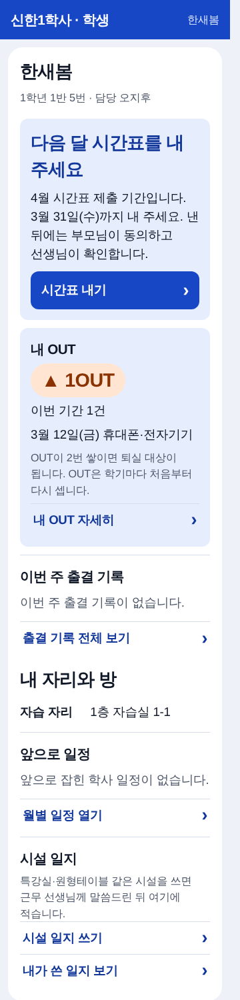
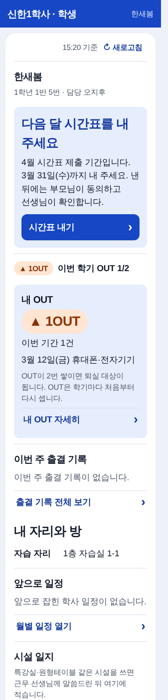

**노트북 1366×768** — 고치기 전 / 고친 뒤

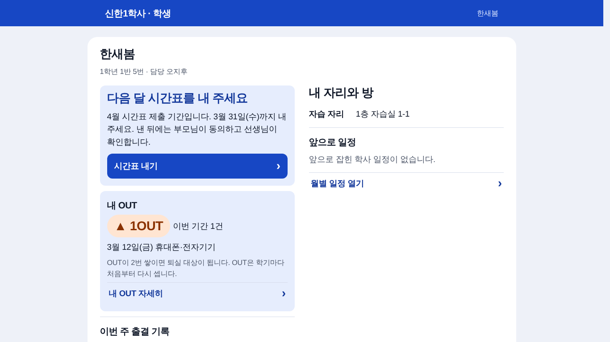
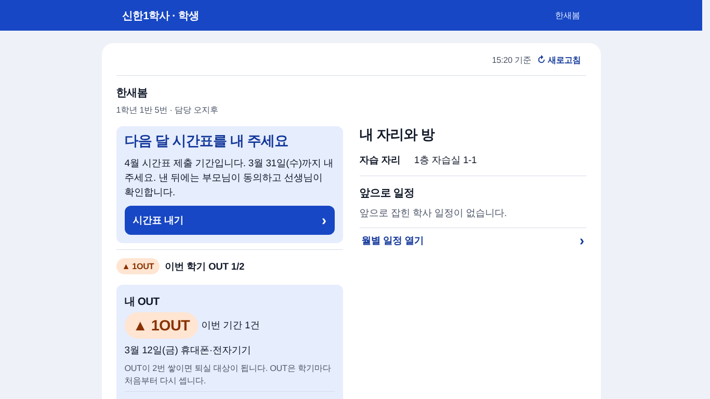

## 사진 — G5·G3 학부모 홈(포털)
**휴대폰 360×800** — 고치기 전 / 고친 뒤

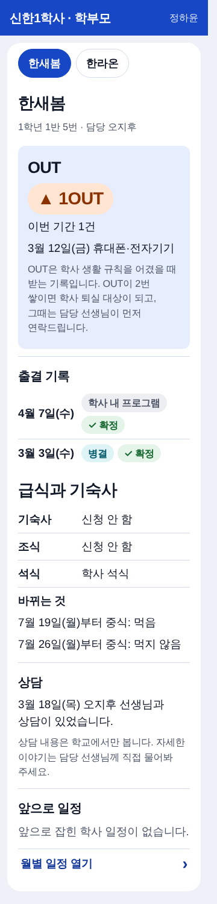
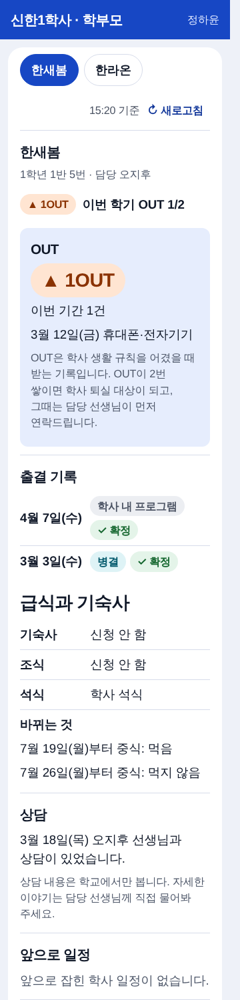

**노트북 1366×768** — 고치기 전 / 고친 뒤

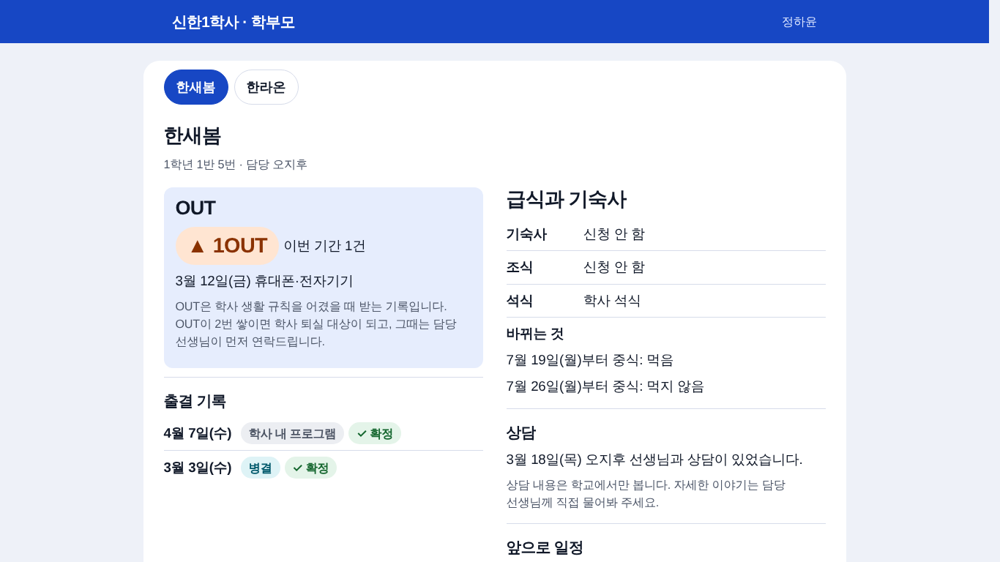
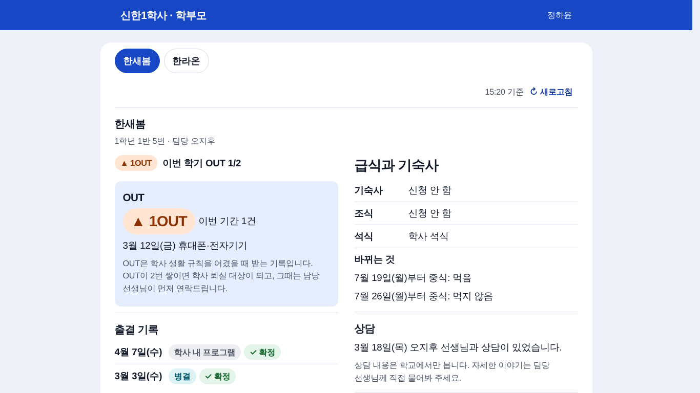

## 사진 — G3 교사 홈
**휴대폰 360×800** — 고치기 전 / 고친 뒤

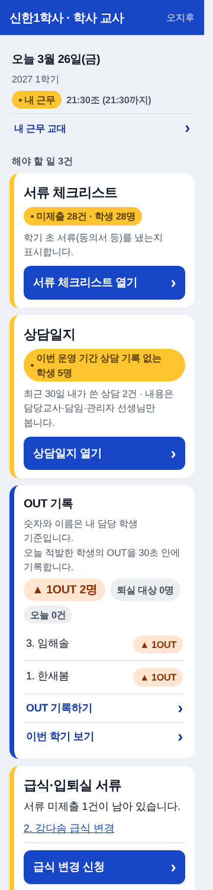
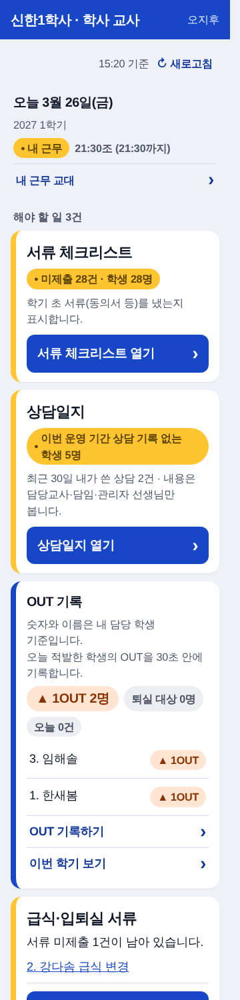

**노트북 1366×768** — 고치기 전 / 고친 뒤

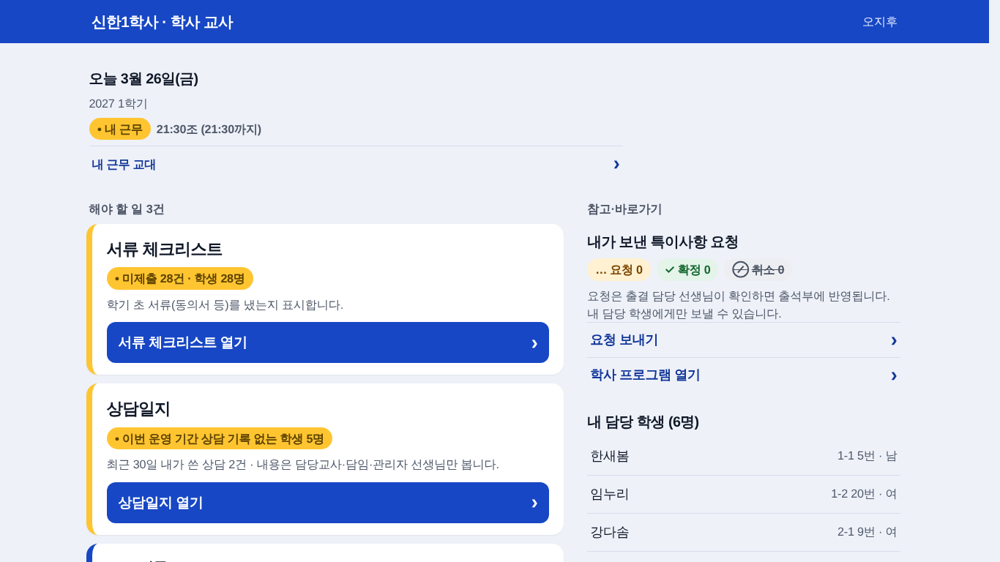
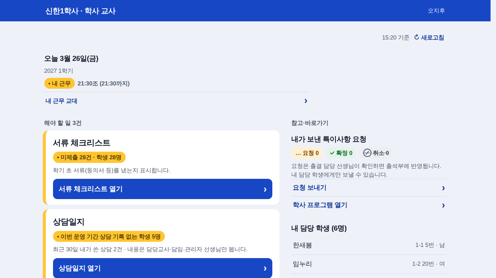

## 사진 — G1·G3 출결 담당 "요청 처리" 목록
**휴대폰 360×800** — 고치기 전 / 고친 뒤

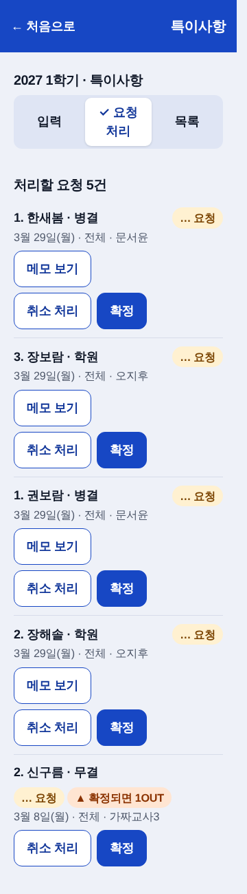
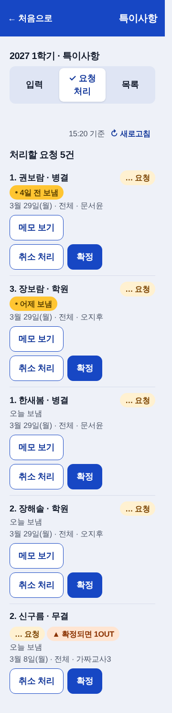

**노트북 1366×768** — 고치기 전 / 고친 뒤

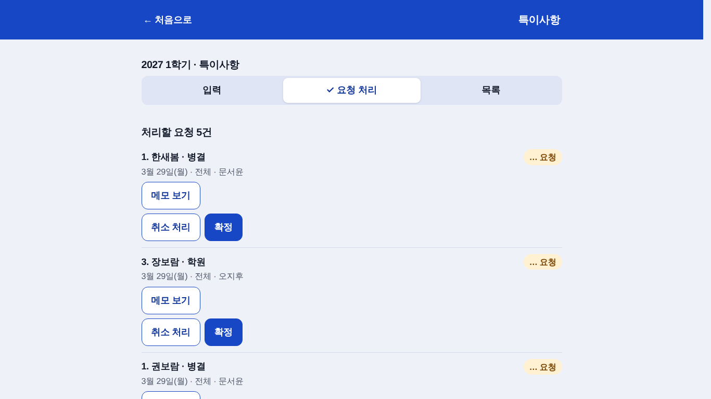
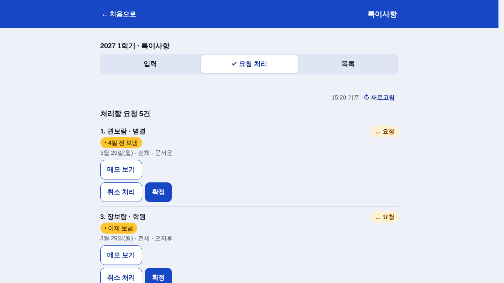

## 사진 — G8 결과 격자(고정)
**휴대폰 360×800** — 고치기 전 / 고친 뒤

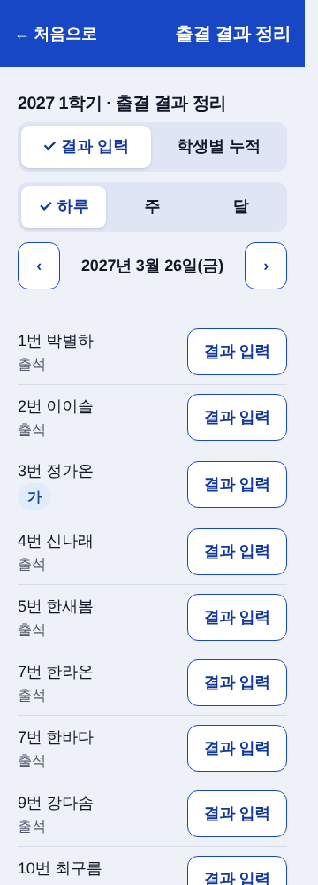

**노트북 1366×768** — 고치기 전 / 고친 뒤

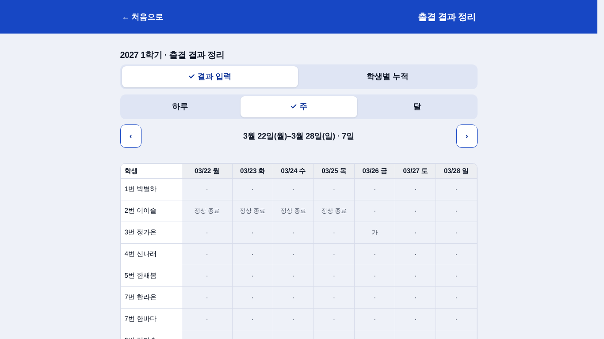
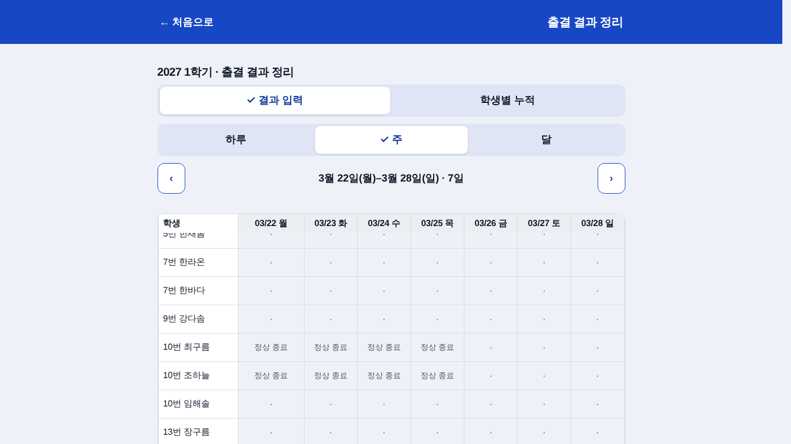

## 건너뛴 것·확인 못 한 것
- G1 경과는 서버 필드(`requestedAt`)가 생기기 전이라 사진은 화면에서 덧붙인 가짜 값으로만 봤습니다.
- 출석부 화면(`screen_sheet`) 고정은 위 이유로 하지 않았습니다.
- 새로고침을 눌렀을 때의 깜빡임·서버 호출 횟수는 사진으로 못 봤습니다(눌렀을 때 그 화면을 다시 불러오는 것이 전부).
- 학생 180명·요청 수십 건의 모습은 못 봤습니다.
- 실제 기기·실제 시계(한국 시각이 아닌 기기)는 못 봤습니다.
