# D17 — HR 근태 레퍼런스 Top 10 중 화면 몫(①·⑦·⑨)

근거: `docs/design/references-hr.md` 0절(When I Work 대시보드·BambooHR Who's out 등). 레퍼런스는 **배치·위계 수준**으로만 참고했고 색·글꼴·문구는 우리 것(결정 85·writing.md)입니다. 사진은 실제 화면을 가짜 서버에 띄워 찍은 것입니다(이름·숫자 모두 가짜, 가짜 오늘 2027-03-26 15:20). 고치기 전 = main, 고친 뒤 = 이 PR.

## 한 줄 요약
관리자·출결 담당 홈 맨 위에 **"오늘 처리할 것"** 줄 몇 개(건수 + 이름 ›)를 두고, 기능 카드 수십 장은 **"전체 기능"** 줄 링크 목록(숫자 배지)으로 내렸습니다(840px 이상은 왼쪽 레일). 학사 교사 홈에는 **"오늘 빠지는 학생"** 시간대 순 목록을 넣었습니다. 서버·권한·시트는 그대로입니다.

## ① 오늘 처리할 것 (`UI.todoList`)
- 건수가 **0보다 큰 줄만** 보입니다(0건은 숨김). 하나도 없으면 회색 한 줄 "지금 처리할 일이 없습니다."
- **관리자:** 특이사항 확인 대기 · 2OUT 대상 면담·퇴실 확정 · 복귀 예정일이 지난 임시 퇴실 · 서류 미제출 · 신청 서류 확인 · 시간표 확인 대기 · 근무표 빈 날.
- **출결 담당:** 특이사항 확인 대기 · 오늘 빠지는 학생 · 퇴실 대상(2OUT) · 복귀 예정일이 지난 임시 퇴실 · 서류 미제출 · 시간표 확인 대기.
- **지금 홈 데이터에 있는 숫자만** 나옵니다. 아래 숫자는 서버가 주지 않아 줄이 숨어 있고, 오면 자동으로 보입니다 → **코딩A에 넘길 것**:
  - 관리자 홈 `d.exc` = `{pending, today, tomorrow}` (출결 담당 홈에는 이미 있는 모양 그대로). 관리자는 확정 권한이 있어 같은 숫자를 줄 수 있음.
  - 두 홈 `d.moves = {overdue}` — 복귀 예정일이 지난 임시 퇴실 학생 수(이름 없이 숫자만).
  - 두 홈 `d.timetable = {confirmPending}` — 시간표 확인 대기 건수(교사 홈의 `timetable`과 같은 계산).
- 전체 기능으로 내린 카드: 운영 기간·명단 올리기·자습 일정·블록·사전 특이사항·출석부·좌석표(관리자), 오늘·내일 특이사항·출석부·좌석표·특이사항 요청 카드(출결 담당). 숫자·상태가 든 카드(OUT 기록, 근무표, 서류, 급식·인원, 기숙사 빈 자리 등)는 그대로 둡니다.

## ⑦ 처리할 수 배지 (`UI.featureList`)
- '전체 기능' 줄 옆에 **숫자 배지**(위 '처리할 것'과 같은 값, 0이면 안 보임): 사전 특이사항·OUT 기록·서류 체크리스트.
- 840px 이상에서는 왼쪽 레일 메뉴(`.rail`, 홈 왼쪽 열 맨 위). 역할이 둘 이상이면 기존 역할 전환 레일 옆에 하나 더 생깁니다.

## ⑨ 오늘 빠지는 학생 (학사 교사 홈)
- 기존 `listExceptions`(범위: 오늘~내일)를 홈 카드에서 불러 **확정**된 것만 시간대 순(전체 → 블록 글자 순 → 이름)으로 "블록 · 학년. 이름 · 유형 약어(학·가·병결…)" 한 줄씩. 요청 중인 것은 출석부에 아직 안 들어가므로 뺍니다. 서버 변경 없음.
- 순수 함수 `UI.util.whosOut`·`addDays` 시험 있음. 불러오지 못하면 "불러오지 못했습니다. 위의 새로고침을 눌러 주세요."

## 사진 — ① 관리자 홈
**휴대폰 360×800** — 고치기 전 / 고친 뒤

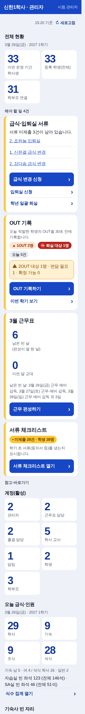
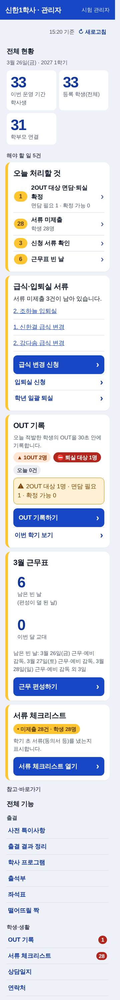

**노트북 1366×768** — 고치기 전 / 고친 뒤

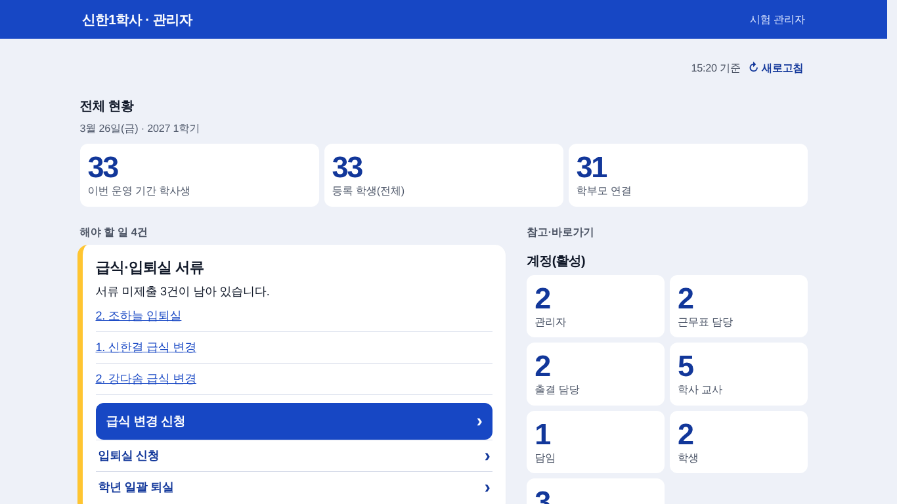
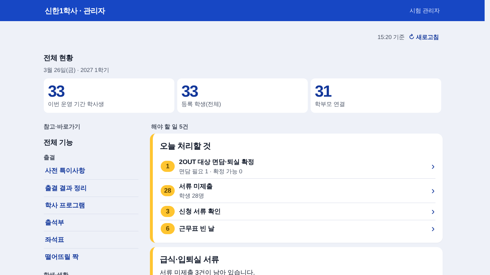

## 사진 — ① 출결 담당 홈
**휴대폰 360×800** — 고치기 전 / 고친 뒤

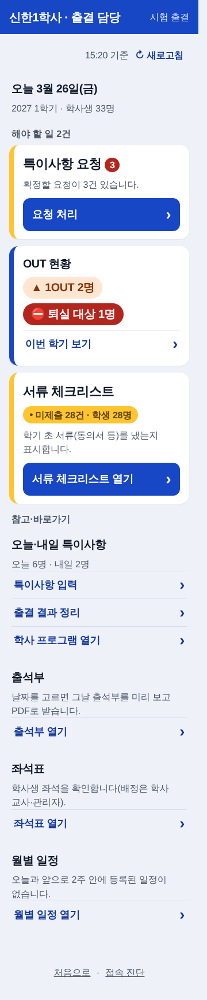
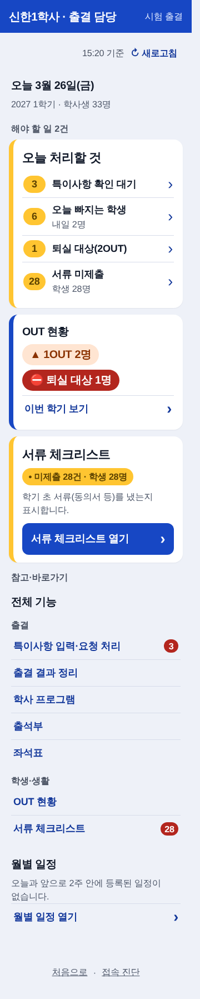

**노트북 1366×768** — 고치기 전 / 고친 뒤

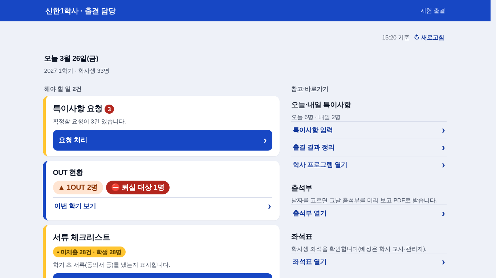
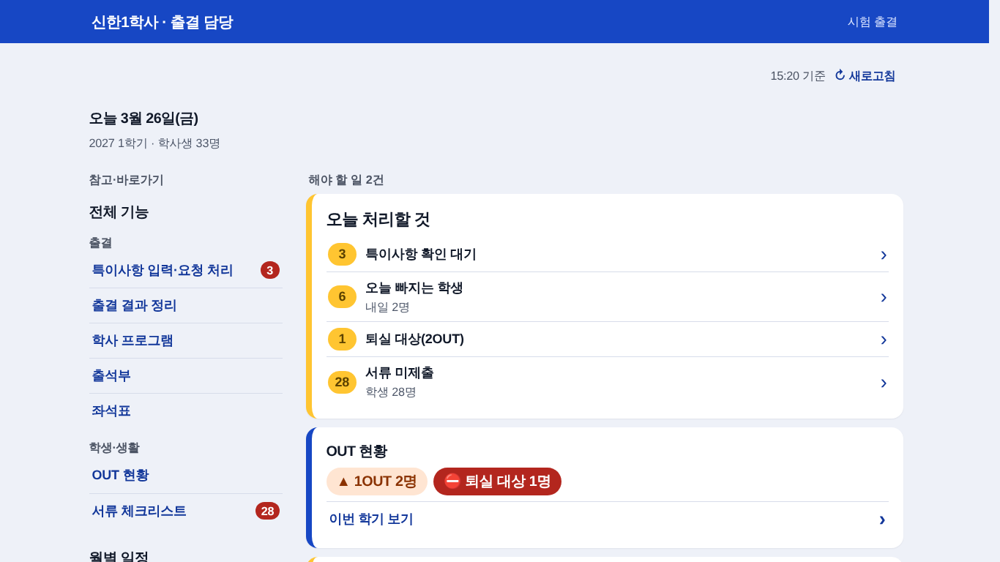

## 사진 — ⑨ 학사 교사 홈 — 오늘 빠지는 학생
**휴대폰 360×800** — 고치기 전 / 고친 뒤

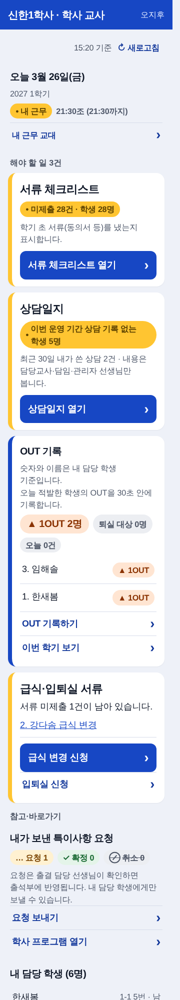
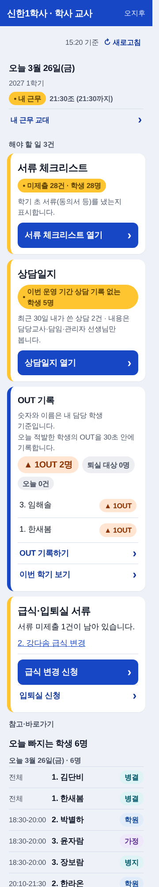

**노트북 1366×768** — 고치기 전 / 고친 뒤

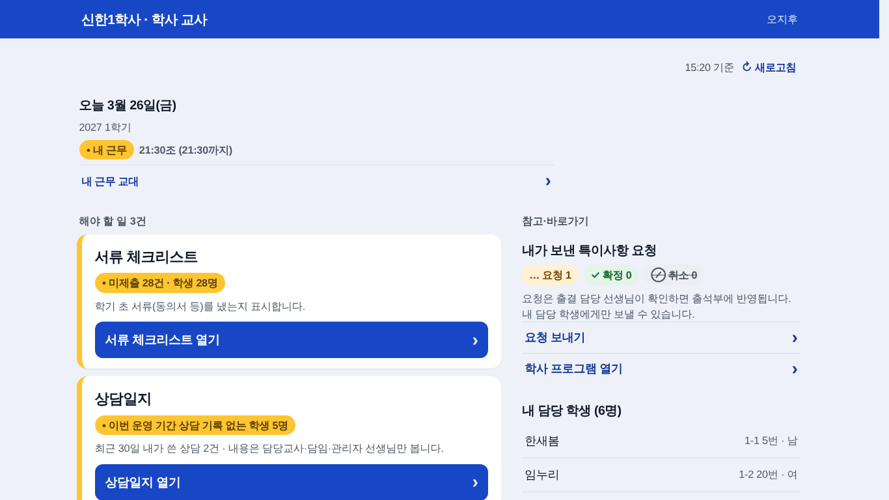
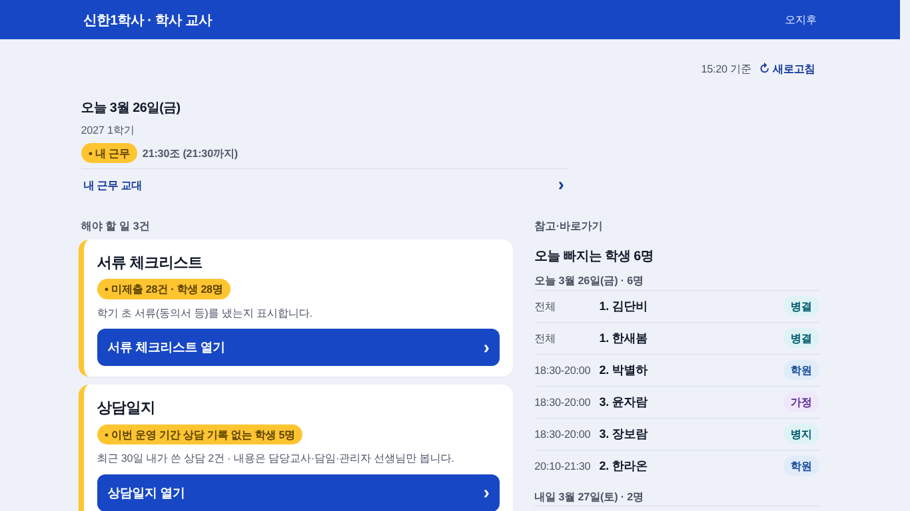

## 건너뛴 것·확인 못 한 것
- 관리자 홈은 카드가 아직 많이 남아(숫자·상태 카드) 휴대폰 길이는 약 5,260px → 5,130px로 크게 줄지 않았습니다. 숫자 카드까지 '처리할 것'으로 합치는 것은 서버 숫자가 갖춰진 뒤 다음 단계로 제안합니다.
- 위 서버 숫자(관리자 `exc`, `moves.overdue`, `timetable.confirmPending`)는 아직 없어서 해당 줄은 사진에 안 나옵니다.
- ⑦ 알림 종 모양의 전체 배지(모든 화면 공통)는 하지 않았습니다. 홈 목록 배지만.
- 근무 중일 때만 보이게 하는 것은 하지 않았습니다(학사 교사 홈에 늘 보임). 근무 날만 위로 올리는 것은 필요하면 다음에.
- 학생 180명·특이사항 수십 건, 실제 기기는 못 봤습니다.
