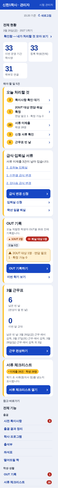
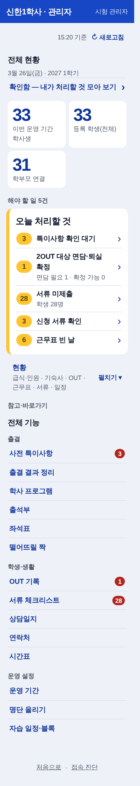
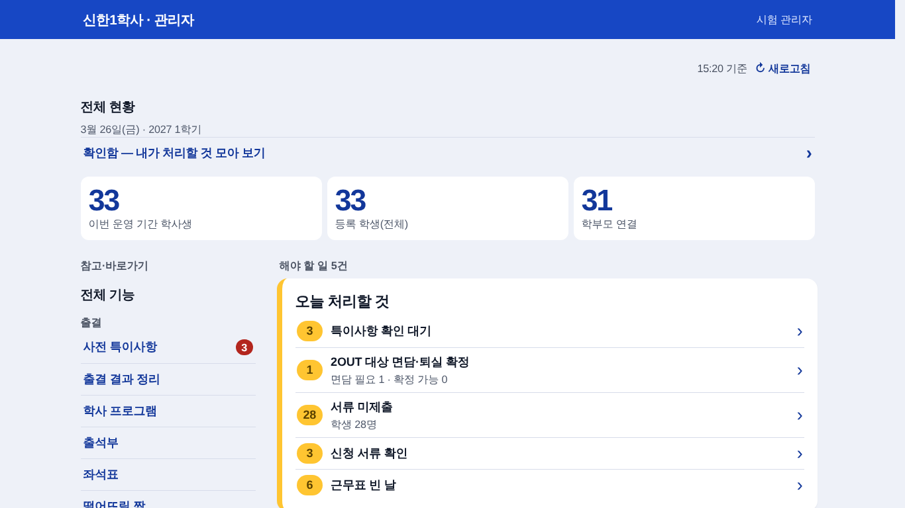
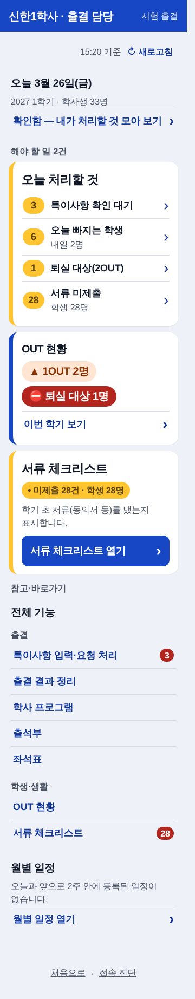
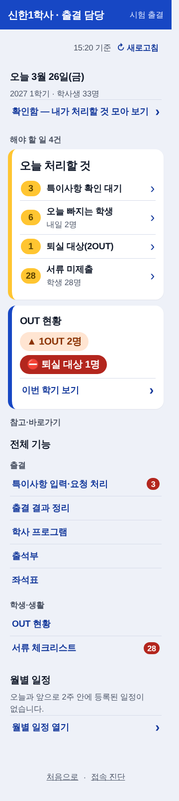
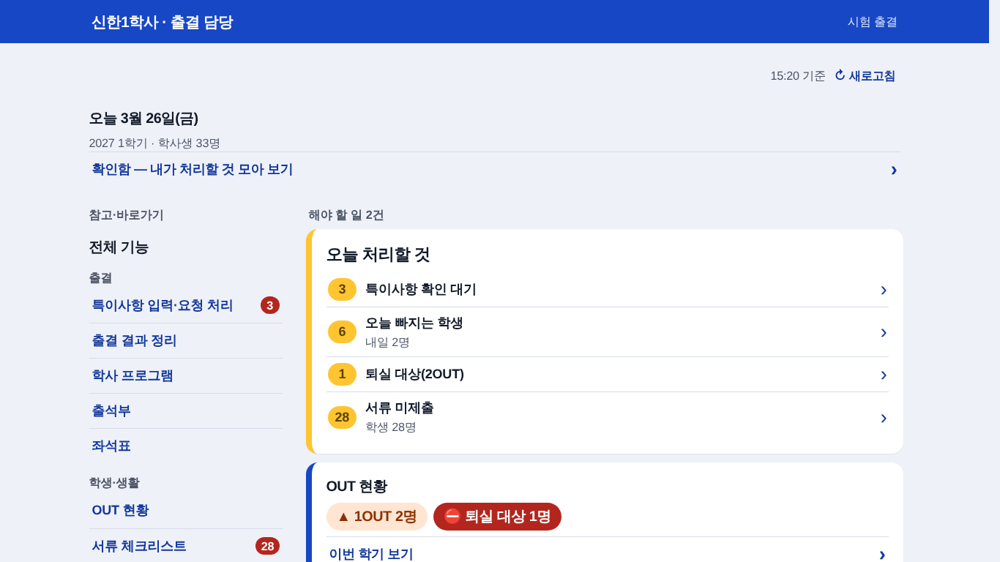
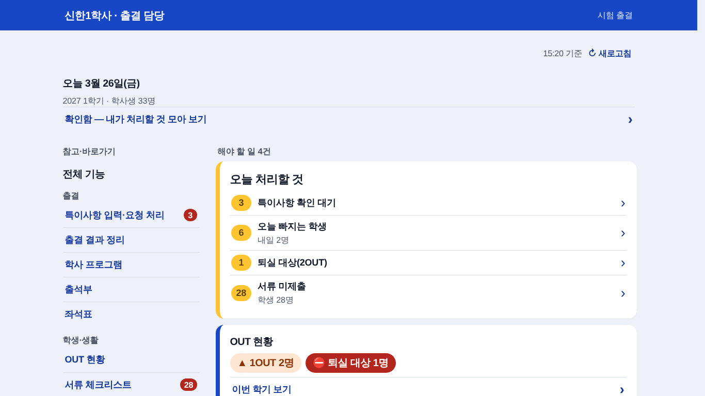
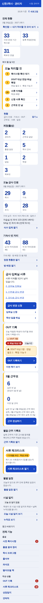
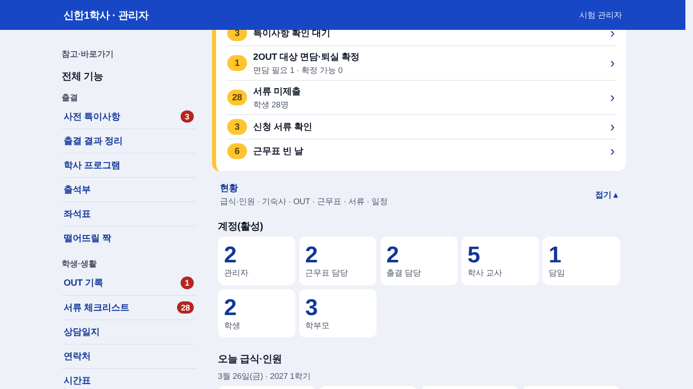

# D18 — 관리자 홈 '현황' 접기 · '해야 할 일' 숫자 · 출결 담당 정리

근거: 총괄 지시(C48 병합 뒤). 사진은 실제 화면을 가짜 서버에 띄워 찍은 것입니다(이름·숫자 모두 가짜, 가짜 오늘 2027-03-26 15:20). 고치기 전 = main(C48 포함), 고친 뒤 = 이 PR.

## 한 줄 요약
관리자 홈의 숫자·상태 카드 열두 장 남짓을 **접힌 '현황' 한 장**으로 묶어 휴대폰 길이를 **5,225px → 2,017px**(목표 약 2,600px보다 짧게)로 줄였습니다. '해야 할 일 N건'은 이제 **보이는 처리 줄 수**와 같고, 출결 담당 홈에서 권한 없는 '시간표 확인 대기' 줄을 지웠습니다. 서버·권한·시트는 그대로입니다.

## 바뀐 것
- **현황 접기(관리자 홈):** 맨 위 카드(전체 현황)·'오늘 처리할 것'·'전체 기능'은 그대로 두고, 나머지 카드(급식·인원, 기숙사 빈 자리, OUT 기록, 근무표, 월말 근무 기록표, 서류, 월별 일정, 시설 일지, 계정…)를 `
` 한 장 "현황 — 급식·인원 · 기숙사 · OUT · 근무표 · 서류 · 일정 [펼치기]"에 넣었습니다. 카드는 옮길 뿐 다시 만들지 않아 링크·동작은 그대로(펼치면 그대로 보임). 길이: 휴대폰 5,225 → 2,017px, 노트북 3,791 → 1,385px.
- **'해야 할 일 N건' 머리 숫자:** 이전에는 노란 띠 **카드 수**를 세어 바로 아래 '처리할 것' 줄 수와 엇갈렸습니다(출결 담당: 머리 2건·줄 4개). 이제 처리할 것 카드는 **줄마다** 세고 그 밖의 노란 띠 카드는 한 장에 1로 셉니다. 처리할 것 카드가 있으면 "지금 처리할 일이 없습니다" 줄을 두 번 쓰지 않습니다(`UI.layoutHome`).
- **출결 담당 홈:** '시간표 확인 대기' 줄 삭제(출결 담당은 시간표 확인 권한이 없어 눌러도 거부 화면이 열림). 같은 숫자를 하는 '서류 체크리스트' 노란 카드도 '처리할 것' 줄과 '전체 기능'에 이미 있어 지웠습니다.
- 접힌 현황 머리는 48px 이상, 키보드로 열고 닫을 수 있는 `
`입니다(숨은 정보가 아니라 접힌 정보 — 펼치기 글자가 늘 보임).

## 사진

### 관리자 홈
**휴대폰 360×800** — 고치기 전 / 고친 뒤

**노트북 1366×768** — 고치기 전 / 고친 뒤

### 출결 담당 홈
**휴대폰 360×800** — 고치기 전 / 고친 뒤

**노트북 1366×768** — 고치기 전 / 고친 뒤

### 관리자 홈 — 현황을 펼친 모습

## 건너뛴 것·확인 못 한 것
- 출결 담당 홈 길이는 1,845 → 1,604px로 조금만 줄었습니다(원래 짧아서 접지 않았습니다).
- 접힌 '현황' 안의 카드는 아직 예전 모양 그대로입니다(펼치면 보입니다). 각 카드를 한 줄 요약으로 줄이는 것은 하지 않았습니다.
- 접힌 현황 머리에 숫자(예: OUT 1 · 서류 28)를 미리 보이는 것은 하지 않았습니다(처리할 것에 이미 있음).
- 학생 180명·실제 기기는 못 봤습니다. 열고 닫은 상태를 기억하지는 않습니다(새로고침하면 다시 접힘).
