# D15 ⑤b 적용 — ③ 출결 결과 반 고르기 · ④ 서류 화면

선생님 답 "네 가지 모두 적용" 중 ③④입니다(①② 목록|상세는 PR ⑤a #279). 시안: `list-detail.md` 5절.
사진은 실제 화면을 가짜 서버에 띄워 찍은 것입니다(이름·숫자 모두 가짜, 가짜 오늘 2027-03-26). 고치기 전 = main, 고친 뒤 = 이 PR. 반 28개는 가짜 학생을 1학년 10반·2학년 10반·3학년 8반으로 흩뜨려 만들었습니다.

## ③ 출결 결과 — 반 고르기: 학년 먼저
- 반이 8개를 넘고 학년이 둘 이상이면 **학년 3칸을 먼저 고르고, 그 학년의 반만 한 줄(최대 10개)**에 보입니다. 칩 글자는 "1반"처럼 짧게(학년은 위에서 이미 고름). 반이 적으면(8개 이하) 지금과 같습니다.
- 서버 함수·권한은 그대로(`getResultGrid`의 `classes`를 화면에서 나눠 보일 뿐). 학년을 바꾸면 그 학년 첫 반으로 열립니다.

**노트북 1366×768** — 고치기 전(칩 28개) / 고친 뒤

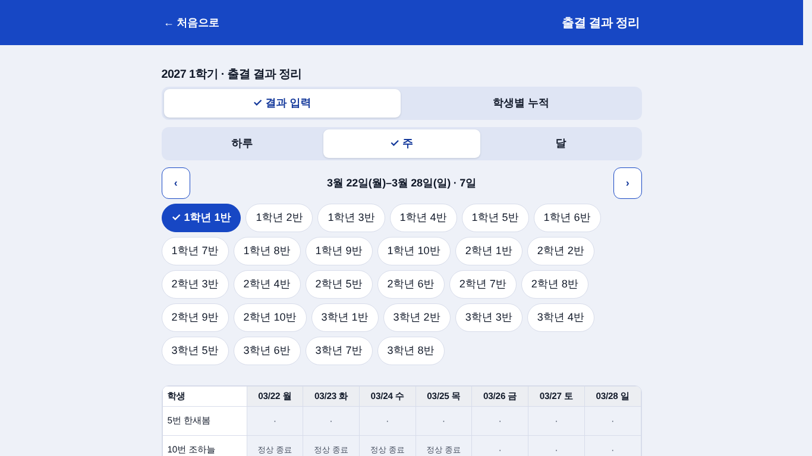
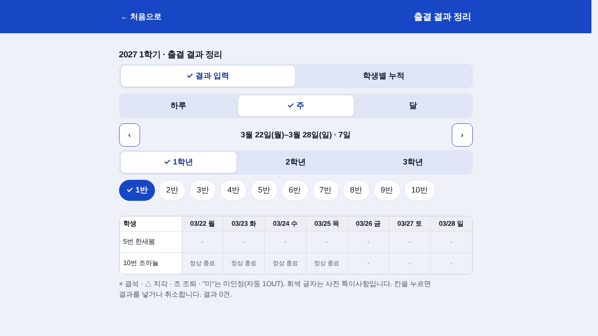

**노트북 1093×560(1366 화면 배율 125%)** — 고치기 전(칩 28개) / 고친 뒤

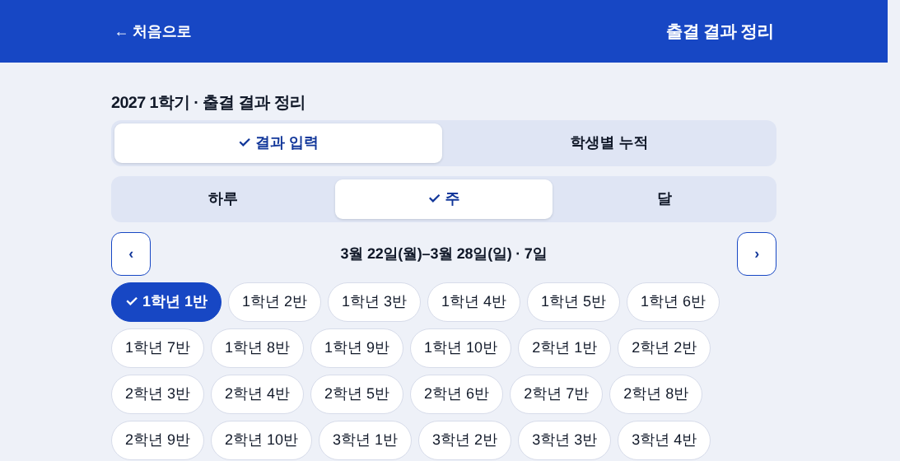
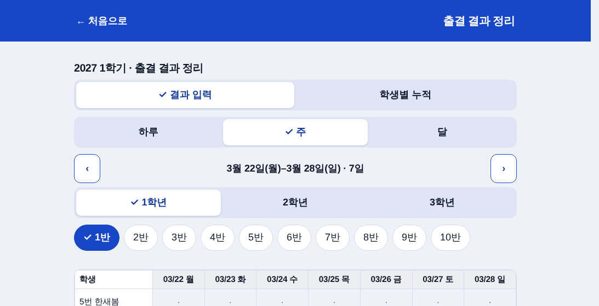

**휴대폰 360×800** — 고치기 전(칩 28개) / 고친 뒤

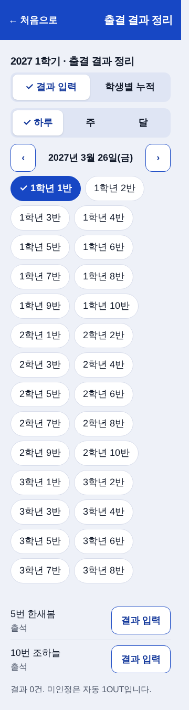
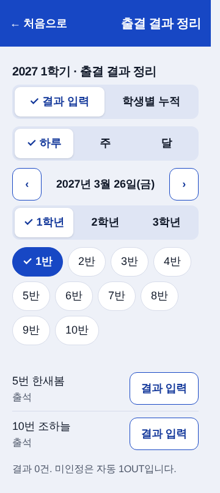

## ④ 서류 화면 — 상태 알약 하나 + 열기 + 시트 안 토글
- 줄마다 **상태 알약 하나 + [열기 ›]**: '미제출 목록'은 "못 받은 서류 N건"(노란 알약, 건수가 0보다 클 때만) 아래 못 받은 서류 이름을, '서류별'은 그 서류의 상태(✓ 제출 · 미제출 · 해당없음)를 보입니다. 줄 안에서는 상태를 바꾸지 않습니다.
- **못 받은 학생이 위로**: 미제출 목록은 못 받은 건수가 많은 학생부터, 서류별은 미제출 → 제출 → 해당없음 순.
- **[열기]를 누르면 시트**가 올라오고 서류마다 [제출][미제출][해당없음] 토글(지금과 같은 버튼). 저장은 **기존 `saveDocState` 그대로**(stale 확인·감사 기록 그대로): 바꾸면 목록을 다시 불러오고 시트도 새로 그립니다. 보기만 가능한 계정은 토글이 꺼져 있습니다.
- 학생 줄 표기는 앱 표기('1. 이름' + 둘째 줄 반·번호·담당).

**노트북 1366×768** — 고치기 전 / 고친 뒤

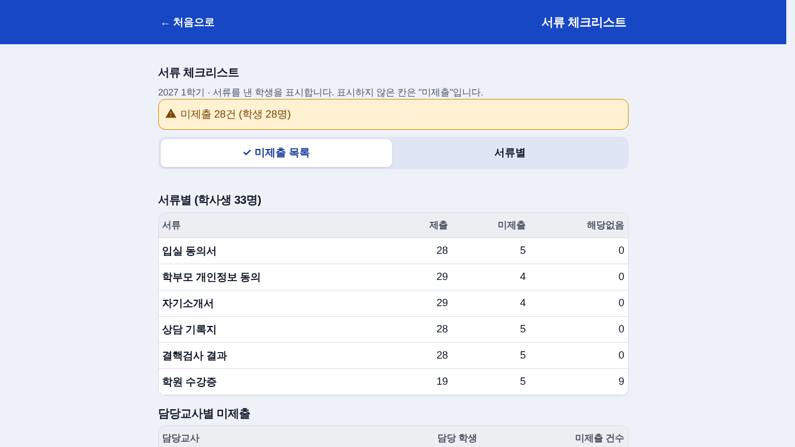

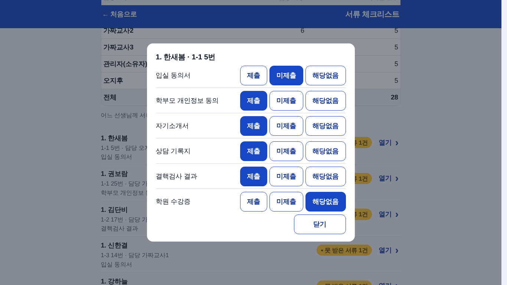

**노트북 1093×560(1366 화면 배율 125%)** — 고치기 전 / 고친 뒤

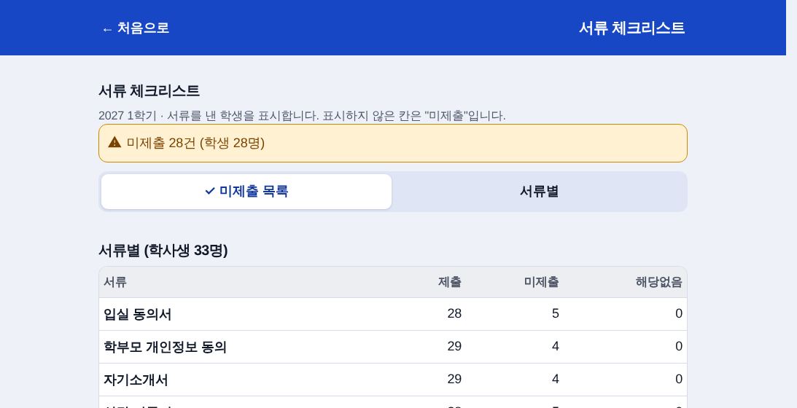
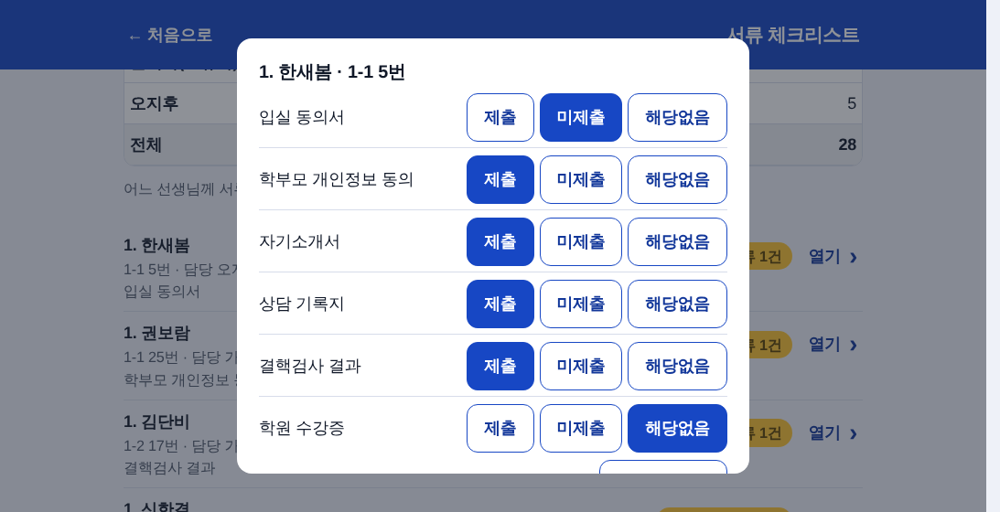

**휴대폰 360×800** — 고치기 전 / 고친 뒤

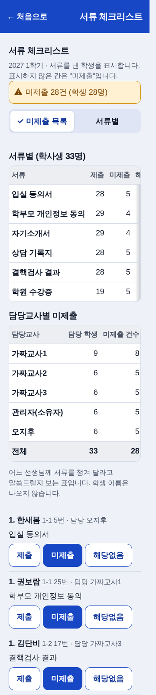
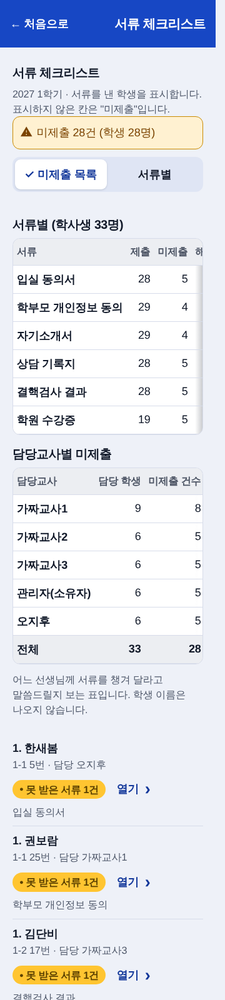
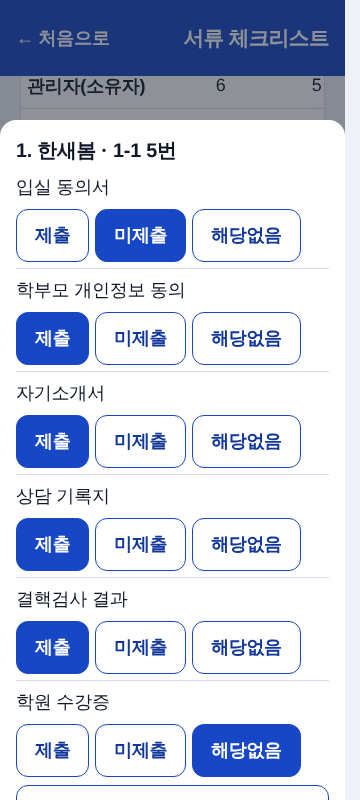

## 건너뛴 것·확인 못 한 것
- 서류 줄 수를 학생 180명으로 늘려 보지 못했습니다(가짜 학생 33명). 줄 하나가 훨씬 짧아져 길이는 줄지만, 직접 확인은 못 했습니다.
- 서류 화면 윗부분의 '서류별'·'담당교사별' 진행 표(관리자)는 바꾸지 않았습니다.
- 시트에서 토글을 연달아 누를 때의 느낌(저장 뒤 다시 불러오는 사이)은 사진으로 못 봤습니다. 동작은 바뀐 것이 없습니다(`busy`로 중복 방지).
- 실제 기기·실제 반 28개 데이터는 못 봤습니다.
