# D15 ⑤a 적용 — 목록 | 상세 (상담일지 · 출결 특이사항 목록 탭)

선생님 답 "네 가지 모두 적용" 중 ①②입니다(③ 반 고르기·④ 서류는 PR ⑤b). 시안: `list-detail.md`. **명단 올리기 두 칸은 하지 않았습니다**(선생님 결정).
사진은 실제 화면을 가짜 서버에 띄워 찍은 것입니다(이름·숫자 모두 가짜, 가짜 오늘 2027-03-26). 고치기 전 = main, 고친 뒤 = 이 PR.

## 한 줄 요약
노트북(너비 840px 이상)에서만 왼쪽 목록 · 오른쪽 상세 두 칸. 휴대폰·좁은 화면은 지금처럼 화면이 옮겨 간다(Nav 뒤로 가기 그대로).

## 바뀐 것
- **상담일지:** 학생 줄이 '1. 이름' + 둘째 줄 '반·번호'(앱 표기, `UI.util.studentLabel`). 줄 전체가 버튼이라 노트북에서는 목록이 늘 보이고, 고른 줄은 파란 띠 + 굵게(`aria-current`). 오른쪽에 상담 기록. 휴대폰은 줄 끝 "상담 보기 ›"와 "학생 바꾸기"가 그대로.
- **출결 특이사항 목록 탭:** 오늘·내일·이번 주·학생별 결과를 왼쪽 줄(이름·유형, 기간, 상태 알약)로 보이고, 오른쪽에 고른 묶음의 상세와 [확정]·[취소 처리](사유 시트 그대로). 줄을 누르면 서버를 다시 부르지 않고 두 칸만 다시 그린다. 입력·요청 처리 탭은 읽기 폭 그대로(목록 탭일 때만 넓은 본문).
- 서버 함수·권한·시트 구조·감사 기록은 그대로입니다. 목록에 나오는 학생은 서버(`getCounselContext`)가 이미 권한 범위로 거른 것만 씁니다.

## 서버 함수(총괄 지시 반영)
상담일지 왼쪽 목록은 **`getCounselRoster()`**(C42, #277)로 그립니다: `{ok, students:[{id, grade, classNo, number, name, count, lastDate}]}`. 서버가 '그 교사가 상담을 볼 수 있는 학생만'과 건수를 계산하고, 권한 없는 역할은 서버가 거부합니다. 둘째 줄은 `반·번호 · 상담 N건 · 최근 3월 22일(월)`(최근 날짜는 있을 때만). 학생 검색은 이 목록 안에서 거르기(이름·학번). 유형 목록·오늘 날짜는 기존 `getCounselContext`에서 받고, 오른쪽 상세는 기존 `getCounselNotes(studentId)` 그대로입니다.

## 상담일지 · 처음(학생 목록)
**노트북 1366×768** — 고치기 전 / 고친 뒤

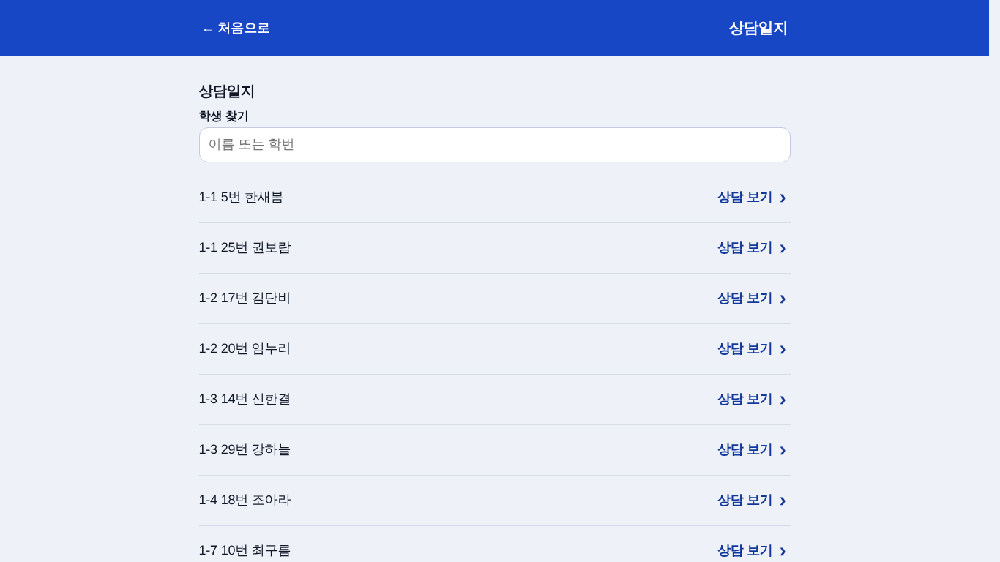
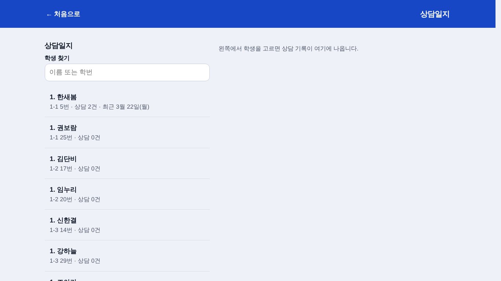

**노트북 1093×560(1366 화면 배율 125%)** — 고치기 전 / 고친 뒤

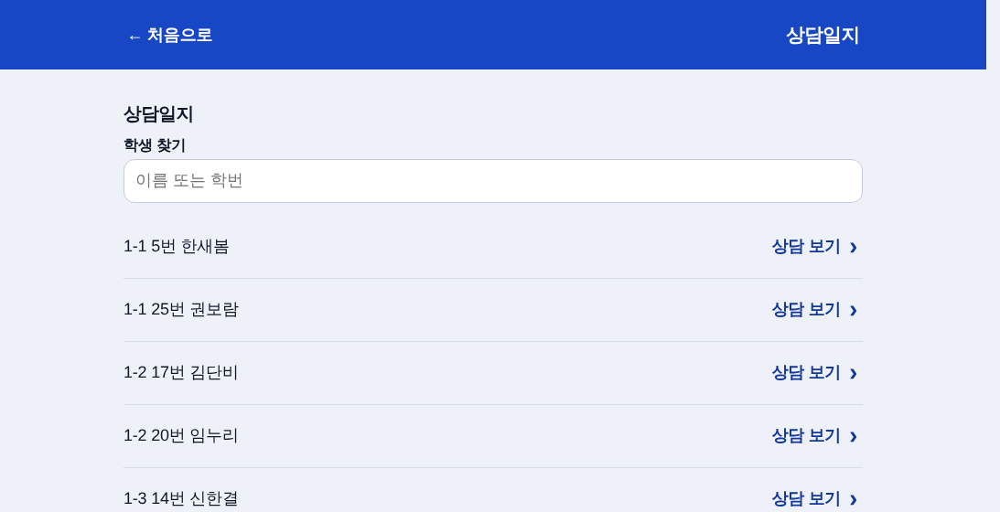
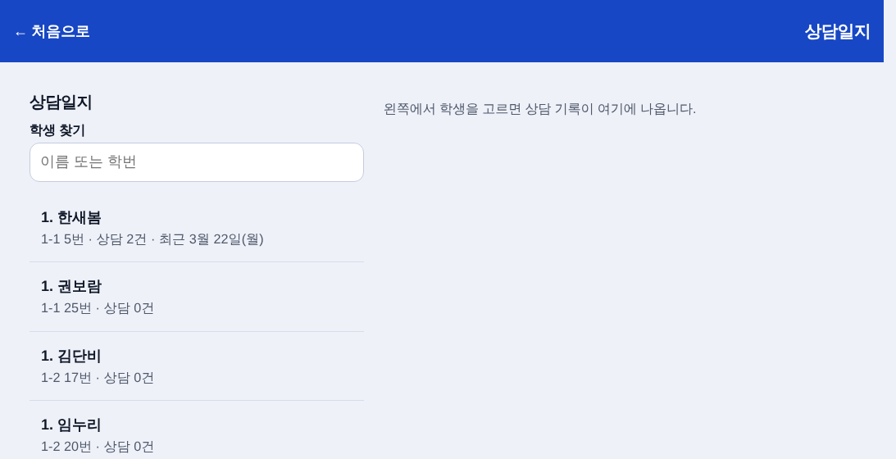

**휴대폰 360×800** — 고치기 전 / 고친 뒤

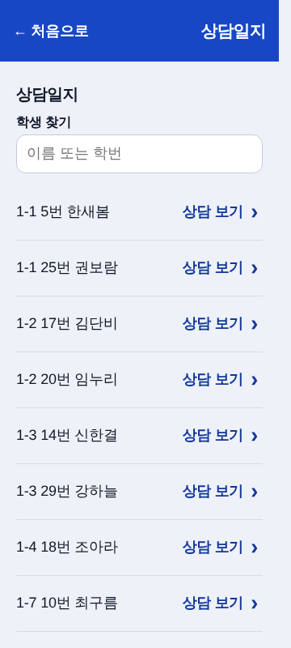
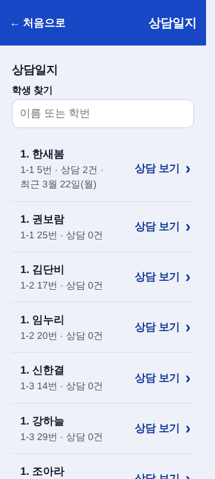

## 상담일지 · 학생을 연 모습
**노트북 1366×768** — 고치기 전 / 고친 뒤

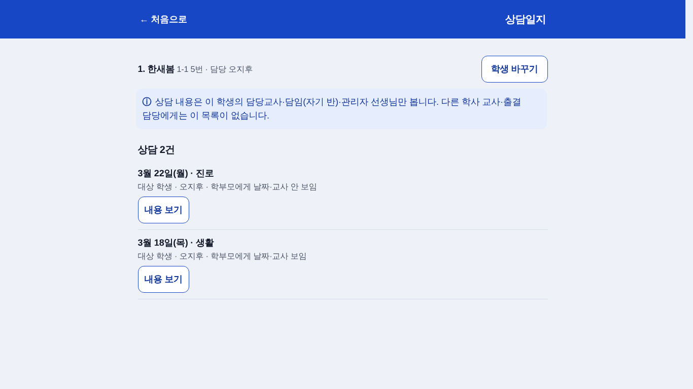
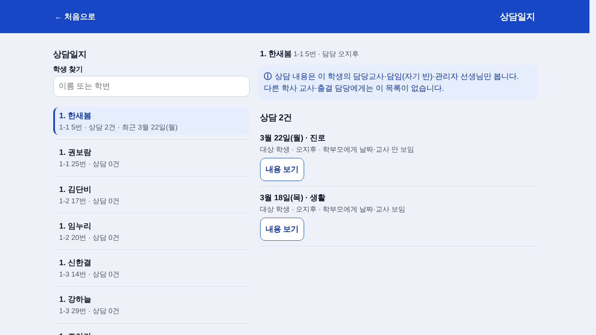

**노트북 1093×560(1366 화면 배율 125%)** — 고치기 전 / 고친 뒤

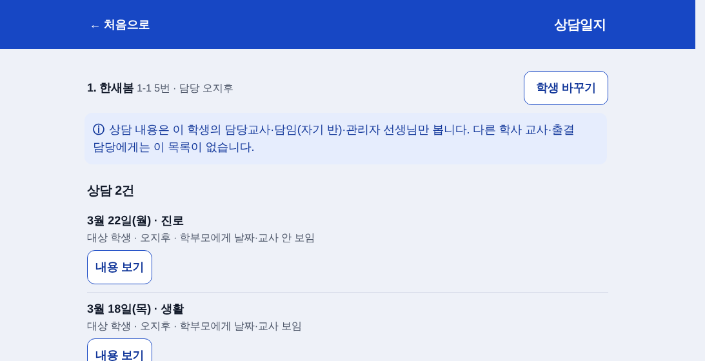
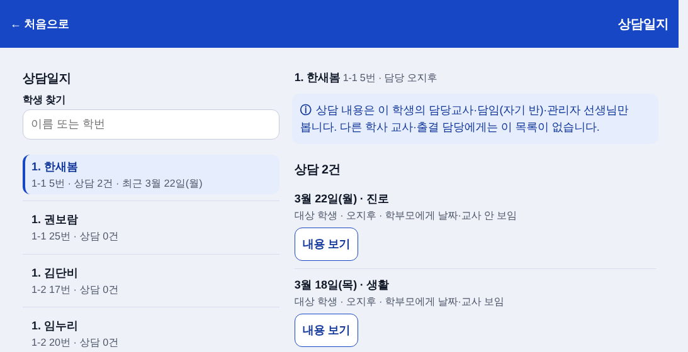

**휴대폰 360×800** — 고치기 전 / 고친 뒤

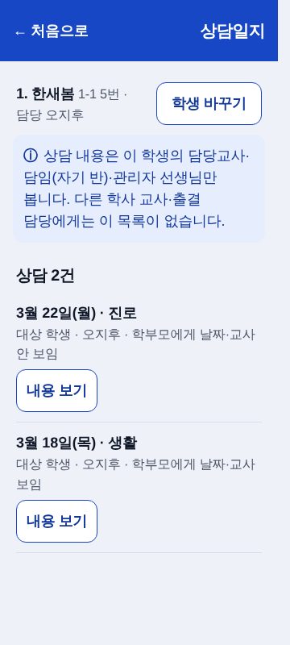

## 출결 특이사항 · 목록 탭
**노트북 1366×768** — 고치기 전 / 고친 뒤

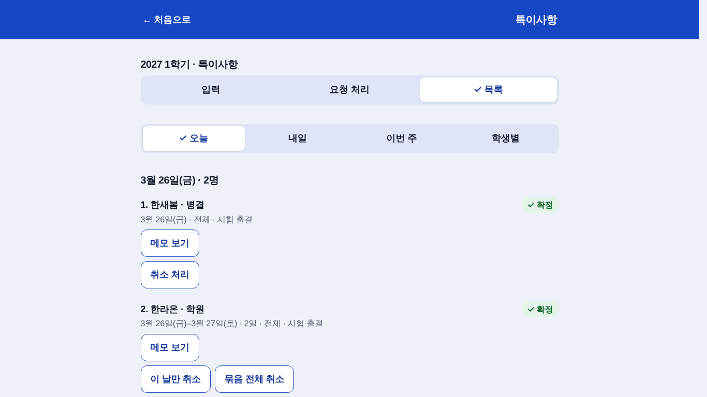
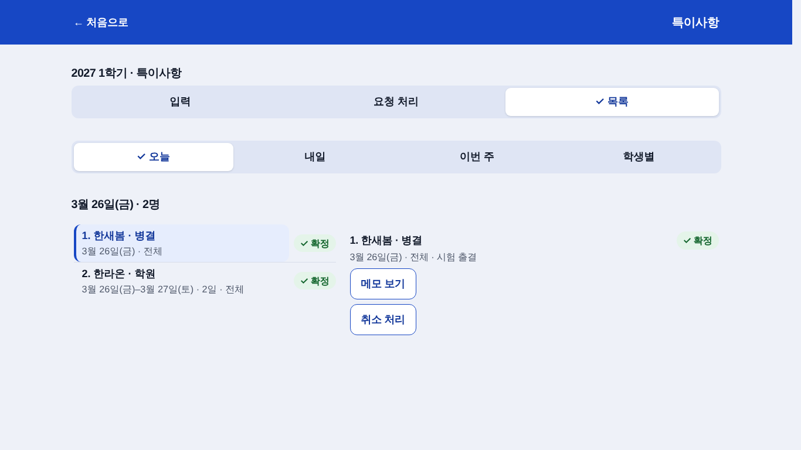

**노트북 1093×560(1366 화면 배율 125%)** — 고치기 전 / 고친 뒤

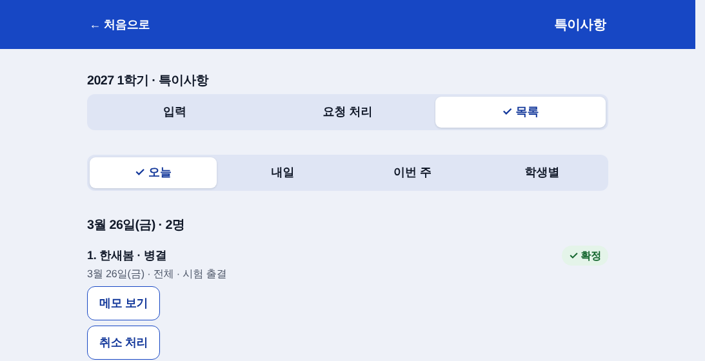
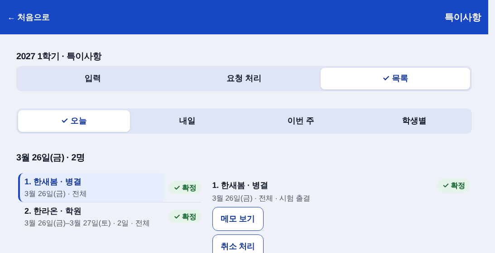

**휴대폰 360×800** — 고치기 전 / 고친 뒤

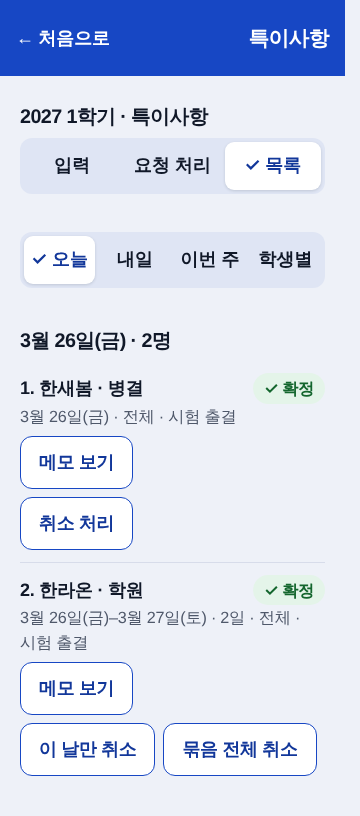

## 지킬 것(코드에 반영)
- 두 칸은 `@media (min-width: 840px)`에서만(Styles.html `.ld`). 좁으면 `.has-detail`일 때 목록을 숨겨 지금과 같이 번갈아 나온다.
- 줄은 `<button>`이라 Tab·Enter·Space로 열린다. 위·아래 화살표 이동은 하지 않았다.

## 건너뛴 것·확인 못 한 것
- 학생 180명일 때의 목록 길이(목록 안 스크롤)는 실제로 못 봤습니다. 가짜 학생 30명 안팎으로 찍었습니다.
- 노트북 1093×560은 크기만 흉내 낸 것이고 실제 기기는 못 봤습니다.
- 특이사항 목록이 많을 때(한 주 수십 건) 왼쪽 목록의 길이·스크롤은 가짜 5건으로만 봤습니다.
