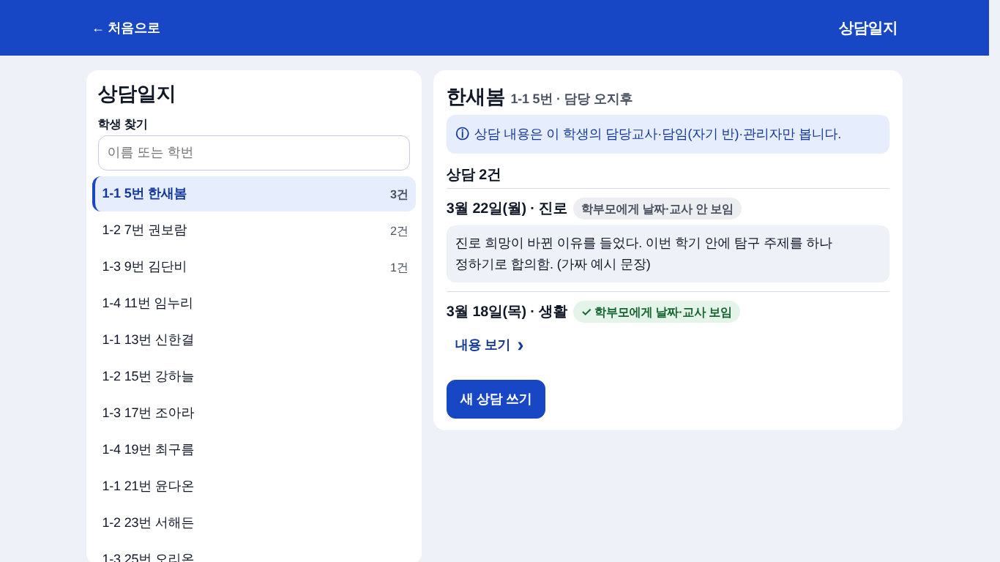
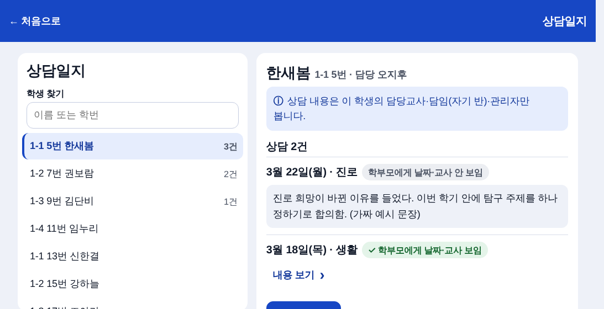
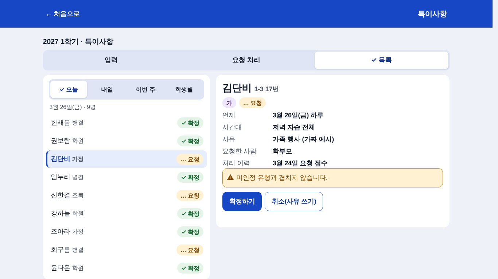
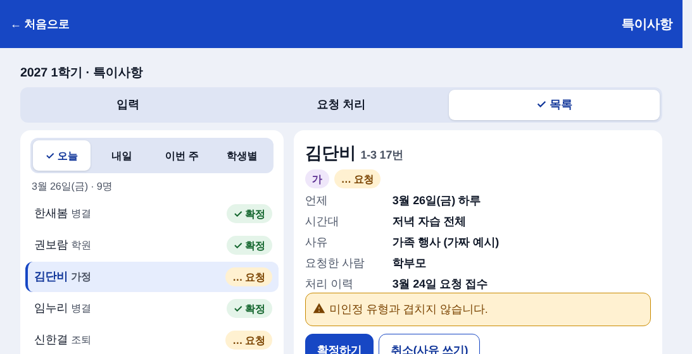
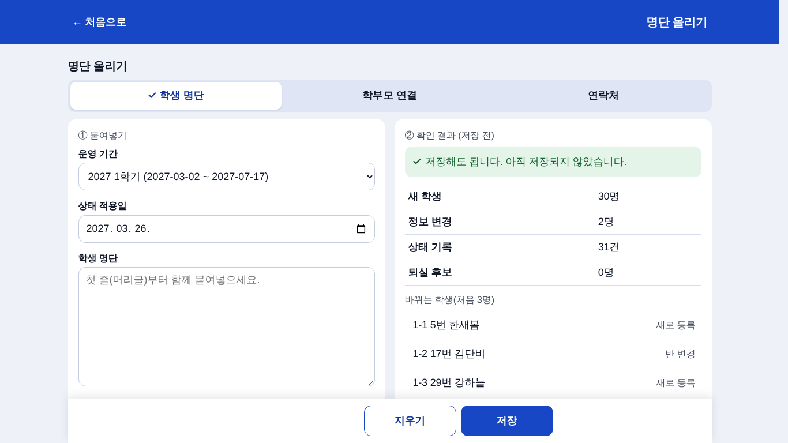
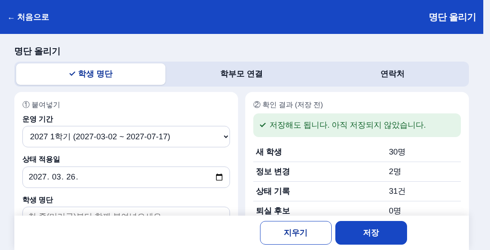
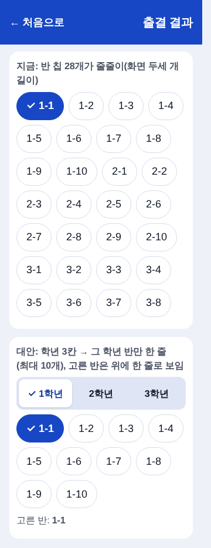
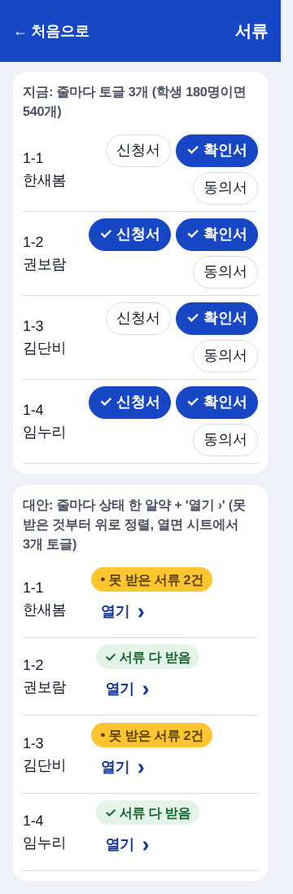
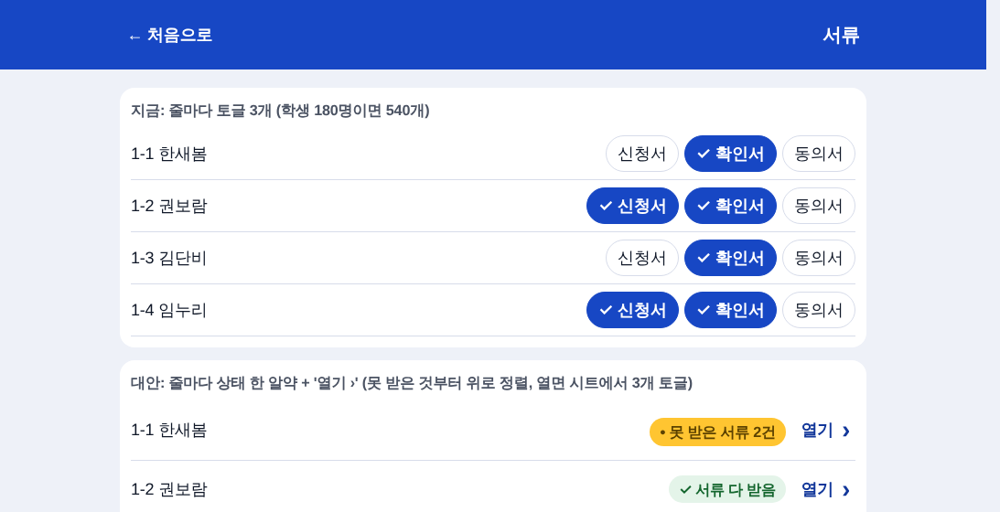

# D15 ④ 시안 — 목록 왼쪽 · 상세 오른쪽 (총괄 판단 ③, 선생님 확인용)

> **시안 단계입니다. 화면 코드는 바꾸지 않았습니다.** 선생님이 고르시면 PR ⑤에서 적용합니다. 사진은 실제 `Styles.html` 그대로 + 시안용 줄 몇 개만 덧붙인 가짜 쪽입니다(이름·숫자 모두 가짜). 만든 도구: `design/preview/refresh-listdetail.js`.

## 한 줄 요약
노트북(너비 840px 이상)에서만 **왼쪽에 목록, 오른쪽에 고른 항목의 상세**를 같이 보입니다. 휴대폰은 지금처럼 화면이 옮겨 갑니다(바뀌는 것 없음). 학생을 하나 볼 때마다 "학생 바꾸기"를 눌러 처음으로 돌아가던 왕복이 없어집니다.

## 1. 상담일지 — 목록 | 상세

- 왼쪽: 학생 찾기 + 학생 줄(상담 건수). 고른 줄은 파란 띠 + 굵게(색만으로 알리지 않음). 목록이 길면 **목록 안에서만** 스크롤(오른쪽 상세는 그대로).
- 오른쪽: 학생 머리말, 열람 범위 안내, 상담 건. "내용 보기"는 글자 버튼(줄 끝 `›`).
- 개인 정보 규칙은 그대로: 상담 내용은 담당교사·담임·관리자만. 화면 배치만 바뀌고 서버가 주는 것은 같다.

## 2. 출결 특이사항(목록 탭) — 목록 | 상세

- 입력·요청 처리·목록 탭은 위에 그대로 둡니다. **목록 탭만** 두 칸이 됩니다.
- 왼쪽: 오늘/내일/이번 주/학생별 + 줄마다 상태 알약(✓ 확정, … 요청). 오른쪽: 유형·시간대·사유·처리 이력과 **확정하기 / 취소(사유 쓰기)**.
- 취소는 지금처럼 사유를 받고 "취소"로 남깁니다(삭제 없음).

## 3. 학생 명단 올리기 — 입력 | 결과 (※ 목록·상세가 아니라 '입력 | 결과')

- 이 화면은 학생 목록을 고르는 화면이 아니라 **붙여넣고 → [확인] → 결과를 보고 → 저장**하는 화면입니다. 그래서 같은 두 칸 틀이지만 왼쪽은 붙여넣기, 오른쪽은 확인 결과(새 학생·정보 변경·퇴실 후보)로 쓰자는 제안입니다. 결과를 보려고 아래로 내려가는 일이 없어집니다.
- 의견이 갈릴 수 있는 곳: 명단 올리기는 학기에 몇 번 안 쓰므로 **안 해도 큰 손해는 없습니다.** 상담일지·특이사항을 먼저 하고 이것은 뒤로 미뤄도 됩니다.

## 4. 휴대폰·좁은 노트북
- 휴대폰(599px 이하)·작은 화면: **지금과 같음**(목록 → 상세로 이동). 시안의 두 칸은 840px 이상에서만.
- 1093px(화면 배율 125%): 위 사진처럼 왼쪽 약 40%·오른쪽 약 60%로 맞습니다. 목록 줄이 너무 좁아지면(이름 줄바꿈) 목록 최소 너비 280px에서 멈춥니다.

## 5. 후속 후보 대안 (각 한 장)
**출결 결과의 반 칩 28개** — 지금은 칩 28개가 줄줄이 쌓여 화면 두세 개 길이입니다. 대안: 학년 3칸을 먼저 고르고 그 학년의 반(최대 10개)만 한 줄에 보입니다.

**서류 화면의 줄마다 토글 3개** — 지금은 학생 한 명에 토글 3개(180명이면 540개). 대안: 줄마다 상태 한 알약(못 받은 서류 N건 / 다 받음) + "열기 ›", 못 받은 학생이 위로 올라오고, 열면 시트에서 3개를 토글합니다.

## 6. 선택지와 권장
| 선택 | 내용 |
|---|---|
| 가 (권장) | 상담일지 + 특이사항 목록 두 화면만 적용(PR ⑤). 명단 올리기는 보류 |
| 나 | 세 화면 모두 적용 |
| 다 | 적용하지 않음(지금대로) |
반 칩·서류 대안은 각각 **채택/보류**만 정하면 됩니다.

## 7. 구현할 때 지킬 것(PR ⑤에 적용)
- 두 칸은 `@media (min-width: 840px)`에서만, 순수 CSS(`.ld`)로. 서버 함수·권한·시트 구조는 건드리지 않는다.
- 목록 고른 줄에는 `aria-current="true"`, 키보드 위·아래 화살표로 줄 이동은 **하지 않는다**(제안만 — 마우스·탭으로 충분).
- `tests/design/css-util.js`는 @media 래퍼를 무시하므로 두 칸 규칙의 안전 영역·폭을 테스트에 따로 적는다.

## 건너뛴 것·확인 못 한 것
- 실제 화면 코드는 바꾸지 않았습니다(시안만). 실제 데이터로 목록이 180명일 때의 모습은 못 봤습니다(시안은 학생 16명).
- 실제 윈도우 노트북·화면 배율 125%의 진짜 기기는 못 봤고, 1093×560은 크기만 흉내 낸 것입니다.
