# D15 화면 새 단장 — 1단계 방향 시안 (코드 병합 없음, 시안만)

> 선생님 말씀(총괄 전달): "UI UX writing도 신경 쓰고 프론트엔드 디자인 좀 잘 잡아줘. 너무 밤티나고 별로야."
> 이 문서는 **방향 세 가지**를 같은 실제 화면 다섯 장에 입혀 나란히 보여 드립니다. **고르는 것은 선생님**입니다. 이 PR은 `src/`를 바꾸지 않습니다(시안 CSS는 `design/preview/refresh/`에만 있습니다).
> 사진은 정적 그림이 아니라 **main의 실제 화면**(`src/ui`)에 CSS만 덧씌워 360px 휴대폰 폭으로 찍었습니다(`node design/preview/refresh.js`). 이름·숫자는 모두 가짜 데이터, 가짜 오늘 2027-03-26입니다. 문구는 지금 문구 그대로입니다(문구 정리는 자료조사 세션의 `docs/design/writing.md`가 맡음).

## 1. 지금 화면이 왜 밋밋해 보이는지 — 총괄 진단 7가지와 이 시안의 답

| # | 진단 | 세 방향이 공통으로 한 것 |
| --- | --- | --- |
| 1 | 모든 덩어리가 똑같은 흰 테두리 카드 — 위계가 없다 | **카드는 "할 일"(`.todo`)과 "중요"(`.key`)에만.** 참고 정보(자리·일정·시설 일지)는 상자 없이 줄로 나눈다 |
| 2 | 글자 크기 위계가 약하다, 숫자가 안 보인다 | 이름 1.5~1.6rem, 구역 제목 1.15rem 굵게(본문 1rem과 차이), **OUT 알약 1.5~1.7rem**, 숫자 칸 2.4rem |
| 3 | 버튼이 반쪽 너비 + 테두리 보조 버튼이 입력칸처럼 보임 | 할 일 상자의 **주 버튼 하나만** 폭 가득. 나머지는 **"열기 ›" 줄(48px)**. 한 카드에 버튼이 세로로 쌓이던 시설 일지는 줄 두 개로 |
| 4 | 빈 상태가 자리를 너무 차지 | 가운데 정렬·큰 여백을 없애고 왼쪽 정렬 한 줄 |
| 5 | 상태 알약 모양이 제각각(점선·이중선·실선) | **모양 하나**(테두리 없음). 구분은 **앞 글자(✓ … ⊘ ▲ ●)와 글자와 바탕색** — 색만으로 알리지 않는 규칙은 그대로 |
| 6 | 머리줄이 밋밋, 정체성 없음 | 방향마다 머리줄과 색 한 가지를 정했다(아래) |
| 7 | 시설 일지 '끝나는 시각' 칸이 카드 밖으로 나감 | 세 방향 모두 `.fc-times .field { min-width: 0 }`로 **카드 안에 들어온다**(코딩A에 따로 보낸 버그와 같은 줄) |

## 2. 세 방향 한 줄 설명

| 방향 | 한 줄 | 색 | 머리줄 | 카드 | 글꼴 |
| --- | --- | --- | --- | --- | --- |
| **A 종이·잉크** | 종이 위에 먹으로 쓴 것처럼 조용하다. 구분은 선과 굵기로만 | 먹색 하나(`#1c2a4a`) + 상태색 | 바탕과 같은 색 + 아래 굵은 먹줄 | 가는 줄 구역. 할 일만 먹색 테두리 상자 | 기기 기본 |
| **B 또렷한 브랜드색** | 열자마자 "신한1학사"로 알아보게 색을 머리줄 한 곳에 몰아 쓴다 | 코발트(`#1747c4`) + 강조 노랑(할 일·확인 필요에만) | 코발트 면 + 흰 글자 | 참고는 상자 없음. 할 일은 노란 띠, 중요는 코발트 띠가 있는 흰 상자 | **Pretendard**(이 방향만 웹폰트) |
| **C 부드러운 묶음** | 둥글고 큰 글씨로 부담을 낮춘다. 한 장의 흰 판 안에서 위에서 아래로 읽는다 | 초록청(`#0d6b57`) 하나 | 흰 바탕 + 큰 제목 | 화면 전체가 흰 판 하나, 구역은 줄. 할 일은 연한 초록 상자 | 기기 기본 |

### 학생 홈 — 지금과 세 방향

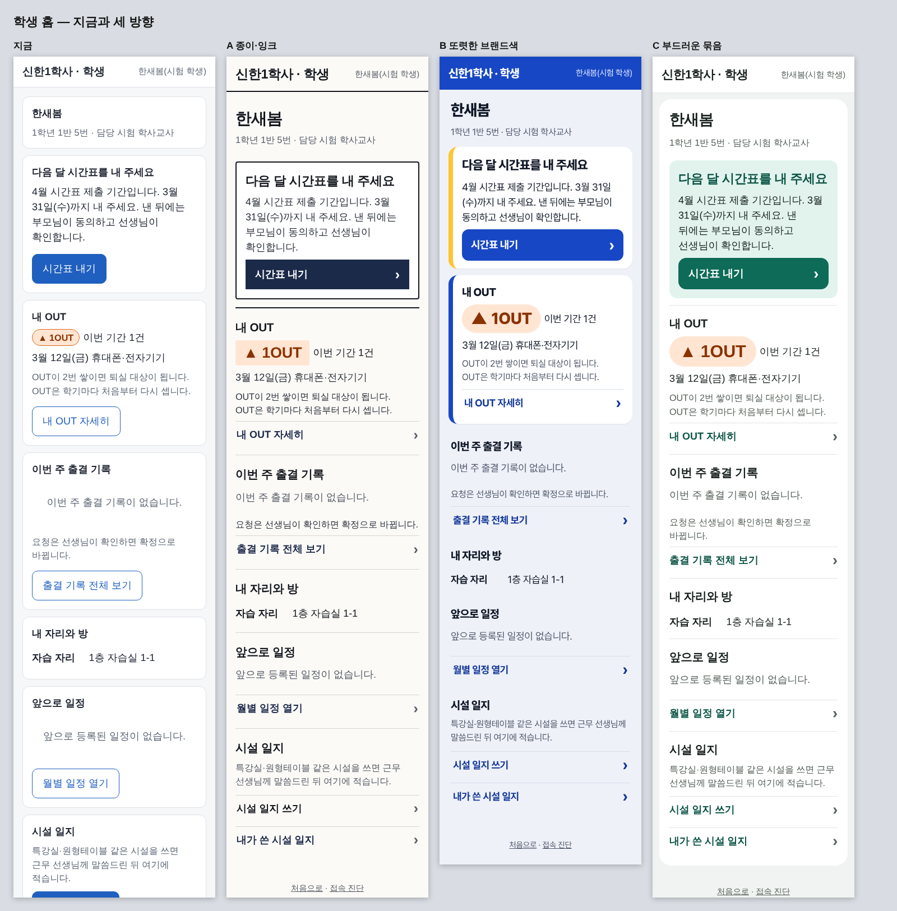

### 학부모 홈

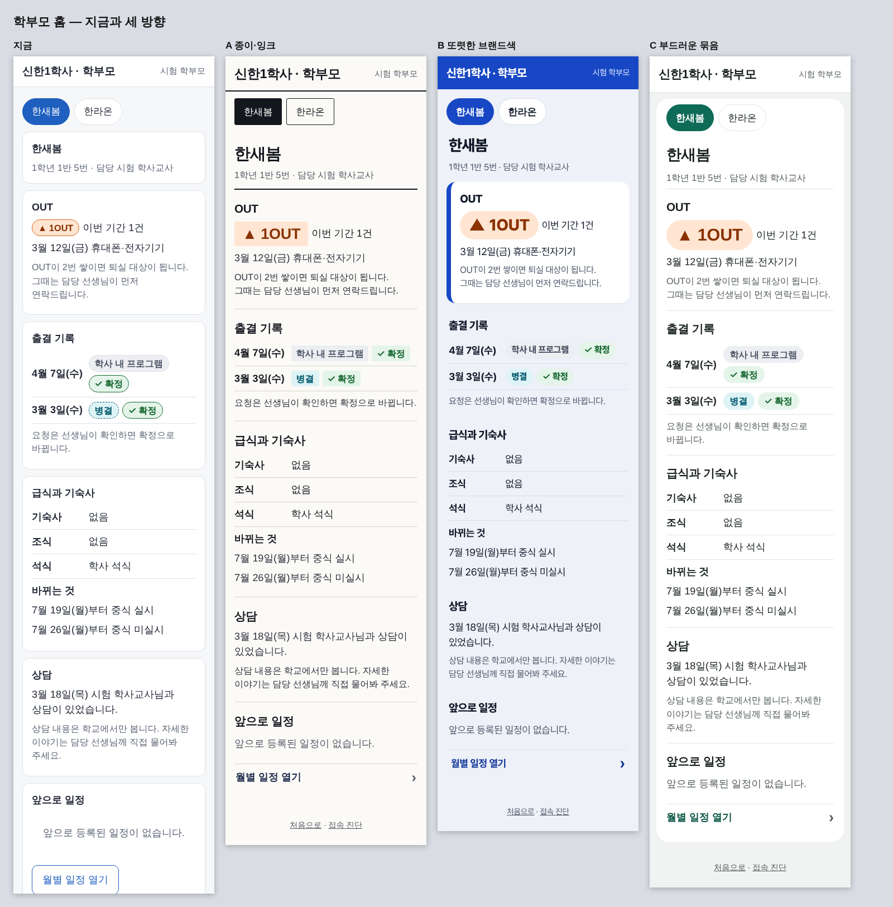

### 학사교사 홈 (위쪽 1500px만)

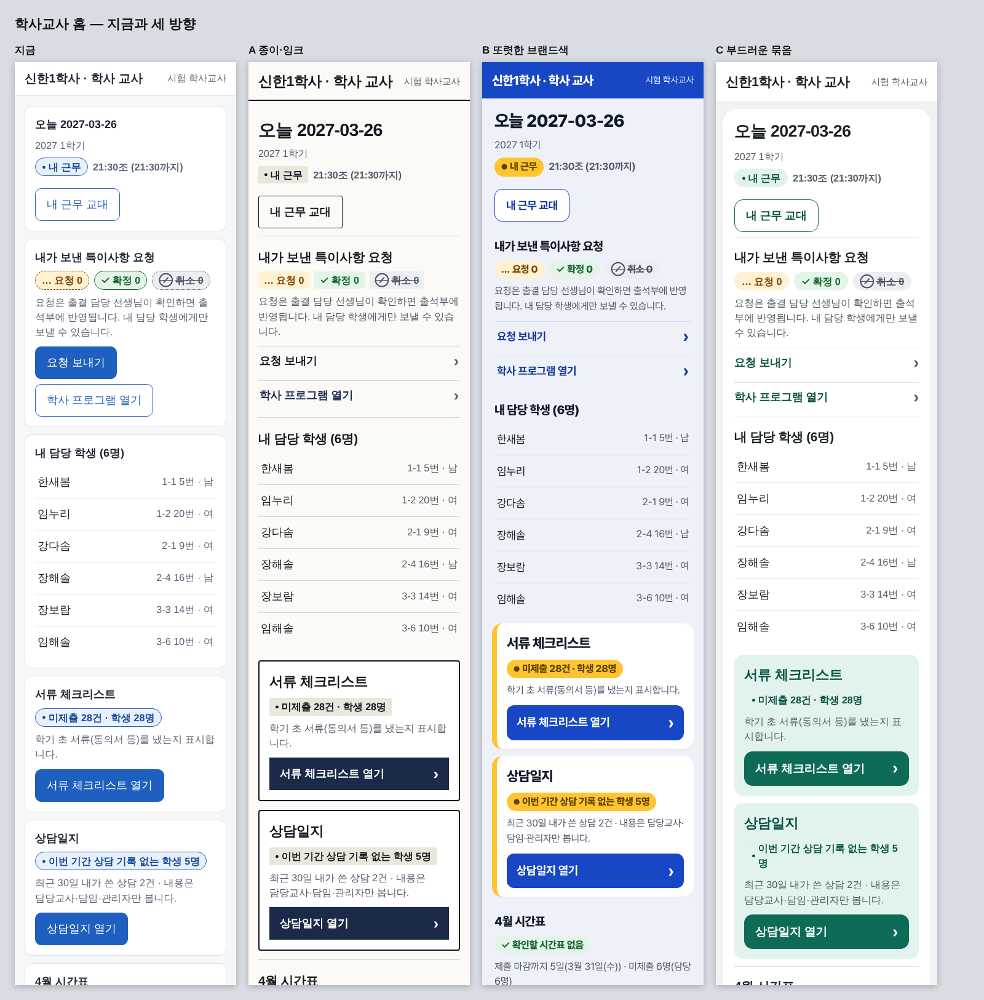

### 시설 일지 쓰기 (끝나는 시각 칸이 카드 안으로 들어옴)

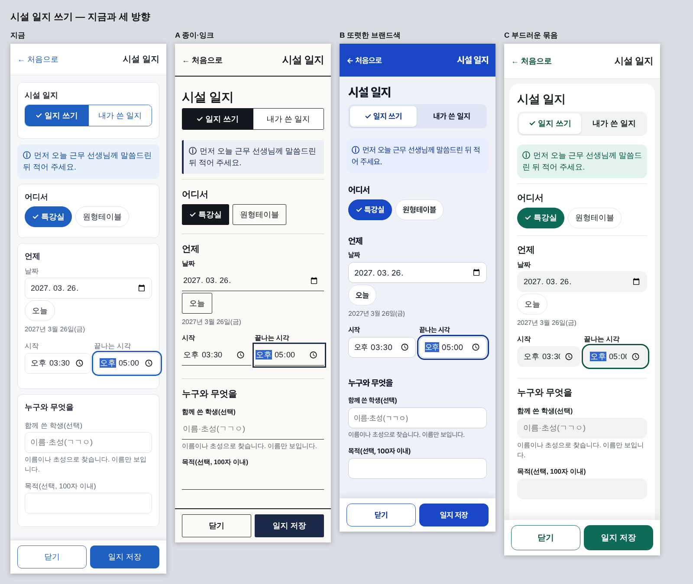

### 교사 시간표 목록

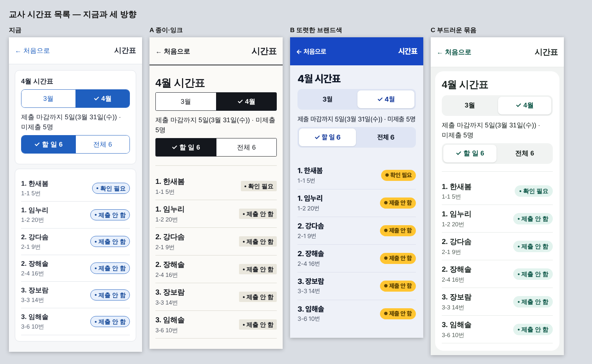

## 3. 토큰 표: 지금과 달라지는 것

`src/ui/Styles.html`의 `:root` 값만 비교합니다(덧씌운 CSS는 같은 이름의 토큰을 다시 정의합니다).

| 토큰 | 지금 | A | B | C |
| --- | --- | --- | --- | --- |
| `--bg` 바탕 | `#f6f7f9` | `#fbfaf7` | `#eef1f8` | `#f1f3f2` |
| `--card` | `#fff` | `#fff` | `#fff` | `#fff` |
| `--text` | `#1d2330` | `#14171d` | `#101828` | `#17201d` |
| `--muted` | `#5d6676` | `#565b66` | `#4f586a` | `#556059` |
| `--accent` 주색 | `#1f5fbf` | `#1c2a4a` | `#1747c4` | `#0d6b57` |
| `--accent-weak` | `#e8f0fc` | `#eceff6` | `#e6edfd` | `#e2f3ee` |
| 강조 색(새 토큰) | 없음 | 없음 | `--signal` `#ffc531`(글자 `#5c4200`) | 없음 |
| `--radius` / `--radius-sm` | 12 / 10px | 4 / 3px | 16 / 12px | 22 / 14px |
| 머리줄 | 흰 바탕 + 가는 줄 | 바탕색 + 2px 먹줄 | 코발트 면 | 흰 바탕 + 그림자 한 줄 |
| 글꼴 | 기기 기본 | 기기 기본 | Pretendard Variable | 기기 기본 |

상태 색(`--ok-*`, `--caution-*`, `--out1-*`, `--out2`, `--code-*`)은 세 방향 모두 **지금 값 그대로**입니다(색 의미를 바꾸지 않음).

## 4. 장단점

| 방향 | 좋은 점 | 아쉬운 점 |
| --- | --- | --- |
| **A 종이·잉크** | 가장 조용하고 정돈돼 보인다. 글자 위계가 또렷하다. 어떤 학교 로고와도 어울린다 | 색이 없어 "정체성"이 약하다. 학생·학부모에게는 딱딱하게 보일 수 있다. 할 일과 나머지가 선·굵기로만 갈려 한눈에 들어오는 힘은 B보다 약하다 |
| **B 또렷한 브랜드색** | 머리줄 색 하나로 앱이 바로 알아보인다. 할 일(노랑 띠)·숫자가 가장 먼저 눈에 들어온다. 요즘 앱 느낌이라 "밤티" 인상을 가장 크게 덜어 낸다 | 코발트 면이 커서 소란스러울 수 있다(교사가 하루 종일 보는 화면). 글꼴을 쓰면 **용량이 늘고 학교 망에서 막힐 수 있다**(5절) |
| **C 부드러운 묶음** | 학생·학부모 첫 화면이 가장 부드럽고 읽기 쉽다. 한 장의 판 안에서 흐름대로 읽힌다 | 교사 홈처럼 카드가 많은 화면은 판이 길어진다. 초록청이 "학교 색"인지는 선생님이 정해야 한다 |

## 5. 글꼴(Pretendard) — 이 방향에서만 예외로 써 본 결과

`rules.md` 3절은 글꼴 내려받기를 금지합니다. B에서만 `pretendardvariable-dynamic-subset.css`(jsdelivr)를 붙여 **무게**를 재 봤습니다.

| 항목 | 결과 |
| --- | --- |
| 라이선스 | **SIL OFL 1.1**(npm `pretendard@1.3.9` 패키지 `license` 필드, 웹 임베딩 허용). 라이선스 문구 보존이 조건 |
| 내려받는 양 | 화면 하나를 열 때 글꼴 조각 **9~15개, 약 250~410KB**(학생 홈 374KB·13개, 학부모 홈 350KB·12개, 교사 홈 406KB·15개, 시설 일지 329KB·12개, 교사 시간표 256KB·9개). 한글을 많이 쓰는 화면일수록 조각이 많이 온다. 한 번 받으면 브라우저가 기억하지만 **조각은 쓰는 글자마다 달라 화면마다 새 조각이 더 온다**. 지금은 **0KB**이다 |
| 속도 | **재지 못했다.** 이 환경은 `cdn.jsdelivr.net`이 막혀 있어, 같은 파일을 npm 패키지로 받아 로컬에서 내려 줬다(바이트 수만 실제와 같다). 학교 망에서 걸리는 시간은 **학교 망에서 재야 한다**. 비슷한 환경이라면 jsdelivr 자체가 막힐 가능성도 있다 |
| 모양 차이 | 사진 `compare-font.png`(같은 B에서 글꼴만 다름). Pretendard는 글자 폭이 조금 좁고 제목이 더 단단하며, 숫자·영문이 한글과 잘 어울린다. 기기 기본 글꼴(안드로이드 Noto Sans, 아이폰 Apple SD 고딕)도 충분히 읽기 좋아 **차이는 "조금"** 이다. 다만 Pretendard는 기기마다 모양이 달라지는 것을 없애 준다 |
| 확인 못 한 것 | Apps Script `HtmlService` 안에서 외부 글꼴이 실제로 막히는지(`sandbox` 정책), 학교 망 지연, 글꼴이 늦게 오는 동안 글자가 바뀌어 보이는 정도 |

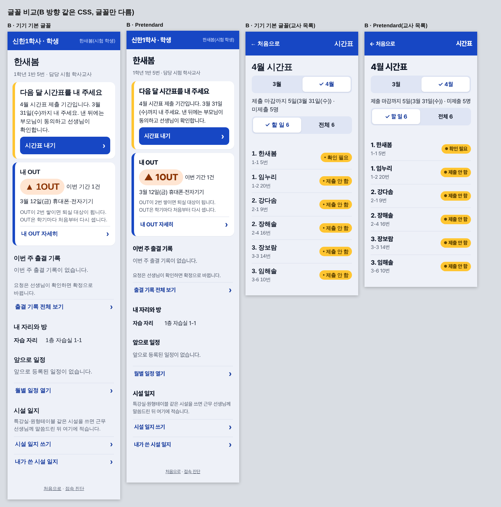

## 6. 지킬 것 점검

| 지킬 것 | 결과 | 어떻게 쟀나 |
| --- | --- | --- |
| 누르는 칸 48px | **15화면 모두 48px 미만 0개** | `refresh.js`가 버튼·칩·탭·되돌아가기 높이를 쟀다 |
| 360px에서 가로 넘침 없음 | **15화면 모두 없음** | `scrollWidth`가 화면 폭을 넘는지 쟀다 |
| 글자 150%에서 가로 넘침 없음 | **세 방향 15화면 모두 없음.** 지금 화면은 학부모 홈·교사 홈·시설 일지 3곳에서 넘친다(긴 알약 "이번 기간 상담 기록 없는 학생 5명"이 줄을 바꾸지 않아서). 시안은 알약 안에서 줄을 바꿔 고쳤다 | `FONT150=1 node design/preview/refresh.js`(html 글자를 18px→27px로) |
| 글자 대비 4.5:1 | **방향별 토큰 쌍 모두 4.5:1 이상**(가장 낮은 값 5.72) | `tests/design/refresh.test.js`가 `dir-a·b·c.css` 토큰으로 계산 |
| 색만으로 상태 알리지 않기 | 알약은 **앞 글자(✓ … ⊘ ▲ ●)와 글자**를 그대로 쓴다. **모양(점선·이중선) 구분은 없앴다** — 아래 "규칙 변경이 필요한 것" | 사진 확인 |
| 캐러셀·가운데 모달 금지 | 지킴(바닥에서 올라오는 시트·작업 줄 그대로) | |
| 토큰으로만 색 | **덜 지켰다.** 시안 CSS에는 토큰 밖 색이 조금 있다: A `#e9e6dc`(할 일 알약), B `#dfe5f4`·`#c4cbe0`(탭 바탕·입력 테두리)와 그림자 rgba, C 그림자 rgba. 채택하면 토큰으로 옮긴다 | |

### 규칙 변경이 필요한 것(선택한 뒤 코드 PR에서)

1. `rules.md` 4절·`tests/design/styles.test.js`는 알약의 **테두리 모양(점선·이중선)** 으로 코드를 구분하도록 정해 두었다. 세 방향 모두 모양을 하나로 줄였으니, 채택하면 "구분은 앞 글자와 글자(+ 색)"로 바꾸고 시험을 고친다.
2. 카드에 `todo`(할 일)·`key`(중요) 클래스를 붙이는 **화면 코드 변경**이 필요하다(이 시안은 제목 글자로 표시만 했다).
3. 홈 카드의 보조 버튼을 "열기 ›" 줄로 바꾸려면 `UI` 쪽 버튼 변형 하나를 더한다.
4. 교사 시간표 목록의 "제출 안 함"은 지금 "할 일" 알약과 같은 종류로 그려진다. **'뒤처짐'이 아니라 '아직'** 이므로 `mute` 종류로 바꾸는 것을 권한다(A·B에서 특히 눈에 띔).

## 7. 총괄 추천

**B 방향을 바탕으로, 글꼴은 기기 기본으로 두는 것**을 추천합니다. 이유: (1) 선생님 말씀의 "밤티"를 가장 크게 덜어 내는 것은 색을 한 곳에 몰고 할 일과 숫자를 키우는 B의 구조이고, (2) Pretendard는 모양 차이가 "조금"인 데 비해 화면마다 250~410KB가 더 들고 학교 망 지연·차단을 아직 못 쟀습니다. 학생·학부모 첫 화면만 C처럼 더 부드럽게(판 한 장 + 큰 글씨) 가는 **B+C 혼합**도 선택지입니다. 교사처럼 매일 오래 보는 화면에는 A처럼 색을 줄인 쪽이 편할 수도 있어, **선생님이 한 방향을 고르시면** 2단계(`Styles.html` 토큰·컴포넌트 바꾸기 + 화면 코드 + 시험 + 사진)를 만들겠습니다.

## 8. 건너뛴 것·확인 못 한 것

- 실제 휴대폰·실제 Apps Script에서는 보지 않았다(가짜 서버 + 크로미움 360px). 기기별 글꼴 모양은 다르다.
- 시안은 다섯 화면뿐이다. 표(격자)·시트·확인 창·PC 화면은 입혀 보지 않았다.
- 문구(UX writing)는 바꾸지 않았다. 눈에 띄게 긴 곳(학생 홈 "시간표 제출 기간입니다…", 학부모 "OUT이 2번 쌓이면…")은 `writing.md`가 정하는 대로 따른다.
- 글꼴 속도·`HtmlService`의 외부 글꼴 허용 여부는 재지 못했다(5절).
- `todo`·`key` 표시는 시안용 가정이다(6절 2번).

## 9. 개별 사진(방향별·화면별)

| 화면 | 지금 | A | B | C |
| --- | --- | --- | --- | --- |
| 학생 홈 | 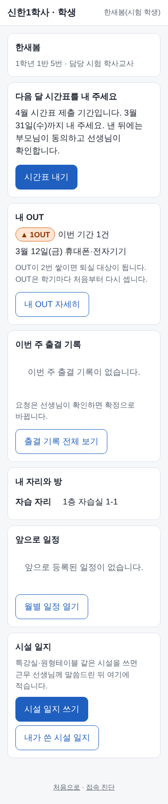 | 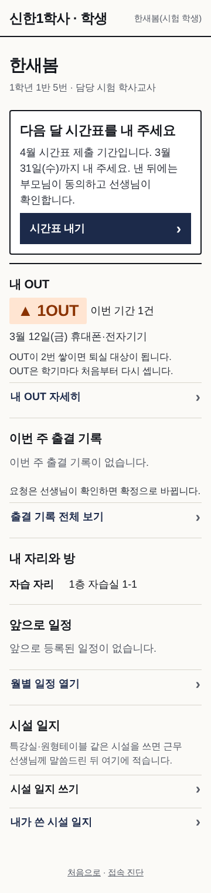 | 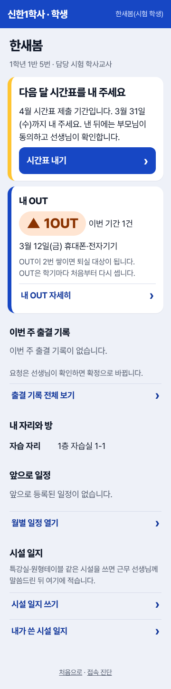 | 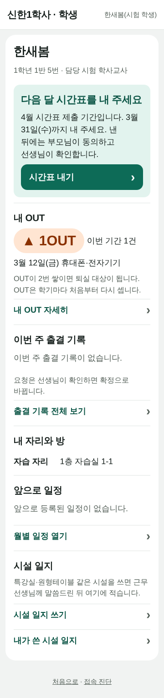 |
| 학부모 홈 | 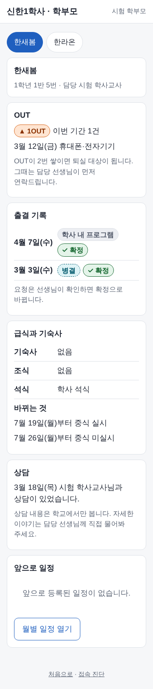 | 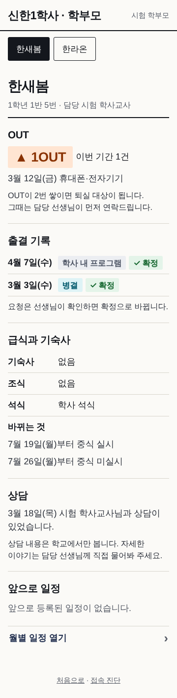 | 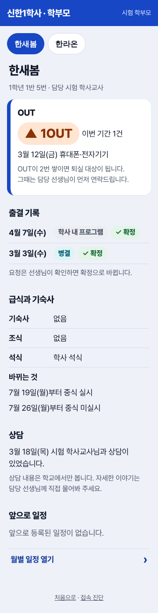 | 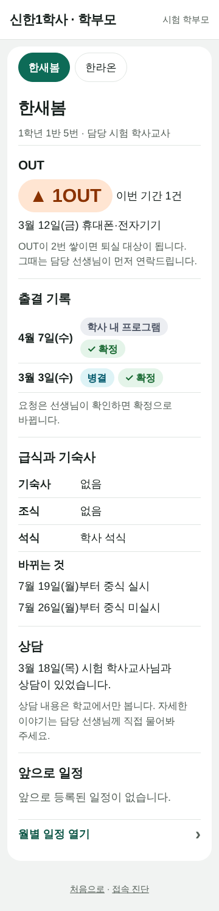 |
| 학사교사 홈 | 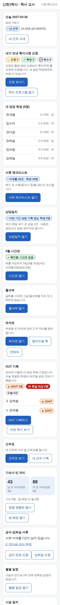 | 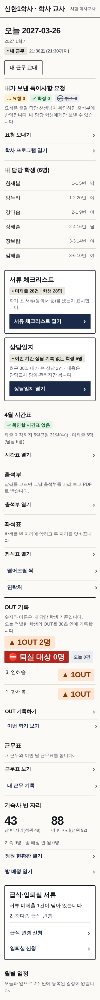 | 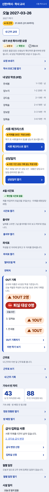 | 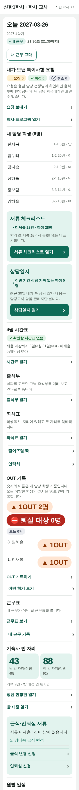 |
| 시설 일지 쓰기 | 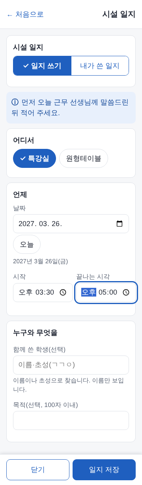 | 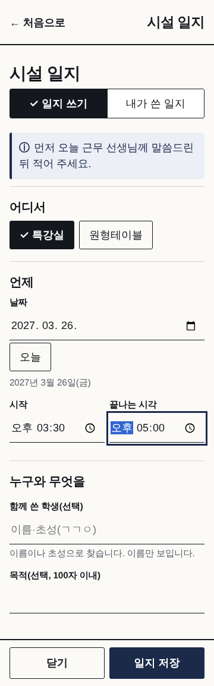 | 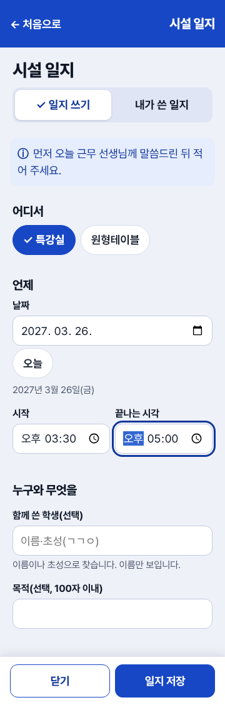 | 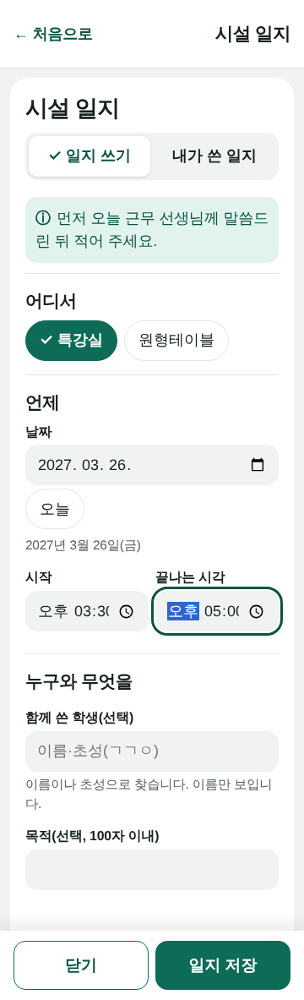 |
| 교사 시간표 목록 | 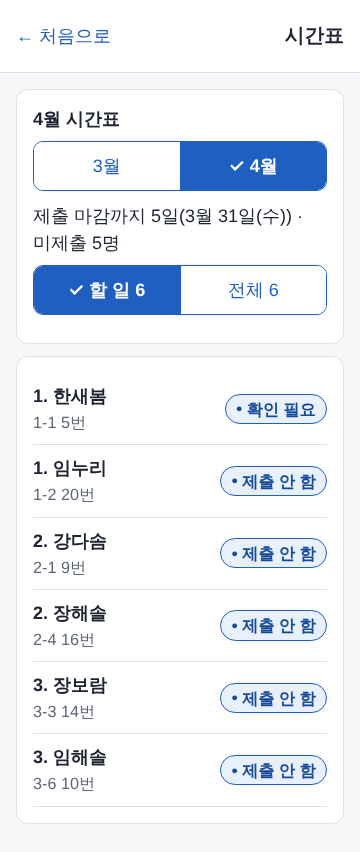 | 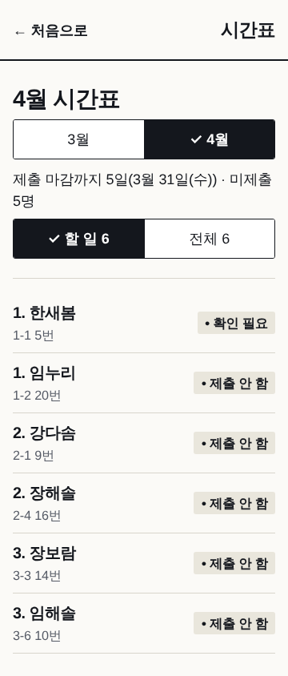 | 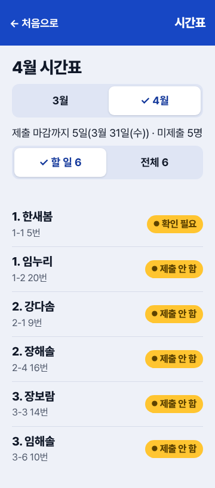 | 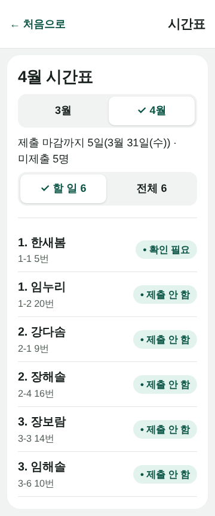 |
