# D15 3단계 — 나머지 화면 전수 점검 (31개 화면 × 휴대폰·노트북)

> 새 단장(결정 85)과 반응형(PR ②)이 들어간 뒤, **홈 7개를 뺀 24개 화면**(역할별 화면 + `SCREENS` 전부)을 한 장씩 휴대폰 360px와 노트북 1366×768로 찍어 눈으로 봤습니다(`node design/preview/refresh-tour.js`). 숫자는 기기 행렬(`npm run devices`)이 재고, 이 문서는 **눈으로 본 것**입니다. 이름·숫자는 모두 가짜, 가짜 오늘 2027-03-26.

## 1. 결과 한눈에

| 점검 | 결과 |
| --- | --- |
| 기기 행렬(`npm run devices -- --base=docs/design/devices-baseline.json`, 31화면 × 9기기, 줄길이 포함) | **279칸 중 279칸 통과**(고치기 전 262칸). **나빠진 칸 0 · 좋아진 칸 26** |
| 눈 점검 | 24개 화면 중 **깨진 곳 없음**. 구역이 헷갈리는 곳(카드 상자가 없어진 뒤)은 없었고, 아래 5곳은 **거슬리는 곳**이라 고침 |

## 2. 고친 것

| 화면 | 문제 | 고친 것 |
| --- | --- | --- |
| **OUT**(`outs`) | 탭 다섯 개에서 "2OUT"이 낱말 중간에서 **"2OU / T"로 끊김** | 탭이 다섯 개 이상이면 글자를 조금 줄이고(`.segmented.dense`) 간격을 좁혀 한 줄에 |
| **상담일지**(`counsel`)·**연락처**(`contacts`) | 학생 33줄마다 **테두리 버튼**("상담 보기"·"연락처 보기")이 반복되어 시끄러움 | 줄 끝 **"열기 ›" 글자 버튼**(`.row-open`, 높이 48px 그대로)으로 |
| **일정**(`schedule`) | "◀ 이전 달 / 다음 달 ▶"이 두 줄로 꺾임, 요일 칸(일~토) 40px | 한 줄(`nowrap`), 요일 칸 48px |
| **좌석표**(`seats`) | 층·성별 버튼 34~42px | 최소 폭 48px |
| **담임 홈 이름 링크**·**식수 집계 링크** | 목록 줄 안 이름 링크 27px, "서류 미제출 3건 ▸" 44px | 48px |
| **글자 150%**(`moves`·`mealcount`·`batch`) | 아래 작업 바가 마지막 내용을 가림(바가 글자 때문에 높아짐) | `UI.actionBar`가 **바의 실제 높이를 `--bar-h`로** 알려 줘 `main`의 아래 여백이 따라감(`ResizeObserver`) |

## 3. 사진 — 고친 화면 고치기 전 | 후 (휴대폰 360px)

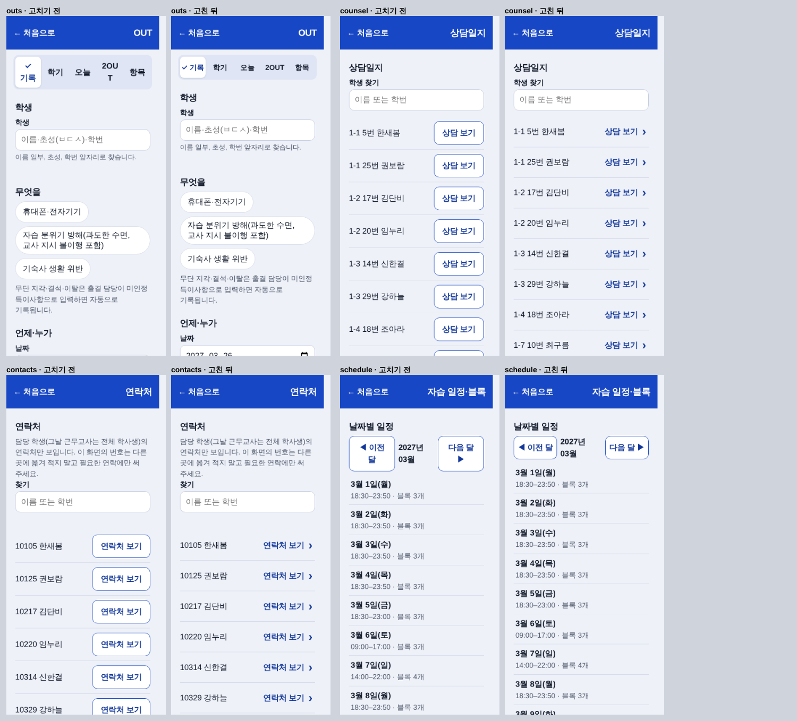

## 4. 사진 — 24개 화면 전체 (고친 뒤)

### 휴대폰 360px (위쪽 1250px까지, 화면 이름은 그림 위)
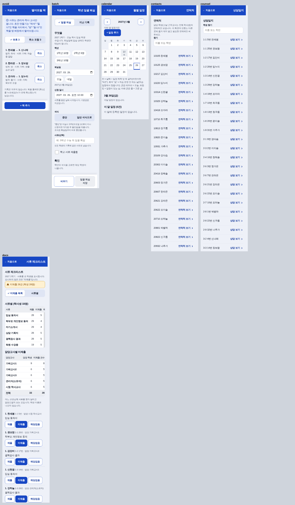
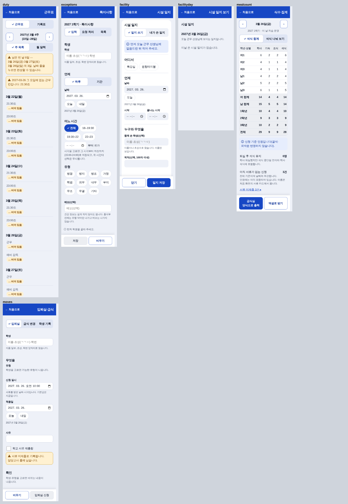
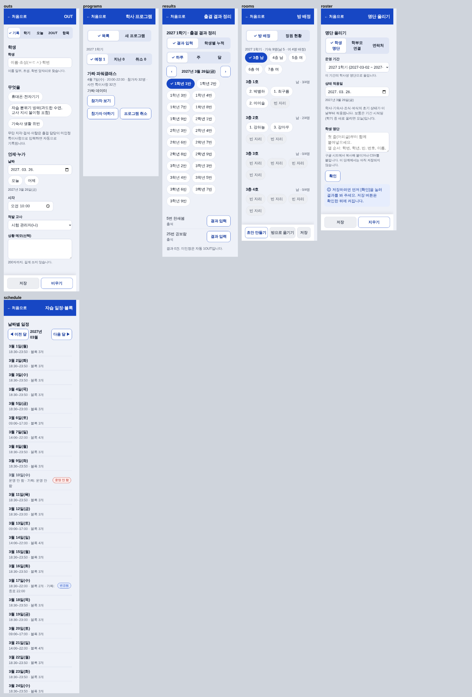
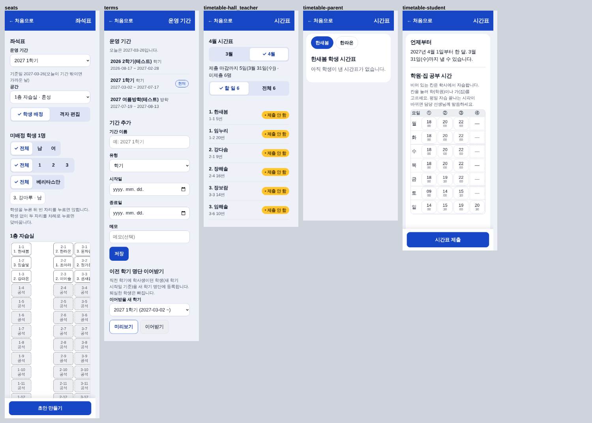

### 노트북 1366×768 (처음 보이는 화면)
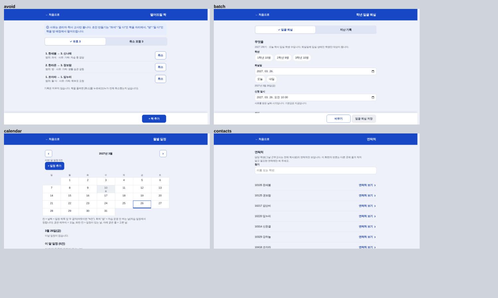
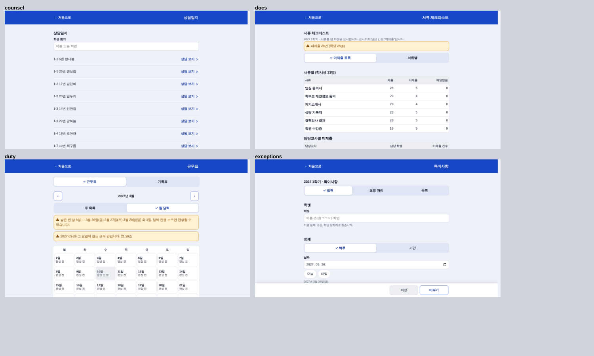
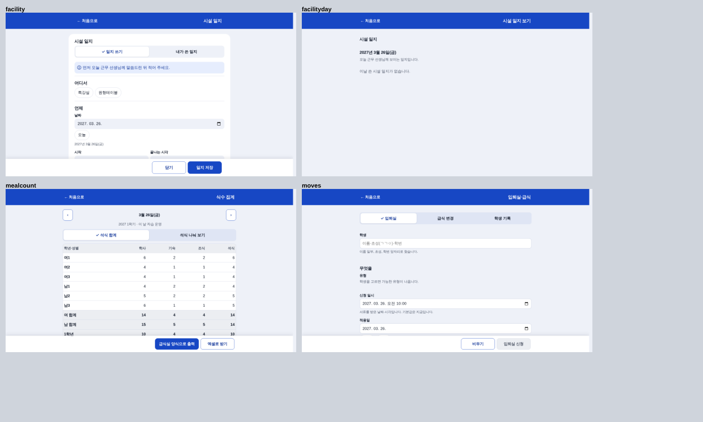
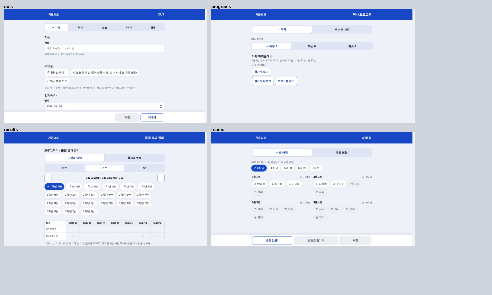
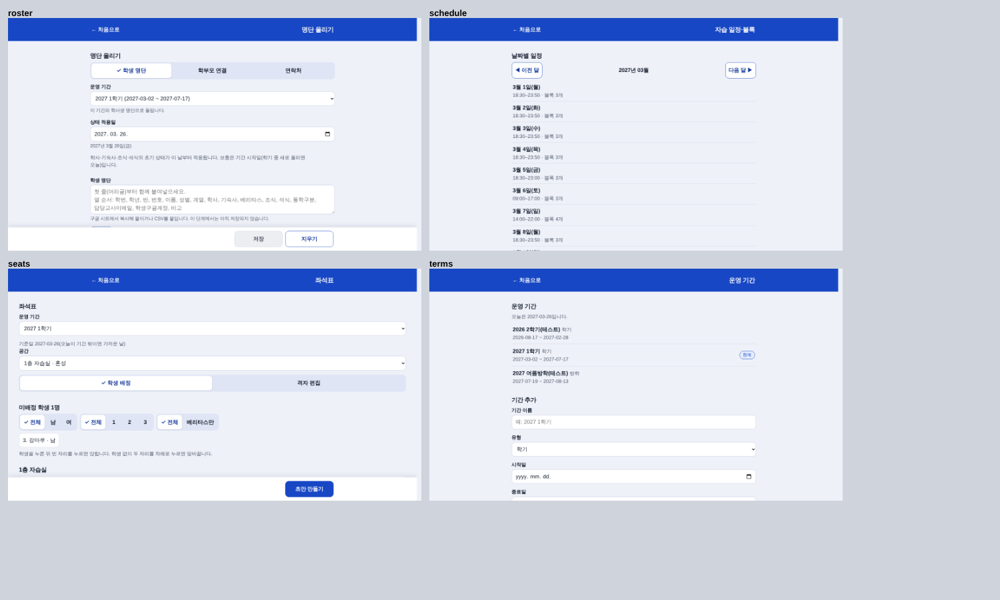
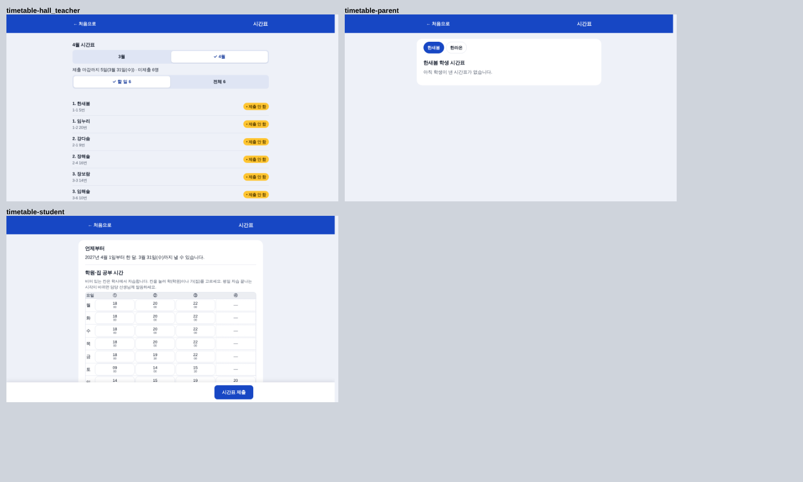

## 5. 화면별 판정

| 화면 | 판정 | 비고 |
| --- | --- | --- |
| avoid(떨어뜨릴 짝) · batch(학년 일괄 퇴실) · calendar(월별 일정) · docs(서류) · duty(근무표) · exceptions(특이사항) · facility(시설 일지) · facilityday · programs · rooms · roster · sheet(출석부) · terms · timetable ×3 | 이상 없음 | 표는 머리 행·이름 열 고정, 시트는 PC에서 가운데 대화창 |
| outs · counsel · contacts · schedule · seats · mealcount · moves | **고침**(2절) | |
| results(출결 결과) | 이상 없음, **후속 후보** | 반 칩이 28개라 세로로 길다 → 반을 고르는 방식(선택 칸)으로 바꿀지 선생님 판단 |
| docs(서류) | 이상 없음, **후속 후보** | 학생 줄마다 [제출][미제출][해당없음] 토글 3개가 반복 → 줄 눌러 시트에서 고르는 방식은 동작이 바뀌어 후속 |

## 6. 이번에 하지 않은 것과 이유

- **Enter로 저장 — 하지 않았다.** 입력 칸이 `<form>`이 아니고, 시설 일지처럼 [저장]이 확인 없이 바로 기록하는 화면이 있어 **Enter 한 번으로 잘못 저장될 수 있다**. 화면마다 "Enter가 확인 시트를 여는지 바로 저장하는지"를 정해야 해서, 선생님이 원하는 화면을 알려 주시면 그 화면부터(화면 코드 변경).
- **타이포 4단계(27/20/18/15) — 하지 않았다.** 지금은 27/20/18/16/14(5단계)이고 작은 글씨(14~16px)를 15px로 모으면 설명문이 조금 작아져 **글자 크기를 키워 쓰는 학부모·교사에게 불리**하다. 모으려면 선생님 확인이 필요하다(`rules.md` 2-1절 그대로 "미적용").
- **목록 + 옆 상세(두 칸)·목록 행 틀 [이름][무엇·언제][상태 ›]** — **하지 않았다.** 화면 구조(OUT·특이사항·입퇴실)를 바꾸는 큰 일이라 이 PR(화면은 그대로 두고 깨진 곳만 고침)과 따로 다룬다. 시안부터 그려 선생님께 보여 드리는 것을 제안한다(PR ④).
- 출석부는 인쇄 미리보기(iframe)라 안의 모양은 보지 않았다(인쇄 규칙은 `print-layout.md`).

## 7. 건너뛴 것·확인 못 한 것

- **실제 윈도우 노트북(맑은 고딕)·아이폰 Safari·카카오톡 인앱은 못 봤다.** 사진은 크로미움이라 글자 모양이 다르다.
- 24개 화면은 **가짜 데이터로 처음 열었을 때 모습**만 봤다(저장·취소 뒤 화면, 오류·빈 화면, 시트가 열린 모습은 일부만). 시트·오류 화면 전수는 후속.
- 아래 고정 바가 **아이폰 키보드에 가려지는지**는 실기기 확인이 필요하다.
