# 3단계 선생님 확인 체크리스트 (초안)

> 3단계(떨어뜨릴 짝 C21, 좌석 초안 C22, 방 배정·정원 현황판 C23)를 선생님이 실제 Apps Script에서 따라 하며 확인하는 순서입니다. 형식은 `stage2-teacher-checks.md`와 같습니다. 화면·버튼 이름은 지금 코드(`screen_avoid`·`screen_seats`·`screen_rooms`)와 D10 시안(`docs/design/screens.md` 5-3)에서 가져왔고, 실제와 다르면 ×가 아니라 "이름 차이"로 적어 주세요(코딩 세션이 이 문서를 고칩니다).
> **사진 읽는 법:** 각 절 끝의 "시안 사진"은 D10 시안의 휴대폰(360px) 모양입니다. 실제 화면은 숫자·이름이 다르지만 **모양과 표시(빨간 테두리·⚠·꺼진 [저장])가 이렇게 나오면 통과**입니다. 표의 "사진" 칸은 선생님이 찍은 실제 화면을 붙이는 자리입니다.

## 읽는 법

- 한 단계 = **누르는 것 → 이렇게 보이면 통과 → 사진 → 결과(○/×)** 입니다.
- **누가** 칸: **소유자**는 선생님(앱 주인, 스크립트 편집기를 쓸 수 있는 계정), **시험1**·**시험2**는 아래 시험 계정, **아무 교사**는 편집기 없이 휴대폰에서 화면만 누르면 되는 일입니다.
- ×가 나오면 **번호 + 한 줄**(예: "D6 정원 초과인데 [저장]이 눌림")과 화면 사진을 총괄에게 보냅니다. 앱이 이상한 것이지 선생님이 잘못 누르신 것이 아닙니다.
- 컴퓨터 테스트(`npm test`)가 이미 확인한 것은 "이미 확인됨"으로 적었습니다. 여기서는 **실제 Apps Script에서만 보이는 것**(로그인, 휴대폰 화면, 속도, 권한 계정별 화면)만 봅니다.
- 이름은 모두 **가짜 데이터**입니다. 실제 학생 이름을 쓰는 시험은 없습니다.

## 시험 계정

| 이름 | 어떤 계정 | 맡는 역할 | 쓰는 곳 |
| --- | --- | --- | --- |
| 소유자 | 선생님 계정 | 관리자 + 학사 교사 | 준비, B~D 전체 |
| 시험1 | 시험용 gmail 1 | 학사 교사 | B~D(관리자 없이 학사 교사만으로 되는지) |
| 시험2 | 시험용 gmail 2 | **E에서 역할을 바꿔 가며** 출결 담당 → 근무표 담당자 → 담임 | E(짝 정보가 안 보이는지) |

시험2는 한 계정으로 역할만 바꿉니다. 편집기에서 `addUser`를 같은 이메일로 다시 실행하면 역할이 바뀝니다(이미 있는 계정이면 고쳐 씁니다). 2단계에서 쓰던 시험 계정을 그대로 써도 됩니다.

## A. 먼저 끝나 있어야 하는 것 (준비, 소유자, 약 15분)

이 단계가 안 끝났으면 B~E를 시작하지 않습니다.

| 번호 | 누가 | 할 일 | 이렇게 보이면 통과 | 사진 | 결과 |
| --- | --- | --- | --- | --- | --- |
| A1 | 소유자 | `clasp push`로 새 코드를 올리고 편집기에서 `setup`을 **다시** 실행합니다 | 로그에 `avoid_pairs`·`rooms`·`room_assignments` 탭 `[탭 생성]`이 보인다(이미 있으면 "변경 없음"). 권한을 다시 요청하면 승인한다 | | |
| A2 | 소유자 | 편집기에서 `seedDefaultRooms`를 실행합니다. 이어서 한 번 더 실행합니다 | 처음에 "기본 호실 35개 추가", 두 번째는 추가되지 않는다(이미 있으면 건너뜀). `rooms` 탭에 3층 1~4호 … 7층 28~35호, 남 12실·여 23실, 정원 4 | | |
| A3 | 소유자 | 편집기에서 `seedFakeData` → `seedFakeStage1` → `seedFakeStage3` 순서로 실행합니다. `seedFakeStage3`는 한 번 더 실행합니다 | 두 번째 실행에서 행이 늘지 않는다. `avoid_pairs`에 가짜 짝 3쌍(범위 좌석·방·둘 다, 사유 "가짜: …"), `room_assignments`에 가짜 기숙사생 방 배정이 있다. "가짜 학생만 있는 DB에서만…"으로 거부되면 새 시험 데이터 파일에서 setup부터 다시 한다(안전장치는 넓히지 않는다) | | |
| A4 | 소유자 | 시험1 계정을 `addUser(시험1 gmail, '시험교사', 'hall_teacher')`로 등록하고 시험2는 아래 E에서 등록합니다 | 시험1로 로그인하면 홈이 학사 교사 홈으로 열린다 | | |
| A5 | 소유자 | 홈(관리자)을 엽니다 | **기숙사 빈 자리** 카드와 [정원 현황판 열기]·[방 배정 열기]가 보인다(D1에서 자세히 본다) | | |

## B. 떨어뜨릴 짝 관리 (C21, 약 20분)

| 번호 | 누가 | 누르는 것 | 이렇게 보이면 통과 | 사진 | 결과 |
| --- | --- | --- | --- | --- | --- |
| B1 | 시험1 | 홈 → 좌석표 카드의 **[떨어뜨릴 짝]** | 짝 목록에 가짜 3쌍이 보이고, 줄마다 "A ↔ B", **범위(좌석·방·둘 다)**, **사유**가 있다. 맨 위에 "사유는 관리자·학사 교사만 봅니다." 안내가 있다 | | |
| B2 | 시험1 | **[+ 짝 추가]** → 같은 성별 학생 두 명을 고르고 범위 **둘 다**, 사유 "가짜: 시험"을 적고 [짝 추가] | "저장했습니다". 목록에 새 줄이 생긴다 | | |
| B3 | 시험1 | B2와 같은 두 학생(순서만 바꿔)을 다시 추가해 봅니다 | 막히고 "이미 같은 짝이 있습니다(범위). …" 안내가 나온다. 목록에 줄이 늘지 않는다 | | |
| B4 | 시험1 | 방금 만든 줄의 **[취소]** → 확인창에서 취소 | 줄이 **삭제되지 않고** "취소됨" 표시로 남는다. **삭제 버튼은 어디에도 없다**. [취소 포함]으로 거르면 취소된 줄도 보인다 | | |
| B5 | 시험1 | 이번 기간에 등록되지 않은 학생을 짝으로 고르려 해 봅니다 | "이번 기간에 등록되지 않은 학생이 있습니다."처럼 막힌다 | | |
| B6 | 시험1 | 휴대폰으로 같은 화면을 엽니다 | 가로로 밀리지 않고 버튼이 손가락으로 누를 만하다(48px 이상) | | |

> 컴퓨터 테스트가 이미 확인한 것: 같은 학생 조합 중복, 삭제 없이 취소만, 취소 기록(누가·언제), 학생·학부모·담임·출결 담당·근무표 담당자 호출 거부.

**시안 사진 (360px)**

| B1 목록 (`pair-list`) | B2 추가 (`pair-add`) | B4 취소 확인 (`pair-cancel`) |
| --- | --- | --- |
| 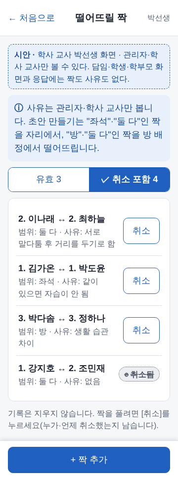 | 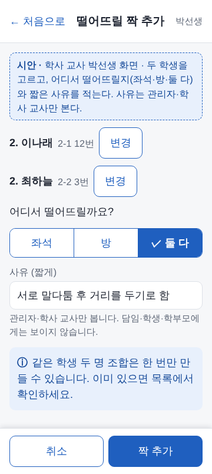 | 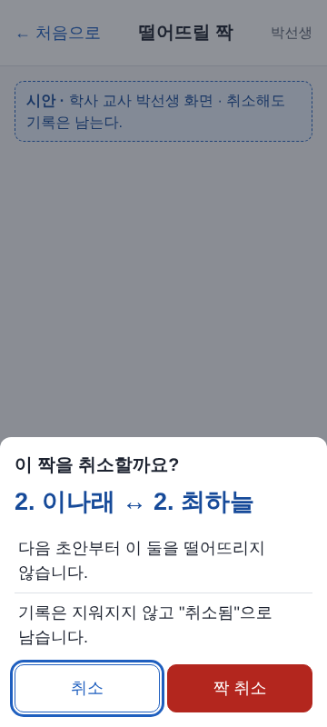 |

## C. 좌석 [초안 만들기]·빨간 칸·저장 (C22, 약 40분)

| 번호 | 누가 | 누르는 것 | 이렇게 보이면 통과 | 사진 | 결과 |
| --- | --- | --- | --- | --- | --- |
| C1 | 시험1 | 홈 → **좌석표 열기** → 공간 "1층 자습실"을 엽니다 | 가짜 배정이 격자에 보이고 아래 바에 **[초안 만들기]**가 있다 | | |
| C2 | 시험1 | **[초안 만들기]**를 누릅니다 | 미리보기가 열리고 위에 **"바뀌는 자리 N개 · 규칙 위반 M개"**, "아직 저장 전입니다. [취소]를 누르면 아무것도 바뀌지 않습니다."가 보인다. 빨간 칸은 **굵은 빨간 테두리 + 번호 앞 ⚠** 모양이다(색만으로 알리지 않음) | | |
| C3 | 시험1 | 미리보기 아래 **규칙 위반 목록** 줄을 하나 누릅니다 | 그 칸이 골라진 모양으로 바뀌고 격자가 그 칸으로 움직인다. 줄 종류는 같은 학년·떨어뜨릴 짝·성별. **떨어뜨릴 짝 줄에는 "짝: 이름"**이 보인다(학사 교사·관리자만) | | |
| C4 | 시험1 | 가짜 짝(범위 좌석 또는 둘 다)의 두 학생 자리가 서로 이웃인지 격자에서 찾아봅니다 | 이웃이면 빨간 칸으로, 이웃이 아니면 빨간 칸이 아니다(기둥·비상문을 사이에 두면 이웃이 아님). 초안은 가능한 한 짝을 떼어 놓는다 | | |
| C5 | 시험1 | **[취소]**를 누른 뒤 화면을 새로 불러옵니다 | 좌석표가 처음 그대로다(아무것도 저장되지 않음). 내일·어제 출석부도 그대로다 | | |
| C6 | 시험1 | 다시 [초안 만들기] → 자리가 있는 학생 한 명의 **[이 자리 고정]** → **[새 초안]** | 그 학생은 새 초안에서도 같은 자리고, 다른 자리는 달라질 수 있다. [고정 풀기]로 되돌아간다 | | |
| C7 | 시험1 | 3학년 학생 두 명의 지난 기간(2026 2학기) 자리를 적어 둡니다(좌석표 기간을 바꿔 보기). 2027 1학기 초안에서 그 두 학생을 봅니다 | 지난 기간에 앉았던 자리가 이번에도 비어 있으면 같은 자리에 있다(3학년은 지난 자리 유지) | | |
| C8 | 시험1 | **[저장]**을 누릅니다(규칙 위반이 있는 초안으로) | 확인창 "이 초안으로 저장할까요?" 맨 위에 "바뀌는 자리 N개 · 규칙 위반 M개", 아래에 **"규칙 위반이 있어도 저장할 수 있습니다."**와 **날짜 두 개가 들어간 문장**이 나온다: "지금 배정은 기준일 전날까지로 끝나고 기준일부터 새 배정이 적용됩니다(지난 날짜의 좌석표와 기록은 그대로 남습니다)" 뜻(전날과 기준일이 모두 날짜로 보이면 통과). [저장]이 **꺼져 있지 않고 눌린다** | | |
| C9 | 시험1 | 확인창에서 저장합니다. 이어서 [초안 만들기]를 한 번 더 누르고 바로 저장해 봅니다 | "저장했습니다." 좌석표가 새 배정이다. 두 번째는 "바뀐 것이 없습니다."/"이미 이 배정으로 저장되어 있습니다."가 나오고 **한 벌만 생긴다**(같은 자리에 학생이 둘 있는 일이 없다) | | |
| C10 | 소유자 | **저장 전에** 홈 → 출석부로 **어제 날짜**와 **오늘 날짜** 출석부를 열어, 바뀌는 자리에 있던 학생 한 명의 자리를 적어 둡니다. C9처럼 저장한 뒤 두 날짜 출석부를 다시 엽니다 | **어제 출석부는 저장 전과 똑같고**, 오늘 출석부는 새 자리로 바뀌었다(오늘부터 새 자리). 지난 날짜 출석부·좌석표는 그대로 남는다 | | |
| C11 | 소유자 | **입실 전 학생**: 가짜 학생 중 마지막 번호(30번, 중도 입실)를 좌석표의 미배정 학생 목록에서 골라 빈 자리에 앉힙니다. [초안 만들기]를 누릅니다 | 안내 **"입실 전 학생 1명의 자리는 그대로 둡니다."**가 보이고, 그 학생 칸에 "(미입실)"이 붙어 있다. 그 자리는 **바뀌는 자리 수에 들어가지 않는다**. 저장한 뒤에도 그 학생 자리는 같다 | | |
| C12 | 시험1 | 휴대폰으로 미리보기를 엽니다 | 가로로 밀리지 않는다. 격자가 넓으면 **격자 상자 안에서만** 옆으로 밀린다. 위반 목록 줄은 한 줄에 잘리지 않고 읽힌다 | | |
| C13 | 아무 교사 | 학사 교사가 아닌 교사(담임) 계정으로 좌석표를 엽니다 | **[초안 만들기]·[저장]·맞바꾸기 버튼이 없다**(E3에서 자세히) | | |

> 컴퓨터 테스트가 이미 확인한 것: 같은 입력 + 같은 seed = 같은 초안, 성별 구역·SA실 규칙, 이웃 계산(기둥 사이), 취소 후 새 배정이 한 락에서 쓰임, 저장 뒤 지난 날짜 배정 보존, 두 번 눌러도 한 벌, 입실 전 학생 자리 보존.

**시안 사진 (360px)**

| C1 처음 (`seat-assign`) | C2~C4 미리보기 (`seat-draft-preview`) | C8 저장 확인 (`seat-draft-save`) | C13 담임 (`seat-homeroom`) |
| --- | --- | --- | --- |
| 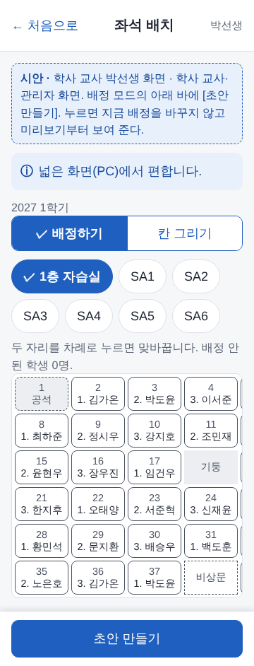 | 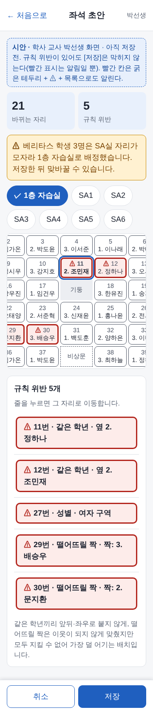 | 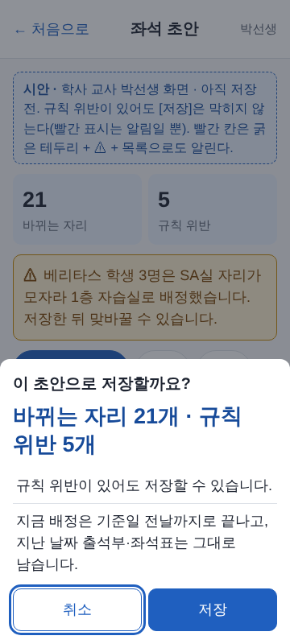 | 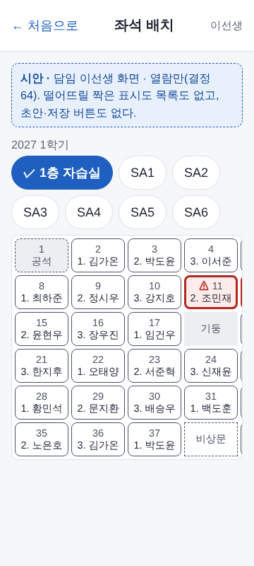 |

## D. 방 배정·정원 현황판·홈 공석 카드 (C23, 약 45분)

| 번호 | 누가 | 누르는 것 | 이렇게 보이면 통과 | 사진 | 결과 |
| --- | --- | --- | --- | --- | --- |
| D1 | 소유자 | 홈(관리자)의 **기숙사 빈 자리** 카드를 봅니다 | 남·여 빈 자리 숫자가 보이고 **정원(남 48·여 92)에서 입실 인원을 뺀 값**이다. 학생 이름이 없다. [정원 현황판 열기]·[방 배정 열기] 버튼이 있다 | | |
| D2 | 소유자 | [정원 현황판 열기](또는 방 배정의 **정원 현황** 탭) | 층별(3~7층) 표에 정원·입실·빈 자리·학년별 인원이 있고 **남 합계 48 · 여 합계 92**. 합계 줄은 굵은 글씨 + 회색 바탕. 휴대폰에서는 표 안에서만 옆으로 밀린다 | | |
| D3 | 소유자 | **방 배정** 탭을 엽니다 | 층 칩(3층 남 … 7층 여)과 방 카드가 있고 칩은 **"학년. 이름"** 모양이다. 가짜 데이터에서는 방마다 3명씩이다. 방·둘 다 짝인 두 학생은 **다른 방**에 있다 | | |
| D4 | 시험1 | **[초안 만들기]**를 누릅니다 | 미리보기에 **"바뀌는 학생 N명 · 규칙 위반 M개"**, "초안은 저장 전에는 어디에도 쓰이지 않습니다." 안내가 있다. 위반이 0이면 "규칙 위반이 없습니다. 저장하면 지금 배정은 기준일 전날까지로 끝나고, 지난 날짜 기록은 그대로 남습니다."가 보인다. 층은 성별이 맞고 방마다 학년이 섞여 있다 | | |
| D5 | 시험1 | 같은 층의 두 학생을 차례로 누릅니다(맞바꾸기) | 확인창 "두 학생의 방을 맞바꿀까요?"에 **"두 방의 인원은 그대로입니다."**가 있고, 맞바꾸면 두 카드의 이름이 서로 바뀐다 | | |
| D6 | 시험1 | 남학생과 **여학생 방**의 학생을 맞바꿔 봅니다 | "성별이 다른 방과는 맞바꿀 수 없습니다."가 나온다 | | |
| D7 | 시험1 | 학생 한 명을 고르고 **[방으로 옮기기]** → **이미 4명인 방**을 고릅니다 | 그 방 카드에 빨간 테두리와 **"⚠ 정원 초과"**가 보이고, 아래에 "정원 초과나 성별이 다른 방이 있으면 저장할 수 없습니다. 학생을 옮겨 주세요."가 있다. **[저장]이 꺼져 있고 눌러도 저장되지 않는다.** 학생을 다른 방으로 옮겨 4명 이하로 만들면 [저장]이 다시 켜진다 | | |
| D8 | 시험1 | 방·둘 다 짝인 두 학생을 **같은 방**에 넣어 봅니다 | 두 학생 칩이 **굵은 빨간 테두리 + ⚠**로 보이고 규칙 위반 목록에 "떨어뜨릴 짝"이 있다. 그래도 **[저장]은 눌린다**("같은 학년·떨어뜨릴 짝 위반은 저장할 수 있습니다.") | | |
| D9 | 시험1 | 손으로 고친 뒤 [초안 만들기]를 누릅니다 | 확인창 "손으로 고친 것을 버리고 초안을 만들까요?"가 나온다. 취소하면 고친 것이 그대로다 | | |
| D10 | 시험1 | **[저장]** → 확인창에서 저장 | 확인창에 "방 배정을 저장합니다"와 "지금 배정은 기준일 전날까지로 끝나고, 지난 날짜 기록은 그대로 남습니다."가 있다. 저장하면 "방 배정을 저장했습니다." 현황판 숫자가 방 카드와 맞다 | | |
| D11 | 소유자 | **기숙사 퇴실**: 입퇴실 화면에서 방에 있는 가짜 기숙사생 한 명을 **기숙사 퇴실**(적용일 오늘)로 신청합니다. 현황판을 다시 불러옵니다 | 입실 숫자가 1 줄고 빈 자리가 1 늘며 그 층 합계가 맞다("기숙사 퇴실 적용일부터 그 자리는 빈 자리로 셉니다"). 적용일이 아직 오지 않은 퇴실은 지금은 세지 않는다 | | |
| D12 | 시험1 | 휴대폰으로 방 배정·현황판을 엽니다 | 가로로 밀리지 않는다. 방 카드가 한 줄에 한 장씩 보이고 학생 칩이 손가락으로 누를 만하다 | | |

> 컴퓨터 테스트가 이미 확인한 것: 방 초안의 층 성별·정원·학년 섞기·짝 분리·기숙사생만, 정원 초과·성별 불일치 저장 거부(서버도 거절), 같은 학년·짝 위반은 저장 가능, 기준일 전날까지로 끝내기, 퇴실 적용일부터 공석, 같은 저장을 두 번 해도 한 벌.

**시안 사진 (360px)**

| D1 홈 카드 (`home-admin-dorm`) | D2 현황판 (`room-stats`) | D3 방 배정 (`room-board`) | D4 초안 (`room-draft-preview`) |
| --- | --- | --- | --- |
| 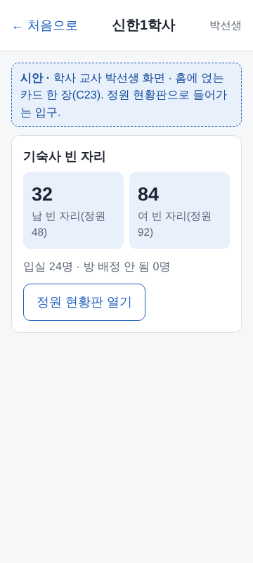 | 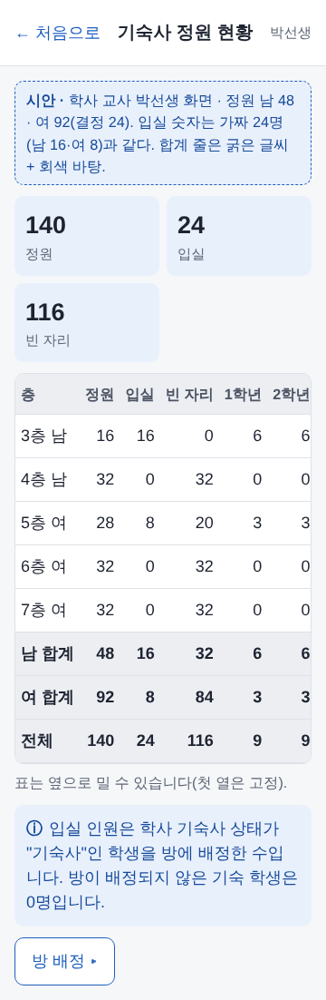 | 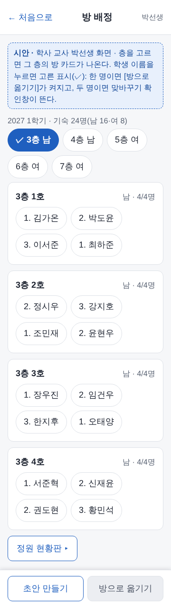 | 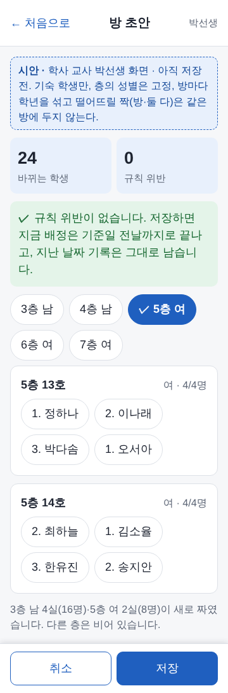 |

| D5 맞바꾸기 (`room-swap-confirm`) | D7 옮기기 (`room-move-sheet`) | D7·D8 정원 초과·짝 위반 (`room-edit`) |
| --- | --- | --- |
| 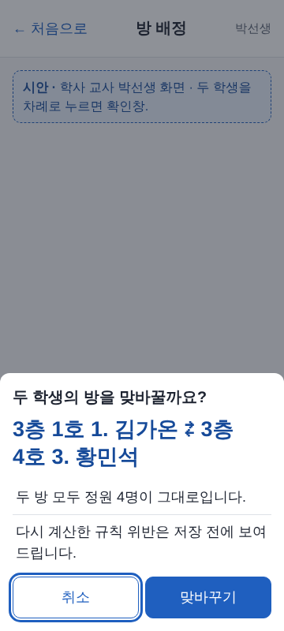 | 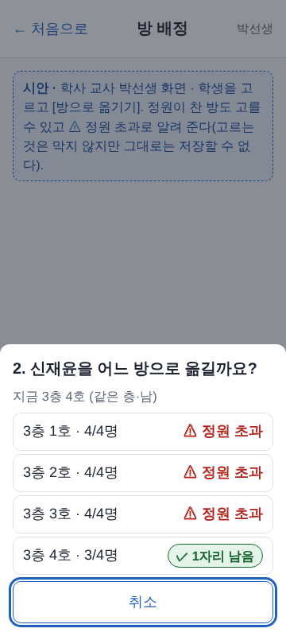 | 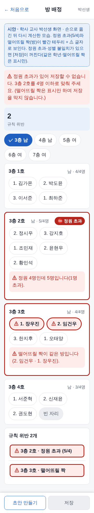 |

## E. 짝 정보가 다른 계정에 안 보이는지 (결정 64, 약 25분)

**떨어뜨릴 짝과 그 사유는 관리자·학사 교사만 봅니다.** 시험2 계정 하나로 역할을 바꿔 가며 확인합니다. 역할을 바꿀 때마다 시험2가 **로그아웃했다가 다시 접속**합니다(편집기 `addUser`는 소유자만 실행).

| 번호 | 누가 | 누르는 것 | 이렇게 보이면 통과 | 사진 | 결과 |
| --- | --- | --- | --- | --- | --- |
| E1 | 소유자 → 시험2 | 편집기에서 `addUser(시험2 gmail, '시험2', 'attendance')` 실행. 시험2로 접속해 홈을 봅니다 | 좌석표 카드에 **[떨어뜨릴 짝] 버튼이 없다.** (출결 담당) | | |
| E2 | 시험2 | 주소 끝에 `?page=avoid`를 붙여 직접 엽니다 | "권한이 없습니다" 화면이 나오고 짝 목록은 한 줄도 보이지 않는다 | | |
| E3 | 시험2 | **좌석표 열기** → 공간을 열어 빨간 칸이 있는 곳을 찾습니다 | 같은 학년·성별 위반의 빨간 표시는 보일 수 있지만 **"떨어뜨릴 짝" 표시도 목록 줄도 없다.** 칸을 눌러도 짝 이름·사유가 없다. [초안 만들기]·[저장]·맞바꾸기 버튼이 없다 | | |
| E4 | 시험2 | **방 배정**(`?page=rooms`)을 엽니다 | **정원 현황(숫자 표)만** 보이고 "방 배정" 탭도 없다. **방 카드·학생 이름·짝 표시·맞바꾸기·옮기기·[초안 만들기]·[저장]이 없다**(보기 권한은 숫자만). | | |
| E5 | 소유자 → 시험2 | `addUser(시험2 gmail, '시험2', 'duty_manager')`로 바꾸고 E2~E4를 다시 합니다(근무표 담당자) | E2~E4와 같다: 짝 화면 권한 없음, 좌석 격자에 짝 표시 없음, 방 배정은 **정원 현황 숫자 표만** 보이고 방 카드·학생 이름이 없다 | | |
| E6 | 소유자 → 시험2 | `addUser(시험2 gmail, '시험2', 'homeroom', '1-1')`로 바꾸고 접속합니다(담임, 학급은 가짜 명단 학급 중 하나) | 홈에 좌석표 카드만 있고 [떨어뜨릴 짝]·방 배정 카드가 없다. `?page=avoid`·`?page=rooms`를 열면 둘 다 "권한이 없습니다". 좌석표에는 **떨어뜨릴 짝 표시도 목록도 없고** 초안·저장 버튼도 없다 | | |
| E7 | 0단계 학생·학부모 계정 | (계정이 있으면) 홈과 `?page=seats`·`?page=avoid`·`?page=rooms`를 엽니다 | 홈에 좌석·방·짝 카드가 없고 세 주소 모두 "권한이 없습니다" 또는 해당 홈으로 돌아간다 | | |
| E8 | 소유자 | 시험2 역할을 원래대로 돌려 둡니다(`addUser(시험2 gmail, '시험2', 'attendance')`) | 이후 시험이 다른 계정 역할과 섞이지 않는다 | | |

> 컴퓨터 테스트가 이미 확인한 것: 담임·학생·학부모·출결 담당·근무표 담당자가 짝 목록을 부르면 거부, 좌석 응답에서 **떨어뜨릴 짝 위반 항목이 `avoid.view` 없는 사람에게는 통째로 빠짐**, 방 응답에도 짝 정보가 없음. E는 이를 실제 로그인 화면에서 한 번 더 보는 것입니다.

## 결과 적는 법

- 모두 ○면 "3단계 확인 통과"라고 총괄에게 알립니다.
- ×는 **번호 + 한 줄 + 사진**으로 적습니다(예: "E3 담임 좌석표에 짝 줄이 보임", "D7 정원 초과인데 [저장]이 눌림").
- 앱이 느린 문제는 선생님 설정 문제일 수 있으니 총괄이 먼저 원인을 찾습니다.
- 가짜 데이터가 모자라 단계를 못 따라 하면(예: 방이 한 칸도 가득 차지 않음) 번호와 "데이터 부족"이라고 적어 주세요. 총괄이 가짜 데이터를 보강합니다.
