# 4단계 선생님 확인 체크리스트

> 4단계(시범 운영 준비)에 새로 들어간 기능을 선생님이 실제 Apps Script에서 따라 하며 확인하는 순서입니다. 형식은 `stage2-teacher-checks.md`·`stage3-teacher-checks.md`와 같습니다.
> **A~F**는 코딩A가 만든 기능(휴일·기간 일괄 설정 C24, 근무 기록표 엑셀 C14b, 서류 체크리스트 C27, 연락처 C29, 방학 중식 C30)이고(`stage4-teacher-checks-coding-a.md`의 내용을 합친 것), **G~K**는 확인서 두 종(C25)·식수 집계(C19b)·입퇴실 세부(C26)·즉시 퇴실 항목(C19b·R17)·학사 프로그램(C28)입니다. **L**은 임시 퇴실입니다(학년 일괄 퇴실 L13은 화면이 병합된 뒤 채웁니다).
> **사진 읽는 법:** 각 절 끝의 "시안 사진"은 D 세션 미리보기의 휴대폰(360px) 모양입니다. 실제 화면은 숫자·이름이 다르지만 **모양과 표시가 이렇게 나오면 통과**입니다. 표의 "사진" 칸은 선생님이 찍은 실제 화면을 붙이는 자리입니다. 화면·버튼 이름이 실제와 다르면 ×가 아니라 "이름 차이"로 적어 주세요(디자인 세션이 이 문서를 고칩니다).

## 읽는 법

- 한 단계 = **누르는 것 → 이렇게 보이면 통과 → 사진 → 결과(○/×)** 입니다.
- ×가 나오면 **번호 + 한 줄**(예: "D4 학사 교사에게 진행 표가 보임")과 화면 사진을 총괄에게 보냅니다. 앱이 이상한 것이지 선생님이 잘못 누르신 것이 아닙니다.
- 컴퓨터 테스트(`npm test`)가 이미 확인한 것은 "이미 확인됨"으로 적었습니다. 여기서는 **실제 Apps Script에서만 보이는 것**(로그인, 시트 열 끼우기, 휴대폰 화면, 실제 엑셀 열림, 계정별 화면)만 봅니다.
- 이름·번호는 모두 **가짜 데이터**입니다(전화는 `010-0000-xxxx` 형식뿐). 실제 학생·학부모 정보를 쓰는 시험은 없습니다.
- 날짜는 가짜 데이터가 있는 **2027년**을 화면의 날짜 고르기로 고릅니다(오늘 날짜를 바꾸지 않습니다).

## 시험 계정

| 이름 | 역할 | 쓰는 곳 |
| --- | --- | --- |
| 소유자 | 관리자 + 학사 교사(선생님 계정) | 준비, B~K 전체 |
| 시험1 | 학사 교사(가짜 데이터에서 담당 학생이 있는 계정) | C~K에서 "담당 학생만 보이는지", G·I·K의 담당교사 일 |
| 시험2 | **역할을 바꿔 가며** 출결 담당 → 근무표 담당자 → 담임 → 학생 → 학부모 | 모든 절의 "안 보여야 하는 사람" 확인(G11·J5·K12·K13 포함) |

시험2는 편집기에서 `addUser`를 같은 이메일로 다시 실행하면 역할이 바뀝니다(3단계 체크리스트와 같은 방법).

## A. 먼저 끝나 있어야 하는 것 (준비, 소유자, 약 15분)

| 번호 | 누가 | 할 일 | 이렇게 보이면 통과 | 사진 | 결과 |
| --- | --- | --- | --- | --- | --- |
| A1 | 소유자 | `clasp push` 뒤 편집기에서 `setup`을 **다시** 실행합니다 | 로그에 `doc_types`·`programs`·`program_participants` `[탭 생성]`, 기간마다 `student_docs_<기간>` `[탭 생성]`, **`[열 추가] students: phone`**, **`[열 추가] guardian_links: name, phone`**이 보이고 `[경고]`가 없다(두 번째 실행은 모두 `[탭 유지]`) | | |
| A2 | 소유자 | 시트(운영 DB)를 직접 열어 `students`·`guardian_links` 탭을 봅니다 | 새 열 `phone`(학생), `name`·`phone`(보호자)이 **`email`·`relation` 뒤, `memo` 앞**에 있고 **기존 값이 그대로**다. 열이 어긋나거나 값이 밀린 줄이 없다 | | |
| A3 | 소유자 | 편집기에서 `seedFakeData` → `seedFakeStage1` → `seedFakeStage2` → `seedFakeStage3` → `seedFakeStage4`를 차례로 실행하고, `seedFakeStage4`를 한 번 더 실행합니다 | 두 번째 실행에서 행이 늘지 않는다. `seedFakeStage4` 로그에 휴일 2일·서류 6종·전화·방학 기간 추가가 보인다 | | |
| A4 | 소유자 | 시험1을 `addUser(시험1 gmail, '시험교사', 'hall_teacher')`로 등록합니다 | 시험1로 로그인하면 학사 교사 홈이 열린다 | | |
| A5 | 소유자 | 시트의 `audit_log` 탭에서 방금 만든 전화 관련 줄을 찾아봅니다 | 전화 값 대신 **`(연락처 생략)`**만 보인다. `010-0000-` 로 시작하는 글자가 `audit_log` 어디에도 없다 | | |

## B. 휴일·기간 일괄 설정 (C24, 소유자, 약 25분)

홈 → **자습 일정 열기**.

| 번호 | 누가 | 누르는 것 | 이렇게 보이면 통과 | 사진 | 결과 |
| --- | --- | --- | --- | --- | --- |
| B1 | 소유자 | 달력에서 **2027년 5월**로 갑니다. 5월 5일(수)을 누릅니다 | 요일 유형이 **휴일**, 시작 **09:00**, 종료 **21:50**이고 블록이 5개(09–12, 14–15:30, 15:30–17, 19–20:30, 20:30–21:50)다. 가짜 데이터가 미리 넣어 둔 휴일이다 | | |
| B2 | 소유자 | 홈 → **출석부** → 날짜 **2027-05-05** | 출석부 칸이 5개이고 마지막 칸 머리말이 **20:30–21:50**이다 | | |
| B3 | 소유자 | 일정 화면 아래 **블록 편집**에서 요일 유형 **휴일**·기간 유형 **학기**를 고릅니다 | 가짜 데이터가 저장해 둔 5개 블록이 보인다. (실제 운영 시트처럼 휴일 블록이 아직 없으면 "아직 저장되지 않은 제안 틀입니다…" 노란 안내와 함께 같은 5개가 채워져 있고, **[블록 저장]을 눌러야** 적용된다) | | |
| B4 | 소유자 | **기간 일괄 설정** 카드에서 시작 날짜 **2027-03-01**, 끝 날짜 **2027-03-31**, 요일 **수**만 체크, 시작 시각 **18:00**을 적고 **[미리 보기]** | "5일 중 5일이 바뀝니다. 운영 안 하는 날 0일, 이미 같은 값 0일은 건너뜁니다." 아래에 날짜·요일·**앞 → 뒤**(예: "3월 3일(수) 18:30–23:50 월~목 → 18:00–23:50 월~목")가 5줄 보인다. 아직 아무것도 저장되지 않았다 | | |
| B5 | 소유자 | **[이대로 저장]** | "5일을 바꿨습니다." 달력 3월에서 **수요일 5일만** 시작이 18:00이고 다른 요일은 그대로다 | | |
| B6 | 소유자 | B4와 같은 값으로 다시 **[미리 보기]** | "5일 중 0일이 바뀝니다 … 이미 같은 값 5일은 건너뜁니다." **[이대로 저장]이 꺼져 있다**(누를 수 없다) | | |
| B7 | 소유자 | 3월 10일(수)을 눌러 **운영 안 함**으로 저장(확인창이 나오면 확인)합니다. 그다음 B4를 다시 하되 시작 시각을 **17:30**으로 바꿔 [미리 보기] | "운영 안 하는 날 **1일**" 건너뛴다고 나온다. 저장하면 3월 10일은 **운영 안 함 그대로**다 | | |
| B8 | 소유자 | 기간 **2027-03-01 ~ 2027-03-01**(월요일 하루)에 요일 **수**만 체크하고 [미리 보기] | 오류 "고른 기간에 해당 요일이 없습니다." 저장 버튼이 켜지지 않는다 | | |
| B9 | 소유자 | 시작 **18:00**, 종료 **17:00**으로 [미리 보기] | 종료가 시작보다 앞이라는 오류가 칸 아래에 나온다. 아무것도 저장되지 않는다 | | |
| B10 | 소유자 | **두 창으로**: 창1에서 B4를 [미리 보기]까지만 합니다. 창2에서 3월 17일(수) 하루의 종료를 바꿔 저장합니다. 창1로 돌아와 **[이대로 저장]** | "다른 관리자가 먼저 바꿨습니다. 새로 불러온 뒤 다시 해 주세요." 안내가 나오고 화면이 새로 불러와진다. 창1의 일괄 저장은 **반영되지 않았다** | | |
| B11 | 시험1 | 홈 → 자습 일정(학사 교사 홈에 보이는 경로) | **기간 일괄 설정** 카드에 "일괄 설정은 관리자만 할 수 있습니다."만 보이고 입력칸·버튼이 없다 | | |
| B12 | 소유자 | 시트 `day_schedules` 탭에서 B5의 수요일들을 봅니다 | 같은 날짜에 **옛 행은 `취소`, 새 행은 `유효`**로 남아 있다(지워진 행이 없다). `audit_log`에 `schedule:batch` 한 줄이 있다 | | |
| B13 | 시험1 | 휴대폰으로 일정 화면을 엽니다 | 가로로 밀리지 않고 요일 체크·버튼이 손가락으로 누를 만하다 | | |

> **알려진 한계(오류 아님):** 휴일이 평일(월~목)에 걸리면 **근무 칸 틀과 '23:00 종료' 칸이 아직 달력 요일 기준**입니다(규칙 세션 R21 대기). 시험 기간 새벽 연장(01:00·02:00)은 규칙이 바뀐 뒤에 열립니다 — 지금은 종료가 24:00까지만 입력됩니다.
> 이미 확인됨: 건수 = 직접 센 수요일, 비운 칸은 기존 값 유지, 같은 날 옛 행 모두 취소, sig 불일치 시 쓰기 0, 관리자 외 6개 역할 거부, 블록이 없는 요일 유형은 저장 전에 막힘.

## C. 근무 기록표 엑셀 (C14b, 약 15분)

홈(관리자) → **근무표** → **기록표** 탭.

| 번호 | 누가 | 누르는 것 | 이렇게 보이면 통과 | 사진 | 결과 |
| --- | --- | --- | --- | --- | --- |
| C1 | 소유자 | 달을 **2027년 1월**로 하고 **[엑셀 받기]** | "엑셀 파일을 만들었습니다." 파일 `근무기록표_2027-01.xlsx`가 받아지거나 옆 링크가 나온다 | | |
| C2 | 소유자 | 받은 파일을 **엑셀(또는 구글 시트)**로 엽니다 | **경고 없이 열린다.** 시트가 둘이다: **월별 근무표**, **합계·교대** | | |
| C3 | 소유자 | 시트 **월별 근무표**를 봅니다 | 일~토 달력이다. 평일 칸에 "21:30 이름 / 23:00 이름", 주말 칸에 이름과 **(예비 이름)**. 1월 1일은 "(운영 안 함)". **교대한 칸은 `원래=>바뀐`** 모양(예: 1월 5일 "가짜교사2=>시험 학사교사")이다 | | |
| C4 | 소유자 | 시트 **합계·교대**를 봅니다 | 교사별 근무 합계(크게)와 21:30조·23:00조·단독·예비 지정 횟수가 보이고 **합계 줄**이 있다. 아래 교대 목록에 교대 3건(대신 근무 1건 포함)이 있다. **학생 이름·이메일이 없다** | | |
| C5 | 소유자 | 같은 달 기록표 화면의 **교사별 합계 표**와 [PDF 받기]로 받은 PDF의 합계를 엑셀 합계와 맞춰 봅니다 | 세 곳의 교사별 숫자가 모두 같다 | | |
| C6 | 시험2(근무표 담당자) | 같은 화면을 열고 [엑셀 받기] | 소유자와 같은 파일이 받아진다 | | |
| C7 | 시험1 | 학사 교사 홈의 **내 근무 기록** | **본인 행만** 보이고 [엑셀 받기]·[PDF 받기]가 **없다** | | |
| C8 | 시험2(출결 담당으로 바꾼 뒤) | 근무표 → 기록표 | 파일 버튼이 없다 | | |
| C9 | 소유자 | 근무가 없는 달(예: 2027-12)에서 [엑셀 받기] | 빈 달력과 빈 합계 시트로 열린다(오류가 아니다) | | |

> 이미 확인됨: 시트2 합계 = 독립 계산 = PDF 모델, XML 짝·이스케이프·열 문자, 허용(담당자·관리자)·거부(5개 역할) 권한, 만든 파일이 openpyxl·LibreOffice에서 열림.
> 확인 못 한 것: **실제 Apps Script의 `Utilities.zip`으로 만든 파일이 실제 엑셀에서 열리는지**(C2가 그 확인입니다).

**시안 사진 (근무 기록표 엑셀 칸 배치, D9)**

| C3 월별 근무표 (`duty-xlsx-sheet1`) | C4 합계·교대 (`duty-xlsx-sheet2`) |
| --- | --- |
| 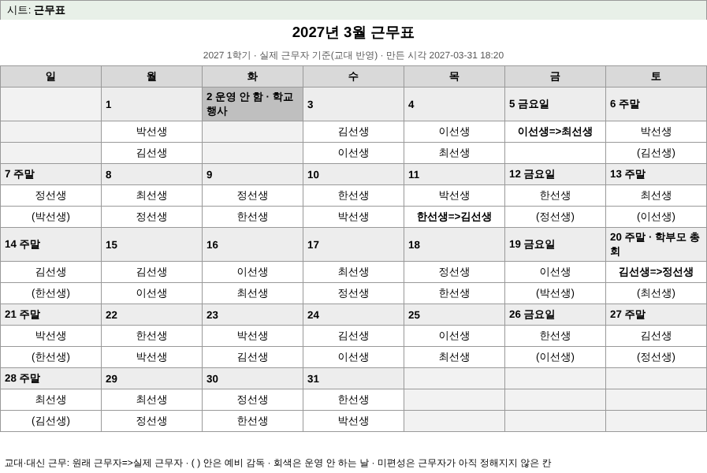 | 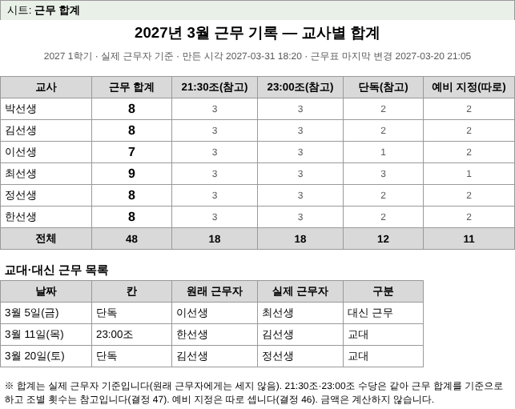 |

## D. 서류 체크리스트 (C27·C27b, 약 30분)

| 번호 | 누가 | 누르는 것 | 이렇게 보이면 통과 | 사진 | 결과 |
| --- | --- | --- | --- | --- | --- |
| D1 | 소유자 | 홈 → **서류 체크리스트** 카드 | "미제출 N건 · 학생 M명"과 [서류 체크리스트 열기]. 서류 체크리스트를 열면 위에 **서류별·담당교사별 진행 표**, 아래에 [미제출 목록 \| 서류별]과 학생 줄이 있다 | | |
| D2 | 소유자 | 진행 표를 봅니다 | **서류별**: 서류 6종마다 제출·미제출·해당없음 학생 수. **담당교사별 미제출**: 선생님마다 담당 학생 수·미제출 건수(많은 선생님이 위), 마지막 **전체** 줄. 학생 이름이 없다. 홈 카드 숫자(N건)와 전체 줄의 미제출 건수가 같다 | | |
| D3 | 소유자 | 학생 줄을 봅니다 | "**2. 이름 2-3 5번 · 담당 선생님**" 모양(다른 화면과 같은 표기)이다 | | |
| D4 | 시험1 | 홈 → 서류 체크리스트 | **담당 학생만** 보이고 진행 표는 **없다**. 미제출 목록에서 어느 서류의 **[제출]**을 누르면 그 줄이 목록에서 사라지고 숫자가 1 줄어든다 | | |
| D5 | 시험1 | [서류별] → 서류 하나를 고르고 방금 낸 학생의 **[미제출]** | 다시 미제출이 되고 목록·숫자에 돌아온다. 같은 학생 줄이 **새로 생기지 않고 같은 칸이 바뀐다**(시트 `student_docs_<기간>`에서 학생·서류당 한 줄) | | |
| D6 | 소유자 + 시험1 | **두 창으로**: 둘 다 같은 학생·서류 칸을 열어 둔 채 소유자가 [제출]을 누른 뒤, 시험1이 같은 칸에서 [해당없음] | 시험1 쪽에 "다른 선생님이 먼저 바꿨습니다…" 안내가 나오고 화면이 새로 불러와진다. 소유자가 한 [제출]이 그대로다 | | |
| D7 | 시험2(출결 담당) | 서류 체크리스트 | 학사생 **전체**가 보이지만 **버튼이 모두 꺼져** 있고 "보기만 할 수 있습니다…"가 보인다. 진행 표·서류 종류 관리는 없다 | | |
| D8 | 소유자 | 맨 아래 **서류 종류 관리**를 봅니다 | 서류마다 "서류 이름·설명 (선택)·순서" **글자 라벨이 입력칸 위에** 있고 입력칸이 손가락으로 누르기 편한 크기(48px 이상)다 | | |
| D9 | 소유자 | 새 서류 "가짜: 확인용"을 **[서류 추가]** → 그 서류의 이름을 고쳐 [저장] → **[끄기]**(확인창에서 끄기) | 추가하면 목록(과 진행 표)에 생긴다. 끄면 목록에서 사라지지만 **삭제 버튼은 없고** 시트 `doc_types`에 `취소`로 남는다. 이미 표시한 제출 기록은 지워지지 않는다 | | |
| D10 | 소유자 | 서류 이름을 **이미 있는 이름**으로 저장해 봅니다 | "같은 이름의 서류가 이미 있습니다." 오류가 그 줄 아래 나온다 | | |
| D11 | 시험2(담임 → 학생 → 학부모로 바꿔 가며) | 주소창에 `?page=docs`로 열어 봅니다 | 모두 "권한이 없습니다" 또는 메뉴 자체가 없다. 홈에 서류 카드도 없다 | | |
| D12 | 시험1 | 휴대폰으로 서류 체크리스트를 엽니다 | 가로로 밀리지 않고 세 버튼이 손가락으로 누를 만하다 | | |

> 이미 확인됨: 같은 칸 한 줄·되돌려도 같은 줄 수정, stale(expect·token), 담당·근무교사·관리자만 표시, 출결 보기만, 서류 종류 관리 관리자만, 진행 표 숫자 = 직접 센 값·이름 없음, 기간 탭이 없을 때 안내.
> 배포 전 확인(A1): `student_docs_<기간>` 탭이 없으면 이 화면이 "setup을 실행하라"는 안내를 보이고 표시는 막힙니다.

**시안 사진 (360px, C27 실제 화면에 맞춘 시안)**

| D1 홈 카드 (`docs-home`) | D1 미제출 목록 (`docs-missing`) | D5 서류별 (`docs-by-type`) | D7 출결 담당 보기만 (`docs-readonly`) |
| --- | --- | --- | --- |
| 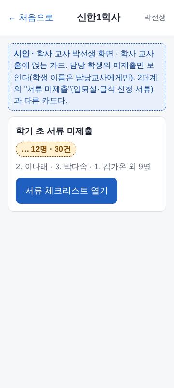 | 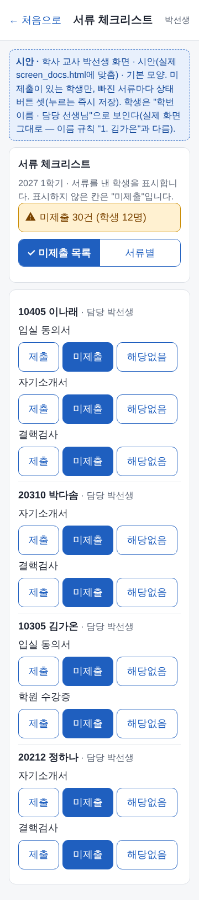 | 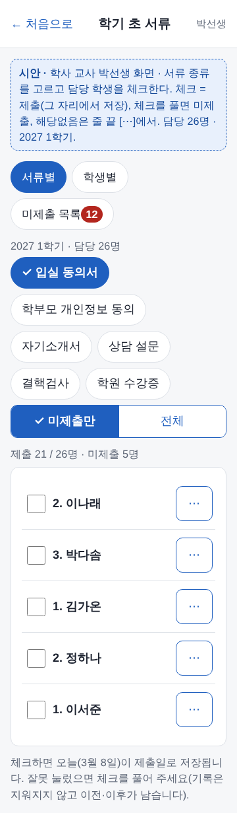 | 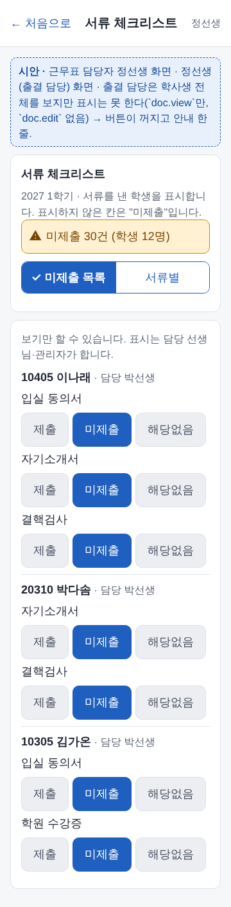 |

| D8 서류 종류 관리 (`docs-types`) | D9 끄기 확인 (`docs-type-off`) |
| --- | --- |
| 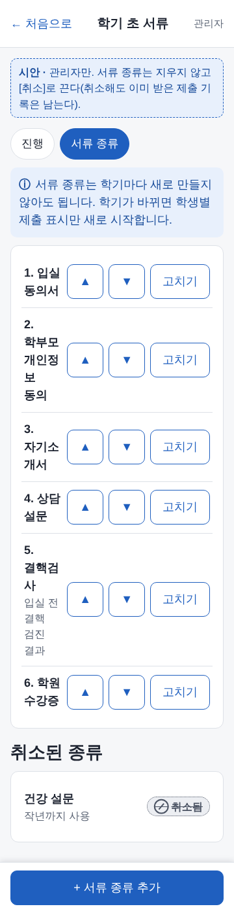 | 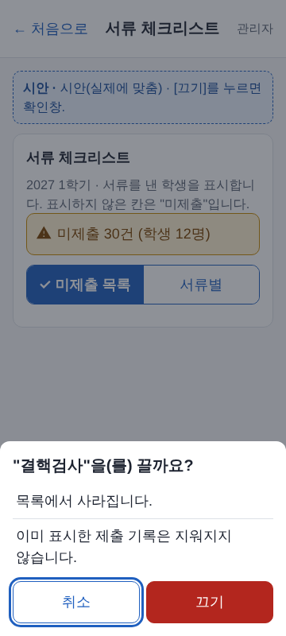 |

> D2의 관리자 진행 표는 시안(`docs-proposal-summary`, "실제와 다름")으로만 있습니다. 실제 화면 모양은 #187 이후 코드가 기준이고, 시안과 숫자·배치가 달라도 ×가 아닙니다.

## E. 연락처 (C29, 약 25분)

| 번호 | 누가 | 누르는 것 | 이렇게 보이면 통과 | 사진 | 결과 |
| --- | --- | --- | --- | --- | --- |
| E1 | 소유자 | 홈 → **명단 올리기** → **연락처** 탭, 기간을 고르고 **가짜 표**(첫 줄 `학번 학생전화 학부모구글계정 보호자이름 보호자전화`, 아래에 학번·번호 한두 줄. 보호자 줄은 학부모 연결이 있는 학생)를 붙여 넣고 **[확인]** | "학생 전화 변경 N명 · 보호자 연락처 변경 M건 · 이미 같음 K건"과 학번+이름만 나온다. **전화번호·보호자 이름이 화면 어디에도 나오지 않는다**. [저장]이 확인 뒤에 켜진다 | | |
| E2 | 소유자 | 번호를 `01012345678`·`010 1234 5678`처럼 다르게 쓴 줄로 [확인] → [저장] | 저장된다. 시트에는 **`010-1234-5678` 모양**으로 들어가 있다 | | |
| E3 | 소유자 | 같은 표를 다시 [확인] | "변경 없음"이고 [저장]이 꺼져 있다. 번호 칸을 **비운** 줄은 기존 번호를 지우지 않는다 | | |
| E4 | 소유자 | 틀린 표로 [확인]: 번호 자릿수 부족, 학번 4자리, 연결되지 않은 학부모 계정 | 줄 번호와 열 이름이 있는 오류(예: "3번째 줄 · 학생전화: 전화번호 형식이 아닙니다")가 나온다. **오류 문구에 번호가 되풀이되지 않는다.** 아무것도 저장되지 않는다 | | |
| E5 | 시험1 | 홈 → **연락처** | **담당 학생만** 목록에 나온다(번호 없음, "연락처 없음" 표시만). 학생 줄의 **[연락처 보기]**를 누르면 학생 전화와 보호자(관계·이름) 전화가 나오고 **전화 링크(눌러서 전화)**로 보인다 | | |
| E6 | 시험1 | 담당이 아닌 학생의 연락처를 보려 합니다(목록에 없으므로 주소·화면으로는 못 가는 것이 정상) | 목록에 없다. 소유자가 알려 준 학생 id로 `?page=contacts`에서 억지로 열어도 "권한이 없습니다" | | |
| E7 | 소유자 | 근무표에서 **오늘 시험1이 근무**가 되도록(근무표 편성에서 오늘 날짜 칸에 시험1 지정) 한 뒤 시험1로 연락처를 엽니다 | 시험1에게 **이번 기간 학사생 전체**가 보인다(그날 근무교사). 근무가 아닌 날에는 다시 담당 학생만 보인다 | | |
| E8 | 시험2(출결 담당 → 근무표 담당자 → 담임 → 학생 → 학부모) | 연락처 화면과 학생 상세·출석부·특이사항·OUT·식수 집계·서류 체크리스트·PDF·엑셀을 열어 봅니다 | **어디에도 전화번호·보호자 이름이 없다.** 연락처 화면은 "권한이 없습니다" 또는 메뉴가 없다 | | |
| E9 | 소유자 | 근무 기록표 엑셀·식수 집계 엑셀/PDF·출석부 PDF를 한 번씩 열어 봅니다 | 어디에도 전화번호가 없다 | | |
| E10 | 소유자 | 시트 `audit_log`에서 E2·E3을 저장한 줄을 봅니다 | `before`/`after`에 **번호가 없고 `(연락처 생략)`**만 있다 | | |

> 이미 확인됨: 모든 역할 × 읽기 함수 응답·출력물·메일·감사 기록에 번호 없음(전화 노출 감시 시험), `readAll_`가 연락처 열을 지움, 줄 수정이 전화 칸을 지우지 않음, 담당·관리자·근무교사만 통과(그 밖 역할 거부 + `denied:contact.view`).
> 일부러 안 한 것: 누가 연락처를 열어 봤는지 기록은 남기지 않습니다(필요하면 알려 주세요). 학생·학부모가 자기 연락처를 보는 화면은 6.1 뒤입니다.

## F. 방학 중식 (C30, 약 25분)

| 번호 | 누가 | 누르는 것 | 이렇게 보이면 통과 | 사진 | 결과 |
| --- | --- | --- | --- | --- | --- |
| F1 | 소유자 | 홈 → **식수 집계 열기** → 날짜를 **2027-07-21**(방학 기간 안)로 고릅니다 | 표의 **조식 오른쪽에 중식 열**이 있고, 가짜 데이터의 중식 실시 학생 수가 보인다(전체 줄 = 위 줄들의 합). 위에 "2027 여름방학(테스트)" | | |
| F2 | 소유자 | 날짜를 **2027-04-05**(학기)로 바꿉니다 | 중식 열이 **없다** | | |
| F3 | 소유자 | 날짜 **2027-07-21**에서 아래 바의 **[급식실 양식으로 출력]**(PDF)과 **[엑셀로 받기]**를 누릅니다 | 둘 다 조식 다음에 **중식 열**이 있고 화면 숫자와 같다. PDF에는 "중식은 방학 기간에만 집계합니다" 안내가 있다 | | |
| F4 | 소유자 | 날짜 **2027-04-05**에서 [급식실 양식으로 출력]·[엑셀로 받기] | 둘 다 중식 열이 **없다** | | |
| F5 | 소유자 | 식수 집계에서 날짜를 **2027-07-19**(실시 시작일), **2027-07-26**(방학 중 미실시 신청이 적용되는 월요일)로 바꿉니다 | 중식 실시 인원이 **7/26부터 1명 줄어든다**(가짜 데이터: 한 명이 7/21에 미실시를 신청해 다음 주 월요일부터 빠짐) | | |
| F6 | 시험1 | 홈 → **입퇴실·급식** → 급식 변경 | **오늘이 방학(또는 방학 시작 30일 전)이 아니면 "중식 실시/미실시" 버튼이 보이지 않는다** — 이것이 정상이다. 버튼은 조식·석식 5개만 | | |
| F7 | 시험1 | 가짜 데이터의 방학 학생(담당 학생 중 한 명)의 **학생 기록**을 엽니다 | 중식 신청이 있는 학생은 "지금" 줄에 **중식 실시**(또는 미실시)가 보이고, 기록에 "중식 실시 …"가 있다. 중식 신청이 없는 학생도 줄이 **지금 방학이 아니어도 값이 있으면** 보인다 | | |
| F8 | 소유자 | (**실제 방학 시작 한 달 전~방학 중에 한 번 더**) F6을 다시 확인합니다 | 이때는 **중식 실시·중식 미실시** 버튼이 보인다. 중식 실시를 저장하면 적용일은 조식과 같은 마감 규칙(11:30 전이면 당일, 미실시는 수요일 11:30 전이면 다음 주 월요일), 방학 시작 전에 낸 신청은 **방학 시작일부터**다 | | |
| F9 | 시험1·시험2 | 담임·학생·학부모·출결 담당 계정으로 식수 집계를 엽니다 | 식수 집계는 관리자만 열린다(그 밖은 거부) — 중식이 생겨도 달라지지 않는다 | | |

> 이미 확인됨: 중식 신청은 방학에만(서버도 거부), 방학 시작일부터 적용, 적용일을 방학보다 이르게 고치면 오류 문구, 식수 집계 `lunch` = 직접 센 값, 화면·엑셀·PDF가 같은 기준(`hasLunch`), 학기 날짜에는 중식 열이 없음.
> 확인 못 한 것·가정: **방학 시작 30일 전부터 미리 신청**할 수 있게 한 것은 가정입니다(결정 73에 기간이 없음). **퇴실할 때 중식**(결정 79)은 규칙 세션의 R19 보충 뒤에 저장 쪽 연결을 확인합니다 — 지금은 퇴실한 날부터 집계에서 빠지는 것까지만 입니다.

**시안 사진 (360px, 식수 집계 PDF 모양)**

| F3 방학 날짜 — 중식 열 있음 (`vacation`) | F4 학기 날짜 — 중식 열 없음 (`term`) |
| --- | --- |
| 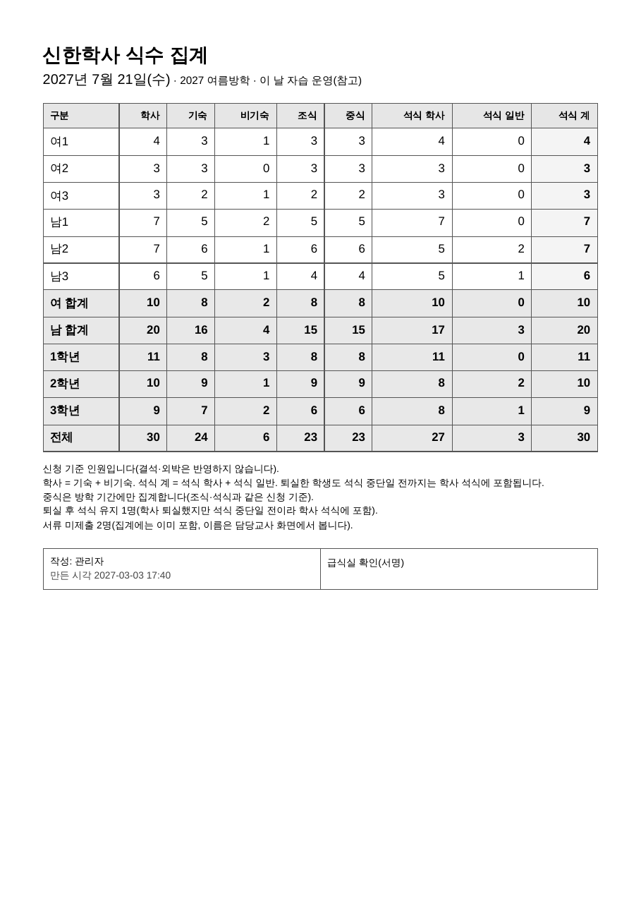 | 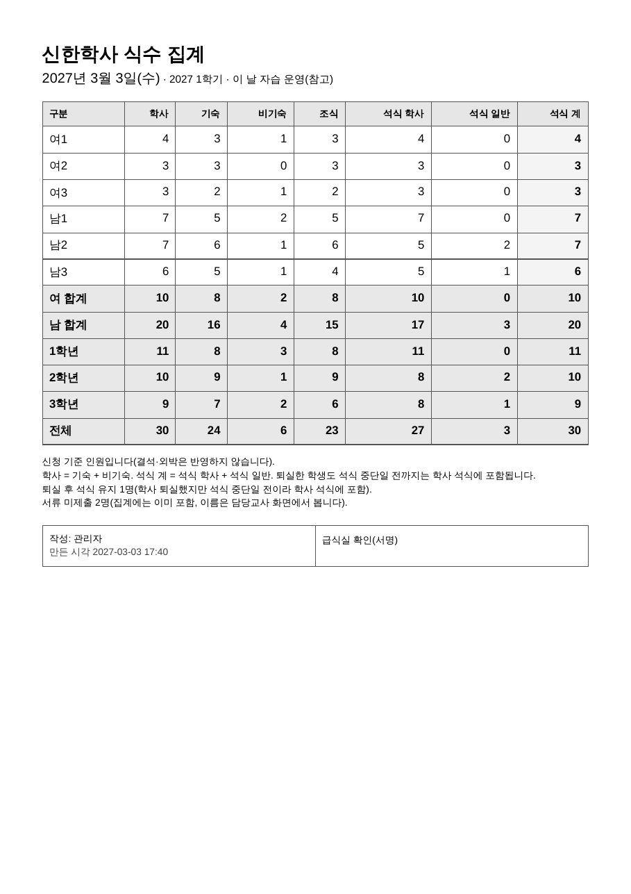 |

## G. 확인서 두 종 — 급식(미)실시·입퇴실 (C25·D11b, 결정 68, 약 40분)

**준비물:** 2025판 **빈 양식 종이 두 장**(학교급식(미)실시 확인서, 기숙사 및 신한학사 입․퇴실 확인서)과 **mm 자**. 인쇄는 **A4 세로, 배율 100%**.
여기서는 **화면 흐름·권한·파일이 남지 않는 것**을 봅니다. 종이 위 글자·○·✓의 자리는 `print-check.md` 11절(67~82번)에서 빈 양식과 나란히 놓고 봅니다. 시험한 신청은 끝에서 **취소**해 가짜 데이터를 되돌립니다(G13).
확인서는 **담당교사와 관리자만** 만들 수 있고, 학생 이름은 **종이에만** 있습니다(파일 이름·목록 화면·감사 기록에 없습니다).

| 번호 | 누가 | 누르는 것 | 이렇게 보이면 통과 | 사진 | 결과 |
| --- | --- | --- | --- | --- | --- |
| G1 | 시험1 | 홈 → **급식 변경 신청**에서 담당 가짜 학생을 고르고 **조식**을 "미실시"로 바꾸는 신청을 저장합니다(확인창에서 저장) | 저장 뒤 화면에 카드 **"방금 저장한 신청서의 학교급식(미)실시 확인서를 인쇄해 서명을 받으세요."**와 **[확인서 인쇄]**·**[닫기]**가 보인다 | | |
| G2 | 시험1 | **[확인서 인쇄]**를 누릅니다 | 버튼이 "만드는 중…"으로 바뀌었다가 PDF가 받아지고 알림 **"확인서를 만들었습니다. 서명을 받은 뒤 [제출 표시]를 눌러 주세요."**가 나온다. 파일 이름이 `급식확인서_날짜.pdf`(학생 이름 없음). 열어 보면 **1쪽**, 제목 "학교급식(미)실시 확인서", **급식미실시 ( ○ )**, 조식 미실시 칸 ✓ | | |
| G3 | 시험1 | [닫기]를 누르고 화면을 새로 고쳐 입퇴실·급식의 **[학생 기록]** 탭에서 그 학생을 엽니다 | 방금 신청한 줄 오른쪽에 **[확인서 인쇄]**가 있다(저장 직후 카드를 닫아도 기록 줄에서 다시 받을 수 있다). 누르면 G2와 같은 PDF가 나온다 | | |
| G4 | 시험1 | 급식 변경 신청 화면 위쪽 **"확인서 사유 구분(선택)"** 칩에서 **전입**을 고르고 다른 가짜 학생의 급식 변경을 저장해 확인서를 받습니다 | 확인서 "구분(사유)" 줄의 **"전입"에 둥근 동그라미**가 있다. 칩을 아무것도 고르지 않은 신청(G2)의 확인서에는 동그라미가 없다 | | |
| G5 | 시험1 | 사유 구분을 **기타**로 고르고 사유 칸을 **비워** 저장해 봅니다. 이어서 "가짜: 시험" 두 글자 이상을 적고 저장합니다 | 비웠을 때는 **"'기타'는 사유를 2자 이상 적어 주세요(확인서에 적힙니다)."**로 막힌다. 적고 저장하면 확인서에 `기타 ( 가짜: 시험 )`이 적힌다 | | |
| G6 | 시험1 | 담당 학생의 **석식을 "학사 석식 ↔ 일반 석식"으로만 바꾸는** 신청을 저장합니다(실시·미실시는 그대로) | 저장 뒤 카드와 기록 줄에 **[확인서 인쇄]가 없다**(실시·미실시가 바뀔 때만 만든다) | | |
| G7 | 시험1 | 홈 → **입퇴실 신청**에서 담당 가짜 기숙사생을 고르고 **학사 및 기숙사 퇴실**(석식은 "중단")을 저장합니다 | 저장 뒤 카드 **"방금 저장한 입퇴실 신청서의 확인서(행정실 제출용)를 인쇄해 서명을 받으세요."**와 [확인서 인쇄]가 보인다 | | |
| G8 | 시험1 | **[확인서 인쇄]**를 누릅니다 | `입퇴실확인서_날짜.pdf`가 받아진다. 열면 **1쪽**, 제목 "기숙사 및 신한학사 입․퇴실 확인서", **퇴 실 ( ○ )**, 구분 **기숙사·신한학사 둘 다 ○**, 입․퇴실일이 적용일, 비고 칸에 사유 | | |
| G9 | 시험1 | (입실 전이거나 재입실 제한이 없는 가짜 학생이 있으면) **학사 입실**을 저장하고 확인서를 받습니다 | **입 실 ( ○ )**이고 구분은 신청한 것 하나만 ○. 마땅한 학생이 없으면 번호와 "데이터 부족"만 적고 넘어갑니다(자진 퇴실 학생은 다음 학기 끝까지 다시 입실할 수 없는 것이 정상입니다, 결정 70) | | |
| G10 | 소유자 | 2단계 C7~C10 흐름으로 **2OUT 퇴실 확정**을 해 미리 채워진 입퇴실 신청서(사유 "2OUT 퇴실")를 저장하고 확인서를 받습니다 | 확인서 **비고 칸이 비어 있다**(행정실에 내는 종이에 징계 사유를 적지 않는다). 다른 칸(퇴실·구분·퇴실일·이름)은 G8과 같은 모양이다 | | |
| G11 | 시험2(출결 담당 → 담임 → 학생 → 학부모로 바꿔 가며) | 입퇴실·급식 화면의 학생 기록이나 담임 홈의 신청 줄을 봅니다 | **어느 줄에도 [확인서 인쇄]가 없다.** (담당교사·관리자만. 다른 교사가 서버에 직접 부르면 거부되며 컴퓨터 테스트가 확인함) | | |
| G12 | 소유자 | 시험이 끝난 뒤 **구글 드라이브**(내 드라이브·앱이 쓰는 폴더)를 봅니다 | 확인서 PDF가 **새 파일로 남아 있지 않다**(받은 PDF는 내 컴퓨터에만 있다). `audit_log`에 학생 이름이 든 줄이 없다 | | |
| G13 | 시험1 | G1·G4·G5·G7·G10에서 만든 시험 신청을 **[퇴실 취소]**(퇴실류) 또는 급식 변경 취소로 되돌립니다. 취소한 줄을 다시 봅니다 | 취소된 줄에는 **[확인서 인쇄]가 없다**(취소된 신청서는 확인서를 만들 수 없다). 기록은 지워지지 않고 "취소"로 남는다 | | |
| G14 | 소유자 | **입퇴실 확인서 비고 칸 높이를 빈 양식과 나란히 비교합니다.** G8에서 받은 PDF를 A4·100%로 인쇄해 **빈 양식 종이 옆**에 놓고, 표 맨 아래 "★ 비고" 칸의 **위 선에서 아래 선까지** 높이를 자로 잽니다. 빈 양식 쪽도 같은 곳을 잽니다 | 두 종이의 비고 칸 높이가 **같다**(앱은 약 **51mm**로 만들었다). 손으로 사유를 더 적을 만큼 높고, 표가 위 20mm·아래 15mm·좌우 30mm 안에 있다. **다르면 앱 숫자와 빈 양식 숫자(mm)를 적어 알려 주세요** — 앱의 51mm는 빈 양식의 "★ 비 고 (두 칸 합침)"을 **항목 칸·내용 칸 모두 51mm로 읽은 가정**이라(ASSUMPTION) 선생님 눈이 기준입니다 | | |

> 이미 확인됨: 두 양식의 문구·○·✓ 자리·1쪽·여백(컴퓨터 PDF 시험), 서버가 만든 모델 = 렌더러 입력, 실시·미실시가 안 바뀌면 급식 확인서 거부, 취소·미래·대표 행이 아닌 신청 거부, 학생 이름이 파일 이름·감사 기록에 없음, 담당교사·관리자만 허용.
> 확인 못 한 것: **실제 Apps Script에서 만든 PDF가 휴대폰·컴퓨터에서 정상으로 받아지는지**(G2·G8), **빈 양식과 손 계산한 칸 높이**(G14), 조식 사유(기숙사 입실·퇴실 등)는 종이에 손으로 ○하게 비워 둔 것(ASSUMPTION).

**시안 사진 (확인서 PDF 모양)**

| G2 급식 미실시 (`meal-stop`) | G2 급식 실시 (`meal-serve`) | G2 조식 미실시 (`meal-breakfast-stop`) |
| --- | --- | --- |
| 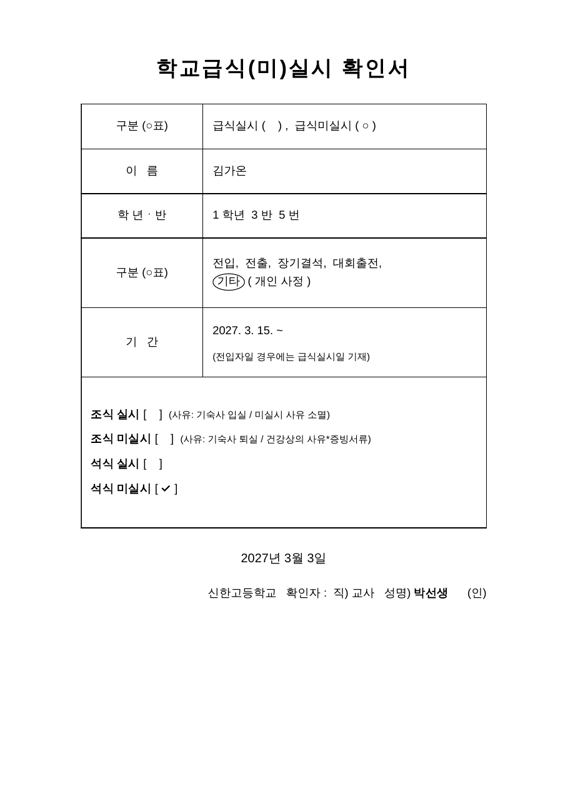 |  | 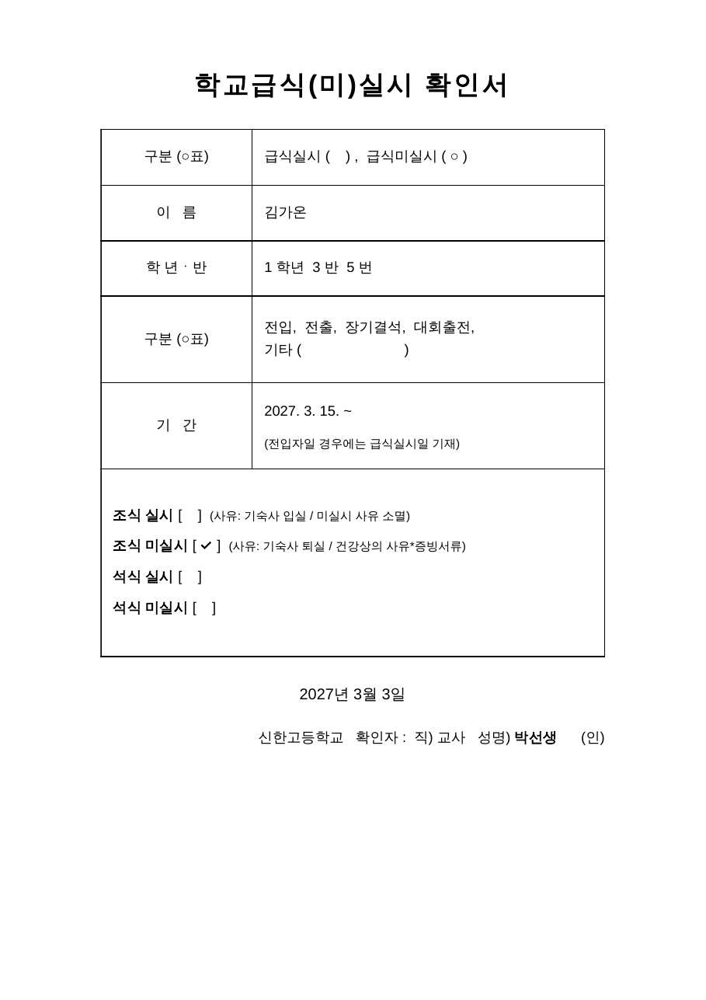 |

| G8·G14 퇴실 (`move-leave`) | G9 입실 (`move-enter`) |
| --- | --- |
| 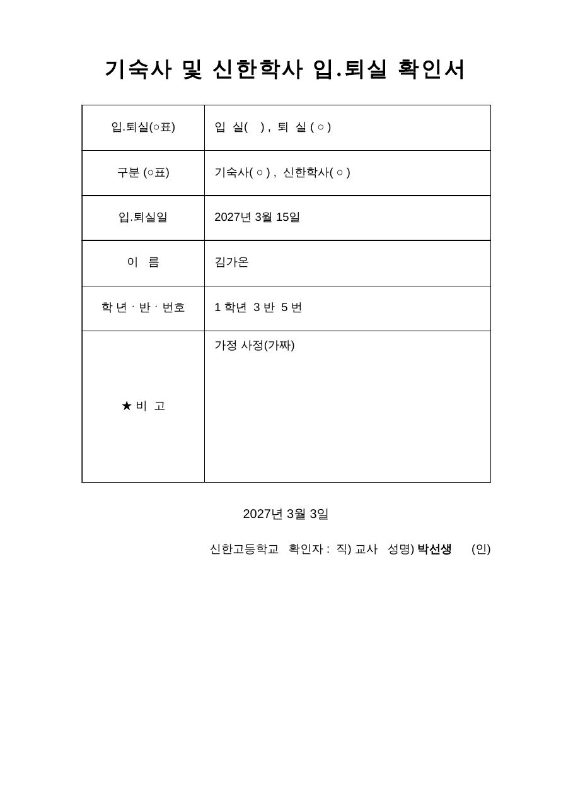 | 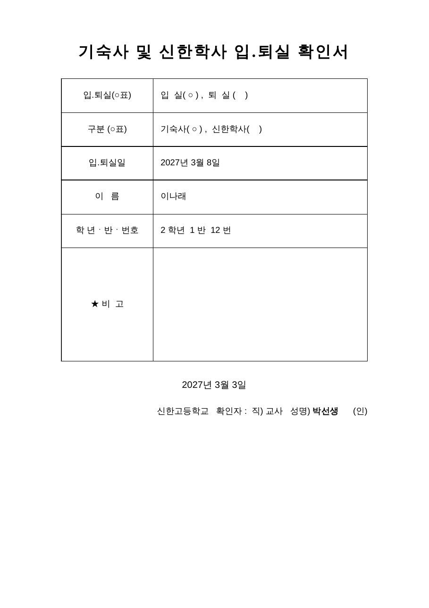 |

## H. 식수 집계 — 줄 순서·엑셀·PDF (C19b·D9, 결정 67, 약 20분)

2단계 **E3·E4**(`stage2-teacher-checks.md`)가 PDF·엑셀의 숫자와 순서를 이미 보았고, 4단계에서 **엑셀 작성기가 새로 바뀌었고 방학 날짜에 중식 열이 더해졌습니다**. 중식 열 자체는 **F1~F4**에서 봅니다. 여기서는 순서·엑셀을 한 번 더 확인합니다.

| 번호 | 누가 | 누르는 것 | 이렇게 보이면 통과 | 사진 | 결과 |
| --- | --- | --- | --- | --- | --- |
| H1 | 소유자 | 홈 → **식수 집계 열기** → 날짜 **2027-04-05**(학기, 가짜 데이터가 있는 날) → **[엑셀로 받기]** | "엑셀을 만들었습니다" 계열 알림과 함께 파일이 받아진다. 엑셀이든 구글 시트든 **경고 없이 열린다** | | |
| H2 | 소유자 | 받은 파일의 시트 **식수 집계**를 봅니다 | 맨 위에 제목 "신한학사 식수 집계"(가로로 합쳐진 한 칸), 둘째 줄에 "2027년 4월 5일(월) · 학기 이름". 넷째 줄이 머리(**구분·학사·기숙·비기숙·조식·석식 학사·석식 일반·석식 계**)이고 위 네 줄과 왼쪽 첫 열이 **스크롤해도 고정**된다 | | |
| H3 | 소유자 | 줄 순서를 현황표와 맞춰 봅니다. 홈 → **현황표**의 **전체** 탭 집계 표를 옆에 둡니다 | 줄이 **여1 → 여2 → 여3 → 남1 → 남2 → 남3 → 여 합계 → 남 합계 → 1학년 → 2학년 → 3학년 → 전체**로 현황표와 같다. 합계 줄은 굵은 글씨·바탕색으로 구분된다 | | |
| H4 | 소유자 | **손 계산:** "전체" 줄의 학사 = 기숙 + 비기숙, 석식 계 = 석식 학사 + 석식 일반, 여 합계 + 남 합계 = 전체 | 모두 맞는다. 맨 아래 **※ 경고 줄이 없다** | | |
| H5 | 소유자 | 같은 날짜로 **[급식실 양식으로 출력]**(PDF)과 화면의 표를 엑셀과 나란히 봅니다 | 세 곳의 숫자가 같다. PDF 줄 순서도 H3과 같다. 아래 줄에 "신청 기준 인원입니다(결석·외박은 반영하지 않습니다)", "퇴실 후 석식 유지 N명"이 있다 | | |
| H6 | 소유자 | 엑셀에서 **학생 이름·이메일·전화번호**를 찾아봅니다(찾기 기능) | 어디에도 없다(숫자만 있는 표다) | | |
| H7 | 시험1 | 홈에서 식수 집계를 찾아봅니다. 주소 끝에 `?page=mealcount`를 붙여 열어 봅니다 | 버튼이 없고 주소로 열어도 "권한이 없습니다"(식수 집계는 관리자만) | | |

> 이미 확인됨: 엑셀 줄 순서 = PDF 순서 = 현황표 순서, 엑셀 숫자 = 집계 규칙 값(합계 검사 포함), 열 문자·XML 짝, 이름·이메일이 없는 것, 관리자 외 거부.
> 확인 못 한 것: **실제 Apps Script `Utilities.zip`으로 만든 파일이 실제 엑셀에서 열리는지**(H1이 그 확인입니다).

## I. 입퇴실 세부 — 다음 달 1일 · 5일 안내 · 학기 중 명단 (C26, 결정 74, 약 25분)

비용은 **계산하지 않고 안내 문구만** 보입니다. 시험 뒤 만든 신청은 G13처럼 취소합니다. 학기 중 명단 올리기(I6~I7)로 넣은 가짜 학생은 `seedFakeStage4`로 가짜 데이터를 다시 만들어 되돌립니다. 날짜는 **오늘 날짜**가 기준입니다(오늘이 11월이면 "다음 달 1일"은 12월 1일).

| 번호 | 누가 | 누르는 것 | 이렇게 보이면 통과 | 사진 | 결과 |
| --- | --- | --- | --- | --- | --- |
| I1 | 시험1 | 홈 → **입퇴실 신청**에서 학생을 고른 뒤 유형 칩에서 **학사 입실**(입실 전 학생이면 보입니다)을 고릅니다 | **적용일 칸이 "오늘의 다음 달 1일"로 채워진다.** 칸 아래 날짜 글자(예: "2027년 4월 1일(목)")도 같다. 12월에는 다음 해 1월 1일 | | |
| I2 | 시험1 | 적용일을 **직접 다른 날로 고친 뒤** 유형 칩을 **기숙사 입실**↔**학사 입실**로 바꿔 봅니다 | 고친 날짜가 **그대로 남는다**(직접 고친 뒤에는 다시 채우지 않는다) | | |
| I3 | 시험1 | 입퇴실 신청에서 담당 가짜 학생에게 **학사 및 기숙사 퇴실**(또는 학사 퇴실)을 고르고 확인창이 열리게 합니다 | 확인창 줄에 **"새 달 5일이 지나 퇴실하면 그달 비용을 냅니다"**가 있다. **금액·날짜 계산·"비용 N원" 같은 숫자는 어디에도 없다** | | |
| I4 | 시험1 | I3에서 [취소]로 닫고, **입실** 유형으로 확인창을 열어 봅니다 | 입실 확인창에는 5일 안내 줄이 **없다**(퇴실을 저장할 때만) | | |
| I5 | 소유자 | 2OUT 퇴실 확정으로 미리 채워진 입퇴실 신청서(G10)의 확인창을 봅니다 | 5일 안내 줄이 **없다**(징계 퇴실은 안내하지 않는다). 확정한 다음 날이 적용일이다 | | |
| I6 | 소유자 | 홈 → **명단 올리기** → 진행 중인 기간(2027 1학기)에서 **이미 올린 가짜 명단에 새 가짜 학생 한 줄만 더한 표**를 붙여 [확인]합니다 | 기존 학생은 "이미 같음"으로 넘어가고 **새 학생만 새로 들어오는 것**으로 나온다. "학기 중 새로 올리면 오늘이 적용일"이라는 안내가 보인다. [저장]은 [확인] 뒤에 켜진다 | | |
| I7 | 소유자 | [저장]한 뒤 그 학생의 학생 기록을 엽니다 | 새 학생의 **학사 입실** 기록이 있고 **기존 학생들의 상태·기록은 그대로**다(명단 업로드는 기존 학생 상태를 덮어쓰지 않고 경고만 낸다) | | |

> 이미 확인됨: 입실 유형이면 다음 달 1일, 직접 고친 날짜 유지, 12월→다음 해 1월, 5일 안내는 퇴실류 저장 때만(2OUT 확정 제외), 학기 중 명단 올리기가 기존 상태를 덮어쓰지 않음.
> 확인 못 한 것·가정: **비용 금액과 "5일" 기준일 계산은 앱이 하지 않습니다**(결정 74④, 안내만). **학년 일괄 퇴실**은 L에서 봅니다.

**시안 사진 (360px)**

| I1 신규 입실 — 기본값 다음 달 1일 (`moves-enter-first`) | I3 퇴실 확인창 — 5일 안내 (`moves-leave-5day`) |
| --- | --- |
| 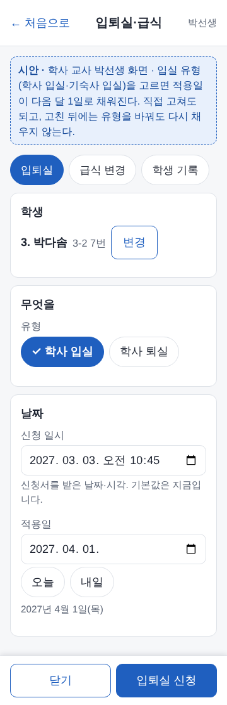 | 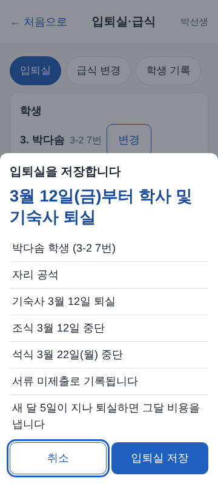 |

## J. 즉시 퇴실 항목 설정 (C19b·R17, 결정 69·78, 약 25분)

관리자가 OUT **항목** 중 일부(예: 흡연·음주·라면·배달음식)를 **즉시 퇴실 항목**으로 정하면, 그 항목의 OUT **한 건이 한 번에 2OUT(퇴실 대상)**이 됩니다. 그 뒤 절차(학부모 면담 기록 → 관리자 퇴실 확정)는 같습니다.

> **결정 78(#192):** 즉시 퇴실로 **정한 뒤 기록된** 위반부터 한 건이 2OUT입니다. **정하기 전에 기록된 위반은 그대로 1OUT**(소급하지 않음)이고, 해제해도 정해 둔 동안 기록된 OUT은 2OUT으로 남습니다.

| 번호 | 누가 | 누르는 것 | 이렇게 보이면 통과 | 사진 | 결과 |
| --- | --- | --- | --- | --- | --- |
| J1 | 소유자 | 홈 → **OUT** → **[항목]** 탭을 엽니다 | 항목 카드에 항목마다 **[수정]·[끄기]·[즉시 퇴실로 정하기]**가 있다. 자동 항목("미인정 지각" 등 **자동** 표시)에는 [즉시 퇴실로 정하기]가 **없다**. 즉시 퇴실로 정해 둔 항목이 없으면 "즉시 퇴실" 표시가 없다 | | |
| J2 | 소유자 | [항목 추가]로 **"가짜: 즉시 퇴실 시험"** 항목을 만들고 그 줄의 **[즉시 퇴실로 정하기]**를 누릅니다 | 확인창 "즉시 퇴실 항목으로 정합니다"에 **"지금부터 기록되는 이 항목의 위반부터 OUT 한 번이 바로 2OUT(퇴실 대상)이 됩니다." / "이미 기록된 위반은 그대로 셉니다(소급하지 않습니다)." / "퇴실 확정은 지금처럼 학부모 면담 기록 뒤 관리자가 합니다."**가 있다 | | |
| J3 | 소유자 | 확인창에서 **[즉시 퇴실로 정하기]**로 확정합니다 | 알림 **"즉시 퇴실 항목으로 정했습니다. 지금부터 기록되는 위반부터 2OUT으로 셉니다."**가 나오고(퇴실 대상이 새로 생기지 않는다) 그 항목 이름 옆에 **"즉시 퇴실" 표시**가, 버튼은 **[즉시 퇴실 해제]**로 바뀐다. 다른 항목은 그대로다 | | |
| J4 | 시험1 | 정한 **뒤에**, **OUT 기록**에서 1OUT·2OUT이 없는 가짜 학생에게 방금 만든 **즉시 퇴실 항목으로 OUT 한 건**을 저장합니다 | 저장하면 그 학생이 **한 건만으로 퇴실 대상**(2OUT) 탭에 나타난다. [퇴실 확정]은 학부모 면담 기록 전까지 눌리지 않는다(2단계 C7과 같다). 홈 카드·OUT 현황의 퇴실 대상 숫자가 1 늘었다 | | |
| J5 | 시험2(출결 담당 → 담임 → 근무표 담당자) | OUT 화면을 엽니다(주소 끝에 `?page=outs`) | **[항목] 탭이 없다.** 항목 이름은 보여도 **[즉시 퇴실로 정하기]·[끄기]가 없다**(관리자만). 서버에 직접 부르면 거부된다(컴퓨터 테스트가 확인함) | | |
| J6 | 소유자 | **[즉시 퇴실 해제]**를 누릅니다(확인창 없이 바로 해제됨) | **"즉시 퇴실을 해제했습니다. 이미 지정 중에 기록된 OUT은 그대로 2OUT으로 남고, 지금부터 기록되는 위반은 1OUT으로 셉니다."**가 나온다. "즉시 퇴실" 표시가 사라지고 버튼이 [즉시 퇴실로 정하기]로 돌아온다. **J4의 학생은 그대로 퇴실 대상**이다(정해 둔 동안 기록된 OUT) | | |
| J7 | 시험1 | **해제한 뒤**, 다른 가짜 학생(OUT 없음)에게 같은 항목으로 OUT을 저장합니다 | 이번에는 **1OUT**이다(저장 전 "2OUT" 안내가 없다) | | |
| J8 | 소유자 | 시험 항목 **"가짜: 즉시 퇴실 시험"**(J9를 했다면 "가짜: 소급 시험"도)을 **[끄기]**로 끕니다 | 항목이 입력 목록에서 빠지고 **삭제되지 않는다**(꺼짐 표시로 남는다). 이미 기록된 OUT은 그대로다. 시험한 OUT은 OUT 취소로 되돌린다 | | |
| J9 | 소유자 | **정하기 전에 기록된 OUT은 소급하지 않는지** 봅니다. 시험 항목을 [끄기] 전에 **새 항목 "가짜: 소급 시험"**을 만들어 (정하지 않은 채) 다른 가짜 학생에게 OUT 한 건을 기록하고, 그 뒤 그 항목을 **[즉시 퇴실로 정하기]**로 정합니다 | 정한 뒤에도 그 학생은 **1OUT 그대로**다(퇴실 대상 탭에 새로 나타나지 않는다). 이제 같은 학생에게 같은 항목으로 **새 OUT을 한 건 더** 기록하면 바로 **퇴실 대상**이 된다 | | |

> 이미 확인됨: 즉시 항목 한 건 = 2OUT 판정 표(규칙 함수), **지정한 뒤 기록된 OUT부터**만 2OUT(`outInstantNext_`, 화면·서버 연결 #192), 지정 구간 이력은 스크립트 속성에 저장(시트 구조 변경 없음), OUT 수를 세는 모든 곳(홈 카드·현황·퇴실 확정)이 같은 판정을 씀, 관리자 외 거부, 자동 항목은 지정할 수 없음.
> 확인 못 한 것: 홈 카드·퇴실 대상 탭의 숫자가 J4·J6 전후로 **실제 시트에서** 바뀌는지(위 단계가 그 확인입니다). J9는 **지정 시각 기준**이라 같은 분 안에 정하고 기록하면 순서가 헷갈릴 수 있으니 한두 분 사이를 두세요.

**시안 사진 (360px)**

| J1 [항목] 탭 (`outs-instant`) | J2 확인창 (`outs-instant-confirm`) |
| --- | --- |
| 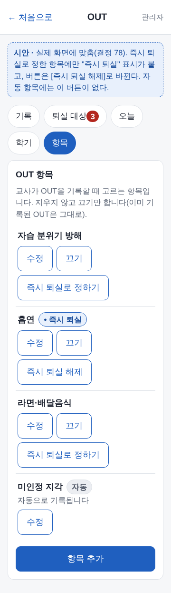 | 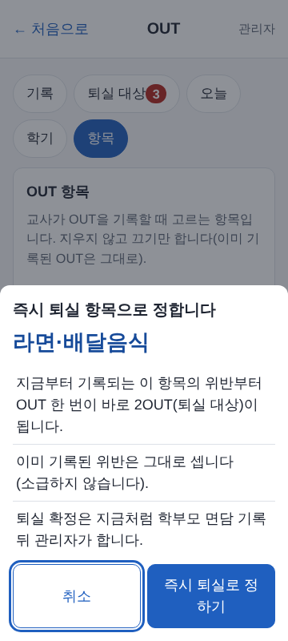 |

## K. 학사 프로그램 + 참가자 (C28, 결정 75②, 약 35분)

프로그램(예: 파워클래스·면접 특강)을 만들고 참가 학생을 담으면 **학생마다 "학사 내 프로그램" 사전 특이사항이 확정으로** 만들어져 출석부 칸에 반영됩니다. 프로그램을 취소하면 그 특이사항도 함께 취소됩니다(기록은 남음). 가짜 데이터에 **2027-04-07 "가짜 파워클래스"(20:00–22:00)**가 이미 있습니다(`seedFakeStage4`).

| 번호 | 누가 | 누르는 것 | 이렇게 보이면 통과 | 사진 | 결과 |
| --- | --- | --- | --- | --- | --- |
| K1 | 소유자 | 홈 → **학사 프로그램 열기** | 맨 위에 [목록]·[새 프로그램] 탭, 기간 이름, **예정·지난·취소**(건수 포함). "가짜 파워클래스" 카드에 "날짜 · 시간 · 참가자 N명 · 사전 특이사항 N건"(두 숫자가 같다)이 보인다 | | |
| K2 | 소유자 | 카드의 **[참가자 보기]** | 카드 **안에서** 참가자가 펼쳐지고 줄이 "1-3 5번 이름" 모양이다. 줄마다 [빼기]가 있고 버튼이 손가락으로 누를 만하다. 따로 상세 화면은 없다 | | |
| K3 | 소유자 | 홈 → 출석부 → 날짜 **2027-04-07**을 열어 참가 학생 한 명의 줄을 봅니다 | 프로그램 시간(20:00–22:00)에 해당하는 칸에 **그 학생의 사전 특이사항 표시**가 있다 | | |
| K4 | 시험1 | **[새 프로그램]** 탭에서 이름 "가짜: 시험 특강", 날짜(자습 운영일), 시간 칩(전체가 기본), 참가 학생을 **반 단위로**(학년 칩 → 반 칩 → **[이 반 담기]**) 담습니다 | "N학년 N반 학사생 M명 · …" 숫자가 나오고 담긴 학생은 "고른 학생 N명"에 합쳐진다. **[모두 비우기]**가 있다. 이름·참가 학생이 있어야 아래 [확인하고 저장]이 켜진다 | | |
| K5 | 시험1 | 이미 담은 반을 **다시 [이 반 담기]** 합니다 | 이미 담은 학생은 **건너뛰고** 새로 담기는 수만 늘어난다(중복 없음) | | |
| K6 | 시험1 | **[확인하고 저장]** → 확인창을 봅니다. (같은 시간에 이미 다른 특이사항이 있는 학생이 있으면 그 학생이 섞이게 K4를 하세요) | 확인창 "프로그램을 저장합니다"에 날짜·시간, **"참가 학생 N명에게 사전 특이사항(학사 내 프로그램)이 확정으로 만들어집니다."**가 있다. 겹치면 **"N명은 같은 시간에 다른 특이사항이 있습니다. 그대로 두고 프로그램 특이사항을 따로 만듭니다."**(숫자만, 이름 없음)가 있고 막지는 않는다 | | |
| K7 | 시험1 | 확인창에서 저장합니다 | "저장했습니다" 계열 알림 뒤 [목록]의 **예정**에 새 카드가 생긴다. 참가자 수 = 사전 특이사항 건수. 출석부(K3 방식)에 반영된다 | | |
| K8 | 시험1 | 새 카드의 **[참가자 더하기]**에서 다른 반을 더합니다 | 이미 담은 학생은 건너뛰고, 더한 만큼 참가자·특이사항 건수가 같이 늘어난다 | | |
| K9 | 시험1 | 참가자 한 명의 **[빼기]** | 사유를 적게 하는 확인창 "참가에서 뺍니다"가 열리고 "그 학생의 사전 특이사항도 취소됩니다"가 보인다. 사유 없이는 저장되지 않고, 저장하면 **그 학생만** 빠진다. 출석부에서 그 학생의 특이사항이 사라진다(취소 행은 시트에 남는다) | | |
| K10 | 시험1 | 새 카드의 **[프로그램 취소]** | 확인창 "프로그램을 취소합니다"에 "참가자 N명의 사전 특이사항도 함께 취소됩니다(기록은 남습니다)."가 있고 사유 입력이 필수다. 저장하면 "취소했습니다. 특이사항 N건도 함께 취소되었습니다." 카드는 **취소** 탭으로 가고 **취소됨 표시만**(버튼 없음) 남는다 | | |
| K11 | 소유자 | 시트 `programs`·`program_participants`·`exceptions`(사전 특이사항) 탭을 봅니다 | K9·K10에서 **지워진 행이 없다.** 상태가 `취소`이고 `audit_log`에 취소 줄이 있다 | | |
| K12 | 시험2(출결 담당) | 홈에서 **학사 프로그램 열기**를 엽니다 | 열린다. [목록]·[새 프로그램]이 보이고 프로그램을 만들고 참가자를 더하고 뺄 수 있다(출결 담당 `program.edit`, #182) | | |
| K13 | 시험2(담임 → 학생 → 학부모) | 홈과 주소 끝 `?page=programs`를 열어 봅니다 | 홈에 프로그램 카드가 없고 주소로 열어도 "권한이 없습니다". (그 학생의 특이사항은 기존 특이사항 화면에 보인다) | | |
| K14 | 소유자 | 끝난 기간(지난 학기)을 보는 화면이 있으면 프로그램을 열어 봅니다 | **"끝난 기간 — 볼 수만 있습니다"**로 보이고 [참가자 더하기]·[프로그램 취소]·[빼기]가 없다. 없으면 "데이터 부족"으로 적고 넘어갑니다 | | |
| K15 | 소유자 | 날짜·시간을 **고치는 화면**을 찾아봅니다 | **없다**(잘못 만들었으면 취소하고 새로 만든다, 결정) | | |

> 이미 확인됨: 프로그램 하나 = 참가자 한 줄씩 + 학생마다 특이사항 한 건, 같은 반 중복 제외, 겹치는 특이사항은 막지 않고 숫자 안내, 빼기·프로그램 취소가 **그 프로그램의 특이사항만** 취소(다른 특이사항은 그대로), 취소 사유 필수, 출결 담당·관리자·학사 교사 허용, 담임·학생·학부모 거부, 126명 규모 프로그램 흐름 리허설(T5).
> 확인 못 한 것: 한 프로그램에 **120명대**를 담을 때 휴대폰에서 [이 반 담기]·저장 속도(리허설은 컴퓨터 시험), 학사 입실 상태가 아닌 학생이 섞였을 때 확인창의 "N명은 이 날 학사 입실 상태가 아닙니다." 문구.

**시안 사진 (360px, 실제 화면 #173에 맞춘 시안 — 숫자·이름은 가짜)**

| K1 목록 (`program-list`) | K2 카드 펼침 (`program-card-open`) | K4 새 프로그램 (`program-add`) | K8 참가자 더하기 (`program-add-more`) |
| --- | --- | --- | --- |
| 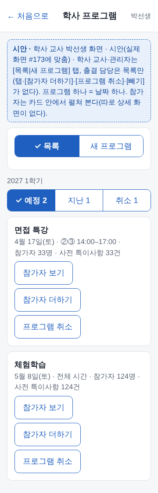 | 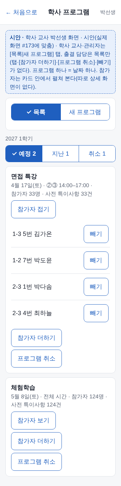 | 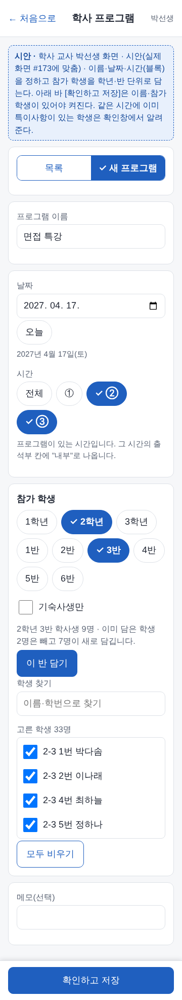 | 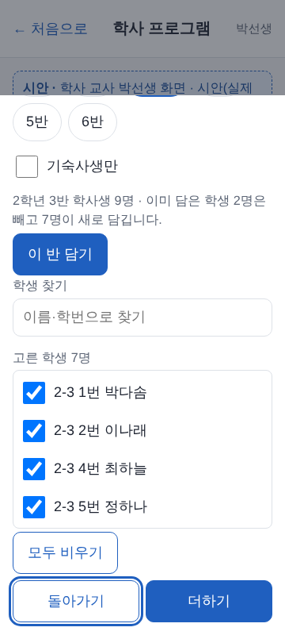 |

| K6 저장 확인 (`program-confirm`) | K9 빼기 (`program-remove`) | K10 취소 (`program-cancel`) |
| --- | --- | --- |
| 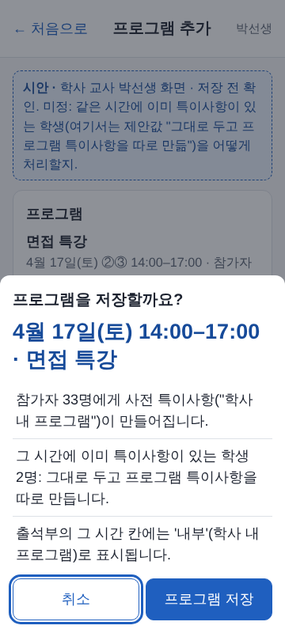 | 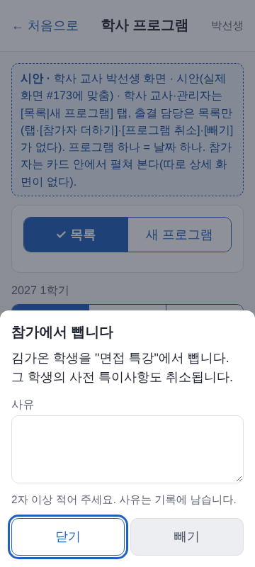 | 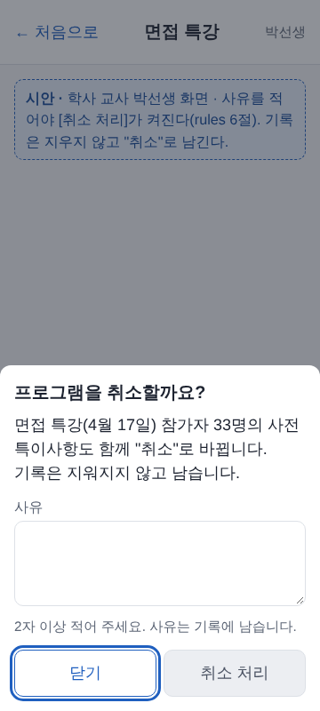 |

## L. 임시 퇴실·학년 일괄 퇴실 (C26, 결정 70·74①·77, 약 35분)

**건강상 임시 퇴실**: 급식을 끊고(조식은 바로, 석식은 미실시 규칙) 자리·침대도 비우지만, **다시 들어오는 것을 막지 않습니다**(일반 퇴실과 다른 점은 이것뿐). 사유는 **건강상만** 씁니다(가정 사정·대회 출전 같은 짧은 부재는 사전 특이사항). 시험한 신청은 끝에서 취소합니다(L9).

| 번호 | 누가 | 누르는 것 | 이렇게 보이면 통과 | 사진 | 결과 |
| --- | --- | --- | --- | --- | --- |
| L1 | 시험1 | 홈 → **입퇴실 신청**에서 담당 가짜 **기숙사생**을 고르고 유형 칩을 봅니다 | 칩에 **학사 임시 퇴실**(꺼짐: "기숙사생은 '학사 및 기숙사 임시 퇴실'로 신청해 주세요.")과 **학사 및 기숙사 임시 퇴실**이 있다. 기숙사에 없는 학사생에게는 반대로 "학사 임시 퇴실"만 켜져 있다 | | |
| L2 | 시험1 | **학사 및 기숙사 임시 퇴실**을 고릅니다 | 아래에 **[임시 퇴실] 카드**가 나온다: **복귀 예정일**(날짜 칸), "임시 퇴실은 건강상 사유만 씁니다…" 안내, **[사전 특이사항 입력으로 가기]** 링크, "임시 퇴실도 일반 퇴실처럼 급식을 끊고 자리를 비웁니다. 다른 점은 다시 들어오는 것을 막지 않는 것뿐입니다." | | |
| L3 | 시험1 | 복귀 예정일을 **비우거나 적용일보다 앞으로** 두고 [입퇴실 신청]을 눌러 봅니다 | 저장되지 않고 오류가 칸 아래에 나온다: 비우면 **"복귀 예정일을 날짜로 입력해 주세요."**, 적용일 이하이면 **"복귀 예정일은 퇴실일 뒤여야 합니다."** | | |
| L4 | 시험1 | 사유 칸에 **"임시 퇴실"** 두 글자만 적고 저장해 봅니다(예약어) | **"'임시 퇴실' 글자는 임시 퇴실 유형에서만 쓰입니다. 다른 사유를 적어 주세요."**로 막힌다 | | |
| L5 | 시험1 | 복귀 예정일을 **며칠 뒤**로, 사유 "가짜: 독감 입원", 석식 **중단**으로 저장합니다(확인창에서 저장) | 확인창 줄에 **"복귀 예정일 N월 N일(요일) · 건강상 임시 퇴실은 재입실을 막지 않습니다"**가 있다. 저장 뒤 학생 기록 줄에 **"임시 퇴실 중 · 복귀 예정 …"**이 보이고, 자리가 공석이 되며 조식이 적용일부터 중단된다 | | |
| L6 | 소유자 | 같은 학생을 입퇴실 신청에서 다시 열어 **학사 입실**을 고릅니다 | **재입실이 막히지 않는다**(일반 퇴실은 "다음 학기 끝까지 다시 들어올 수 없다"고 막힌다 — 비교용으로 G7에서 일반 퇴실한 학생을 열어 봅니다) | | |
| L7 | 소유자 | **복귀 예정일이 이미 지난** 가짜 임시 퇴실이 필요하면, 신청 일시·적용일을 과거(예: 일주일 전)로, 복귀 예정일을 어제로 해서 저장합니다 | 담당교사 홈(관리자·학사 교사)에 카드 **"복귀 예정일 지남"**이 나온다: "임시 퇴실 중인 학생 N명의 복귀 예정일이 지났습니다." 줄마다 "학생 · 복귀 예정 …(N일 지남)" 링크, 아래 안내 "학생을 눌러 기록에서 [일반 퇴실로 바꾸기]를 누를 수 있습니다. 복귀했다면 입퇴실 신청에서 학사 입실을 기록해 주세요." | | |
| L8 | 시험1 | 카드의 학생을 눌러 기록으로 가서 줄의 **[일반 퇴실로 바꾸기]**를 누릅니다 | 줄에 경고색으로 "임시 퇴실 중 · 복귀 예정 … (예정일이 지났습니다)". 확인 시트 "일반 퇴실로 바꿉니다": **"재입실 제한은 처음 임시 퇴실한 날(…)부터 셉니다. …까지 다시 들어올 수 없습니다."**, "급식·자리는 임시 퇴실 때와 같이 이미 정리되어 있어 그대로입니다.", "기록은 지우지 않고 임시 퇴실 신청서를 취소 처리합니다." | | |
| L9 | 시험1 | 시트에서 [일반 퇴실로 바꾸기]로 확정합니다 | 알림 "일반 퇴실로 바꿨습니다." 줄이 일반 퇴실로 바뀌고 **재입실이 막힌다**(L6처럼 학사 입실을 시도하면 막힘). `입퇴실` 기록은 지워지지 않고 옛 임시 퇴실 신청서가 **취소**로 남는다 | | |
| L10 | 소유자 | **임시 퇴실 중인 학생이 2OUT 퇴실 대상**이 되게 합니다(OUT 2건 기록 후 면담까지) → OUT 화면 **[2OUT]** 탭 | 그 학생 카드에 **"임시 퇴실 중이라 복귀 뒤에 확정합니다(복귀 예정 …)."**가 보이고 **[퇴실 확정]이 막혀 있다**. 복귀 뒤(학사 입실 기록) 확정할 수 있다 | | |
| L11 | 시험2(출결 담당 → 담임 → 학생·학부모) | 입퇴실·급식 학생 기록과 홈을 봅니다 | **[일반 퇴실로 바꾸기]·"복귀 예정일 지남" 카드가 없다**(담당교사·관리자만). 입퇴실 신청에서 임시 퇴실을 고르는 화면도 없다(담당교사·관리자만 신청) | | |
| L12 | 시험1 | 시험한 신청을 **[퇴실 취소]**(퇴실류)로 되돌립니다 | 취소 확인 시트에 같이 취소되는 것(급식 복구 등)이 보이고, 취소하면 학생이 다시 입실 상태가 된다. 지워진 행은 없다 | | |
| L13 | (자리) | **3학년 수능 뒤 학년 일괄 퇴실**(결정 74①): 학년 고르기 → 미리보기 → 저장, 급식·좌석·방 정리, 되돌리기 | 화면(C26)이 병합된 뒤 작성. 규칙(R20 `movePlan_` 여러 학생)은 main에 있음 | | |

> 이미 확인됨: 임시 퇴실 규칙(재입실 안 막음·일반 퇴실과 같은 급식·자리 정리), 사유 예약어 거부, 일반 퇴실로 바꾸기(같은 적용일·같은 신청 일시라 재입실 제한이 처음 임시 퇴실한 날부터), 임시 퇴실 중 2OUT 퇴실 확정 막힘, 복귀 예정일 지남 카드 계산, 담당교사·관리자만 허용.
> 확인 못 한 것: L7의 "복귀 예정일이 지난" 가짜 데이터는 지금 시드에 없어 **손으로 만들어야** 합니다(데이터 부족이면 번호와 함께 알려 주세요 — 총괄이 시드를 보강). 임시 퇴실이 **좌석 초안·방 초안**에서 빠지는지는 G/K에서 직접 보지 않았습니다.

**시안 사진 (360px)**

| L2 임시 퇴실 입력 (`moves-temp-leave`) | L7 홈 카드 (`home-temp-overdue`) | L8 일반 퇴실로 바꾸기 (`moves-temp-convert`) |
| --- | --- | --- |
| 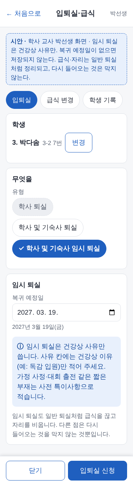 | 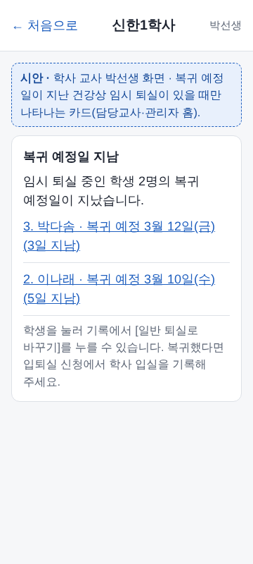 | 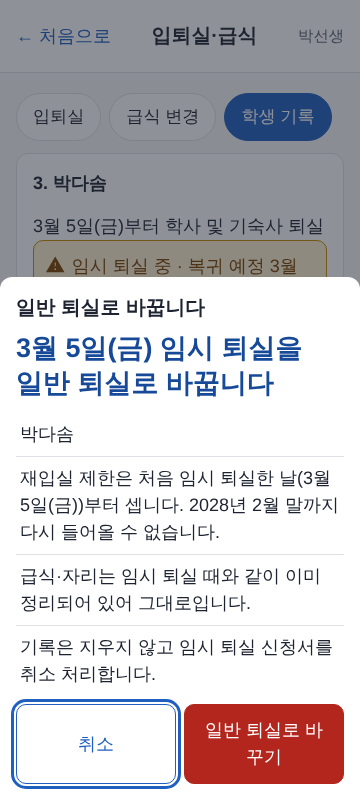 |

## 확인 뒤

- ×가 하나도 없으면 총괄에게 "4단계 확인 통과"라고만 알려 주세요(L13 학년 일괄 퇴실은 화면 병합 전이라 빠집니다).
- ×가 있으면 **번호 + 한 줄 + 화면 사진**을 총괄에게 보냅니다(예: "G8 입퇴실 확인서에 구분 ○가 하나만 있음", "J4 즉시 퇴실 항목인데 2OUT 안내가 없음").
- 특히 **A1·A2(실제 시트 열 끼우기), C2·H1(실제 엑셀 열림), E8~E10(전화번호가 어디에도 안 나옴), G2·G8·G14(실제 PDF와 빈 양식 비교), G12(드라이브에 파일이 안 남음), J4·J6(즉시 퇴실 판정이 지정한 뒤부터)**는 컴퓨터 테스트가 흉내만 낸 것이라 꼭 봐 주세요.
- 가짜 데이터가 모자라 단계를 못 따라 하면 번호와 "데이터 부족"이라고 적어 주세요. 총괄이 가짜 데이터를 보강합니다.
- 사진 칸에는 실제 화면(이름·번호·전화는 가리고)을 붙입니다.
