# 5단계 화면 시안 (D12) — F11 결과 격자 · F12 상담일지 · F13 월별 일정

코딩A(C33 F11 화면)·코딩B(C32 F12 상담일지)가 이 문서와 시안을 보고 만든다. 시안 코드는 `design/preview/stage5-screens.js`(실행 `node design/preview/stage5.js` → `design/preview/out/stage5/<이름>-360.png`·`-1280.png`), 사진은 `docs/design/stage5-photos/`(360px, PC 화면은 `-1280.png`도). 서버를 부르지 않고 이름·숫자는 모두 가짜다. 규칙은 `docs/design/rules.md`, 부품은 `docs/design/components.md`를 따른다. **정해지지 않은 것은 맨 아래 "미정·가정"에 모았다 — 코딩이 임의로 정하지 말고 총괄에게 묻는다.**

가짜 숫자: 오늘 = 2027년 3월 15일(월), 격자는 지난주 3월 8일(월)~14일(일), 3월 12일(금)은 운영 안 함, 3학년 1반 12명(실제는 180명이라 학년·반 칩으로 거른다).

## 시안 이름 한눈에

| 이름 | 화면 | 누가 |
| --- | --- | --- |
| `result-grid-pc` | F11 결과 격자 — PC, 학생 × 날짜 한 주 | 출결 담당·관리자 |
| `result-grid-phone` | F11 결과 정리 — 휴대폰, 날짜 하나 → 학생 줄 | 출결 담당·관리자 |
| `result-cell-sheet` | 칸을 누르면: 결과 → 시간 → 유형 → 사유(인정) | 출결 담당·관리자 |
| `result-cell-sheet-family` | 가정사유를 고르면: 덮는 블록으로 센다는 안내(결정 81) | 출결 담당·관리자 |
| `result-cell-sheet-bad` | 미인정을 고르면: 자동 1OUT 안내 | 출결 담당·관리자 |
| `result-cell-pre` | 사전 특이사항이 있는 칸: 위에 안내 | 출결 담당·관리자 |
| `result-cancel` | 입력한 결과 취소(사유 필수, 자동 1OUT도 취소) | 출결 담당·관리자 |
| `result-student-total` | 학생별 누적(결석·지각·조퇴 × 인정·미인정) | 출결 담당·관리자 |
| `counsel-list` | F12 상담 목록(내용은 접어 둠) | 담당교사·담임(자기 반)·관리자 |
| `counsel-list-open` | 상담 목록 — 한 건 펼침 | 같음 |
| `counsel-write` | 작성 폼 | 담당교사 |
| `counsel-write-2out` | 작성 폼 — 2OUT 학부모 면담(OUT 연결) | 담당교사 |
| `counsel-cancel` | 취소 시트(사유 필수) | 담당교사 |
| `home-counsel` | 학사 교사 홈의 "상담일지" 카드 | 담당교사·관리자 |
| `calendar-month` | F13 월 달력(칸에 짧은 제목, 운영 안 하는 날 회색) | 모든 역할 보기, 관리자 [일정 추가] |
| `calendar-day-sheet` | 날짜를 누르면 그날 일정 목록 시트(관리자: [취소]·[이 날에 일정 추가]) | 관리자 |
| `calendar-day-sheet-teacher` | 같은 시트, 교사 역할(보기만, 운영 안 하는 날 안내) | 교사 역할 전부 |
| `calendar-add` | 일정 추가 폼 시트(제목·시작일·종료일·종류 칩·메모) | 관리자 |
| `calendar-add-error` | 일정 추가 — 종료일이 시작일보다 앞이면 오류 | 관리자 |
| `calendar-cancel` | 일정 취소 확인(사유 필수) | 관리자 |

## 1. F11 출결 결과 정리 (C33)

종이 출석부 결과(× 결석 · △ 지각 · 조 조퇴, 결정 38)를 출결 담당이 주말·월말에 옮겨 적는 화면이다. 홈 → 출결 담당 홈의 "격자 정리"로 들어온다. 맨 위 **[결과 입력 | 학생별 누적]** 탭(`UI.segmented`).

### 1-1. PC 격자 (`result-grid-pc`)

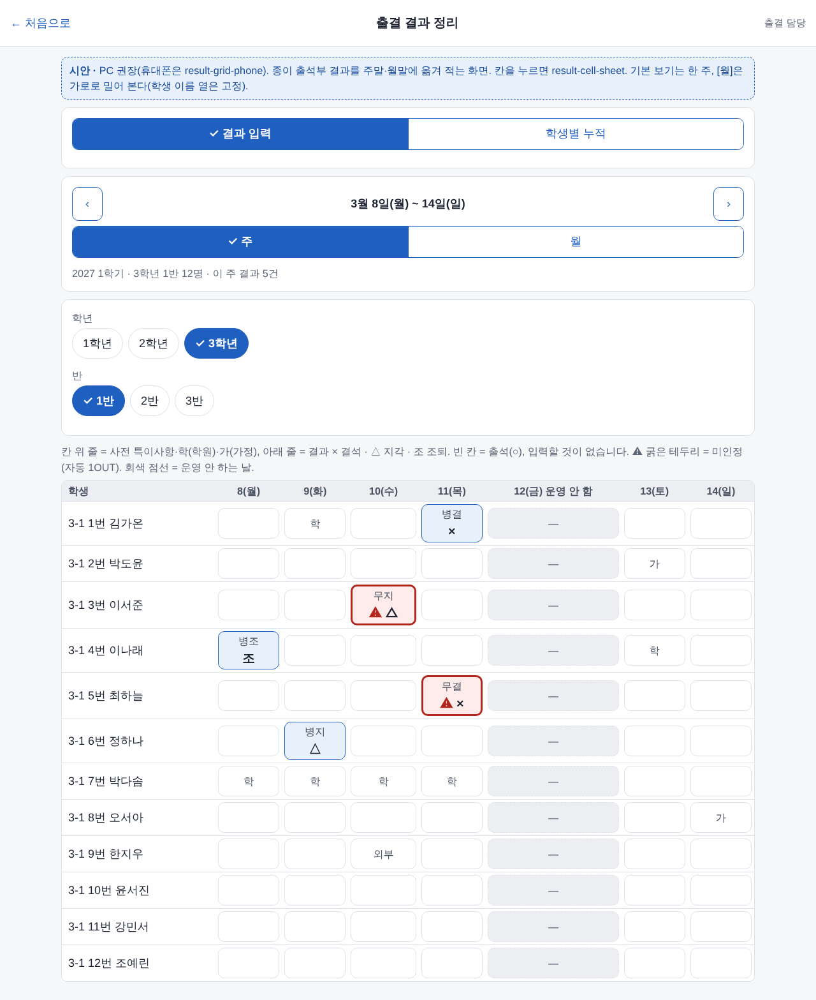

- 머리: [‹ 이전 주] "3월 8일(월) ~ 14일(일)" [다음 주 ›], 범위 [주 | 월], "2027 1학기 · 3학년 1반 12명 · 이 주 결과 5건". 학년·반 칩으로 거른다(전체 180명을 한 번에 그리지 않는다). 기본은 **한 주**, [월]은 가로로 밀어 보되 **학생 이름 열은 고정**(`table.data` 첫 열 sticky가 그대로).
- 표는 `.tablewrap` + `table.data.rg`. 학생 열 "3-1 5번 최하늘"(다른 화면과 같은 표기), 날짜 열 머리 "8(월)". 운영 안 하는 날은 머리에 "운영 안 함", 칸은 회색 점선 `.rg-cell.off`("—", 눌러도 열리지 않음).
- **칸(`.rg-cell`)**: 위 줄 = 사전 특이사항 약어·'학'·'가'(`.rg-pre`, 출석부와 같은 약어), 아래 줄 = 결과 기호 × △ 조(`.rg-sym`). 빈 칸 = 출석(○), 입력할 것이 없다. 결과가 있으면 `.has`(연한 파랑 바탕 + 파랑 테두리), **미인정이면 `.bad`(굵은 빨간 테두리 + ⚠, 색만으로 알리지 않는다)**.
- 칸 크기는 최소 높이 48px(손가락·마우스 모두), 칸을 누르면 `result-cell-sheet`. 격자 위에 범례 한 줄(칸 위 줄·아래 줄·⚠·회색 설명).

### 1-2. 휴대폰 (`result-grid-phone`)

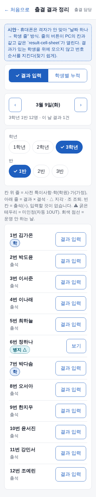

- 격자는 360px에 안 맞으므로 **"날짜 하나 고르기 → 학생 줄"**: [‹ 전날] "3월 9일(화)" [다음 날 ›]. 줄 = "1번 김가온" + 아래 줄 상태(없으면 "출석", 사전 특이사항·학·가는 알약 `UI.statusPill('hak'…)`, 결과가 있으면 "병지 △"·미인정은 `todo` 알약) + 오른쪽 **[결과 입력]**(결과가 있으면 [보기]). 번호 순서를 지킨다(결과 있는 학생을 위로 올리지 않는다 — 번호로 찾기 쉽다).
- PC와 휴대폰은 **같은 서버 함수·같은 바텀 시트**를 쓴다. 화면 폭에 따라 격자/목록만 바꾼다(제안: 900px 이상이면 격자, 아래면 목록 — 6절 4번).

### 1-3. 칸을 눌렀을 때 (`result-cell-sheet`·`result-cell-sheet-bad`·`result-cell-pre`)

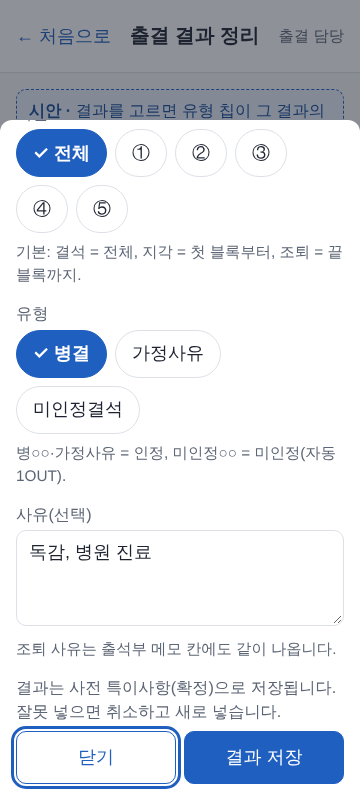 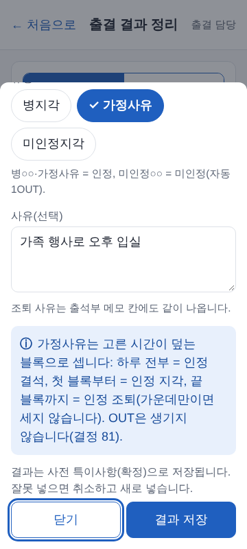 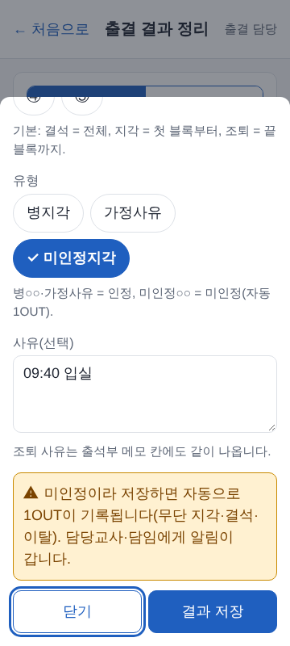 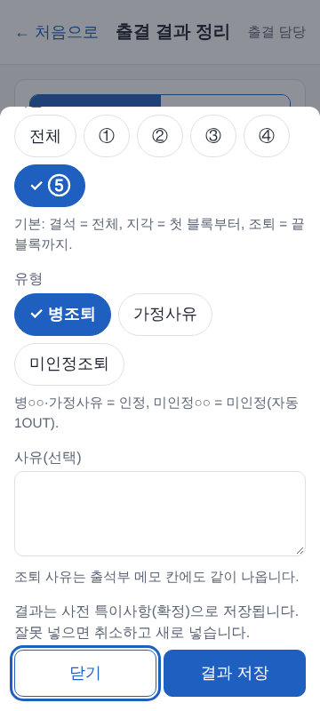

`UI.bottomSheet` 하나. 위에서 아래로: 제목 "결과 입력", 리드 "3월 11일(목) · 3-1 1번 김가온" →
1. **결과** `UI.segmented`: 결석 × · 지각 △ · 조퇴 조.
2. **시간** `UI.blockChips`: **기본 = 결석 전체 · 지각 첫 블록 · 조퇴 마지막 블록**(결정 81 총괄 답). 고칠 수 있다(조퇴 "20:30부터"처럼 시간을 남긴다).
3. **유형** 칩 — 고른 결과의 유형만 보인다: 결석 = 병결 · 가정사유 · 미인정결석, 지각 = 병지각 · 가정사유 · 미인정지각, 조퇴 = 병조퇴 · 가정사유 · 미인정조퇴. **'기타'는 결과로 세지 않아 칩에 없다.** 인정 = 병○○·가정사유, 미인정 = 이름이 '미인정'으로 시작하는 유형(자동 1OUT). 칩 아래 설명 "병○○·가정사유 = 인정, 미인정○○ = 미인정(자동 1OUT)".
   - **가정사유(`result-cell-sheet-family`)**를 고르면 시간 칩이 덮는 블록을 정한다: 하루 전부 = 인정 결석, 첫 블록부터 = 인정 지각, 끝 블록까지 = 인정 조퇴, 가운데만이면 세지 않는다. 안내 상자로 알리고 OUT은 생기지 않는다.
4. **사유(선택)** 글 칸 200자(조퇴 사유는 출석부 메모 칸에도 나온다, 결정 38).
5. 안내 한 줄: 인정이면 "결과는 사전 특이사항(확정)으로 저장됩니다. 잘못 넣으면 취소하고 새로 넣습니다." **미인정이면 경고 상자**(`.notice.warn`, ⚠) "미인정이라 저장하면 자동으로 1OUT이 기록됩니다(무단 지각·결석·이탈). 담당교사·담임에게 알림이 갑니다." — 바꾼 유형에 따라 두 안내가 바뀐다.
6. 아래: [닫기] · [결과 저장].

- **사전 특이사항이 있는 칸**(`result-cell-pre`): 시트 맨 위에 안내 상자 "이 칸에는 사전 특이사항 "학(학원)"이 있습니다. 학원에 가지 않고 결과가 있을 때만 더해 주세요. 사전 특이사항 자체는 [사전 특이사항]에서 고칩니다." — 같은 칸에 결과를 더할 수 있다.
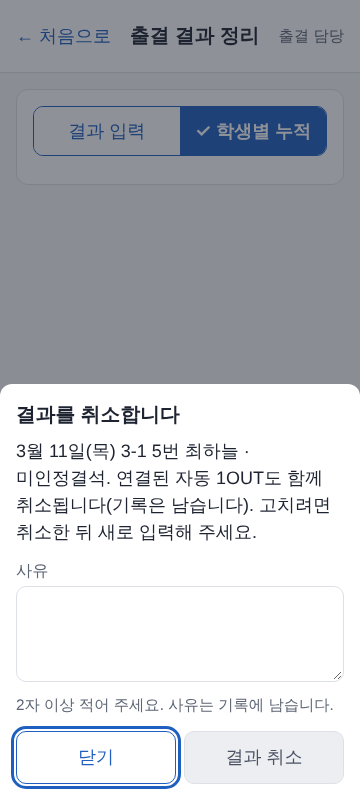

- **고치지 않는다.** 결과를 잘못 넣었으면 **취소**(`result-cancel`, `UI.confirmWithReason` "결과를 취소합니다", 사유 필수)하고 새로 입력한다. 취소하면 연결된 자동 1OUT도 함께 취소된다(결정 10). 취소 진입은 학생별 누적(1-4)의 기록 줄 [취소]와 격자 칸의 시트에서 한다.
- 저장은 **사전 특이사항(확정) 행**이다(새 탭 없음, 코딩A 확인표). 미인정이면 R5 자동 1OUT이 그대로 만든다(결정 40: 설정을 넓히기 전 유형에는 만들지 않는다).

### 1-4. 학생별 누적 (`result-student-total`)

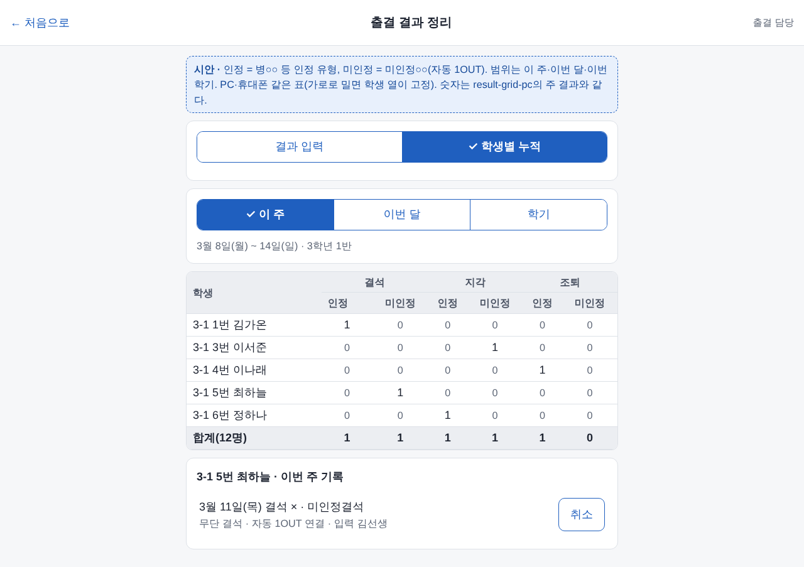

- 범위 [이 주 | 이번 달 | 학기], 표 머리는 두 줄(결석·지각·조퇴 아래 인정·미인정), 학생 열 고정, 마지막 줄 합계(회색 바탕 굵은 글씨, `tr.total`). 0은 연한 글씨. 숫자는 격자의 결과와 같아야 한다(둘 다 규칙 R22가 센다).
- 학생 줄을 누르면 아래에 그 학생의 기록(날짜·결과·유형·사유·입력자·자동 1OUT 연결 여부)과 줄마다 [취소]가 펼쳐진다.

## 2. F12 상담일지 (C32)

학생 기록(입퇴실·급식 [학생 기록] 옆 또는 OUT 퇴실 대상 카드)에서 들어온다. 상담일지는 별도 스프레드시트에 저장하고 **내용은 담당교사·담임(자기 반)·관리자만** 본다(결정 42, PRD F12). 위 학생 줄(이름·학년반번호·담당교사)과 **[상담 목록 | 새로 쓰기]** 탭.

### 2-1. 목록 (`counsel-list`·`counsel-list-open`)

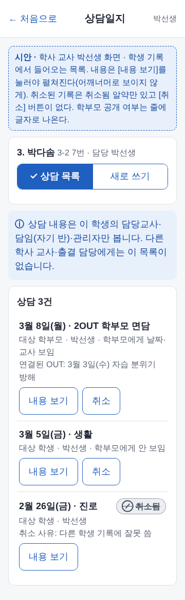 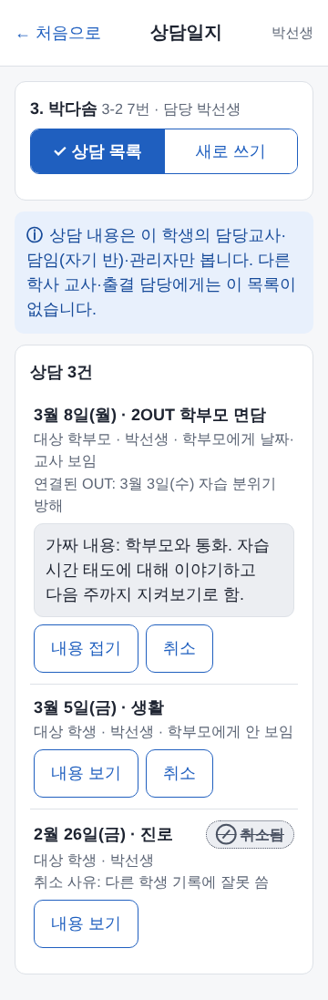

- 맨 위 안내 "상담 내용은 이 학생의 담당교사·담임(자기 반)·관리자만 봅니다. 다른 학사 교사·출결 담당에게는 이 목록이 없습니다."
- 카드 안 줄 = **날짜 · 유형**(굵게), 아래 "대상 학부모 · 교사 · 학부모에게 날짜·교사 보임/안 보임", 연결된 OUT이 있으면 "연결된 OUT: 3월 3일(수) 자습 분위기 방해". 버튼 [내용 보기](누르면 같은 줄 안에서 펼침, [내용 접기]로 되돌림) · [취소].
- **내용은 처음엔 접혀 있다**(어깨너머로 보이지 않게). 펼친 내용은 회색 상자에 줄바꿈을 지켜 보인다.
- 취소된 기록은 줄에 "취소됨" 알약(`UI.statusPill('canceled')`)과 "취소 사유: …"만 있고 **[취소] 버튼이 없다**. 삭제 버튼은 어디에도 없다.

### 2-2. 작성 (`counsel-write`·`counsel-write-2out`)

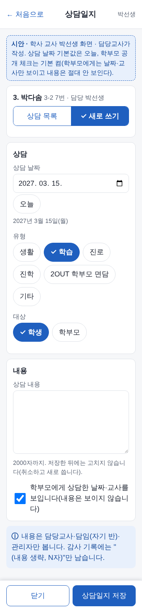 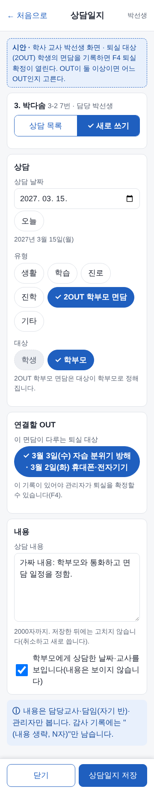

- 카드 "상담": 상담 날짜(`UI.dateField`, 바로가기 "오늘"), 유형 칩(생활·학습·진로·진학·2OUT 학부모 면담·기타), 대상 칩(학생·학부모).
- **유형이 "2OUT 학부모 면담"이면** 대상이 학부모로 고정(학생 칩 꺼짐, 안내 한 줄)되고, 카드 "연결할 OUT"이 나온다(2OUT 학생의 OUT 목록에서 하나 고름 — OUT이 하나면 미리 골라 있다). "이 기록이 있어야 관리자가 퇴실을 확정할 수 있습니다(F4)."
- 카드 "내용": 상담 내용(`textarea`, 160px 이상, 2000자), **체크 "학부모에게 상담한 날짜·교사를 보입니다(내용은 보이지 않습니다)" 기본 켬**.
- 안내 한 줄 "내용은 담당교사·담임(자기 반)·관리자만 봅니다. 감사 기록에는 "(내용 생략, N자)"만 남습니다." 아래 바 [닫기] · [상담일지 저장]. 내용이 비면 저장 버튼이 꺼진다.
- **저장한 뒤에는 고치지 않는다**(결정 42: 감사에 옛 글이 남지 않으므로). 고치기 = 취소 + 새로 쓰기 — 작성 폼 안내에 한 줄로 적는다.

### 2-3. 취소 (`counsel-cancel`)

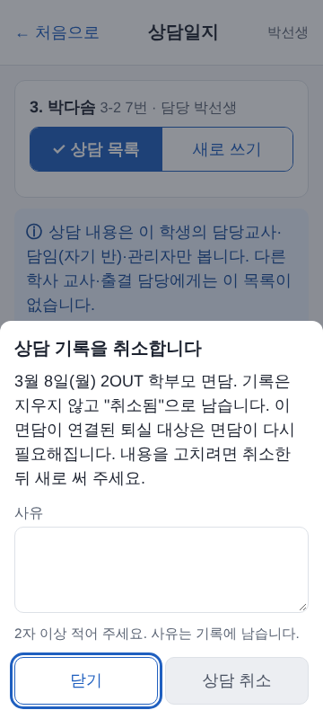

`UI.confirmWithReason` "상담 기록을 취소합니다", 메시지 "기록은 지우지 않고 "취소됨"으로 남습니다. 이 면담이 연결된 퇴실 대상은 **면담이 다시 필요해집니다**(2OUT 학부모 면담일 때만). 내용을 고치려면 취소한 뒤 새로 써 주세요.", 사유 필수(2자 이상), 버튼 [상담 취소](danger).

### 2-4. 홈 카드 (`home-counsel`)

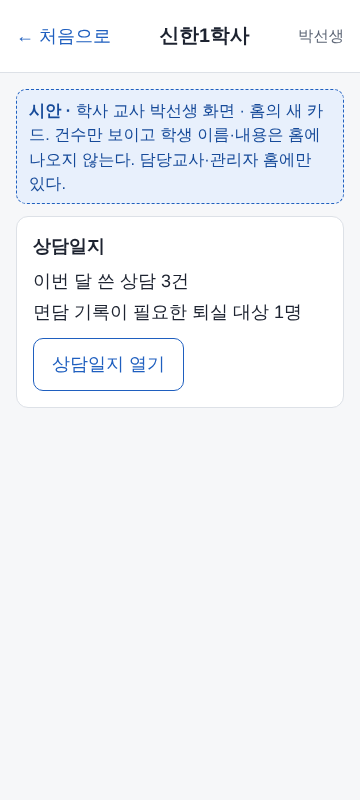

담당교사·관리자 홈의 카드 "상담일지": "이번 달 쓴 상담 N건", "면담 기록이 필요한 퇴실 대상 N명", [상담일지 열기]. **건수만, 학생 이름·내용은 홈에 나오지 않는다.**

## 3. F13 월별 일정 (C34, 결정 80)

`events` 탭(결정 80): 열 **시작일·끝날·제목·종류·메모·상태**(+ 공통 열). 관리자만 등록·취소(삭제 없이 `취소`), 교사 역할은 모두 달력으로 본다. 운영 안 하는 날은 자습 일정(`day_schedules`)에서 읽어 함께 보이고 **일정으로 두 번 입력하지 않는다.** 학생·학부모 보기는 0단계 진단 뒤(F14).

### 3-1. 월 달력 (`calendar-month`)

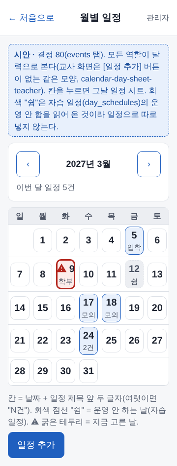 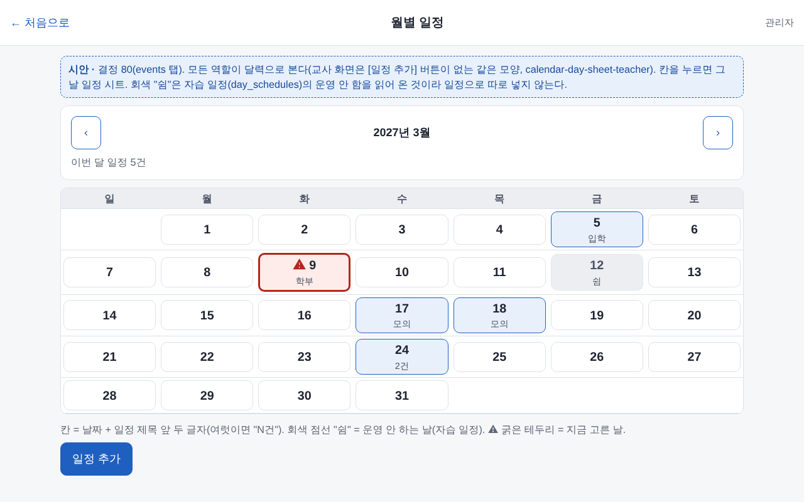

- 머리: [‹ 이전 달] "2027년 3월" [다음 달 ›], "이번 달 일정 5건". 아래 일~토 7열 달력(`.tablewrap` + `table.data.rg`, `table-layout: fixed`로 7칸이 같은 폭).
- **칸(`.rg-cell`)**: 위 줄 날짜 숫자, 아래 줄 — 일정이 하나면 **제목 앞 두 글자**(칸이 40px쯤이라 세 글자는 안 들어간다), 둘 이상이면 "2건". 일정이 있는 날은 `.has`(연한 파랑 + 파랑 테두리), **운영 안 하는 날은 `.off` 회색 점선 + "쉼"**(자습 일정에서 읽음), **지금 고른 날은 굵은 테두리 + ⚠**(`.bad`를 "고른 날"로 재사용). 모두 글자·모양으로도 알린다.
- 여러 날에 걸친 일정(시작일~끝날)은 그 기간의 **모든 날 칸**에 같은 제목이 나온다(모의고사 17~18일).
- 맨 아래 범례 한 줄, **관리자만** 그 아래 [일정 추가] 버튼. 교사 역할 화면은 같은 모양에서 이 버튼만 없다.

### 3-2. 날짜를 누르면 (`calendar-day-sheet`·`calendar-day-sheet-teacher`)

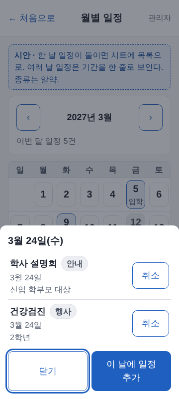 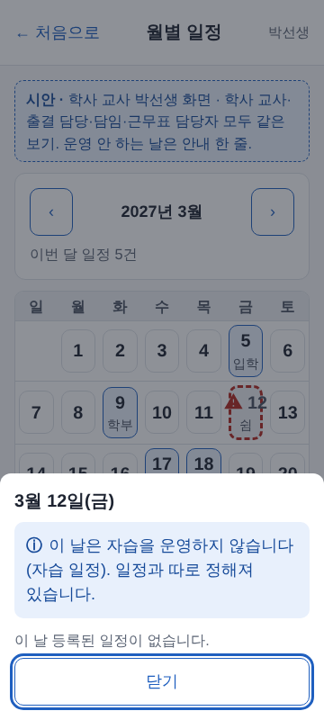

- `UI.bottomSheet` 제목 "3월 24일(수)", 그날 일정 목록: **제목(굵게) + 종류 알약(`UI.statusPill('mute')`)**, 아래 날짜(하루면 "3월 24일", 여러 날이면 "3월 17일 ~ 18일"), 메모.
- 관리자: 줄마다 [취소], 시트 아래 [닫기] · **[이 날에 일정 추가]**(누르면 날짜가 채워진 추가 폼). 교사 역할: [닫기]만.
- 운영 안 하는 날이면 맨 위 안내 "이 날은 자습을 운영하지 않습니다(자습 일정). 일정과 따로 정해져 있습니다." 일정이 없으면 "이 날 등록된 일정이 없습니다."

### 3-3. 추가 폼 (`calendar-add`·`calendar-add-error`)

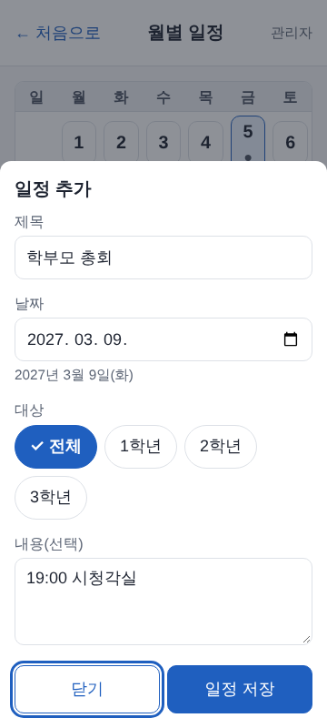 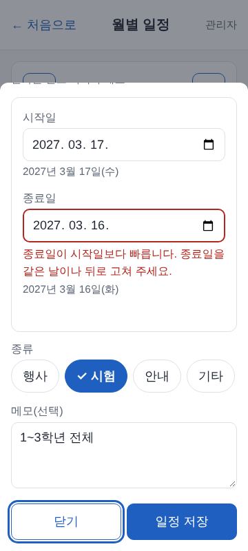

- 시트 안 폼: **제목**(60자, 안내 "달력 칸에는 앞 두 글자만 나옵니다"), **시작일·종료일**(기존 `UI.rangeField` — 시작일을 고르면 종료일이 같은 날로 맞춰지고, 종료일이 앞서면 칸 아래 오류 "종료일이 시작일보다 빠릅니다…"), **종류** 칩, 메모(선택, 300자). 화면 글자는 부품의 "종료일"을 쓴다(열 이름은 끝날). 아래 [닫기] · [일정 저장]. 제목이 비거나 날짜가 틀리면 저장하지 않는다.
- **종류 칩 값은 미정**이다(시안은 행사·시험·안내·기타를 제안). 정해지면 `docs/contracts/vocabulary.md`에 적는다(총괄 소유).

### 3-4. 취소 (`calendar-cancel`)

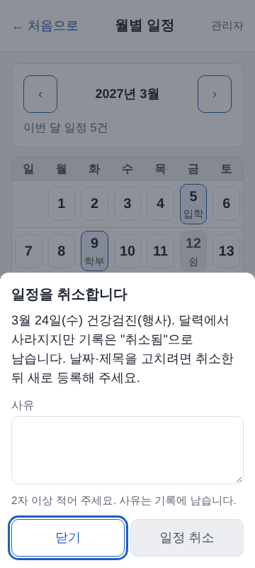

`UI.confirmWithReason` "일정을 취소합니다", 메시지 "달력에서 사라지지만 기록은 "취소됨"으로 남습니다. 날짜·제목을 고치려면 취소한 뒤 새로 등록해 주세요.", 사유 필수, 버튼 [일정 취소](danger). 삭제 버튼은 어디에도 없다.

## 4. 권한 한눈에

| 화면 | 관리자 | 출결 담당 | 학사 교사(담당) | 담임(자기 반) | 학생·학부모 |
| --- | --- | --- | --- | --- | --- |
| F11 결과 격자·누적 보기 | ○ | ○ | 보기 | — | — |
| F11 결과 입력·취소 | ○ | ○ | — | — | — |
| F12 상담 목록(내용 포함) | ○ | — | ○ 담당 학생 | ○ 우리 반 | — (학부모는 날짜·교사만, 이 단계 밖) |
| F12 작성·취소 | — | — | ○ 담당교사만 | — | — |
| F13 일정 보기 | ○ | ○ | ○ | ○ | (F14) |
| F13 일정 추가·취소 | ○ | — | — | — | — |

서버 키: F12는 기존 `counsel.view`·`counsel.save`·`counsel.cancel`(Auth.gs, 출결 담당은 `counsel.view`에 없다). F11·F13의 키(예: 결과 입력·일정 등록)는 코딩A가 정한다 — **이 표는 화면 쪽 기본값이고 서버가 다르면 서버가 맞다**(차이는 총괄에게).

## 5. 컴포넌트·스타일

| 화면 | 쓰는 것 |
| --- | --- |
| F11 격자·목록 | `UI.segmented` `UI.field` `UI.statusPill` `UI.bottomSheet` `UI.blockChips` `UI.confirmWithReason` `.tablewrap` `table.data.rg` `.rg-cell` |
| F12 상담일지 | `UI.dateField` `UI.field` `UI.segmented` `UI.statusPill` `UI.actionBar` `UI.confirmWithReason` + `.chip` `.check` `.notice` |
| F13 달력 | `UI.bottomSheet` `UI.rangeField` `UI.field` `UI.statusPill` `UI.confirmWithReason` + `table.data.rg` `.rg-cell` |

**이번에 `src/ui/Styles.html`에 더한 것(디자인 소유):** `table.data.rg`(가운데 정렬 표), `.rg-cell`(누르는 칸, 최소 높이 48px) + 상태 `.has`·`.bad`·`.off`, 칸 안 줄 `.rg-pre`·`.rg-sym`. 새 색은 없고 기존 토큰만 쓴다. 의미를 색만으로 전하지 않는다(⚠·기호·점선·"운영 안 함" 글자).

## 6. 미정·가정·확인 못 한 것 (코딩이 임의로 정하지 않는다)

1. **(결정됨, 결정 81)** 결과 시트 유형 칩은 인정 = 병결·병지각·병조퇴 + 가정사유, 미인정 = 미인정○○. '기타'는 뺐다(결과로 세지 않음). 가정사유는 시간 칩이 덮는 블록으로 인정 결석·지각·조퇴를 정한다.
2. **(결정됨)** 이름이 '미인정'으로 시작하면 미인정(자동 1OUT), 사전 병결은 인정 결석으로 센다.
3. **(결정됨)** 시간(블록) 칩을 둔다. 기본: 결석 = 전체, 지각 = 첫 블록, 조퇴 = 마지막 블록.
4. **격자·목록 전환 기준**은 화면 폭 900px 이상(PC)/미만(휴대폰)으로 제안했다(코딩이 조정 가능).
5. **(결정됨: 만들지 않는다)** "정리 끝낸 날" 표시. PRD 출결 담당 홈의 "격자 정리 남은 날짜"를 센다면 날짜별 정리 완료 표시(새 저장)가 필요하다 — 이 시안에는 없다. 필요하면 총괄이 새 탭 승인과 함께 정한다.
6. **월 보기**는 가로로 미는 한 줄(31열)로 가정했다. 180명 × 31일은 학년·반 칩으로 거른 뒤에 쓴다.
7. F12의 학부모 화면(상담 날짜·교사만 보임)은 F14(학생·학부모 포털, 0단계 진단 뒤)로 이 시안 밖이다.
8. **F13 종류 칩 값**(행사·시험·안내·기타는 제안)과 칸에 나오는 제목 글자 수(앞 두 글자 제안), 하루에 일정이 많을 때의 "N건" 표시는 코딩A·총괄이 확정한다. 학생·학부모 달력(F14)은 이 시안 밖.
9. **확인 못 한 것:** 실제 Apps Script·실제 휴대폰에서 돌려 본 것이 아니다(정적 시안). 한 학년 60명 이상을 한 주 격자로 그릴 때 PC 화면 스크롤 길이·휴대폰 목록 길이는 실제 데이터로 봐야 한다.
