# 5단계 선생님 확인 체크리스트

> 5단계(실사용 기능) 교사 쪽 세 가지 — **A 월별 일정(F13, C34)**, **B 상담일지(F12, C32)**, **C 출결 결과 정리(F11, C33)** — 를 선생님이 실제 Apps Script에서 따라 하며 확인하는 순서입니다. 형식은 `stage4-teacher-checks.md`와 같습니다.
> **사진은 정적 시안이 아니라 main 코드의 실제 화면**입니다(`design/preview/stage5-real.js`가 실제 `src/ui` 화면을 가짜 서버에 이어 붙여 찍음). 이름·숫자는 모두 가짜 데이터이고 날짜는 가짜 오늘 **2027-03-15(월)** 기준이라, 실제 Apps Script에서는 날짜와 이름이 다르게 보입니다. 모양과 문구가 같으면 통과입니다.

## 읽는 법

- 한 단계 = **누르는 것 → 이렇게 보이면 통과 → 사진 → 결과(○/×)** 입니다.
- ×가 나오면 **번호 + 한 줄**(예: "C7 미인정으로 저장했는데 OUT에 안 나옴")과 화면 사진을 총괄에게 보냅니다. 앱이 이상한 것이지 선생님이 잘못 누르신 것이 아닙니다.
- 컴퓨터 테스트(`npm test`)가 이미 확인한 것은 각 절 끝에 "이미 확인됨"으로 적었습니다. 여기서는 **실제 Apps Script에서만 보이는 것**(로그인, 계정별 화면, 휴대폰 화면, 메일, 시트에 남는 기록)을 봅니다.
- 이름은 모두 **가짜 데이터**입니다. 실제 학생 이름·상담 내용으로 시험하지 않습니다. 시험한 일정·결과·상담은 끝에서 **취소**해 가짜 데이터를 되돌립니다.
- **날짜 주의:** 결과 정리(C)는 **오늘(실제 날짜) 이후 날짜에는 입력하지 않고**, 가짜 데이터의 운영 기간은 `2026 2학기(테스트)`(2026-08-17 ~ 2027-02-28)와 `2027 1학기`(2027-03-02 ~)입니다. 그래서 2027-03-02 전에는 **오늘이 들어 있는 기간(2026 2학기 테스트)에서 오늘이나 지난 날짜로** 하고, 2027-03-02 뒤에는 2027 1학기로 합니다. 사전 특이사항·OUT이 미리 들어 있는 가짜 데이터는 대부분 2027-03 날짜라 **오늘이 그 전이면 그런 칸이 비어 있는 것이 정상**입니다(해당 단계는 "데이터 부족"으로 적고 넘어갑니다).

## 시험 계정

| 이름 | 어떤 계정 | 맡는 역할 | 쓰는 곳 |
| --- | --- | --- | --- |
| 소유자 | 선생님 계정 | 관리자 + 학사 교사 | 준비, A~C 전체 |
| 시험1 | 시험용 gmail 1 | 학사 교사(담당 학생이 있는 계정) | B 쓰기, A·C 보기 |
| 시험2 | 시험용 gmail 2 | **역할을 바꿔 가며** 출결 담당 → 담임 → 근무표 담당자 → 학생 → 학부모 | 모든 절의 "안 보여야 하는 사람" 확인 |

시험2는 편집기에서 `addUser`를 같은 이메일로 다시 실행하면 역할이 바뀝니다(역할을 바꿀 때마다 **로그아웃했다가 다시 접속**). 시험1·시험2는 3·4단계에서 쓰던 계정을 그대로 써도 됩니다.

## 0. 먼저 끝나 있어야 하는 것 (준비, 소유자, 약 10분)

| 번호 | 누가 | 할 일 | 이렇게 보이면 통과 | 사진 | 결과 |
| --- | --- | --- | --- | --- | --- |
| 0-1 | 소유자 | `clasp push` 뒤 편집기에서 `setup`을 **다시** 실행합니다 | 로그에 `[탭 생성] events`가 보이고(두 번째 실행은 `[탭 유지] events`), `[경고]`가 없다. `신한1학사_상담일지`는 `[유지]`, `counsel_notes`는 `[탭 유지]` | | |
| 0-2 | 소유자 | 편집기에서 `seedFakeData` → `seedFakeStage1` → … → `seedFakeStage4`가 이미 돌아 있는지 확인합니다(3·4단계에서 했으면 다시 하지 않아도 됨) | 시트 `students`에 가짜 학생 30명대, `terms`에 가짜 기간 3개(2026 2학기 테스트·2027 1학기·2027 여름방학 테스트)가 있다 | | |
| 0-3 | 소유자 | 시험1을 `addUser(시험1 gmail, '시험교사', 'hall_teacher')`로 등록하고, 시트 `enrollments`에서 **시험1이 담당교사인 학생이 한 명 이상** 있는지 봅니다 | 시험1로 로그인하면 학사 교사 홈이 열린다. 담당 학생이 없으면 소유자가 `enrollments`의 `teacher_email` 칸에 시험1 이메일을 넣어 줍니다(가짜 데이터라 괜찮다) | | |
| 0-4 | 소유자 | 스크립트 속성 `MAIL_ENABLED`가 `'true'`인지 봅니다(C의 메일 단계에서 필요. 꺼져 있으면 C9는 "메일 꺼짐"으로 적고 넘어갑니다) | 켜져 있으면 미인정 저장 때 메일이 갑니다. 받는 곳이 `@example.com`인 가짜 계정이면 메일은 가지 않습니다(결정 41) | | |

## A. 월별 일정 (F13, C34, 결정 80, 약 30분)

홈 → **월별 일정 열기**. 관리자만 일정을 넣고 취소하고, 학사 교사·담임·출결 담당·근무표 담당자는 **달력으로 보기만** 합니다. 운영 안 하는 날은 **자습 일정**에서 정한 것이 회색 "쉼"으로 함께 나오며 일정으로 따로 넣지 않습니다.

| 번호 | 누가 | 누르는 것 | 이렇게 보이면 통과 | 사진 | 결과 |
| --- | --- | --- | --- | --- | --- |
| A1 | 소유자 | 홈 맨 아래 **월별 일정** 카드를 봅니다 | "오늘과 앞으로 2주 안에 등록된 일정이 없습니다." 또는 오늘·다음 일정(제목·종류)과 [월별 일정 열기] 버튼이 있다. 학생 이름은 없다 | 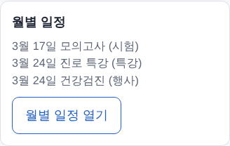 | |
| A2 | 소유자 | **[월별 일정 열기]**를 누릅니다 | 위에 [‹] "2027년 3월" [›]와 "이번 달 일정 N건", **[+ 일정 추가]**, 아래 일~토 달력. 오늘 칸은 굵은 파란 테두리, 일정이 있는 날은 연한 파랑 바탕에 **제목 앞 두 글자**(여럿이면 "2건"), 맨 아래 범례 한 줄 | 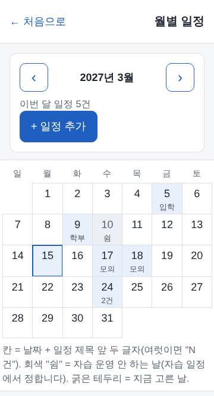 | |
| A3 | 소유자 | 달력에서 **자습 일정에서 "운영 안 함"으로 정한 날**(가짜 데이터는 2027-03-10)을 찾습니다. 없으면 홈 → 자습 일정에서 아무 날을 "운영 안 함"으로 저장하고 돌아옵니다 | 그 칸이 **회색 바탕 + "쉼"**이고, 눌러 보면 아래에 노란 안내 **"자습 운영 안 함 · (메모)"**와 "이날 일정이 없습니다."가 나온다 | 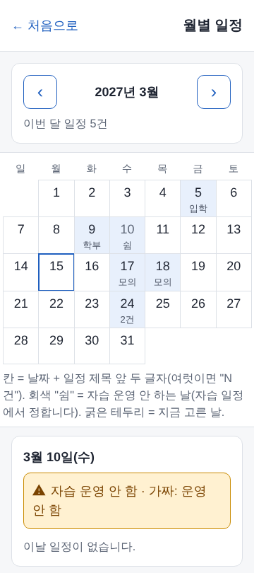 | |
| A4 | 소유자 | 일정이 둘 이상인 날(아래 A6~A8로 만든 뒤)을 누릅니다 | 칸에 "2건", 아래 카드에 그날 일정이 줄마다 **제목 · 종류 알약 · 날짜 · 메모 · [취소]** 로 나온다 | 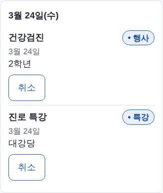 | |
| A5 | 소유자 | **[+ 일정 추가]**를 누릅니다 | 아래에 카드 "일정 추가": 제목, **종류**(시험·행사·특강·휴업·기타 중 고름), **시작 날짜**(기본 = 지금 고른 날), **끝 날짜 (하루면 비워 두세요)**, 메모(선택), [저장]·[닫기] | 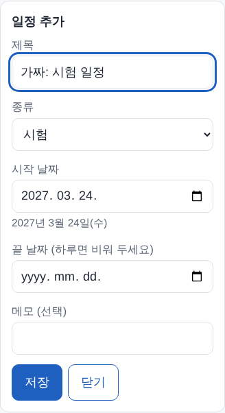 | |
| A6 | 소유자 | 제목 "가짜: 시험 일정", 시작 날짜 3월 24일, **끝 날짜를 3월 23일**(시작보다 앞)로 하고 [저장] → 확인 시트에서 [등록] | **끝 날짜 칸 아래 빨간 글자 "끝 날짜가 시작 날짜보다 앞입니다."**가 나오고 저장되지 않는다. 제목을 비우면 "제목을 적어 주세요.", 종류를 안 고르면 "종류를 골라 주세요." | 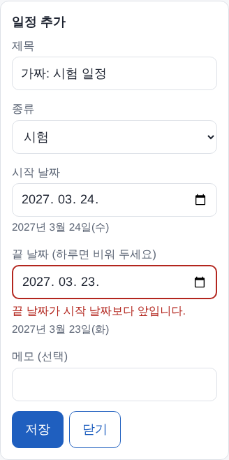 | |
| A7 | 소유자 | 끝 날짜를 **비우고**(하루짜리) [저장] | 아래에서 올라오는 확인 시트 **"이 일정을 등록할까요?"**: 제목, "종류 · 3월 24일", "모든 교사의 달력에 보입니다."와 [취소]·[등록] | 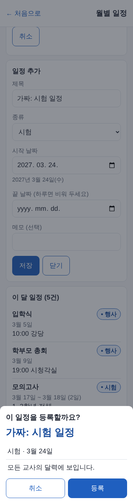 | |
| A8 | 소유자 | [등록]을 누릅니다 | 알림 "일정을 등록했습니다.", 시트가 닫히고 달력 3월 24일 칸에 제목 앞 두 글자가 나오며 "이번 달 일정 N건"이 1 늘고 아래 "이 달 일정" 목록에 줄이 생긴다. **같은 제목·종류·기간을 한 번 더** 저장하면 "같은 일정(제목·종류·기간)이 이미 있습니다." | | |
| A9 | 소유자 | 3월 17일 ~ 18일(**여러 날**) "가짜: 모의고사"(종류 시험)를 같은 방법으로 등록합니다 | 17일·18일 **두 칸 모두**에 제목이 나오고, 목록과 날짜 카드에 "3월 17일 ~ 3월 18일 (2일)"로 보인다 | | |
| A10 | 소유자 | 일정 하나의 **[취소]**를 누릅니다 | 그 줄 아래에 카드 **"○○ 취소"**가 열린다: "취소 사유 (필수)" 칸, 안내 "기록은 지워지지 않고 "취소"로 남습니다.", [일정 취소]·[닫기] | 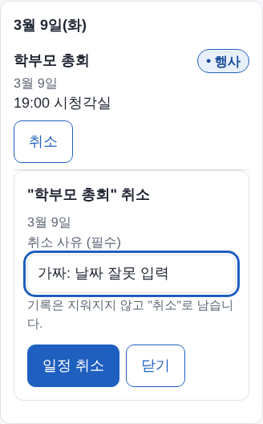 | |
| A11 | 소유자 | 사유를 **비운 채** [일정 취소] → 다음에 "가짜: 날짜 잘못 입력"을 적고 [일정 취소] → 시트에서 [일정 취소] | 비웠을 때는 "취소 사유를 2자 이상 적어 주세요."로 막힌다. 확인 시트 **"이 일정을 취소할까요?"**(모든 교사 달력에서 사라집니다. 기록은 지워지지 않고 "취소"로 남습니다.) → 알림 "일정을 취소했습니다." → 달력·목록에서 빠진다 | | |
| A12 | 소유자 | 시트 `events` 탭과 `audit_log`를 봅니다 | A11에서 취소한 행이 **지워지지 않고 `status` 칸에 `취소`, 취소 사유가 남아** 있다. `audit_log`에 등록·취소 줄이 있다. `이 달 일정` 목록에는 취소한 일정이 없다 | | |
| A13 | 소유자 | **두 창으로**: 창1에서 달력을 열어 둔 채, 창2에서 일정을 하나 등록합니다. 창1에서 다른 일정을 [저장] → [등록] | 창1에 **"다른 관리자가 먼저 바꿨습니다. 새로 불러온 뒤 다시 해 주세요."**가 나오고 달력이 새로 불러와진다. 창1의 저장은 반영되지 않았다 | | |
| A14 | 소유자 | **달 경계**: 3월 30일 ~ 4월 2일 일정을 등록하고 [‹][›]로 3월·4월을 오갑니다 | 3월 달력 30·31일, 4월 달력 1·2일 **양쪽 모두**에 보인다 | | |
| A15 | 시험1 | 홈 맨 아래 월별 일정 카드 → [월별 일정 열기] | 달력과 일정 목록은 소유자와 같지만 **[+ 일정 추가]도 [취소]도 없다**(보기만). 운영 안 하는 날은 같은 회색 "쉼" |  | |
| A16 | 시험2(출결 담당 → 근무표 담당자 → 담임) | 홈과 월별 일정을 엽니다 | 세 역할 모두 홈에 월별 일정 카드가 있고 달력이 열리며 **추가·취소 버튼이 없다** | | |
| A17 | 시험2(학생 → 학부모) | 홈을 보고 주소 끝에 `?page=calendar`를 붙여 엽니다 | 홈에 월별 일정 카드가 없고(학생 홈은 "3단계 이후에 추가합니다" 안내), 주소로 열면 **권한 없음 화면**이 나온다(학생·학부모 달력은 0단계 진단 뒤) | | |

> 이미 확인됨: 같은 일정(제목·종류·기간) 중복 거부, 취소는 사유 2자 이상·삭제 없이 `취소`, 두 달에 걸친 일정, 낡은 화면(token) 거부, 관리자 외 등록·취소 거부, 교사 역할 보기 허용·학생·학부모 거부, 운영 안 하는 날은 자습 일정에서 읽음(events에 두 번 넣지 않음).
> 확인 못 한 것: 실제 휴대폰에서 달력 칸이 손가락으로 누르기 편한지(칸 높이는 52px 이상).

## B. 상담일지 (F12, C32, 결정 42, 약 40분)

상담 **내용**은 별도 스프레드시트(`신한1학사_상담일지`)에만 있고, **그 학생의 담당교사·담임(자기 반)·관리자만** 봅니다. 그날 근무교사·출결 담당·다른 학사 교사는 보지 못합니다. 쓰기는 **담당교사만**이고, **고치기 = 취소 + 새 기록**입니다(내용을 제자리에서 고치지 않아야 감사 기록에 옛 글이 남지 않습니다). 학부모에게는 상담 **날짜·교사**만 보이고 내용은 보이지 않습니다(학부모 화면은 0단계 진단 뒤).

| 번호 | 누가 | 누르는 것 | 이렇게 보이면 통과 | 사진 | 결과 |
| --- | --- | --- | --- | --- | --- |
| B1 | 시험1 | 홈의 **상담일지** 카드를 봅니다 | "이번 기간 상담 기록 없는 학생 N명"(또는 "담당 학생 모두 기록 있음")과 "최근 30일 내가 쓴 상담 N건 · 내용은 담당교사·담임·관리자만 봅니다." 그리고 [상담일지 열기]. **학생 이름·내용은 홈에 없다** |  | |
| B2 | 시험1 | **[상담일지 열기]** | "상담일지" 카드에 "학생 찾기" 칸과 **내 담당 학생 줄**(학번 이름 + [상담 보기]). 이름·학번으로 거를 수 있다 | 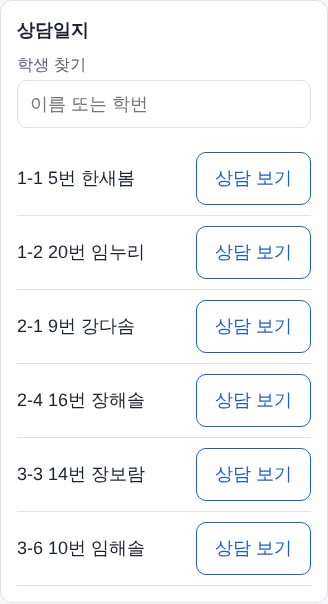 | |
| B3 | 시험1 | 담당 학생 한 명의 **[상담 보기]** | 위에 학생 줄(이름·학년반번호·담당 교사)과 **[상담 목록 \| 새로 쓰기]** 탭, 파란 안내 "상담 내용은 이 학생의 담당교사·담임(자기 반)·관리자만 봅니다. 다른 학사 교사·출결 담당에게는 이 목록이 없습니다.", 카드 "상담 N건": 줄마다 **날짜 · 유형**, "대상 학생 · 교사 · 학부모에게 날짜·교사 보임/안 보임", [내용 보기]·[고치기]·[취소]. **내용은 접혀 있다** | 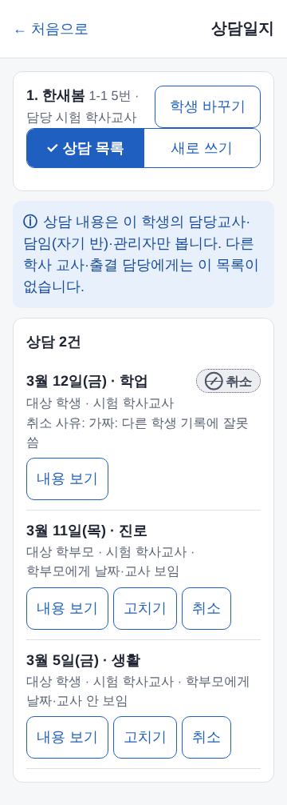 | |
| B4 | 시험1 | 한 건의 **[내용 보기]** → 다시 **[내용 접기]** | 회색 상자에 줄바꿈을 지켜 내용이 펼쳐지고, 접으면 사라진다. **취소된 건**은 "취소" 알약(⊘)과 "취소 사유: …"가 보이고 [고치기]·[취소] 버튼이 없다 | 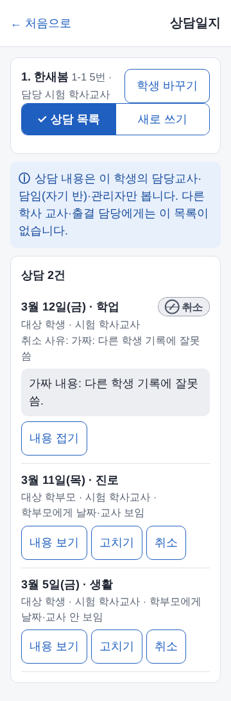 | |
| B5 | 시험1 | **[새로 쓰기]** 탭 | 카드 "상담": 상담 날짜(기본 오늘, **[오늘]** 바로가기), **유형** 칩(학업·생활·진로·건강·가정·기타), **대상** 칩(학생·학부모). 카드 "내용": 상담 내용(160px 이상, "2000자까지. 저장한 뒤에는 고치지 않습니다(취소하고 새로 씁니다)."), **체크 "학부모에게 상담한 날짜·교사를 보입니다(내용은 보이지 않습니다)"가 처음부터 켜져 있다**. 파란 안내 "…감사 기록에는 "(내용 생략, N자)"만 남습니다." 아래 바 [닫기]·**[상담일지 저장]**(내용이 비면 꺼져 있다) | 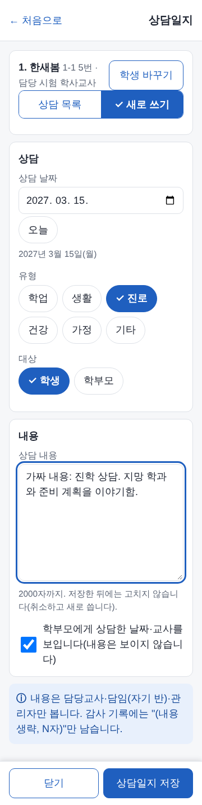 | |
| B6 | 시험1 | 내용 "가짜 내용: 시험"만 적고 **유형을 고르지 않은 채** [상담일지 저장]. 이어서 날짜를 **내일**로 바꿔 저장 | 유형 칸 아래 "유형을 목록에서 골라 주세요." / 날짜 칸 아래 "앞으로의 날짜는 기록할 수 없습니다." 가 나오고 저장되지 않는다 | | |
| B7 | 시험1 | 유형 "생활", 대상 "학생", 체크는 그대로 두고 [상담일지 저장] | 알림 "저장했습니다." 후 상담 목록으로 돌아가고 맨 위에 새 건("학부모에게 날짜·교사 보임")이 생기며 "상담 N건"이 1 는다. 같은 내용을 한 번 더 저장하면 "이미 같은 기록이 있습니다." | | |
| B8 | 시험1 | 체크를 **끄고** 다른 상담을 하나 저장합니다 | 그 줄에 "학부모에게 날짜·교사 안 보임"이 나온다 | | |
| B9 | 시험1 | 건 하나의 **[고치기]** → 내용을 바꾸고 [고쳐서 저장] | 위 탭이 **[고치기]**, 카드 제목이 "상담 고치기"이고 내용이 미리 채워져 있다. [고쳐서 저장]을 누르면 아래에서 시트 **"상담을 고칩니다"**("옛 기록은 "취소됨"으로 남고 새 기록이 생깁니다.", 고치는 이유 칸, 2자 이상)가 올라오고, 이유를 적고 [고쳐서 저장]하면 "고쳐서 저장했습니다." **옛 건은 "취소"로 남고 새 건이 하나 더 생긴다** | 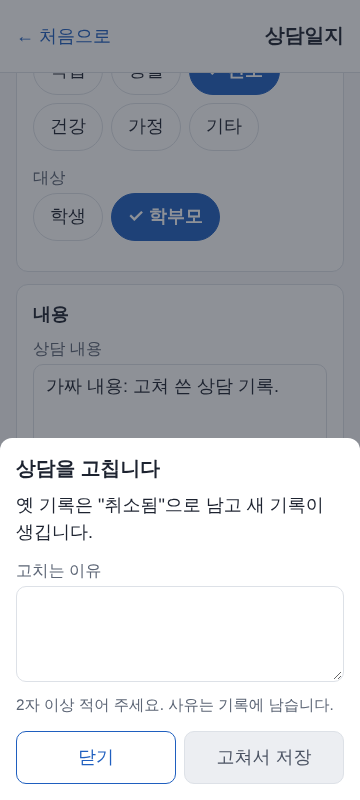 | |
| B10 | 시험1 | 건 하나의 **[취소]** | 시트 **"상담 기록을 취소합니다"**("기록은 지우지 않고 "취소됨"으로 남습니다. 내용을 고치려면 [고치기]를 쓰거나 취소한 뒤 새로 써 주세요."), 사유 칸(2자 이상)이 있다. 사유를 적고 [상담 취소]하면 "취소했습니다." 그 건이 "취소" 알약과 사유로 바뀌고 "상담 N건"이 줄어든다 | 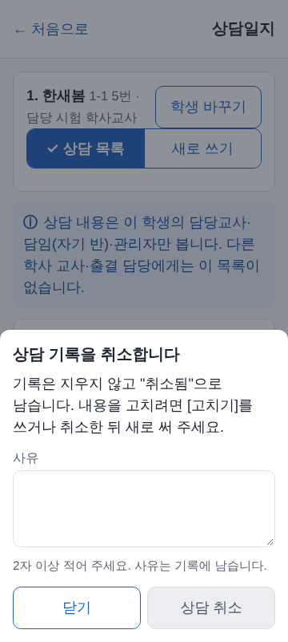 | |
| B11 | 소유자 | 시트 `신한1학사_상담일지`의 `counsel_notes` 탭, 운영 DB의 `audit_log`·모든 탭을 봅니다 | 상담 **내용은 `counsel_notes` 탭에만** 있다. 운영 DB 어느 탭에도 B7~B10에서 쓴 글자가 없고, `audit_log`에는 내용 대신 **`(내용 생략, N자)`**만 있다. B9·B10의 옛 건은 **행이 남아 있고 `status`가 `취소`**다 | | |
| B12 | 소유자 | 드라이브에서 `신한1학사_상담일지` 파일의 **공유 설정**을 봅니다 | **"제한됨"**(나만)이다. 다른 사람과 공유된 흔적(링크 공유·사용자 추가)이 없다 | | |
| B13 | 시험2(담임으로 바꾼 뒤, 학급은 가짜 명단 학급 중 하나) | 홈 → **상담일지 열기** | 우리 반 학생 줄이 나오고 [상담 보기]로 **목록과 내용은 볼 수 있지만** 위 탭에 **[새로 쓰기]가 없다**(보기만). 다른 반 학생은 목록에 없다 | 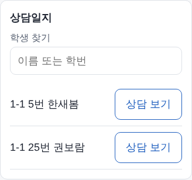 | |
| B14 | 시험2(담당 학생이 없는 다른 학사 교사로 `addUser(시험2 gmail, '시험2', 'hall_teacher')`, 소유자가 `enrollments`에서 시험2 담당을 모두 비워 둔 상태) | 주소 끝에 `?page=counsel&student=` + B3의 학생 id를 붙여 직접 엽니다(id는 시트 `students`의 `id` 칸) | **"볼 수 있는 학생이 없습니다."** 학생의 상담 목록·내용은 한 줄도 보이지 않는다(다른 학사 교사는 못 본다) | 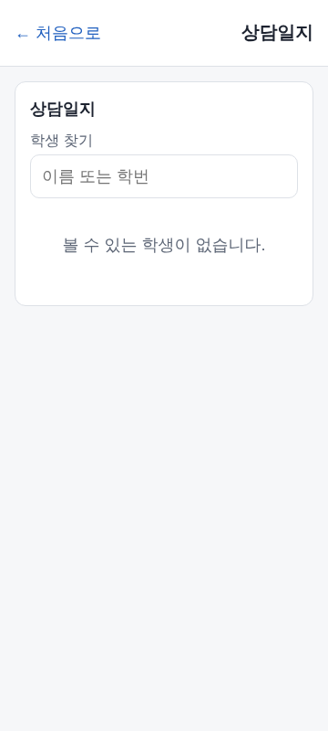 | |
| B15 | 시험2(출결 담당으로 바꾼 뒤) | 홈에 상담일지 카드가 있는지 보고, 주소 끝에 `?page=counsel`을 붙여 엽니다 | 홈에 상담일지 카드가 없고, 주소로 열면 **"권한이 없습니다"** 화면이 나온다(출결 담당은 상담을 못 본다). "접속한 계정: …" 아래에 **"이 화면은 볼 수 있는 역할이 아닙니다. 처음으로 돌아가 주세요."**가 보인다(등록된 계정인데 그 화면의 역할이 아니라는 뜻. 등록되지 않은 계정이면 다른 문구가 나온다) | 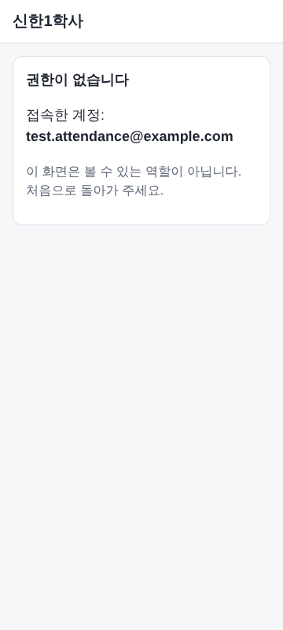 | |
| B16 | 시험2(근무표 담당자 → 학생 → 학부모) | 같은 주소 `?page=counsel` | 모두 **권한 없음**. 홈에도 카드·버튼이 없다 | | |
| B17 | 소유자 | (소유자는 관리자 + 학사 교사) 상담일지를 열고 **담당이 아닌 학생**을 봅니다 | 전체 학생이 목록에 나오고(담당 아님은 이름 옆 "(담당 아님)") [상담 보기]로 목록·내용을 볼 수 있다. 쓰기는 **담당 학생일 때만** 된다 | | |
| B18 | 소유자 | 2OUT 학생에게 2단계 OUT 화면의 [퇴실 대상]에서 **학부모 면담**을 기록해 둔 가짜 데이터가 있으면, 그 학생의 상담 목록을 봅니다 | "2OUT 학부모 면담" 건이 목록에 있고 **[고치기]가 없고** 줄에 "2OUT 학부모 면담 — 취소는 OUT 화면에서만 합니다."가 보인다. 이 화면의 새로 쓰기 유형 칩에는 "2OUT 학부모 면담"이 **없다**. 가짜 데이터에 면담이 없으면 "데이터 부족"으로 적습니다 | | |

> 이미 확인됨: 담당교사만 쓰기·취소·고치기, 담임(자기 반)·관리자만 보기, 그날 근무교사·출결 담당·다른 학사 교사·학생·학부모 거부, 내용이 운영 DB·audit_log·메일·다른 공개 함수 응답에 없음(상담 내용 노출 감시), 고치기는 취소 + 새 행, 앞으로의 날짜·빈 내용·모르는 유형 거부, 같은 내용 중복 저장 한 번만.
> 확인 못 한 것: **별도 스프레드시트의 실제 공유 설정**(B12가 그 확인입니다), 실제 휴대폰에서 상담 목록 버튼 세 개([내용 보기]·[고치기]·[취소])가 한 줄로 들어가는지.

## C. 출결 결과 정리 (F11, C33, R22, 결정 81, 약 60분)

종이 출석부 결과(× 결석 · △ 지각 · 조 조퇴)를 **출결 담당·관리자**가 주말·월말에 옮겨 적는 화면입니다. 결과는 **사전 특이사항(확정)** 행으로 저장되고(새 탭 없음), **미인정**이면 자동으로 **1OUT**이 기록됩니다. 학사 교사·담임은 **보기만** 합니다. 결과 유형: 인정 = 병결·병지각·병조퇴·**가정사유**, 미인정 = 미인정결석·미인정지각·미인정조퇴(기타는 결과로 세지 않음). 시간 기본값: 결석 = 전체, 지각 = 첫 시간, 조퇴 = 마지막 시간. **PC는 학생 × 날짜 한 주 격자, 휴대폰은 날짜 하나 → 학생 줄**입니다(화면 폭 900px 기준).

| 번호 | 누가 | 누르는 것 | 이렇게 보이면 통과 | 사진 | 결과 |
| --- | --- | --- | --- | --- | --- |
| C1 | 시험2(출결 담당으로 바꾼 뒤) | 홈에서 **출결 결과 정리** 버튼을 찾아 누릅니다(소유자 홈에도 같은 버튼) | 화면 위에 "(기간 이름) · 출결 결과 정리", **[결과 입력 \| 학생별 누적]** 탭, **[하루 \| 주 \| 달]** 보기 | | |
| C2 | 시험2 | **휴대폰**(또는 창을 좁게)으로 엽니다 | 기본 보기가 **하루**: [‹] 날짜 [›], **반 칩**(학년 반), 아래에 학생 줄 **"N번 이름"** 과 상태("출석" 또는 사전 특이사항·결과 알약)와 **[결과 입력]**, 맨 아래 "결과 N건. 미인정은 자동 1OUT입니다." | 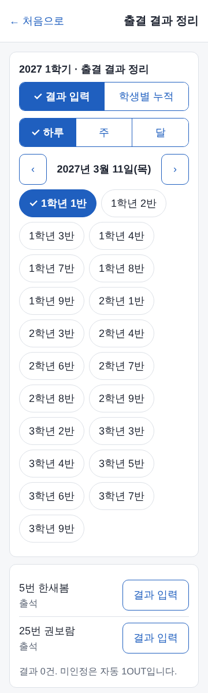 | |
| C3 | 시험2 | **PC**(창 폭 900px 이상)로 같은 화면을 엽니다 | 기본 보기가 **주**: 표 머리 "03/02 화 …", 학생 줄 "N번 이름", 칸 위 줄 **회색 사전 특이사항**(병결·학원 …), 아래 줄 **결과 기호 × △ 조**(미인정은 빨간 "미"), 출결이 없는 칸은 "·". 아래 범례 "× 결석 · △ 지각 · 조 조퇴 · "미"는 미인정(자동 1OUT). 회색 글자는 사전 특이사항입니다." | 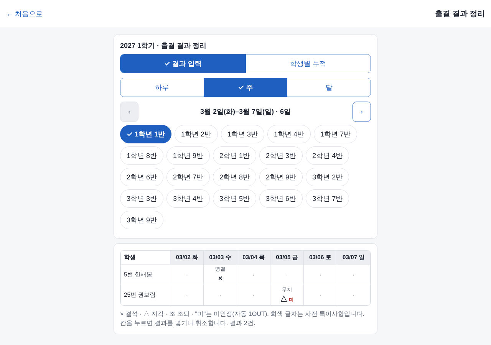 | |
| C4 | 시험2 | 운영 안 하는 날(가짜 데이터 2027-03-10)을 엽니다 | 휴대폰은 안내 "이날은 자습을 운영하지 않아 결과를 넣을 수 없습니다." 이고 [결과 입력] 버튼이 없다. PC 격자의 그날 칸은 "–"이고 눌러도 열리지 않는다 | | |
| C5 | 시험2 | 휴대폰에서 운영하는 날(예: 2027-03-11)의 학생 한 명 줄 **[결과 입력]**을 누릅니다 | 아래에서 시트가 올라온다: 제목 "(이름) 03/11", 날짜 · 시간(블록), "출석부 칸: …"(결과·특이사항이 없는 칸은 **"출석(특이사항 없음)"**), 위에 "결과 넣기" **[결석 \| 지각 \| 조퇴]** 와 안내 "결석·지각·조퇴 중에서 먼저 고르세요."(고르기 전에는 [확인하고 저장]이 꺼져 있다). **결석**을 고르면 **유형 칩**(병결 · 가정사유 · 미인정결석 — **'기타'·학원은 없다**)이 나오고, 유형을 고르면 시간 칩(전체/각 블록, 결석은 **전체가 기본**), 사유(선택)가 나온다 | 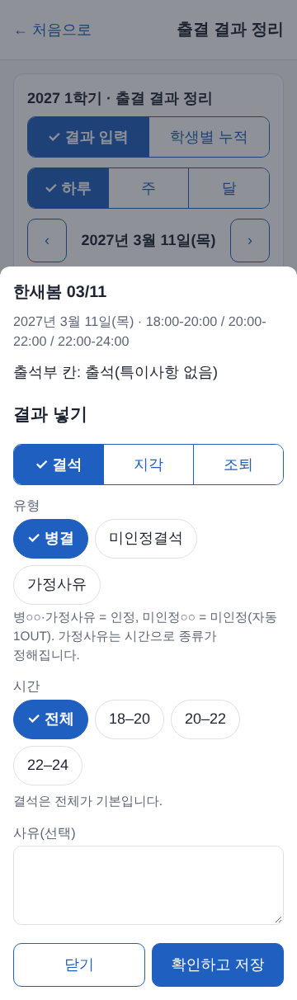 | |
| C6 | 시험2 | 유형 **병결**을 고르고 **[확인하고 저장]** → 확인 시트에서 **[저장]** | 확인 시트 **"결과를 저장할까요?"**에 이름·날짜·"결석 · 병결"이 있고 인정이라 경고 줄이 없다. 저장하면 알림 **"저장했습니다."** 시트가 닫히고 그 학생 줄이 **"결석 인정" 알약**으로 바뀌고 맨 아래 "결과 N건"이 1 는다 | 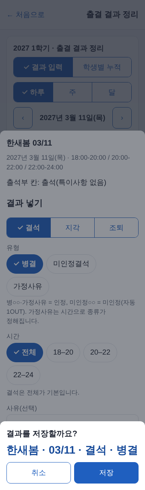 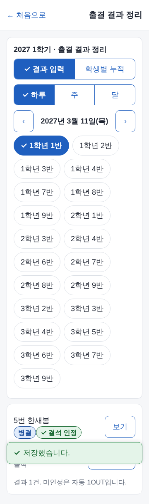 | |
| C7 | 시험2 | 다른 학생의 **[결과 입력]** → **지각** → **미인정지각** | 유형 아래에 **노란 경고 "미인정입니다. 저장하면 자동으로 1OUT이 기록되고 담당교사·담임에게 알림이 갑니다."**가 나온다. 시간 기본은 **첫 블록**(맨 앞 칩)이다. 지각이면 유형 칩이 병지각·미인정지각·가정사유다 | 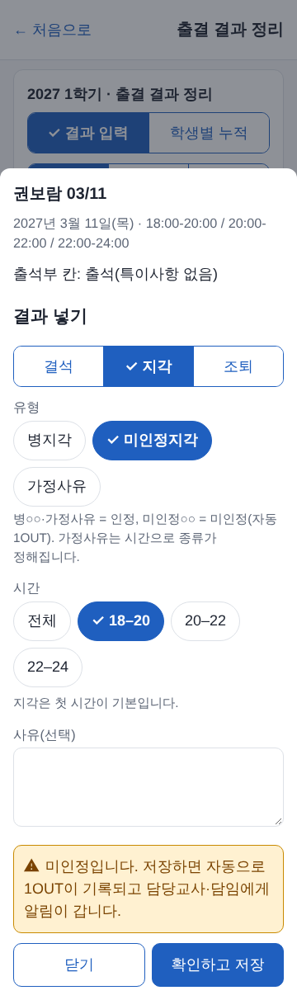 | |
| C8 | 시험2 | **[확인하고 저장]** → 확인 시트 → **[저장]** | 확인 시트 "(이름) · 03/11 · 지각 · 미인정지각" 아래에 **"미인정이라 저장하면 자동으로 1OUT이 기록됩니다(1건). 담당교사·담임에게 알림이 갑니다(받는 사람마다 한 통)."** 저장하면 알림 **"저장했습니다. 자동 1OUT 1건이 기록되었습니다."** 줄이 "지각 미인정" 알약(경고색)으로 바뀐다 | 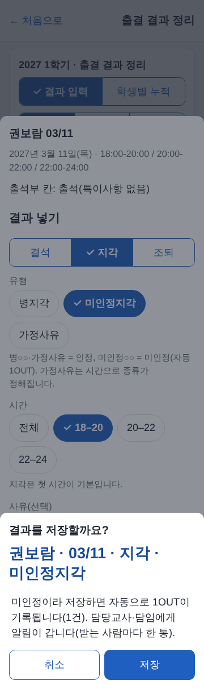 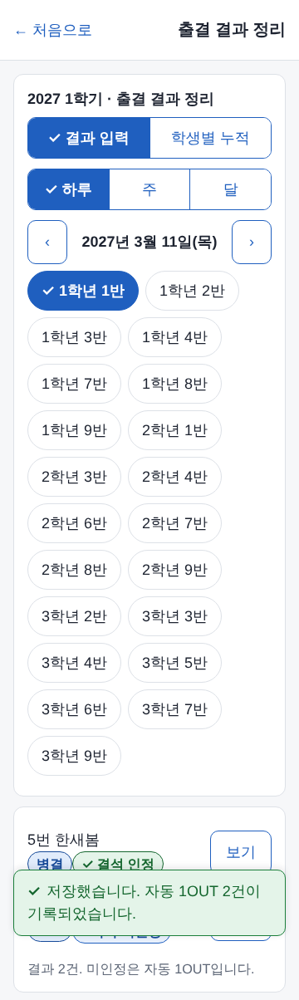 | |
| C9 | 소유자 | 홈 → **OUT** → **[학기]** 탭에서 C8의 학생을 찾습니다 | 그 학생이 **1OUT**(이미 1OUT이었다면 **퇴실 대상**)으로 나오고 "가장 최근: 3월 11일(목) **무단 지각·결석·이탈(미인정지각)(자동)**"이 보인다. **메일이 켜져 있고 받는 사람이 진짜 주소라면** 담당교사·담임에게 **한 통씩만**(같은 사람이 담당교사이자 담임이어도 한 통, 두 반을 맡은 교사도 한 통) 가고 본문에 학생 이름·사유가 없다 | 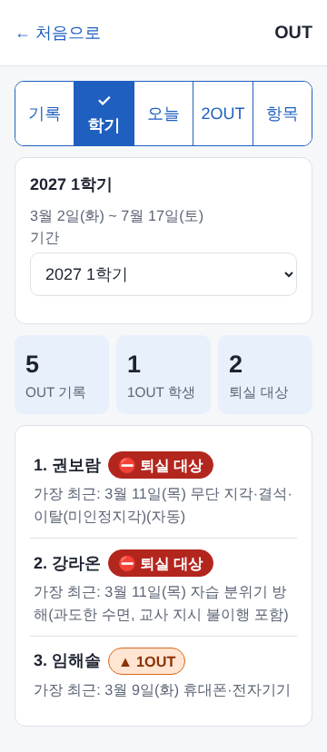 | |
| C10 | 시험2 | C8의 학생 줄 **[보기]**를 누릅니다 | 시트에 "이 날 기록": **"미인정지각 · 시간 · 지각 미인정"**, 사유, 입력한 사람, 그 아래 **[취소]**. 위 "결과 넣기"에 같은 날 같은 종류를 다시 넣을 수도 있다 | 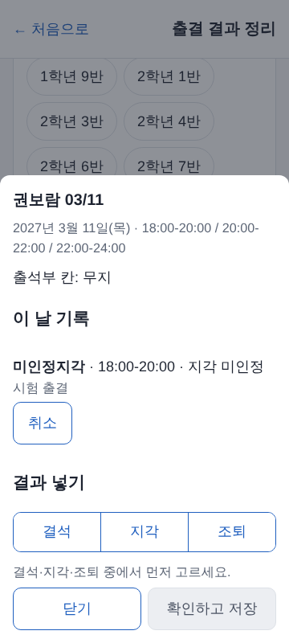 | |
| C11 | 시험2 | **[취소]** → 사유를 적습니다 | 아래에서 시트 **"지각 결과 취소"**: "(이름) 2027-03-11 미인정지각 — **연결된 자동 1OUT도 함께 취소됩니다.**"(미인정일 때만), 사유 칸(2자 이상, 비면 [결과 취소]가 꺼져 있다). 확정하면 알림 **"결과를 취소했습니다. 연결된 자동 OUT도 취소되었습니다."** 그 줄이 "출석"으로 돌아간다 | 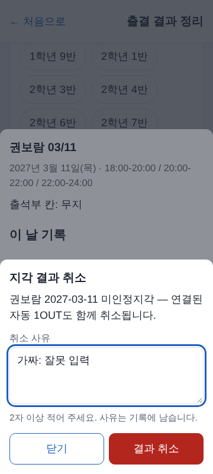 | |
| C12 | 소유자 | 시트 `exceptions_(기간)`과 `violations_(기간)` 탭, `audit_log`를 봅니다 | C11에서 취소한 행들이 **지워지지 않고 `status`가 `취소`**, 사유가 남아 있고, 자동 OUT 행도 **취소**로 남는다. `audit_log`에 저장·취소 줄이 있다 | | |
| C13 | 시험2 | **사전 특이사항 대체**: 사전 특이사항 "학원(보강 포함)"이 있는 칸(가짜 데이터 2027-03-04)의 학생에게 결석 → **미인정결석**을 고르고 [확인하고 저장] | 칸 시트 위에 안내 "이 칸에는 사전 특이사항 "학원"이 있습니다. 결과를 넣으면 시간이 겹치는 사전 특이사항은 결과로 바뀝니다."가 있고, 확인 시트에 **"(이름) 03-04 사전 특이사항 "학원(보강 포함)"(15:00-24:00)를 결과로 바꿉니다."** 경고와 미인정 1OUT 경고가 함께 나온다(오늘이 그 날짜보다 이르면 "데이터 부족") | 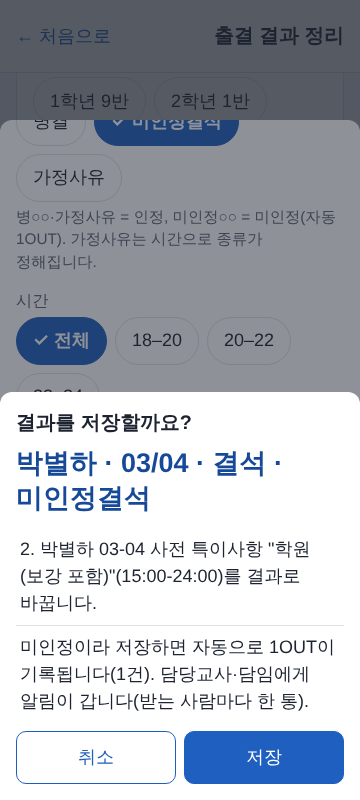 | |
| C14 | 시험2 | C13을 [저장]한 뒤 홈 → **사전 특이사항**에서 그 날짜를 봅니다 | 겹친 사전 특이사항 "학원"은 **취소**로 남고(사유에 "결과 정리에서 바꿈"), 결과(미인정결석)가 확정으로 생겼다. 출석부 칸에는 결과의 약어가 나온다(무결) | | |
| C15 | 시험2 | 이미 결석을 넣은 날에 **지각이나 조퇴**를 더 넣고 [확인하고 저장] | 저장 전 확인에서 **"결석인 날에는 지각·조퇴를 함께 넣을 수 없습니다(결석이 우선)."**로 막힌다. 같은 날 같은 종류를 새로 넣으면 확인 시트에 "이미 입력한 결과 "…"(…)를 새 결과로 바꿉니다." 경고가 나온다 | | |
| C16 | 시험2 | **가정사유**: 한 학생에게 결석 → **가정사유**(시간 전체) / 다른 학생에게 지각 → 가정사유(**첫 블록부터**) / 또 다른 학생에게 조퇴 → 가정사유(**마지막 블록까지**)를 저장합니다. 유형 칩 아래 안내를 읽습니다 | 안내 "병○○·가정사유 = 인정, 미인정○○ = 미인정(자동 1OUT). 가정사유는 시간으로 종류가 정해집니다." 저장 뒤 줄 상태가 결석 인정 / 지각 인정 / 조퇴 인정으로 나오고 **OUT은 생기지 않는다**. (가운데 블록만 고르면 결과로 세지 않는다) | | |
| C17 | 시험2 | **[학생별 누적]** 탭 → 범위 **[이 주 \| 이번 달 \| 학기]** | PC는 표(학생 · 결석/지각/조퇴 **인정/미인정** · **학습량 공부/전체**), 마지막 **합계** 줄(굵은 글씨·회색). 휴대폰은 학생마다 한 줄 카드("결석 1/0 · 지각 0/1 · 조퇴 0/0 · 학습 …"). **숫자가 격자에서 본 결과와 같다**(C6·C8에서 넣은 것이 인정 1·미인정 1로 센다) | 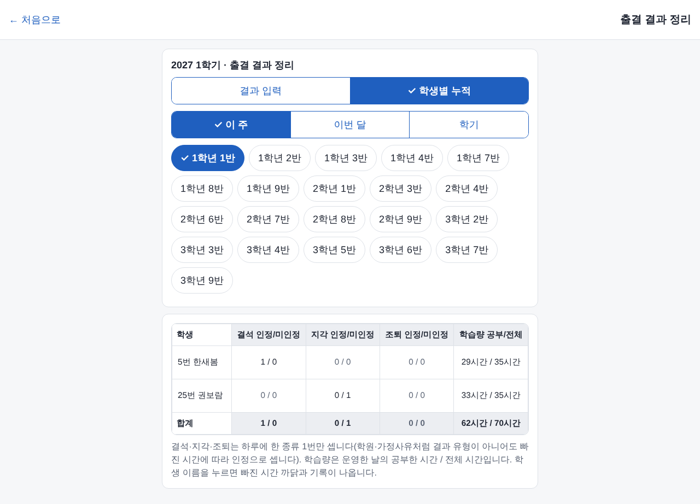 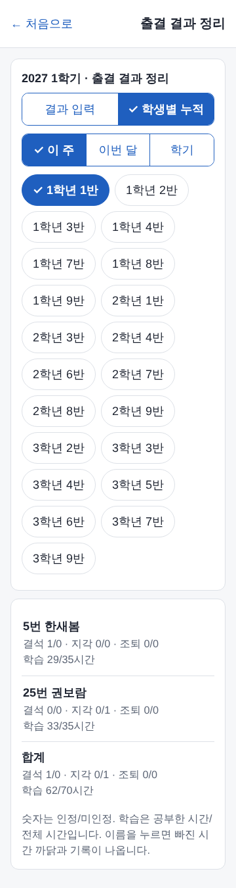 | |
| C18 | 시험2 | 학생 이름을 눌러 펼칩니다 | "빠진 시간 …"(어떤 까닭으로 몇 시간·분 빠졌는지)과 그 범위의 결과 기록(날짜·결과·인정/미인정·자동 1OUT 여부·사유)이 나온다. **학습량의 "공부 시간 + 빠진 시간 = 전체"**(운영한 날 23:00 종료까지의 시간)가 맞다 | | |
| C19 | 시험1(학사 교사)·시험2(담임) | 같은 화면을 엽니다(주소 끝 `?page=results`) | 격자·목록·누적은 **볼 수 있지만** 위에 "보기 전용입니다. 결과 입력은 출결 담당·관리자가 합니다."가 있고, 칸을 누르면 시트 아래 **"결과 입력은 출결 담당·관리자만 합니다."**만 있고 입력 칸이 없다 | 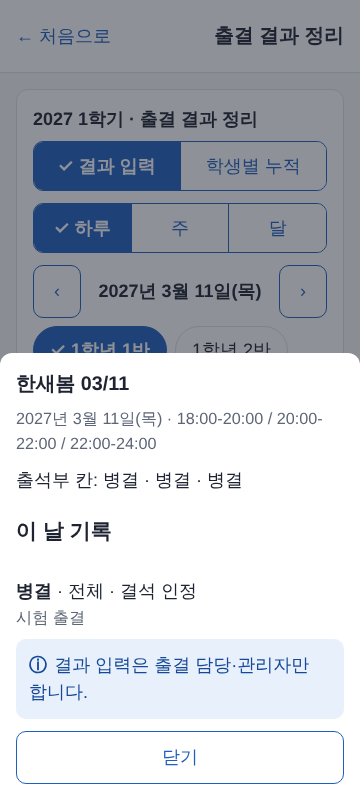 | |
| C20 | 시험2(학생 → 학부모 → 근무표 담당자) | 주소 끝에 `?page=results`를 붙여 엽니다 | 모두 **권한 없음**. 홈에 "출결 결과 정리" 버튼도 없다 | | |
| C21 | 시험2(출결 담당) | **끝난 기간**: 종료 14일이 지난 기간의 날짜를 엽니다(가짜 `2026 2학기(테스트)`는 2027-02-28에 끝나므로 **오늘이 2027-03-15 이후**일 때 가능. 아니면 "데이터 부족") | 위에 파란 안내 **"이 기간은 끝난 지 오래되어 볼 수만 있습니다(2027-03-14까지 고칠 수 있었습니다)."**가 있고 칸 시트에는 입력 칸이 없다("끝난 기간이라 고칠 수 없습니다."). **종료 14일 안**이면 저장·취소가 되고 확인 시트에 "끝난 기간 정리입니다(…까지 정리할 수 있습니다)."가 보인다 | 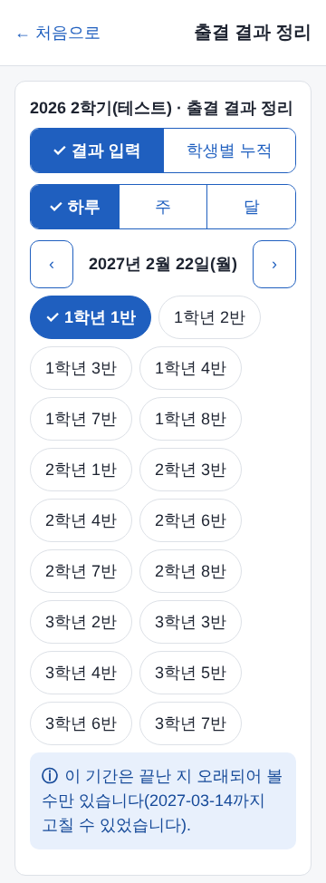 | |
| C22 | 시험2 | **오늘 이후 날짜**의 칸(내일 등)에 결과를 저장해 봅니다 | 저장되지 않고 거부 안내가 나온다(오늘 이후 날짜는 입력하지 않는다). 가짜 데이터 기간 밖 날짜는 "이 날짜는 어떤 운영 기간에도 속하지 않습니다." | | |
| C23 | 소유자 + 시험2 | **두 창으로**: 둘 다 같은 날 칸을 열어 둔 채 소유자가 결과를 저장한 뒤, 시험2가 같은 주에서 다른 결과를 [저장] | 시험2 쪽에 **"다른 선생님이 먼저 바꿨습니다. 새로 불러온 뒤 다시 해 주세요."**가 나오고 시트가 닫히며 화면이 새로 불러와진다. 소유자가 저장한 결과는 그대로다 | | |
| C24 | 소유자 | 시험이 끝났으면 C에서 만든 결과를 모두 **[취소]**해 가짜 데이터를 되돌립니다. 자동으로 생긴 OUT은 결과 취소로 함께 취소됩니다 | OUT [학기]에서 시험 OUT이 줄어든다(취소는 지우지 않고 기록으로 남는다) | | |

> 이미 확인됨: 결과 유형표(인정 = 병○○·가정사유, 미인정 = 미인정○○), 기본 시간, 미인정 = 자동 1OUT·취소하면 OUT도 취소, 같은 날 미인정 둘 = 하루 1OUT, 대체(겹치는 사전 특이사항만 바뀜), 학생별 누적 = 직접 센 값, 학습량 공부 + 빠진 시간 = 운영 시간, 끝난 기간 14일, 메일 받는 사람마다 한 통(학생 이름·사유 없음), 권한(출결 담당·관리자만 저장·취소, 학사 교사·담임 보기, 학생·학부모·근무표 담당자 거부), 낡은 화면(sig·token) 거부, 한 달 결과·리허설 180명(T6).
> 확인 못 한 것: **실제 휴대폰에서 반 칩이 많을 때 화면 길이**(반이 20개 가까이면 칩만 화면 절반), **한 주 격자에 학생 수십 명일 때 PC 화면 스크롤**, **메일이 진짜로 오는지**(C9, `MAIL_ENABLED`와 받는 사람 주소에 달림).

## 결과 적는 법

- 모두 ○면 "5단계 확인 통과"라고 총괄에게 알립니다.
- ×는 **번호 + 한 줄 + 사진**으로 적습니다(예: "A6 끝 날짜 오류가 안 나옴", "B14 다른 학사 교사에게 상담 목록이 보임", "C8 미인정인데 OUT이 안 생김").
- 가짜 데이터가 모자라 단계를 못 따라 하면 번호와 "데이터 부족"이라고 적어 주세요. 총괄이 가짜 데이터를 보강합니다.
- **B14·B15·B16·C20**(안 보여야 하는 사람에게 안 보이는지), **B11·B12**(상담 내용이 운영 DB·감사 기록·공유 설정에 없는지), **C8·C9·C11**(미인정 → 자동 1OUT → 취소하면 OUT도 취소)은 컴퓨터 테스트가 흉내만 낸 것이라 꼭 봐 주세요.
