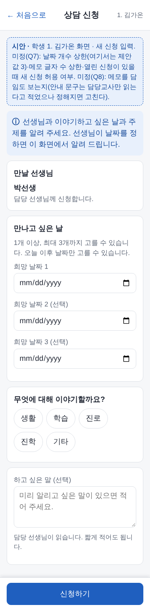
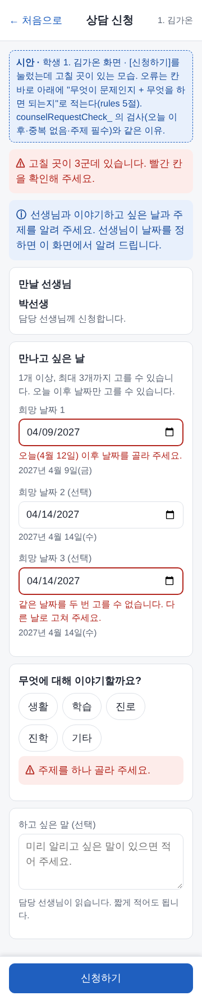
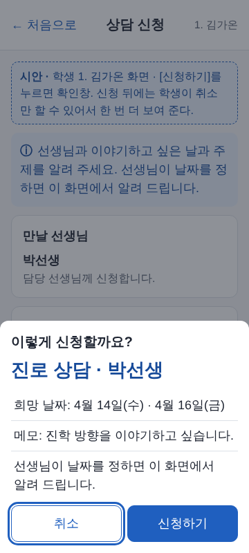
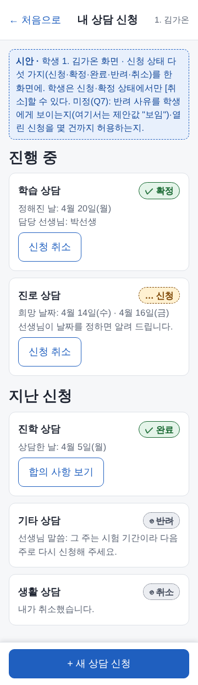

# 예시: UI 프롬프트 틀로 "학생 상담 신청" 화면 채우기 (D11)

> **이 문서는 확정이 아니라 "틀 쓰는 법 예시"입니다.** 6단계 학생 화면은 0단계 진단(학생 로그인 방식, PRD 6.1) 뒤에 만들기 시작하므로, 여기 나온 화면은 만들기로 정한 것이 아닙니다. 틀(`docs/design/ui-vocabulary.md` 3절)을 빈칸까지 채우면 어떤 글이 되고, 그 글에서 어떤 시안이 나오는지를 보여 주는 견본입니다.
> 근거: `docs/plan/stage6-rules-draft.md`(상담 신청 `counselRequestCheck_`·상태 전이)와 PRD 상담 절(F17). 아직 정해지지 않은 것은 rules-draft 5절 질문 번호(Q)와 함께 **"미정"**이라고 적었습니다. 이름·날짜는 모두 가짜입니다(학생 "1. 김가온", 담당 "박선생", 가짜 오늘 = 2027년 4월 12일(월)).

## 1. 틀을 채운 글 (선생님이 총괄에게 보내는 글)

틀의 빈칸을 아래처럼 채웠습니다. **이 글 한 덩어리**를 그대로 보내면 시안이 나옵니다. 두 화면을 한 번에 부탁하는 모양입니다(입력 화면 + 내 신청 목록).

```
[화면] 이름: 상담 신청 (입력)         누가 쓰나: 학생(학사생 본인)   언제·어디서: 저녁 자습 뒤 기숙사에서 휴대폰으로
[목적] 이 화면에서 끝내야 할 일 한 가지: 담당 선생님께 상담을 신청한다(희망 날짜·주제·하고 싶은 말)
[머리줄] 제목: 상담 신청           뒤로 가기: ← 처음으로
[위 안내] .notice에 넣을 한 줄: "선생님과 이야기하고 싶은 날과 주제를 알려 주세요. 선생님이 날짜를 정하면 이 화면에서 알려 드립니다."
[본문 카드] 위에서부터 순서대로
  1. 카드: 만날 선생님            들어갈 것: 담당 선생님 이름(고르지 않음)          고르는 방법: 없음(읽기만)
  2. 카드: 만나고 싶은 날         들어갈 것: 날짜 칸 3개(1개는 꼭, 2·3은 선택)    고르는 방법: 날짜 칸(오늘 이후만, 같은 날 두 번 불가)
  3. 카드: 무엇에 대해 이야기할까요?  들어갈 것: 주제 5개(생활·학습·진로·진학·기타)  고르는 방법: 칩(하나만, 꼭)
  4. 카드: (제목 없음)            들어갈 것: 하고 싶은 말(선택, 짧게)                  고르는 방법: 글 입력(여러 줄)
[탭] 없음
[아래 바] 주 버튼: 신청하기      보조 버튼: 없음(나가려면 ← 처음으로)
[확인 시트] 저장 전에 보여 줄 줄들: 맨 위 "진로 상담 · 박선생", 희망 날짜, 하고 싶은 말, "선생님이 날짜를 정하면 이 화면에서 알려 드립니다."   되돌릴 수 없으면 사유 입력: 아니오(신청 뒤 취소는 목록의 [신청 취소], 취소 때 사유를 받을지는 미정)
[상태] 빈 상태 문구: "아직 상담 신청이 없습니다. 아래 [+ 새 상담 신청]을 눌러 시작해 주세요."   오류 때 문구: 칸마다 "무엇이 문제인지 + 무엇을 하면 되는지" (예 "오늘(4월 12일) 이후 날짜를 골라 주세요.")   불러오는 중 문구: "불러오는 중…"
[권한] 못 보는 역할: 학생 본인 외 전부(학부모는 신청하지 않고 "상담 여부"만 다른 화면에서 본다)   보이지만 못 고치는 역할: 없음
[참고] 비슷한 기존 화면: 학사 교사 OUT 기록 입력 `outs-record`(날짜·항목·메모 입력 + 확인창)   (손그림 없음)
[받을 것] 360px·1280px 시안 사진, 가짜 학생으로

[화면] 이름: 내 상담 신청 (목록)      누가 쓰나: 학생(본인)       언제·어디서: 신청한 뒤 선생님 답을 보러, 휴대폰으로
[목적] 이 화면에서 끝내야 할 일 한 가지: 내 신청이 어디까지 왔는지 보고, 필요하면 신청을 취소한다
[머리줄] 제목: 내 상담 신청        뒤로 가기: ← 처음으로
[위 안내] 없음
[본문 카드] 위에서부터 순서대로
  1. 구역 "진행 중": 신청·확정 상태인 건     들어갈 것: 주제·상태 알약·(확정이면 정해진 날, 신청이면 희망 날짜)·[신청 취소]
  2. 구역 "지난 신청": 완료·반려·취소 건      들어갈 것: 주제·상태 알약·완료면 [합의 사항 보기], 반려면 선생님 말씀(반려 사유)
[탭] 없음
[아래 바] 주 버튼: + 새 상담 신청     보조 버튼: 없음
[확인 시트] [신청 취소] 누르면 "이 신청을 취소할까요?" + [취소] [신청 취소]
[상태] 빈 상태 문구: 위와 같음   오류 때 문구: "신청 목록을 불러오지 못했습니다. 화면을 다시 열어 주세요."
[권한] 위와 같음
[참고] 비슷한 기존 화면: OUT 이번 학기 목록 `outs-term`
[받을 것] 360px 시안 사진, 신청·확정·완료·반려·취소가 한 번씩 보이게
```

**채울 때 지킨 것**

- 지키는 규칙은 적지 않았습니다(360px·48px·주 버튼 하나·색만으로 알리지 않음·애니메이션 없음은 틀이 자동으로 붙입니다).
- **정해지지 않은 것은 "미정"이라고 글에 적었습니다.** AI가 임의로 정하지 않고 "미정 표시와 제안값"으로 그리게 됩니다(4절).
- **학생 화면이라 말투를 쉽게:** 낱말은 "신청하기·희망 날짜·하고 싶은 말"처럼 일상어로, 한 문장은 짧게, 존댓말은 "합니다·해 주세요" 체(rules 5절)로 맞췄습니다. "신청 취소"처럼 버튼은 하는 일을 동사로 적었습니다.
- 주제가 5개라 `UI.segmented`(2~4개용)가 아니라 칩(`.chip`)으로 고르게 했습니다 — 틀의 "고르는 방법"에 "칩"이라고만 적으면 됩니다.

## 2. 시안 사진 (360px, 미리보기 하네스, 가짜 학생)

`node design/preview/stage6.js` → `design/preview/out/stage6/<이름>-360.png`·`-1280.png`(`out/`은 Git에 올리지 않음). 시안 안의 점선 "시안" 안내 줄이 **미정** 표시이고 실제 학생 화면에는 나오지 않습니다.

| 입력 처음 (`counsel-req-form`) | 고칠 곳 안내 (`counsel-req-error`) |
| --- | --- |
|  |  |

| 신청 확인 시트 (`counsel-req-confirm`) | 내 신청 목록 (`counsel-req-list`) |
| --- | --- |
|  |  |

## 3. 규칙에서 화면으로 (`counselRequestCheck_`·`counselRequestNext_`)

| 규칙(rules-draft 3.3) | 화면에서 | 학생에게 보이는 문구 |
| --- | --- | --- |
| 희망 날짜 1~3개, 오늘 이후 | 날짜 칸 3개(1개 필수), `min`=오늘 | "오늘(4월 12일) 이후 날짜를 골라 주세요." |
| 날짜 중복 없음 | 두 칸이 같으면 뒤 칸에 오류 | "같은 날짜를 두 번 고를 수 없습니다. 다른 날로 고쳐 주세요." |
| 주제 5개 중 하나 | 주제 칩, 안 고르면 오류 | "주제를 하나 골라 주세요." |
| 메모 길이 상한 | 글 입력 아래 힌트 | 상한이 정해지면 힌트에 "최대 ○○자" |
| 상태 전이: 신청 → 확정·반려·취소, 확정 → 완료·반려·취소 | 알약 `UI.statusPill`(신청=`requested`, 확정·완료=`confirmed`, 반려·취소=`canceled`) | 낱말은 "신청·확정·완료·반려·취소" 그대로(`docs/contracts/vocabulary.md`) |
| 학생은 취소만 할 수 있음 | 신청·확정 건에만 [신청 취소], 완료·반려·취소 건에는 버튼 없음(완료 건은 [합의 사항 보기]) | |
| 완료 건에 상담일지가 연결됨 | [합의 사항 보기]로 합의 사항만(상담 내용은 학생에게 없음, CLAUDE.md 6번) | |

## 4. 미정 목록 (시안에서 어떻게 그렸나)

| 번호 | 정해지지 않은 것 | 시안에서 | 정해지면 고칠 곳 |
| --- | --- | --- | --- |
| Q7 | 희망 날짜 개수 상한 | 제안값 3개로 그림 | 날짜 칸 수와 안내 문구 |
| Q7 | 열린(신청·확정) 신청이 있을 때 또 신청 | 막지 않고 목록에 2건 보임 | 막는다면 [+ 새 상담 신청]을 꺼 두고 이유 한 줄 |
| Q7 | 반려 사유를 학생에게 보임 | 제안값 "보임"(선생님 말씀 줄) | 안 보이면 반려 건에서 그 줄을 뺌 |
| Q8 | 담임이 신청 메모를 보는지 | 힌트는 "담당 선생님이 읽습니다" | 담임도 보면 힌트를 "담당 선생님과 담임 선생님이"로 |
| Q6 | 학생이 자기 상담일지의 유형을 보는지 | [합의 사항 보기]에 합의 사항만 | 유형도 보이면 그 화면에 한 줄 |
| (새 질문 후보) | 학생이 신청을 취소할 때 사유를 받는지 | 사유 없이 확인창만 | 받는다면 `UI.confirmWithReason`으로 바꿈 |
| (새 질문 후보) | 신청 뒤 날짜가 확정·반려되면 학생에게 알림(메일)이 가는지 | 이 화면 안에서만 알림("정해진 날", "선생님 말씀") | 메일이면 알림 문구·설정 따로 |
| 0단계 | 학생 로그인 방식 | 화면 안 로그인 얘기 없음 | 로그인 방식이 정해진 뒤 학생 홈 진입점 |

## 5. 건너뛴 것·확인 못 한 것

- 이 시안은 **그림일 뿐**입니다. 서버·권한·시트 구조(Schema)는 건드리지 않았고, `counsel_requests` 탭은 아직 만들지 않았습니다(시트 구조는 선생님 승인 뒤).
- 학생 홈에서 이 화면으로 들어오는 카드, 담당교사의 처리 화면(확정·반려·완료), 상담일지·합의 사항 보기 화면은 그리지 않았습니다(틀 쓰는 법 예시에 필요하지 않음).
- "학생이 쉬운 글"은 총괄이 요청한 방향대로 맞췄지만 실제 학생(고등학생)에게 읽혀 본 것은 아닙니다. 시험 계정으로 학생이 읽고 모르는 낱말을 알려 주면 고칩니다.
- 날짜 입력 칸의 모양(mm/dd/yyyy)은 미리보기 브라우저 때문이고, 실제 휴대폰에서는 기기 달력이 뜹니다.
