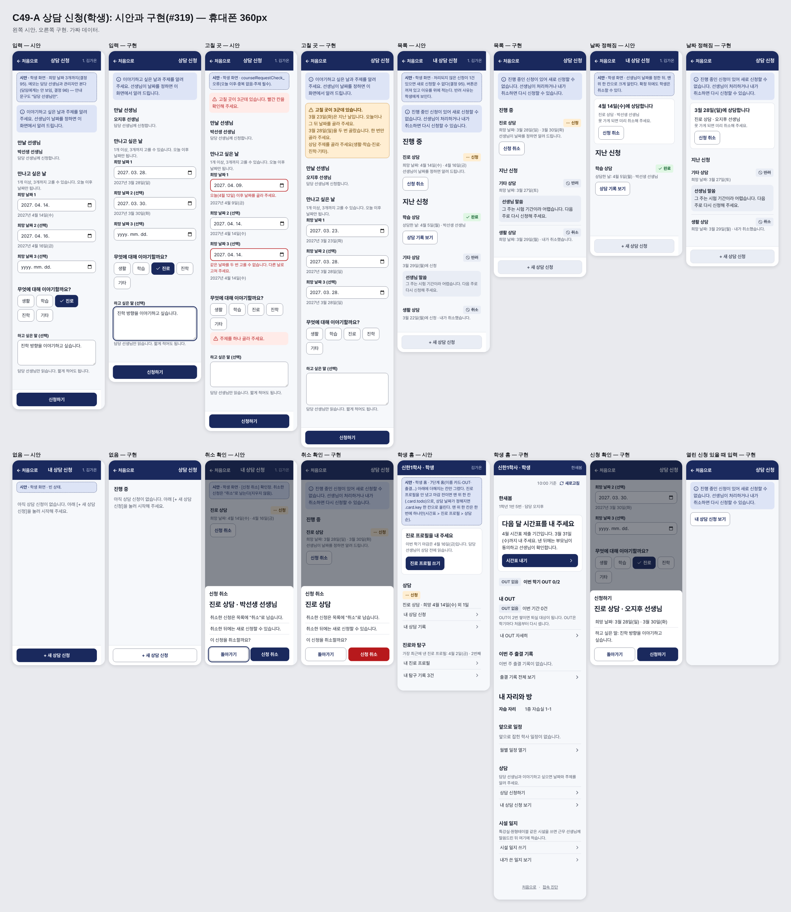
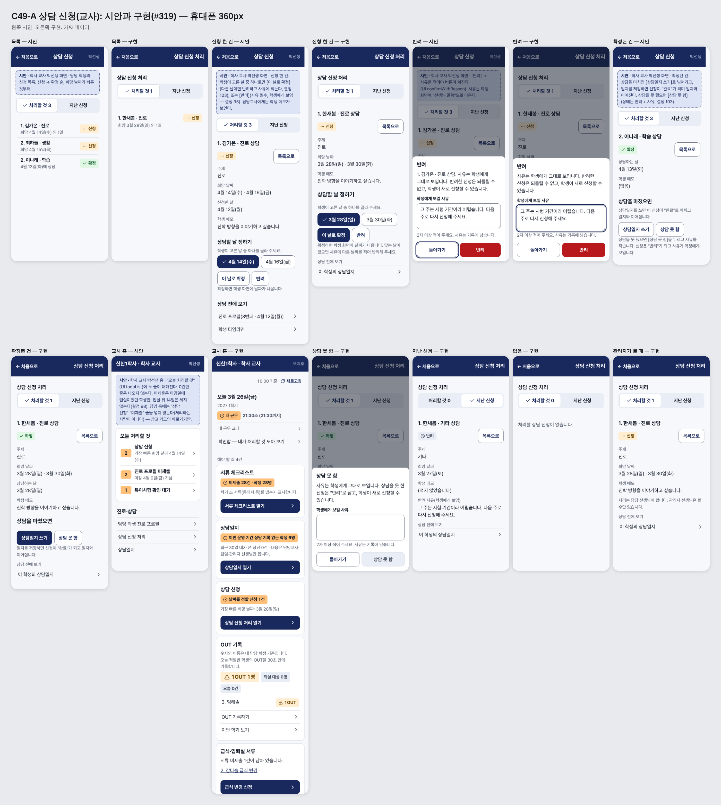
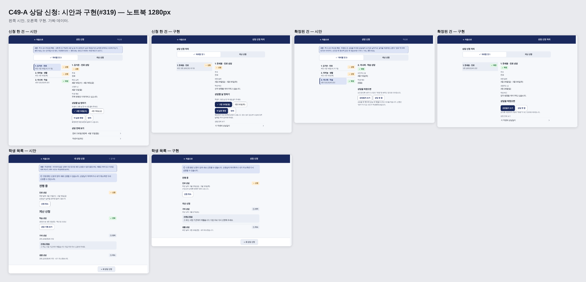
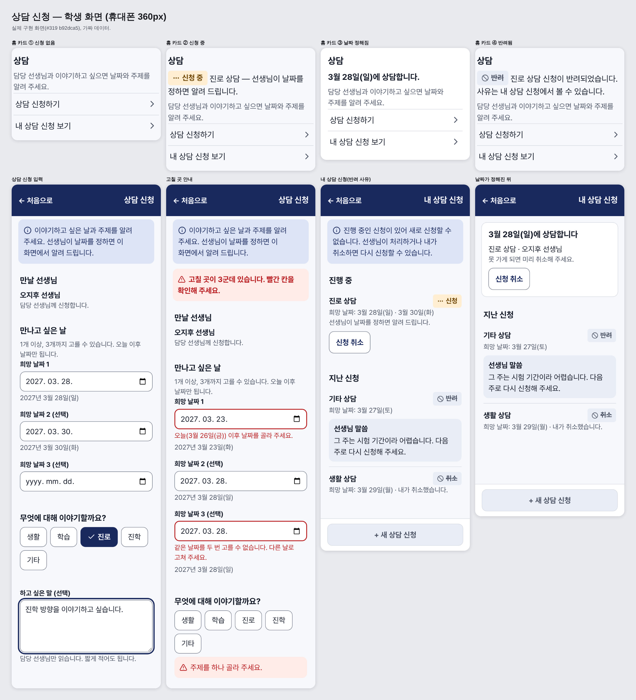
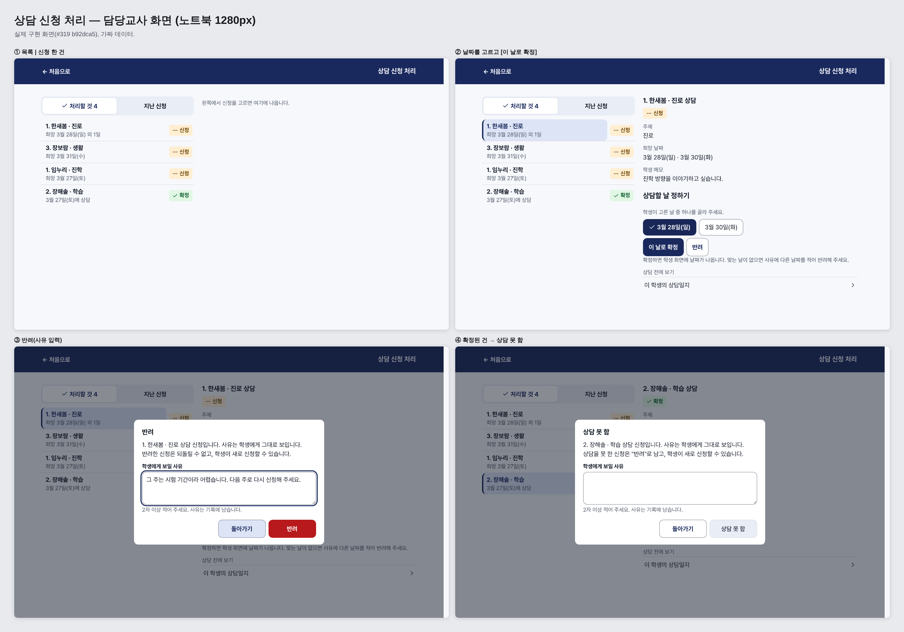

# 구현 화면 검토: C49-A 상담 신청 흐름 (PR #319)

디자인2, 2026-11-28. 시안(`../screens.md` 2절·6절, `../photos/s-counsel-*`·`t-req-*`·`s-home`·`t-home`)과 #319의 실제 화면(커밋 da034b0)을 같은 상태로 놓고 본 결과다. 실제 화면은 미리보기 도구(가짜 서버·가짜 데이터, 글꼴 받은 경우)로 휴대폰 360·노트북 1280에서 찍었다. **고치지 않았다 — PR 작성자에게 넘기는 목록이다.**
기준은 "시안과 같은가"가 아니라 **학생과 선생님이 쓰다가 헷갈리거나 놓치는가**다.

## 한 줄 판정

흐름과 문구는 시안과 거의 같고 잘 읽힌다. 반려 사유("선생님 말씀" 상자), 열린 신청이 있을 때의 안내, 관리자 보기만 안내가 모두 제자리에 있다. **반드시 고칠 것은 2가지**다: 날짜가 정해져도 학생 홈에서는 알 수 없고, 입력 오류가 어느 칸인지 표시되지 않는다. 18가지 상태 × 2크기에서 가로 넘침·48px 미만 단추·브라우저 오류는 없었다.

## 총괄이 특히 보라고 한 것

| 물음 | 답 |
| --- | --- |
| 반려 사유가 보이는 자리 | 좋다. "지난 신청"의 그 건 바로 아래 회색 "선생님 말씀" 상자. 희망 날짜도 같이 남아 어느 신청인지 알 수 있다 |
| 열린 신청이 있을 때 새 신청을 막는 안내 | 좋다. 목록 맨 위 안내 + 꺼진 [+ 새 상담 신청]. 주소로 입력 화면에 바로 들어가도 같은 안내와 [내 상담 신청 보기]가 나온다. 다만 날짜가 정해진 뒤에는 이 안내가 "○월 ○일에 상담합니다"보다 위에 온다(아래 5번) |
| 희망 날짜 3개 입력이 휴대폰에서 편한가 | 쓸 만하다. 날짜 칸 3개가 세로로 놓이고 칸마다 고른 날이 요일과 함께 다시 적힌다. 화면이 길어지지만 한 손으로 내려가며 채울 수 있다 |
| 날짜 단추와 [반려]·[상담 못 함]이 헷갈리는가 | 헷갈리지 않는다. 날짜 칩(고름) → 감색 [이 날로 확정] 옆에 흰 [반려], 확정된 건은 감색 [상담일지 쓰기] 옆에 흰 [상담 못 함]. 날짜를 고르기 전에는 [이 날로 확정]이 꺼져 있다. 반려·상담 못 함은 사유를 적어야 빨간 단추가 켜진다 |

## 반드시 고칠 것

| # | 무엇이 | 시안은 | 구현은 | 왜 |
| --- | --- | --- | --- | --- |
| 1 | 학생 홈의 상담 카드 | 열린 신청 한 줄(신청 꼬리표 + 희망 날짜), 날짜가 정해지면 맨 위 한 칸 "○월 ○일에 상담합니다" | 늘 같은 글과 링크 두 줄("상담 신청하기", "내 상담 신청 보기"). 신청 상태가 없다 | 입력 화면이 "선생님이 날짜를 정하면 이 화면에서 알려 드립니다"라고 약속하는데, 학생이 그 화면을 다시 열지 않으면 날짜가 정해진 것도, 반려된 것도 모른다. 홈 카드에 적어도 한 줄(신청 중 / ○월 ○일에 상담합니다 / 반려됨 — 선생님 말씀 보기)이 있어야 한다. 이번 PR이 어렵다면 C49-B에 꼭 넣는다 |
| 2 | 입력 오류 표시 | 맨 위 빨간 상자 "고칠 곳이 n군데…" + **틀린 칸이 빨갛게**, 칸 바로 아래 문구 | 맨 위 노란 상자 하나에 문장 세 줄. 칸에는 표시가 없다 | 날짜 칸이 3개라 "3월 28일(일)을 두 번 골랐습니다"만으로는 어느 칸을 고칠지 찾아야 한다. 주제를 안 고른 것도 주제 카드에 표시가 없다. `UI.dateField`의 `setError`와 주제 카드 아래 `.error`를 쓰고, 맨 위 상자는 오류색(`.error`)으로 |

## 같이 고칠 것

| # | 무엇이 | 시안은 | 구현은 | 제안 |
| --- | --- | --- | --- | --- |
| 3 | 확인 시트가 틀린 입력에도 열림 | 오류가 있으면 확인 시트 전에 알림 | 주제를 안 골라도 [신청하기] → 확인 시트("주제를 고르지 않았습니다 · ○○○ 선생님") → 다시 [신청하기] → 그제야 오류 | 빈 날짜·빈 주제·같은 날짜는 화면에서 먼저 걸러 확인 시트를 열지 않는다(서버 검사는 그대로) |
| 4 | [+ 새 상담 신청] 단추 | 감색 주 단추 | 흰 보조 단추 | 신청이 하나도 없는 화면에서는 이것이 유일한 할 일이다. 켜져 있을 때는 주 단추로 |
| 5 | 날짜가 정해진 뒤 맨 위 | "○월 ○일에 상담합니다" 한 칸이 맨 위 | "진행 중인 신청이 있어 새로 신청할 수 없습니다…" 안내가 그 위 | 가장 중요한 소식이 둘째로 밀린다. 날짜가 정해졌을 때는 안내를 한 칸 아래로 내리거나 뺀다(단추가 꺼져 있고 이유는 한 칸이 말해 준다) |
| 6 | 반려·상담 못 함 시트에 누구인지 없음 | "1. 김가온 · 진로 상담. 사유는 학생에게 그대로 보입니다…" | "사유는 학생에게 그대로 보입니다…"만 | 시트가 뜨면 뒤 화면이 어두워진다. 첫 줄에 "학년. 이름 · 주제 상담"을 넣는다 |
| 7 | 목록 \| 상세 모양 | 공통 `.ld`(고른 줄 감색 표시, 왼쪽 목록 고정) | 화면 전용 `.rq-wrap`·`.rq-row`(고른 줄 옅은 회색) | 상담일지·진로 프로필과 같은 공통 `.ld` 부품을 쓰면 고른 줄이 같은 모양으로 보이고 화면 전용 스타일이 준다 |
| 8 | 머리줄 제목 | 목록 "내 상담 신청", 입력 "상담 신청" | 둘 다 "상담 신청" | 목록일 때 "내 상담 신청"으로(작은 것) |
| 9 | 화면 안 제목 | 없음 | 머리줄 "상담 신청 처리" 아래 카드 제목이 또 "상담 신청 처리" | 카드 제목을 뺀다 |

## 그대로 둬도 되는 것

| 무엇이 | 판단 |
| --- | --- |
| "신청한 날"이 없음(코딩B ①) | 지금은 괜찮다. 희망 날짜가 있어 어느 신청인지 구분된다. 규칙 쪽에 칸이 생기면 교사 화면에만 한 줄 더한다 |
| 담임 보기 입구 없음(코딩B ②) | 괜찮다. 타임라인(C53)에서 잇는다 |
| 완료 단추 없음(코딩B ③) | 괜찮다. [상담일지 쓰기]가 상담일지 화면으로 가고 "일지를 저장하면 완료가 됩니다"라고 적혀 있다. C49-B 전까지는 일지를 써도 신청이 "확정"에 남는다는 점만 시험 때 알고 있으면 된다 |
| 교사 홈이 "오늘 처리할 것" 목록의 한 줄이 아니라 **카드 한 장** | 괜찮다. 학사 교사 홈의 다른 할 일(서류·상담일지)이 모두 카드라서 이 모양이 맞다. "날짜를 정할 신청 n건" 꼬리표와 가장 빠른 희망 날짜, 정해진 상담 건수까지 있어 시안보다 낫다 |
| 신청 취소 단추가 빨강 | 괜찮다. 취소하면 되살릴 수 없고 다시 신청해야 한다 |
| 지난 신청의 취소 줄에 희망 날짜가 같이 나옴 | 좋다 |
| "상담 전에 보기"에 상담일지 링크만 | 괜찮다. 진로 프로필·타임라인 링크는 C50·C53 뒤에 |
| 관리자 화면의 "처리는 담당 선생님이 합니다. 관리자 선생님은 볼 수만 있습니다." | 시안에 없던 좋은 안내 |
| 확정에 확인 시트가 없음 | 시안과 같다. 날짜를 고른 뒤에만 단추가 켜지고, 잘못 정했으면 [상담 못 함]으로 돌릴 수 있다 |

## 확인하지 못한 것

- 교사 목록은 한 건만 넣어 보았다(가짜 학생 중 로그인 계정이 있는 학생이 한 명이라 여러 건을 만들지 못했다). 여러 건일 때 고른 줄 표시와 정렬은 눈으로 보지 못했다.
- "완료" 상태의 지난 신청(상담한 날 줄)은 이번 PR에서 만들 수 없어 보지 못했다.
- 글자 150%·기기 9종 행렬, 알림 메일 문구는 보지 않았다.

## 다시 본 결과 (커밋 b92dca5, 2026-11-28)

코딩B가 위 목록을 반영한 뒤 구현 화면만 다시 찍었다. **남은 "반드시"가 없다 — 병합해도 된다.**

| # | 무엇 | 결과 |
| --- | --- | --- |
| 1 | 학생 홈 카드의 신청 상태 | **고쳐짐.** 신청 중("신청 중 · 진로 상담 — 선생님이 날짜를 정하면 알려 드립니다."), 날짜 정해짐(굵게 "3월 28일(일)에 상담합니다." + 카드가 강조 칸으로), 반려("반려 · … 사유는 내 상담 신청에서 볼 수 있습니다."). 신청이 없으면 줄이 없다 |
| 2 | 입력 오류를 틀린 칸에 | **고쳐짐.** 맨 위 빨간 상자 "고칠 곳이 3군데 있습니다. 빨간 칸을 확인해 주세요." + 틀린 날짜 칸이 빨갛고 칸 아래 문구, 주제 카드 아래 "주제를 하나 골라 주세요." |
| 3 | 틀린 입력에 확인 시트가 열림 | **고쳐짐.** [신청하기]를 누르면 확인 시트 없이 바로 오류가 나온다 |
| 4 | [+ 새 상담 신청] 단추 | **고쳐짐.** 켜져 있을 때 감색 주 단추 |
| 5 | 날짜가 정해진 뒤 안내 순서 | **고쳐짐.** "○월 ○일에 상담합니다" 한 칸이 맨 위, "새로 신청할 수 없습니다" 안내는 나오지 않는다 |
| 6 | 반려·상담 못 함 시트에 누구인지 | **고쳐짐.** "1. 한새봄 · 진로 상담 신청입니다. 사유는 학생에게 그대로 보입니다…" |
| 7 | 목록 \| 상세를 공통 `.ld`로 | **고쳐짐.** 고른 줄이 감색 띠 + 옅은 감색 바탕으로 보인다(4건으로 확인) |
| 8 | 학생 목록 머리줄 제목 | **고쳐짐.** "내 상담 신청" |
| 9 | 교사 화면 안의 겹친 제목 | **고쳐짐.** 카드 제목이 없어졌다 |

### 남은 작은 것 (병합을 막지 않음, 다음 손댈 때)

| 무엇이 | 제안 |
| --- | --- |
| 교사 목록의 "신청" 줄이 희망 날짜 순이 아니다(3월 28일 → 3월 31일 → 3월 27일, 넣은 순서로 보임). 신청이 위·확정이 아래인 것은 맞다 | 신청끼리는 가장 빠른 희망 날짜 순으로(급한 것이 위) |
| 날짜 오류 문구 "오늘(3월 26일(금)) 이후 날짜를 골라 주세요."에 괄호가 겹친다 | "오늘(3월 26일) 이후…"처럼 요일을 빼거나 "오늘 3월 26일(금) 이후…" |
| 학생 홈 카드에 열린 신청이 있어도 "상담 신청하기" 링크가 그대로 있다(눌러도 안내가 나와 막히지는 않는다) | 열린 신청이 있을 때는 그 줄을 숨긴다 |

확인: 16가지 상태에서 가로 넘침·48px 미만 단추·브라우저 오류 없음. 교사 목록은 시트에 직접 넣은 가짜 신청 4건(신청 3·확정 1)으로 보았다. "완료" 상태, 글자 150%·기기 9종은 여전히 보지 않았다.
