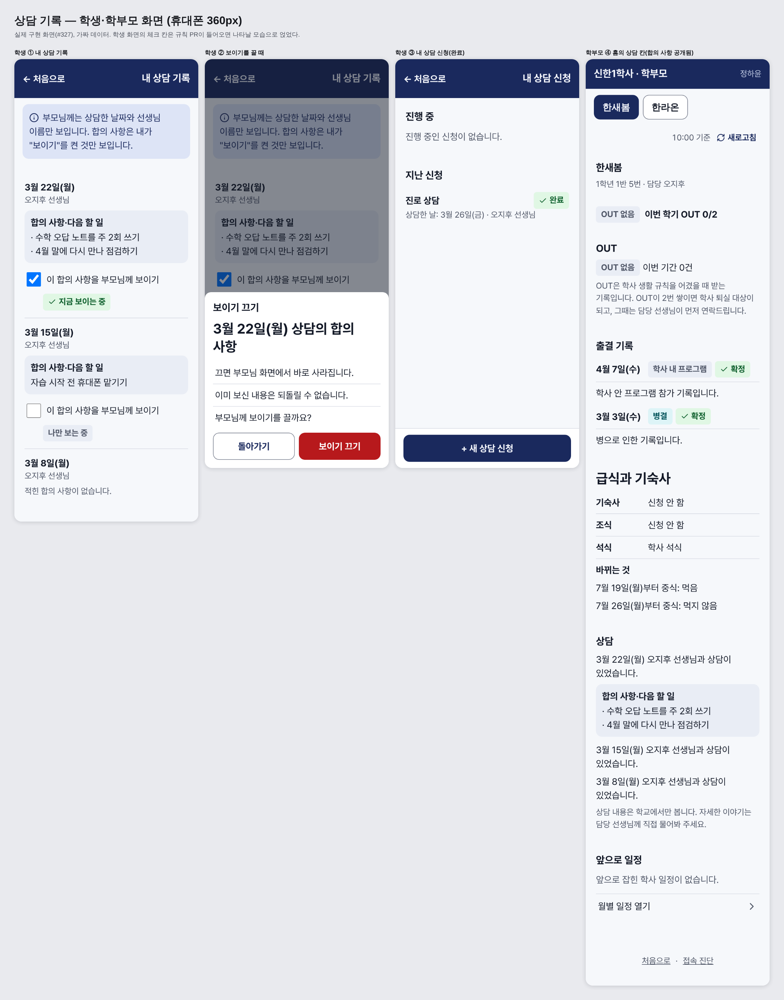
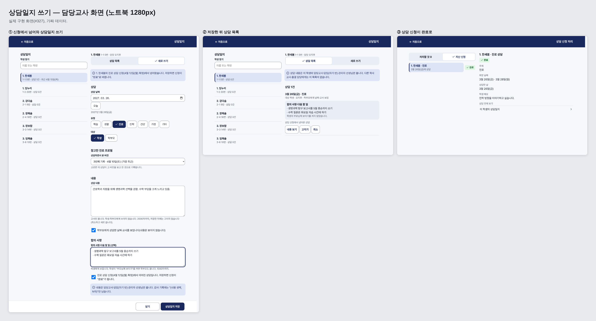
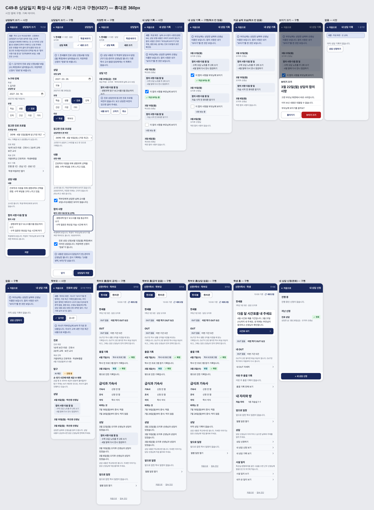

# 구현 화면 검토: C49-B 상담일지 확장 + 내 상담 기록 (PR #327)

디자인2, 2026-11-28. 시안(`../screens.md` 3·5·6절, `../photos/t-note`·`s-notes*`·`p-career`·`p-empty`)과 #327의 실제 화면(커밋 784fbf9)을 같은 상태로 놓고 본 결과다. 실제 화면은 미리보기 도구(가짜 서버·가짜 데이터, 글꼴 받은 경우)로 찍었다. **고치지 않았다 — PR 작성자에게 넘기는 목록이다.**
학생 "내 상담 기록"의 체크 칸은 지금 일부러 그리지 않는 상태라(규칙 PR #323 전), 응답에 공개 표시를 얹어 **체크 칸이 있는 모습**으로 보았다. 지금 실제 모습도 한 장 같이 두었다.

## 선생님께 보여 드릴 사진

## 시안과 나란히

## 한 줄 판정

흐름은 시안대로 잘 이어진다. 신청에서 [상담일지 쓰기]로 넘어오면 바로 쓰기 탭이 열리고 유형이 미리 골라지며, 저장하면 신청이 "완료"가 되고 일지와 이어지는 것을 직접 눌러 확인했다. 학생·학부모 화면에 상담 내용과 유형은 비치지 않았다. **반드시 고칠 것은 1가지**다: 교사가 쓰는 두 칸(교사만 보는 내용 / 학생에게 보이는 합의 사항)이 누구에게 보이는지가 칸 아래 작은 회색 글씨로만 갈린다. 13가지 상태에서 가로 넘침·48px 미만 단추·브라우저 오류는 없었다.

## 총괄이 특히 보라고 한 것

| 물음 | 답 |
| --- | --- |
| 교사가 "상담 내용"과 "합의 사항"을 헷갈려 적지 않게 칸이 갈리는가 | **칸은 갈리지만 표시가 약하다.** 카드가 따로이고 제목도 "내용"·"합의 사항"으로 다르다. 그런데 누가 보는지는 글 칸 **아래** 작은 회색 도움말("교사만 봅니다…" / "학생에게 보입니다…")에만 있고, 두 칸의 모양은 똑같다. 글을 쓰기 시작할 때 눈이 가는 제목 줄에는 없다. 합의 사항 칸에 적은 글은 저장하는 순간 학생에게 보이고 고칠 수 없으므로(취소하고 새로 써야 함) 잘못 적었을 때 값이 크다 → 반드시 1 |
| 학생 화면에 상담 내용·유형이 비치지 않는가 | **비치지 않는다.** "내 상담 기록"은 날짜·선생님 이름·합의 사항뿐이다. 가짜 상담 내용에 표식을 넣어 학생·학부모 화면 글 전체에서 찾았고 나오지 않았다. 유형(학습·생활…)도 없다. "내 상담 신청"의 "진로 상담"은 학생이 직접 고른 신청 주제라 괜찮다 |
| 학부모 빈 상태가 "숨겼다"는 인상을 주지 않는가 | 숨겼다는 인상은 주지 않는다. 합의 사항을 켜지 않은 상담은 "○월 ○일 ○○○ 선생님과 상담이 있었습니다." 한 줄뿐이고 "비공개" 같은 표시가 없다. 다만 상담이 하나도 안 보일 때 문구 "아직 상담 기록이 없습니다."는 **없다고 단정**한다(교사가 학부모에게 보이지 않기로 한 상담이 있어도 같은 문구) → 같이 고칠 3 |

## 반드시 고칠 것

| # | 무엇이 | 시안은 | 구현은 | 왜 |
| --- | --- | --- | --- | --- |
| 1 | 두 글 칸이 누구에게 보이는지 | (시안도 도움말로만 갈랐다 — 시안의 부족) | 카드 제목 "내용" / "합의 사항", 누가 보는지는 칸 아래 작은 회색 글씨 | 민감한 상담 내용을 합의 사항 칸에 적으면 학생에게, 학생이 보이기를 켜 두었다면 학부모에게도 보인다. 저장 뒤에는 고칠 수 없다. **칸 위(제목 줄)에 꼬리표**를 붙인다: 내용 = 회색 "교사만 봄", 합의 사항 = 주의색 "학생에게 보임". 카드 제목도 "상담 내용 (교사만)" / "합의 사항·다음 할 일 (학생에게 보임)"처럼 적는다. 합의 사항 칸에 글이 있으면 저장 전에 한 번 확인 시트("합의 사항 n자가 학생에게 보입니다. 저장한 뒤에는 고칠 수 없습니다.")를 띄우면 더 안전하다. 시안 문서는 디자인2가 같이 고친다 |

## 같이 고칠 것

| # | 무엇이 | 시안은 | 구현은 | 제안 |
| --- | --- | --- | --- | --- |
| 2 | 참고한 진로 프로필 | 버전 고르기 + 그 버전의 진로 희망·목표 진학·탐구 요약 + 타임라인 링크 | 버전 고르기만("3번째 기록 · 4월 10일(토) (가장 최근)") | PRD F17: 진로·진학 상담을 쓸 때 최신 진로 프로필이 옆에 뜬다. 지금은 번호만 보고 고른다. C50이 들어온 뒤 그 버전의 진로 희망·목표 진학 두 줄과 [진로 프로필 열기] 링크를 붙인다 |
| 3 | 학부모 홈 상담 칸의 빈 상태 | "이번 학기에 상담한 기록이 없습니다."(시안도 단정했다) | "아직 상담 기록이 없습니다." + "상담 내용은 학교에서만 봅니다. 자세한 이야기는 담당 선생님께 직접 물어봐 주세요." | 보이지 않게 한 상담이 있어도 "없습니다"라고 말하게 된다. "보여 드릴 상담 기록이 없습니다."로 바꾸고, 빈 상태에서는 아래 안내 줄을 빼거나 "상담이 궁금하시면 담당 선생님께 연락해 주세요."로. 시안 문서도 같이 고친다 |
| 4 | 학생 보이기 체크 칸 | `UI.shareCheck` | 화면 안에서 따로 만든 체크 칸 + 꼬리표가 다음 줄, [보이기 끄기]가 빨강 | C50의 `UI.shareCheck`가 들어오면 그것으로 바꿔 진로 프로필과 같은 모양·같은 색으로(진로 프로필 쪽은 감색 단추) |
| 5 | "내 상담 신청"의 완료 줄 | [상담 기록 보기] 단추 | "상담한 날: … · ○○○ 선생님"만 | 완료된 신청에서 합의 사항을 보러 갈 길이 없다. [상담 기록 보기] → 내 상담 기록 |
| 6 | 저장 뒤 알림이 단추를 가림 | — | 저장하면 "진로 상담인데 참고한 진로 프로필 버전이 없습니다…" 알림이 6초쯤 [취소] 단추 위에 뜬다(노트북) | 알림 자리가 목록의 단추와 겹친다. 이 경고는 알림 대신 그 일지 상자 안의 한 줄로 충분하다(이미 한 줄이 나온다) |
| 7 | 빈 "내 상담 기록" | 빈 상태 한 줄 + 단추 | 맨 위에 "부모님께는 상담한 날짜와…" 안내가 먼저 나온다 | 기록이 없을 때는 그 안내를 빼면 깔끔하다(작은 것) |

## 그대로 둬도 되는 것

| 무엇이 | 판단 |
| --- | --- |
| 신청에서 넘어왔을 때 맨 위 안내 + 맨 아래 체크 칸("…에서 이어진 상담입니다. 저장하면 신청이 완료가 됩니다.") | 좋다. 다른 상담을 쓰는 것이면 체크를 풀 수 있다 |
| 유형이 신청 주제로 미리 골라짐 | 결정 103대로다 |
| 진로 프로필이 없는 학생: "이 학생은 아직 진로 프로필을 내지 않았습니다." | 시안 문구대로다 |
| 상담 목록의 합의 사항 상자 아래 "학생이 부모님께 보이기를 켰습니다/켜지 않았습니다" | 시안에 없던 좋은 한 줄. 교사가 학부모와 통화하기 전에 알 수 있다 |
| "상담 신청에서 넘어온 상담", "참고한 진로 프로필 n번째 기록" 줄 | 좋다 |
| 학부모 화면이 따로 없고 홈의 상담 칸에 합의 사항이 붙음 | 괜찮다. 학부모가 볼 것이 적어 홈 한 칸이 맞다 |
| 학생 홈 카드에 [내 상담 기록 보기] 링크, 진행 중일 때 [상담 신청하기] 빠짐 | 지난 검토의 작은 것까지 반영됐다 |
| 날짜 오류 문구 "오늘 3월 26일(금)부터 고를 수 있습니다." | 괄호 겹침이 없어졌다 |
| 지금(규칙 PR 전) 학생 화면에 체크 칸이 없음 | 괜찮다. 켜진 상태를 모르는 채로 그리지 않는 것이 맞다 |

## 확인하지 못한 것

- 규칙 PR #323이 들어온 뒤의 진짜 체크 칸(응답에 얹어 본 모습만 보았다).
- 일지를 취소한 뒤 다시 잇기(relink), 일지 고치기에서의 합의 사항.
- 학사를 나간 학생의 "고칠 수 없습니다" 화면, 글자 150%·기기 9종.
