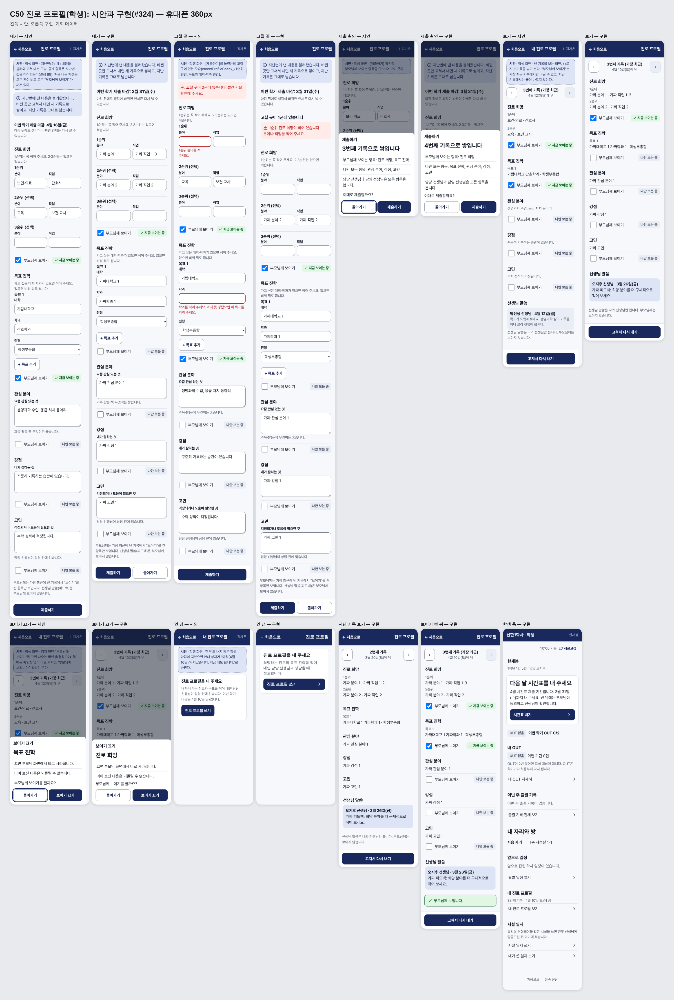
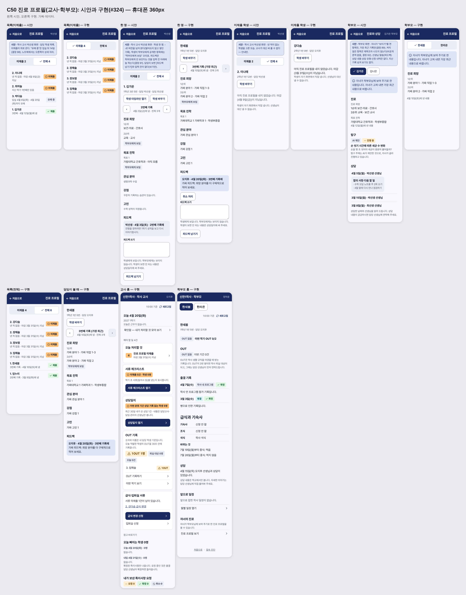
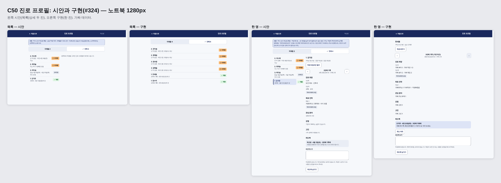
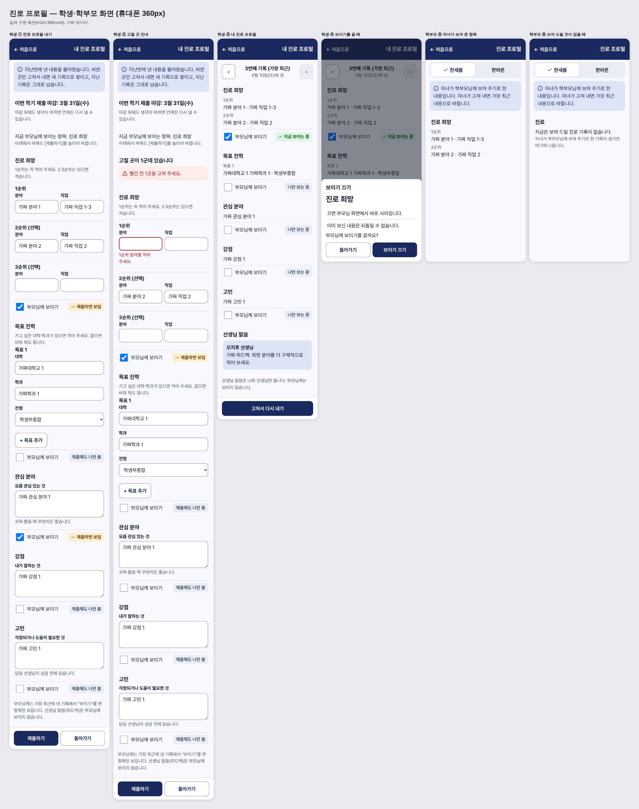
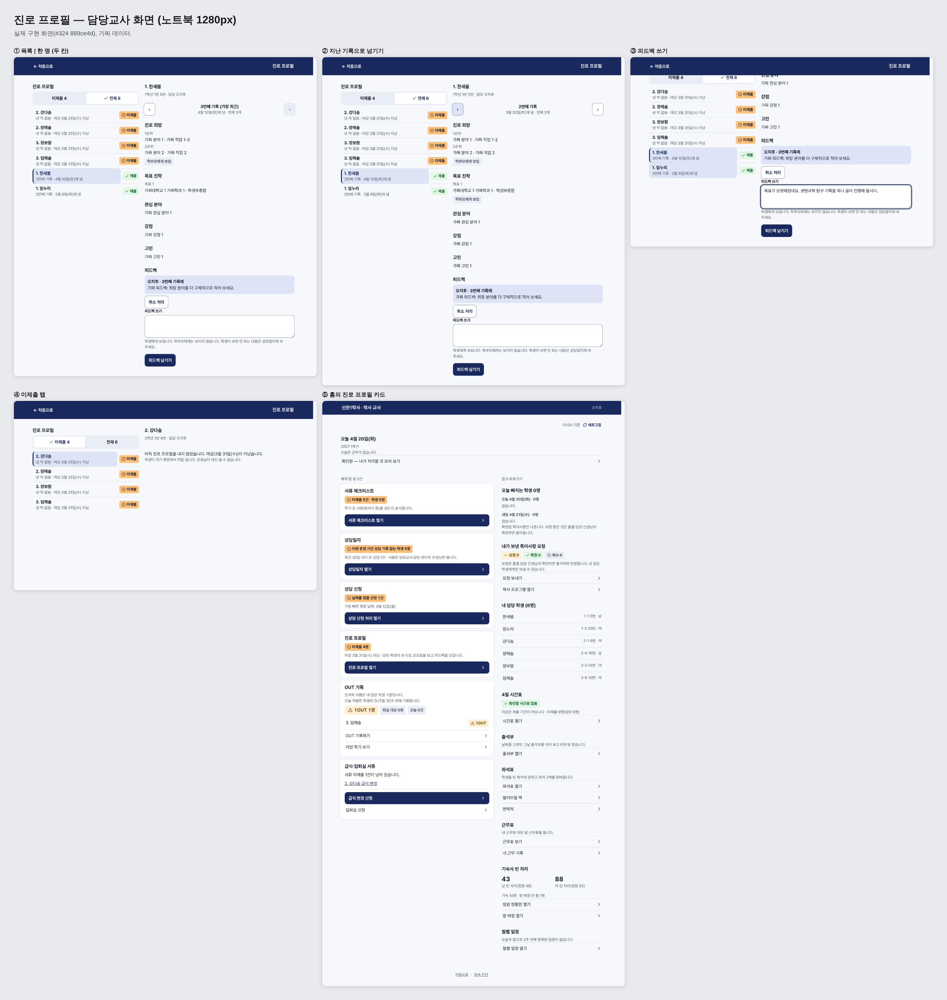

# 구현 화면 검토: C50 진로 프로필 (PR #324)

디자인2, 2026-11-28. 시안(`../screens.md` 1·5·6절, `../photos/s-career-*`·`p-career`·`t-career*`·`t-home`)과 #324의 실제 화면(커밋 b8009e5)을 같은 상태로 놓고 본 결과다. 실제 화면은 미리보기 도구(가짜 서버·가짜 데이터, 글꼴 받은 경우)로 휴대폰 360·노트북 1280에서 찍었다. "안 냄" 한 장은 PR의 `docs/design/c50/` 사진을 썼다. **고치지 않았다 — PR 작성자에게 넘기는 목록이다.**
기준은 "시안과 같은가"가 아니라 **학생·학부모·선생님이 쓰다가 헷갈리거나 놓치는가**다.

## 한 줄 판정

화면과 문구는 시안과 거의 같다. 새 부품 `UI.shareCheck`·`UI.versionNav`도 시안대로 움직인다(끌 때 안내, 지난 기록에서는 보이기 줄 없음, 첫·끝에서 화살표 꺼짐). **반드시 고칠 것은 2가지**다: 입력 화면의 "지금 보이는 중" 꼬리표가 사실과 다르고(이것은 시안의 잘못이기도 하다), 화면 안에서 휴대폰 뒤로 가기가 이어져 있지 않다. 16가지 상태에서 가로 넘침·48px 미만 단추·브라우저 오류는 없었다.

## 총괄이 특히 보라고 한 것

| 물음 | 답 |
| --- | --- |
| ① '부모님께 보이기'를 켜고 끌 때 헷갈리지 않는가 | **보기 화면에서는 분명하다.** 체크하면 꼬리표가 바로 "지금 보이는 중"으로 바뀌고 "부모님께 보입니다." 알림이 뜬다. 끌 때는 "끄면 부모님 화면에서 바로 사라집니다 / 이미 보신 내용은 되돌릴 수 없습니다" 확인 시트가 뜬다. **입력 화면에서는 헷갈린다**(아래 1번) |
| ② 긴 입력 화면이 휴대폰에서 지치지 않는가 | 견딜 만하다. 길이는 휴대폰 화면 세 장쯤(2,460px)이고, 맨 위 안내("지난번에 낸 내용을 불러왔습니다…")가 제자리에 있어 바뀐 곳만 고치면 된다. [제출하기]가 아래에 늘 붙어 있어 끝까지 내리지 않아도 낼 수 있다. 걱정은 길이가 아니라 **쓰다가 뒤로 가기를 누르면 다 사라지는 것**이다(아래 2번) |
| ③ 교사 화면에서 피드백이 학부모에게 안 보임이 분명한가 | 분명하다. 입력 칸 바로 아래 "학생에게 보입니다. 학부모에게는 보이지 않습니다. 학생이 보면 안 되는 내용은 상담일지에 써 주세요." 학생 화면에도 "선생님 말씀은 나와 선생님만 봅니다. 부모님께는 보이지 않습니다."가 있고, 학부모 화면에는 피드백이 없다 |
| ④ 노트북에서 한 열이 실제로 불편한가 | **불편하다.** 한 명을 열면 목록이 사라지고, [학생 바꾸기]로 돌아오면 목록이 맨 위부터 다시 나온다. 누구까지 봤는지 표시도 없다. 담당 학생 30명을 차례로 보려면 "열기 → 읽기 → 학생 바꾸기 → 목록에서 다음 학생 찾기"를 30번 한다. 두 칸이면 왼쪽에서 다음 줄만 누르면 된다. 학기 초에 30명을 한꺼번에 보는 것이 이 화면의 주된 쓰임이라 시범 운영 전에 두 칸으로 바꾸기를 권한다(아래 4번). 이번 PR을 막을 일은 아니다 |

## 반드시 고칠 것

| # | 무엇이 | 시안은 | 구현은 | 왜 |
| --- | --- | --- | --- | --- |
| 1 | **입력 화면**의 보이기 꼬리표 | (시안도 같은 꼬리표를 그렸다 — 시안의 잘못) | 입력 화면에서 체크를 바꾸면 꼬리표가 곧바로 "지금 보이는 중"/"나만 보는 중"으로 바뀐다. 실제로는 [제출하기]를 눌러야 바뀐다 | 학생이 입력 화면에서 "고민"의 체크를 끄고 "나만 보는 중"을 본 뒤 [돌아가기]로 나가면, 학부모 화면에는 그대로 보인다. 공개 범위를 사실과 다르게 알려 주는 것이다. 입력 화면에서는 꼬리표를 "제출하면 보임"/"제출해도 나만 봄"으로 바꾸거나 꼬리표를 빼고, 지금 상태는 맨 위에 한 줄("지금 부모님께 보이는 항목: 진로 희망")로 둔다. `UI.shareCheck`에 꼬리표 문구를 받는 옵션이면 된다. 시안 문서도 디자인2가 같이 고친다 |
| 2 | 화면 안 뒤로 가기 | — | `screen_career.html`이 `Nav`(Client.html)를 쓰지 않는다. 입력·한 명 보기·지난 기록이 모두 같은 주소다 | 안드로이드에서 진로 프로필을 쓰다가 뒤로 가기를 누르면 홈으로 나가고 쓴 글이 사라진다(긴 글 칸 3개). 교사는 한 명을 보다가 뒤로 가면 목록이 아니라 홈으로 간다. 상담일지·시간표 화면처럼 `Nav.go`·`Nav.bind`로 "보기 ↔ 입력", "목록 ↔ 한 명"을 잇는다. **코드로 판단했다 — 실제 휴대폰에서는 확인하지 못했다**(점검표 A2) |

## 같이 고칠 것

| # | 무엇이 | 시안은 | 구현은 | 제안 |
| --- | --- | --- | --- | --- |
| 3 | 입력 오류 표시 | 틀린 칸이 빨갛고 칸 아래 문구 | 맨 위 카드에만 "1순위 진로 희망이 비어 있습니다…". 칸에는 표시가 없고, 확인 시트를 지나 서버까지 갔다 와야 나온다 | 문구가 칸 이름을 말해 줘서 찾을 수는 있다. 그래도 화면이 길어 맨 위와 칸 사이를 오가야 한다. `UI.field`의 `setError`로 칸에 표시하고, 1순위 빈칸·대학만 적고 학과가 빈 경우는 확인 시트 전에 거른다(C49-A에서 고친 것과 같은 방식) |
| 4 | 노트북 목록 \| 상세 | 두 칸(`.ld`) | 한 칸 | 위 ④. 상담 신청 처리(C49-A)가 이미 쓰는 공통 `.ld`로. 두 칸이 어렵다면 최소한 한 명 보기에 [이전 학생]·[다음 학생] 단추 |
| 5 | 학사 교사 홈의 미제출 알림 | "오늘 처리할 것" 목록의 한 줄 | 한 줄짜리 "오늘 처리할 것" 목록 카드가 새로 생기고, 그 아래 서류·상담일지·상담 신청은 각자 카드 | 한 홈에 두 가지 모양이 섞였다. 이 홈의 다른 할 일처럼 "진로 프로필" 카드 한 장(미제출 n명 꼬리표 + [진로 프로필 열기])으로 합치면 아래의 참고 카드 "진로 프로필"도 따로 둘 필요가 없다 |
| 6 | 학생 홈의 진로 카드 자리 | 안 냈으면 맨 위 한 칸 | "앞으로 일정" 아래, 홈의 아래쪽 | 냈을 때는 아래쪽이 맞다. **안 냈을 때의 할 일 칸**은 위(OUT 위, 시간표 칸 아래)로 올린다. 안 낸 상태의 홈은 찍지 못해 자리만 코드로 보았다 |
| 7 | 교사 화면 학생 이름 | "1. 김가온" | 목록은 "1. 한새봄", 한 명 보기 제목은 "한새봄" | `writing.md` 6절: 교사 화면은 "학년. 이름". 제목도 맞춘다 |
| 8 | [피드백 남기기] | 감색 주 단추 | 흰 보조 단추 | 그 카드에서 저장하는 단추는 이것 하나다. 주 단추로 |
| 9 | 학생 머리줄 제목 | 보기 "내 진로 프로필", 입력 "진로 프로필" | 둘 다 "진로 프로필" | 작은 것. 보기일 때 "내 진로 프로필" |

## 그대로 둬도 되는 것

| 무엇이 | 판단 |
| --- | --- |
| 타임라인 단추 없음(코딩A가 알림) | 괜찮다. C53에서 |
| 학부모 화면의 자녀 고르기가 칩이 아니라 두 칸 단추 | 괜찮다. 자녀가 둘일 때 더 누르기 쉽다 |
| 학부모 화면에 진로만 있고 탐구·상담이 없음 | 괜찮다. 이번 PR 범위가 진로다. 화면 이름도 "진로 프로필". 탐구(C52)·상담(C49-B)이 붙을 때 한 화면으로 모을지 그때 정한다 |
| 학부모 빈 상태 "지금은 보여 드릴 진로 기록이 없습니다." | 좋다. 안 냄·안 켬·껐음이 같은 문구다(코드로 확인, 결정 92) |
| 입력 화면 아래 바에 [돌아가기]가 더 있음 | 좋다. 고쳐 내다가 그만둘 수 있다 |
| 목표 진학 6개까지 | 괜찮다 |
| 내 피드백 아래 [취소 처리] | 시안 문구대로다 |
| 담임 화면 | 좋다. 피드백 입력 칸과 단추가 없고 "학부모에게 보임" 꼬리표는 보인다 |
| 미제출이 있으면 목록이 "미제출" 탭으로 열림 | 시안에 없던 좋은 기본값 |

## 확인하지 못한 것

- 유예 중(입실 뒤 14일) 학생 줄, 학사를 나간 학생의 "고칠 수 없습니다" 화면, 안 낸 학생의 홈.
- 휴대폰 뒤로 가기의 실제 움직임(반드시 2번은 코드로 판단).
- 담당 학생이 30명일 때의 목록 길이(가짜 데이터는 6명).
- 글자 150%·기기 9종 행렬.

## 다시 본 결과 (커밋 889ce4d, 2026-11-28)

코딩A가 위 목록을 반영한 뒤 구현 화면만 다시 찍었다. **남은 "반드시"가 없다 — 병합해도 된다.**

| # | 무엇 | 결과 |
| --- | --- | --- |
| 1 | 입력 화면의 보이기 꼬리표 | **고쳐짐.** 입력 화면은 "제출하면 보임"(주의색) / "제출해도 나만 봄"(회색), 맨 위에 "지금 부모님께 보이는 항목: 진로 희망" + "아래에서 바꿔도 [제출하기]를 눌러야 바뀝니다." 입력 화면에서 체크를 바꾸고 [돌아가기]로 나오면 보기 화면의 꼬리표는 그대로였다(직접 눌러 확인) |
| 2 | 화면 안 뒤로 가기 | **고쳐짐(코드와 화면 안 단추로 확인).** 상담일지와 같은 `Nav.go`·`Nav.bind`를 쓴다. 입력 중 [돌아가기]로 나갔다 다시 열면 쓰던 글과 체크가 남아 있었다. 교사는 [학생 바꾸기]로 목록에 돌아오고 고른 탭이 유지된다. **휴대폰의 뒤로 가기 단추 자체는 미리보기 도구로 흉내 낼 수 없어 보지 못했다 — 시험 배포 점검표 A2에서 확인** |
| 3 | 입력 오류를 틀린 칸에 | **고쳐짐.** 틀린 칸이 빨갛고 칸 아래 "1순위 분야를 적어 주세요.", 맨 위 "고칠 곳이 1군데 있습니다 / 빨간 칸 1곳을 고쳐 주세요." 확인 시트는 열리지 않는다 |
| 4 | 노트북 목록 \| 한 명 두 칸 | **고쳐짐.** 공통 `.ld`, 고른 줄이 감색 띠로 보이고 왼쪽 목록이 남아 다음 학생을 바로 누를 수 있다 |
| 5 | 학사 교사 홈 | **고쳐짐.** 다른 할 일과 같은 카드 한 장("진로 프로필 · 미제출 4명" + [진로 프로필 열기]) |
| 6 | 안 낸 학생의 홈 | **고쳐짐.** "진로 프로필을 내 주세요" 칸이 홈 맨 위(PR의 `c50-s-home-todo-360.png`로 확인) |
| 7 | 교사 한 명 보기 제목 | **고쳐짐.** "1. 한새봄" |
| 8 | [피드백 남기기] | **고쳐짐.** 감색 주 단추 |
| 9 | 학생 머리줄 제목 | **고쳐짐.** "내 진로 프로필" |
| D27 | 피드백 칸 이름 "피드백 쓰기 (학생에게 보임)" | **남음(작은 것).** 아직 "피드백 쓰기"다. 도움말에는 "학생에게 보입니다. 학부모에게는 보이지 않습니다…"가 있어 막을 일은 아니다 |

### 남은 작은 것 (병합을 막지 않음)

| 무엇이 | 제안 |
| --- | --- |
| 피드백 칸 이름(D27) | "피드백 쓰기 (학생에게 보임)", 도움말은 "학부모에게는 보이지 않습니다. …"로 시작 |
| 피드백 상자에 쓴 날이 없다("오지후 · 3번째 기록에", 학생 화면은 "오지후 선생님") | 판정표 PR(#323) 뒤에 날짜가 돌아오는지 확인. 학부모 화면의 "○월 ○일에 낸 내용" 줄도 같은 까닭으로 지금은 없다(남음이 아님) |
| 입력 화면 머리줄도 "내 진로 프로필" | 괜찮다. 굳이 나누지 않아도 된다 |

코딩A가 보강한 사진(`docs/design/c50/`의 유예 중·학사를 나간 학생·안 낸 학생 홈·노트북 두 칸)도 보았고 시안 문구와 맞았다.
확인: 16가지 상태에서 가로 넘침·48px 미만 단추·브라우저 오류 없음. 글자 150%·기기 9종, 담당 학생 30명 목록은 여전히 보지 않았다.
