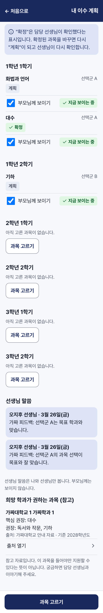
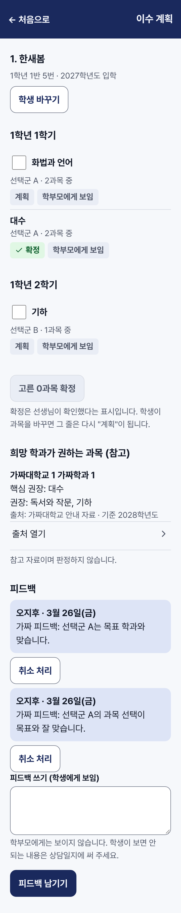
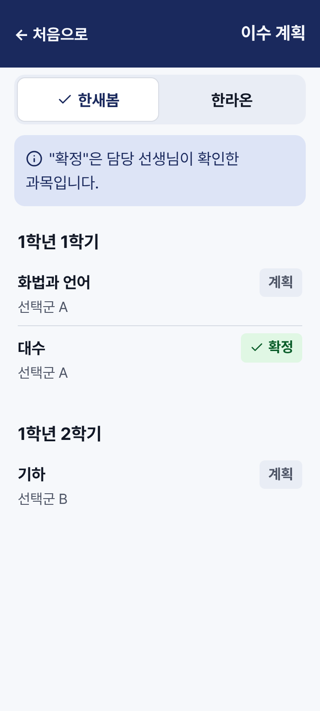
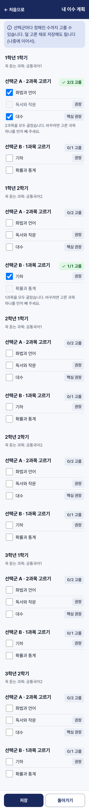

# 구현 화면 검토: C51 이수 계획 + 권장 이수 과목 (PR #341)

디자인2, 2026-11-28. 시안(`../screens.md` 10절, `../photos/s-plan*`·`p-plan`·`t-plan*`)과 #341의 실제 화면(커밋 5eefd22)을 맞춰 본 결과다. 실제 화면은 미리보기 도구(가짜 서버·가짜 데이터, 글꼴 받은 경우)로 휴대폰 360·노트북 1280에서 다시 띄워 눌러 봤다(학생 보기·고르기·많이 고름 오류·보이기 끄기, 교사 목록·한 명·확정, 학부모). **고치지 않았다 — PR 작성자에게 넘기는 목록이다.**

  

## 한 줄 판정

문구·꼬리표·확인 시트는 시안과 거의 같고, 13가지 상태에서 가로 넘침·48px 미만 단추·브라우저 오류는 없었다. **반드시 고칠 것은 2가지**다: 새로 고른 과목이 학생 모르게 부모님께 보이게 저장되는 경우가 있고(규칙 쪽 가정), 고르기 화면이 학기 칩 없이 여섯 학기를 한 장에 펼친다.

## 총괄이 먼저 본 세 가지

| 물음 | 답 |
| --- | --- |
| ① 고르기 화면이 6개 학기를 한 장에(360px에서 3,300px) | **시안대로 학기 칩으로 한 번에 한 학기만** 보이게 한다(아래 2번). 접기보다 칩이 낫다 — 접으면 어느 학기를 다 골랐는지 열어 봐야 알지만, 칩에는 "2/3 고름"처럼 적을 수 있다. **지난 학기를 고칠 수 있는가는 화면이 아니라 규칙**이다: 지금 서버는 막지 않는다(2학년 학생이 1학년 1학기 과목을 바꿀 수 있고, 바꾸면 "확정"이 "계획"으로 돌아간다). 권하는 것은 "이미 지난 학기는 읽기만"이지만 정해진 적이 없어 총괄·선생님이 정할 일이다(아래 '정할 것') |
| ② 교사 화면의 "선택군 A · 2과목 중" | **바로 읽히지 않는다. 시안(제 문구)의 잘못이다.** "2과목 중 하나"로도, "2과목을 듣는 중"으로도 읽힌다. **"선택군 A (2과목 고르기)"** 로 바꾼다 — 학생 고르기 화면의 카드 제목과 같은 말이다. 설명서도 이 PR에서 고쳤다 |
| ③ 확정에 '모두 고르기'가 없어도 되는가 | 한 학생이 서너 줄일 때는 없어도 된다. 그러나 학기 초에는 한 학생이 여러 학기를 한꺼번에 골라 10줄을 넘길 수 있고, 그것을 30명에게 한다. 확정 단추 옆에 **[계획 n과목 모두 고르기]** 를 두기를 권한다(고치면 좋은 것 3번). 확인 시트가 과목을 한 줄씩 다시 보여 주므로 잘못 누를 걱정은 작다 |

## 반드시 고칠 것

| # | 무엇이 | 시안은 | 구현은 | 왜 |
| --- | --- | --- | --- | --- |
| 1 | 새로 고른 과목의 "부모님께 보이기" | 과목마다, **기본 꺼짐** | 그 학생의 살아 있는 줄 중 하나라도 보이기가 켜져 있으면, 새로 고른 과목이 **모두 켜진 채** 저장된다(`coursePlanDiff_`의 `ASSUMPTION: 공개는 계획 전체 단위로 이어받는다`). 미리보기 가짜 자료에서 그대로 일어났다: 학생이 "대수" 하나만 켰는데 위 학부모 사진에 "화법과 언어"·"기하"까지 보인다. 저장 알림은 "저장했습니다."뿐이다 | 학생은 과목 하나만 보여 주기로 했는데 그 뒤에 고른 과목이 말없이 부모님께 보인다. "학부모 공개는 학생이 항목별로 고른다(기본 비공개)"와 어긋난다. **새 줄은 늘 꺼짐**으로 한다(과목을 바꾼 경우도 새 과목은 꺼짐). 규칙 파일의 가정이라 총괄이 정하고 규칙·코딩 세션이 같이 고칠 일이다. 고치기 전까지 PR 사진(`c51-p-plan-360`)과 실제가 다를 수 있다 |
| 2 | 고르기 화면의 학기 | 맨 위 **학년·학기 칩**으로 한 학기를 골라 그 학기의 선택군만 | 여섯 학기 × 선택군을 한 장에 모두(360px에서 3,242px, 체크 칸 30개). [저장]은 한 번에 전부 | 1학년이 다음 학기 두 과목을 고르려고 3학년 2학기까지 지나간다. 어느 학기를 보고 있는지 놓치기 쉽고(카드 제목이 "선택군 A · 2과목 고르기"로 여섯 번 똑같다), 다른 학기 칸을 잘못 눌러도 모른다. 칩으로 한 학기씩 보이고, 보기 화면의 학기 카드 안 [과목 고르기]는 **그 학기 칩을 고른 채** 연다(지금은 어느 카드에서 눌러도 맨 위 1학년 1학기부터). 저장은 지금처럼 한 번에 전부여도 된다 |

## 고치면 좋은 것

| # | 무엇이 | 구현은 | 권하는 것 |
| --- | --- | --- | --- |
| 1 | 고르다가 [돌아가기] | 체크를 바꾼 뒤 [돌아가기]를 누르면 묻지 않고 버린다(눌러 봄) | 바꾼 것이 있을 때만 확인 시트 "저장하지 않은 선택이 있습니다. 버리고 나갈까요?" / [계속 고르기] [버리고 나가기] |
| 2 | 교사 화면 과목 줄의 "선택군 A · 2과목 중" | 시안 문구 그대로 | "선택군 A (2과목 고르기)"(위 ②). 시안의 잘못 |
| 3 | 확정할 줄 고르기 | 줄마다 체크만 | 계획 줄이 3개 이상이면 [계획 n과목 모두 고르기](다시 누르면 모두 풀기) |
| 4 | 많이 고름 오류 문구 | "1학년 1학기 선택군 A 묶음에서는 2과목까지 고를 수 있습니다. 지금 3과목입니다." — 맨 위 카드에만 | "묶음"을 뺀다("1학년 1학기 선택군 A에서는 2과목까지 … 하나를 빼 주세요."). 화면이 칸을 꺼서 막으므로 실제로는 거의 안 나오는 길이라 위치는 그대로 둬도 된다 |
| 5 | 학생 보기 화면의 빈 학기 | 1학년이면 "아직 고른 과목이 없습니다." + [과목 고르기] 카드가 네 장 이어진다 | 시안대로라 그대로 둬도 된다. 길면 빈 학기를 한 카드에 "아직 안 고른 학기: 2학년 1학기 …"로 모을 수 있다(시범 운영 뒤 판단) |
| 6 | 학부모가 보는 곳이 둘 | 홈 [자녀의 이수 계획 보기](따로 화면)와 진로 프로필 화면의 이수 계획 카드, 두 곳에 같은 내용 | 시안은 진로 화면의 카드 하나였다. 둘 다 둬도 틀리지는 않지만 홈 줄을 빼면 볼 곳이 한 곳이 된다 |

## 그대로 두면 되는 것

- 학생 보기: 맨 위 "확정" 안내, 과목 줄(이름·선택군·계획/확정 꼬리표), 줄마다 "부모님께 보이기"가 누르는 즉시 저장되고 꼬리표가 "지금 보이는 중"/"나만 보는 중"으로 바뀜, 끌 때 확인 시트("끄면 부모님 화면에서 바로 사라집니다 / 이미 보신 내용은 되돌릴 수 없습니다").
- 학생 고르기: "2/2 고름" 꼬리표, 다 고르면 남은 칸이 꺼지고 안내가 나옴, "핵심 권장"·"권장" 회색 꼬리표, 덜 고른 채 저장. "꼭 듣는 과목"을 카드 대신 한 줄로 줄인 것은 더 낫다.
- 교사: 목록(확인 n = 살구, 확정 = 초록, 안 고름 = 회색, 확인할 것이 위), "계획" 줄에만 체크 칸, 확정 확인 시트 문구, 확정 뒤 목록 숫자가 바로 바뀜, 피드백 칸 이름 "피드백 쓰기 (학생에게 보임)", 노트북 두 칸. 확정 단추를 학기마다 두지 않고 하나로 모은 것도 괜찮다.
- 담임·관리자: 체크 칸·확정·피드백 입력 없음. 학부모: 권장 과목·선생님 말씀 없음.
- 권장 과목 카드: 출처·기준 연도·"참고 자료입니다…" 문구, 교사 쪽 "참고 자료이며 판정하지 않습니다."
- 교사 홈 "이수 계획 확인 n명"(살구), 0이면 초록 "확인할 이수 계획 없음".

## 정할 것 (디자인이 정할 수 없는 것)

- **지난 학기를 학생이 고칠 수 있는가.** 지금은 막지 않는다. 권하는 것: 이미 지난 학기는 읽기만(고르기 칩에 나오지 않음), 지금 학기부터 고름.
- 1번(새 줄의 보이기 기본값)을 "늘 꺼짐"으로 할지.

## 확인하지 못한 것

- 글자 150%, 기기 9종. 실제 휴대폰의 뒤로 가기(코드에는 `Nav.go`·`Nav.bind`가 있다).
- 2·3학년 학생 화면(로그인되는 가짜 학생이 1학년 한 명), 교육과정에서 빠진 과목 줄, 과목 이름이 긴 실제 편제표(선택군 하나에 과목 10개 이상).
