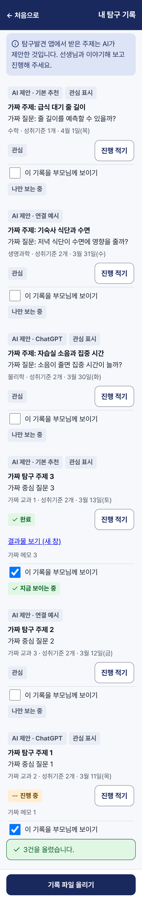
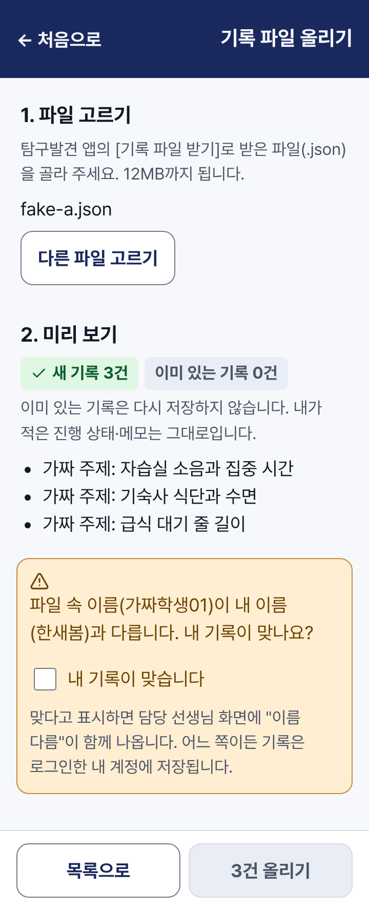
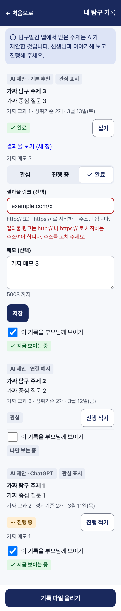

# 구현 화면 검토: C52 탐구 기록 올리기 (PR #345)

디자인2, 2026-11-28. 시안(`../screens.md` 4·8절, `../photos/s-inquiry-*`·`a-cleanup*`)과 #345의 실제 화면(커밋 7d6e8fd)을 맞춰 본 결과다. 학생 화면과 학부모 카드는 미리보기 도구(가짜 서버·가짜 데이터, 글꼴 받은 경우)로 휴대폰 360·노트북 1280에서 다시 띄워 눌러 봤다(목록, 진행 적기·주소 오류, 보이기 끄기, 파일 고르기 → 미리 보기 → 이름 확인 → 올리기, 받을 수 없는 파일). 관리자 정리 화면은 내 가짜 자료에 정리 대상이 없어 **빈 상태만 직접 봤고, 목록·확인 시트는 PR의 `docs/design/c52/` 사진과 코드로 봤다.** **고치지 않았다 — PR 작성자에게 넘기는 목록이다.**

  

## 한 줄 판정

흐름·문구·꼬리표가 시안과 거의 같고 학생이 헷갈릴 곳이 없다. 직접 띄운 12가지 상태에서 가로 넘침·브라우저 오류는 없었다. **반드시 고칠 것은 2가지, 둘 다 한두 줄**이다: 정리 확인 시트의 "되돌릴 수 없습니다"가 실제 동작(Drive 휴지통)과 다르고, "내 기록이 맞습니다" 칸이 44px이다.

## 총괄이 보라고 한 것

| 물음 | 답 |
| --- | --- |
| 미리 보기 → 올리기 흐름 | 좋다. 파일을 고르면 바로 "새 기록 3건 · 이미 있는 기록 0건"과 제목이 나오고, [3건 올리기]를 누르면 "3건을 올렸습니다." 알림과 함께 목록 맨 위에 새 기록이 온다. 새 기록은 모두 "관심"·"나만 보는 중"으로 시작한다. 같은 파일을 다시 고르면 올리기가 꺼진 채 "올릴 것이 없습니다." |
| 이름이 다를 때의 확인 | 분명하다. 주의 상자에 두 이름이 나란히 나오고, 체크하기 전에는 [올리기]가 꺼져 있다. "어느 쪽이든 기록은 로그인한 내 계정에 저장됩니다."를 상자 안에 넣은 것은 시안보다 낫다. 칸 크기만 고친다(아래 2번) |
| 기록마다 '부모님께 보이기' | 좋다. 누르는 즉시 저장되고 꼬리표가 "지금 보이는 중"/"나만 보는 중"으로 바뀐다 — 지금 사실만 말한다. 진행 칸의 [저장]과 따로 움직이는 것도 시안대로다 |
| 끌 때 확인 시트 | 시안과 같다(제목 "보이기 끄기", 기록 제목, "끄면 부모님 화면에서 바로 사라집니다 / 이미 보신 내용은 되돌릴 수 없습니다") |
| 관리자 정리의 "지워지는 것은 원본 파일뿐" 문구와 확인 시트 | 문구·빨간 단추·세 줄 확인은 시안과 같다. **다만 "되돌릴 수 없습니다"가 사실과 다르다**(아래 1번) |

## 반드시 고칠 것

| # | 무엇이 | 시안은 | 구현은 | 왜 |
| --- | --- | --- | --- | --- |
| 1 | 정리 확인 시트의 "Drive에서 원본 파일 n개를 지웁니다. **되돌릴 수 없습니다.**" | 같은 문구(시안도 같이 틀렸다) | 서버는 `setTrashed(true)` — 파일을 **Drive 휴지통으로 옮긴다.** 휴지통에서는 30일 동안 되살릴 수 있고, 그동안 파일은 남아 있다 | 관리자는 "개인정보를 지웠다"고 알지만 실제로는 한 달 더 남는다. 화면 문구는 사실만 말해야 한다. 둘 중 하나: ⓐ 문구를 사실대로 — "Drive 휴지통으로 옮깁니다. 30일 뒤 완전히 지워집니다." + "이 화면에서는 되돌릴 수 없습니다(탐구 기록 요약은 "취소"로 남습니다)." 알림도 "원본 파일 n개를 휴지통으로 옮겼습니다." ⓑ 정말 바로 지우도록 서버를 바꾼다. 결정 100이 "바로 지움"을 뜻하는지는 총괄이 정한다. 설명서 8절에 이 점을 적어 두었다 |
| 2 | "내 기록이 맞습니다" 칸 | 체크 칸(다른 체크 칸과 같은 크기) | 줄 높이 44px, 체크 칸 22px(`.iq-check`). 정리 화면의 체크 칸도 22px(줄은 48px 넘음) | 누르는 칸 48px 규칙. 이 칸을 눌러야만 올릴 수 있어 놓치면 안 되는 칸이다. `min-height: var(--tap)`, 체크 칸은 이수 계획·보이기와 같은 28px로 |

## 고치면 좋은 것

| # | 무엇이 | 구현은 | 권하는 것 |
| --- | --- | --- | --- |
| 1 | 휴대폰 뒤로 가기 | `screen_inquiry.html`이 `Nav`를 쓰지 않는다. "올리기" 화면에서 뒤로 가면 목록이 아니라 홈으로 나간다(코드로 판단, 실제 휴대폰 미확인) | 다른 6단계 화면처럼 `Nav.go('pick')`·`Nav.bind`로 목록 ↔ 올리기를 잇는다. 잃는 것이 고른 파일뿐이라 급하지는 않다 |
| 2 | 정리 목록의 날짜 | "3월 9일(화) · 1년 지남 · 원본 파일 1개" — 연도가 없고 졸업인지 퇴실인지도 없다 | 1년도 더 지난 날짜라 "2026년 3월 9일 퇴실 · 1년 지남 · 원본 파일 1개"처럼 연도와 사유를 적는다 |
| 3 | 올리는 동안 | [올리기]가 꺼지기만 한다 | 큰 파일은 몇 초 걸린다. 단추 글을 "올리는 중…"으로 |
| 4 | 미리 보기의 제목 목록 | 20개까지만 보이고 나머지가 있다는 말이 없다 | 20건을 넘으면 맨 아래 "…외 n건" |
| 5 | "결과물 보기 (새 창)" 줄 | 학생·학부모 화면 모두 브라우저 기본 파란 밑줄 글씨 | 다른 화면의 줄 링크(`UI.rowLink`)나 감색 글씨로 맞춘다. 학부모 카드에는 "(새 창)"이 빠져 있다 |
| 6 | 진행 칸을 쓰다가 [접기]·다른 카드의 [진행 적기] | 쓰던 메모가 말없이 사라진다(화면을 통째로 다시 그림) | 메모가 짧아(500자) 급하지 않다. 손볼 때 그 카드만 다시 그리면 된다 |

## 그대로 두면 되는 것

- 목록: 맨 위 "AI가 제안한 것" 안내, 출처 꼬리표("AI 제안 · ChatGPT / 연결 예시 / 기본 추천")가 늘 붙음, "관심 표시", 진행 꼬리표(관심 회색·진행 중 주의색·완료 초록 — 색과 글·기호를 함께), 카드 안에서 펼치는 진행 칸, 주소 오류가 그 칸 바로 아래에 나옴.
- 올리기: "1. 파일 고르기 / 2. 미리 보기" 두 단계, [다른 파일 고르기], 받을 수 없는 파일 안내("탐구발견 기록 파일이 아닙니다…").
- 학부모: 자녀가 켠 기록만, 없으면 카드 자체가 없음, 아래 "탐구 주제는 AI가 제안한 것으로, 자녀가 골라 진행하고 있습니다." 메모·성취기준은 보이지 않는다.
- 관리자: 위 안내, "정리 대상 n명 · 원본 파일 n개", "지워지는 것은 Drive의 원본 파일뿐입니다…", 빈 상태 문구, 홈의 "정리할 탐구 원본 파일" 줄.

## 알릴 것

- 시안 4절의 **"선생님 말씀"(기록에 달린 피드백)** 은 이 PR에 없다. 교사가 탐구 기록에 피드백을 쓰는 화면이 아직 없어서이므로 그 화면을 만들 때 같이 넣으면 된다.
- 학생 홈은 시안의 "진로와 탐구" 한 카드 대신 "탐구 기록" 카드가 따로 생겼다. 홈 카드가 늘고 있어(이수 계획·상담·탐구) 6단계가 다 들어온 뒤 한 번 모아 정리하기를 권한다.

## 확인하지 못한 것

- 관리자 정리의 목록·확인 시트·지운 뒤 알림을 직접 눌러 보지 못했다(가짜 자료에 대상 없음). 포커스가 [돌아가기]에 가는지도 사진으로는 알 수 없다.
- 글자 150%, 기기 9종, 실제 휴대폰에서 파일 고르기(안드로이드·아이폰의 파일 고르는 창), 12MB에 가까운 큰 파일, 기록 수백 건 목록.
