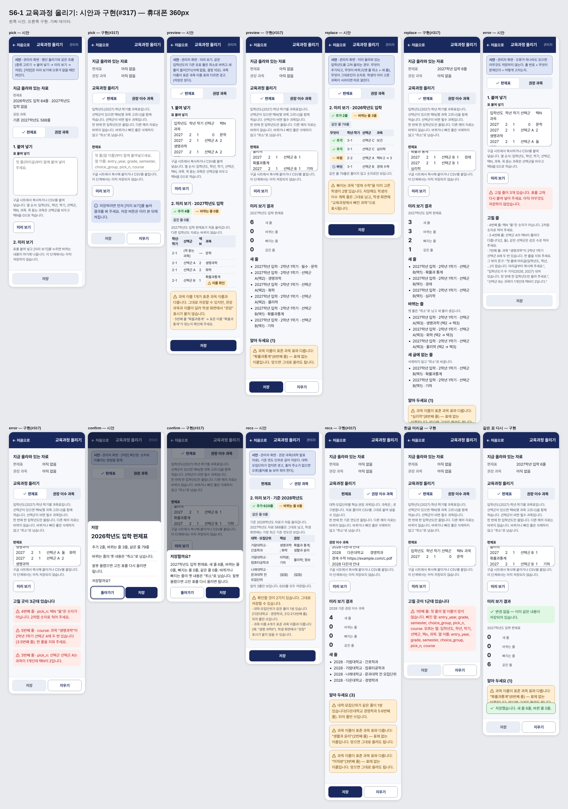
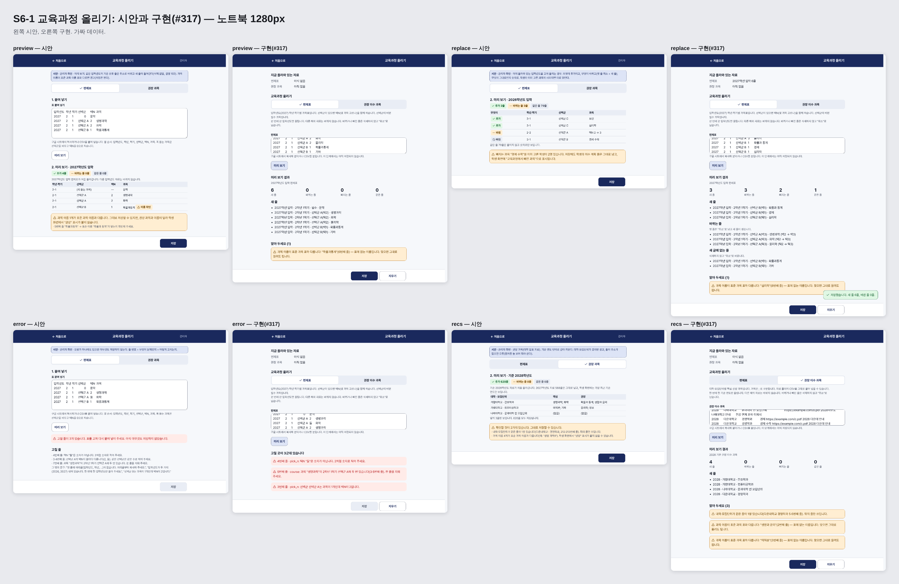

# 구현 화면 검토: S6-1 교육과정 올리기 (PR #317)

디자인2, 2026-11-28. 시안(`../screens.md` 11절, `../photos/a-curr-*`)과 #317의 실제 화면(커밋 1792426)을 같은 상태로 놓고 본 결과다. 실제 화면은 미리보기 도구(가짜 서버·가짜 데이터, 글꼴 받은 경우)로 휴대폰 360·노트북 1280에서 찍었다. **고치지 않았다 — PR 작성자에게 넘기는 목록이다.**
기준은 "시안과 같은가"가 아니라 **관리자가 표를 올릴 때 헷갈리는가**다.

## 한 줄 판정

흐름(종류 고르기 → 붙여 넣기 → 미리 보기 → 저장)과 안전장치(오류면 저장 꺼짐, 내용을 바꾸면 다시 미리 보기, 같은 표는 "변경 없음")는 시안보다 꼼꼼하다. **고쳐야 할 것은 낱말 문제 3가지**(영어 열 이름이 화면에 나옴)이고, 나머지는 고치면 좋은 것이다. 넘침·작은 버튼·브라우저 오류는 8가지 상태 × 2크기에서 없었다.

## 반드시 고칠 것

| # | 무엇이 | 시안은 | 구현은 | 왜 |
| --- | --- | --- | --- | --- |
| 1 | 머리글(첫 줄 열 이름) | 한글(입학년도, 학년, 학기, 선택군, 택N, 과목) | 영어 열 이름만 받음. 한글 머리글을 붙이면 "빠진 열: entry_year, grade, … 모르는 열: 입학년도, 학년, …" | 관리자는 학교 편제표를 한글 머리글로 갖고 있다. 영어 이름은 시트 내부 이름이라 알 수 없다. (코딩A가 이미 고칠 예정이라고 알린 것) 한글·영어 둘 다 받고, 안내 글·도움말에는 한글 이름을 먼저 적는다 |
| 2 | 오류 줄의 열 표시 | "4번째 줄: 택N "둘"은 숫자가 아닙니다." | "4번째 줄 · pick_n: 택N "둘"은…", "5번째 줄 · course: 과목…" | `pick_n`·`course`가 화면에 그대로 나온다. 한글 이름(택N, 과목)으로 바꾸거나, 문장에 이미 이름이 있으므로 뺀다 |
| 3 | 같은 것을 두 이름으로 | "빠짐" 하나 | 숫자 칸은 "빠지는 줄", 그 아래 목록 제목은 "새 글에 없는 줄" | 같은 줄 묶음인데 이름이 달라 숫자와 목록을 잇기 어렵다. "빠지는 줄"로 통일 |

## 고치면 좋은 것

| # | 무엇이 | 시안은 | 구현은 | 제안 |
| --- | --- | --- | --- | --- |
| 4 | 과목 이름 경고 | 결과(학생 화면에 "권장" 표시가 안 붙음)와 표준 이름을 알려 줌 | "표에 없는 이름입니다. 맞으면 그대로 올려도 됩니다." | 왜 확인해야 하는지가 없다. 한 번만 "표준 이름과 다르면 학생 화면에서 권장 표시가 붙지 않습니다."를 더한다. "확률과통계"처럼 띄어쓰기만 다른 이름은 표준 이름("확률과 통계")을 찾아 알려 주면 좋다(지금은 못 찾음) |
| 5 | 권장 과목 미리 보기 줄 | 대학·모집단위 + 핵심·권장 과목 | "2028 · 가람대학교 · 간호학과"(과목 없음) | 핵심 칸과 권장 칸을 바꿔 붙였는지 미리 보기로 알 수 없다. 줄 끝에 "핵심 생명과학; 화학 / 권장 확률과 통계"를 붙인다 |
| 6 | 오류 순서 | 줄 번호 순 | 4번째 → 5번째 → 3번째 | 줄 번호 순으로 정렬하면 표를 위에서부터 고치기 쉽다 |
| 7 | 오류 제목 | "… 아직 아무것도 저장하지 않았습니다." | "고칠 곳이 3군데 있습니다" | "아직 아무것도 저장하지 않았습니다."를 한 줄 더한다(일부만 들어갔을까 걱정하지 않게) |
| 8 | 저장 확인 시트 | 제목 "저장", 맨 위 굵게 "2026학년도 입학 편제표", 줄 3개 | 제목 "저장할까요?", 한 문단 | `writing.md` 4.3: 제목은 동작 이름. `lead` + `lines`로 나누면 숫자가 눈에 들어온다 |
| 9 | 미리 보기 줄의 입학년도 | 표 제목에 한 번 | 줄마다 "2027학년 입학 · 2학년 1학기 · …" | 한 번에 한 해만 올리므로 줄마다 되풀이할 필요가 없다. 빼면 휴대폰에서 한 줄에 들어온다 |
| 10 | "2027학년 입학" | "2027학년도 입학" | 올라와 있는 자료 카드·목록은 "2027학년 입학", 미리 보기 제목은 "2027학년도 입학" | "학년도"로 통일(2학년과 헷갈리지 않게) |
| 11 | 화면 안 제목 | 없음 | 머리줄 "교육과정 올리기" 아래 카드 제목이 또 "교육과정 올리기" | 카드 제목을 빼거나 "올릴 자료"로 |

## 괜찮은 것 (시안과 다르지만 그대로 둬도 됨)

| 무엇이 | 판단 |
| --- | --- |
| 미리 보기가 표가 아니라 **목록** | 괜찮다. 목록이 휴대폰에서 더 잘 읽힌다. 다만 9번(입학년도 되풀이)을 빼면 더 좋다 |
| **"이름 확인" 꼬리표 없음** | 괜찮다. 표가 아니라서 붙일 칸이 없고, 경고 상자가 줄 번호를 알려 준다 |
| 숫자를 꼬리표가 아니라 **큰 숫자 4칸**(새 줄·바뀌는 줄·빠지는 줄·같은 줄) | 괜찮다. 명단 올리기와 같은 모양이다. 휴대폰에서 네 줄을 차지하지만 읽기 쉽다 |
| **"지금 올라와 있는 자료" 카드** | 시안에도 있다. 저장 뒤 숫자가 바로 바뀌는 것이 좋다 |
| 아래 바의 **[지우기]** | 괜찮다 |
| "변경 없음 — 이미 같은 내용이 저장되어 있습니다." | 시안에 없던 좋은 상태 |
| 내용을 바꾸면 "[미리 보기]를 다시 눌러…" | 시안에 없던 좋은 안전장치 |
| 경고가 상자 여러 개로 나옴 | 괜찮다. 개수가 많아지면 한 상자 안 목록이 낫다 |

## 이번 PR 밖

- 시안의 "빠지는 과목을 이미 고른 학생이 n명 있습니다" 경고는 이수 계획(C51)이 있어야 한다. C51에서 넣는다.

## 확인하지 못한 것

- 글자 150%·기기 9종 행렬로는 돌리지 않았다(화면이 `screenList`에 들어 있으므로 PR의 기기 검사가 본다).
- 수백 줄(권장 과목 620줄)을 붙였을 때의 속도와 목록 길이는 보지 않았다.
