# 6단계(상담·진로진학, F15~F17) 화면 시안과 설명서 (D24)

> **시안입니다.** 실제 화면 코드는 바꾸지 않았습니다(`src/` 변경은 출결 결과 꼬리표 한 줄뿐, 맨 아래 9절). 사진은 미리보기 도구로 그린 정적 화면이고 이름·날짜·글은 모두 가짜입니다(학생 "1. 김가온", 담당 박선생, 담임 최선생, 가짜 오늘 2027년 4월 12일(월)).
> 근거: 결정 88(감색 면 + 살구 신호), 결정 89~101, `docs/plan/stage6.md`, `docs/plan/stage6-rules-draft.md` 2절 공개 판정표, PRD 5절 F15~F17, `docs/design/writing.md`.
> 이수 계획(편제표)은 시트 구조 승인 전이라 뺐습니다.
> 다시 찍기: `[PRETENDARD_DIR=…] node design/preview/stage6b.js [화면 id…]` → `design/preview/out/stage6b/`. 화면 코드: `design/preview/stage6b-screens.js`.
> 사진은 화면마다 `photos/<id>-360.png`(휴대폰)과 `photos/<id>-1280.png`(노트북) 두 장이 있습니다. 아래에는 필요한 것만 붙였습니다.

## 0. 화면 목록

| id | 화면 | 누가 | 만드는 작업 |
| --- | --- | --- | --- |
| `s-home` | 학생 홈에 더해지는 칸 | 학생 | C49·C50·C52 |
| `s-career-form` `-error` `-confirm` | 진로 프로필 내기 | 학생 | C50 |
| `s-career-view` `-off` `-empty` | 내 진로 프로필(보기·공개 끄기·안 냄) | 학생 | C50 |
| `s-counsel-form` `-error` | 상담 신청 입력 | 학생 | C49 |
| `s-counsel-list` `-fixed` `-empty` `-cancel` | 내 상담 신청 | 학생 | C49 |
| `s-notes` `-empty` | 내 상담 기록 | 학생 | C49 |
| `s-inquiry-list` `-empty` | 내 탐구 기록 | 학생 | C52 |
| `s-inquiry-pick` `-preview` `-error` `-done` | 기록 파일 올리기 | 학생 | C52 |
| `p-career` `p-empty` | 진로와 상담 | 학부모 | C49·C50·C52 |
| `t-home` | 홈의 할 일 | 담당교사 | C49·C50 |
| `t-career-list` `t-career` `t-career-missing` | 담당 학생 진로 프로필 | 담당교사·담임·관리자 | C50 |
| `t-req-list` `t-req` `-reject` `-fixed` `-homeroom` | 상담 신청 처리 | 담당교사(담임은 보기만) | C49 |
| `t-note` | 상담일지 쓰기(더해지는 칸) | 담당교사 | C49 |
| `t-timeline` | 학생 타임라인 | 담당교사·담임·관리자 | C53 |
| `a-cleanup` `-confirm` `-empty` | 탐구 원본 정리 | 관리자 | C52 |

모든 화면에 공통: 머리줄 왼쪽 [← 처음으로], 불러오는 중 "불러오는 중입니다…", 불러오기 실패 "불러오지 못했습니다. 화면을 다시 열어 주세요.", 저장 실패 "저장하지 못했습니다. 잠시 뒤 다시 눌러 보고, 또 안 되면 담당 선생님께 알려 주세요."(교사 화면은 "관리자 선생님께"). 학생·학부모 화면은 `body.tone-soft`.

## 1. 학생 — 진로 프로필 (F15, 결정 89·91·92)

**누가:** 학생. **일:** 진로 프로필을 써서 낸다, 무엇을 부모님께 보일지 고른다. **가장 눈에 띌 것:** 아래 바의 [제출하기].

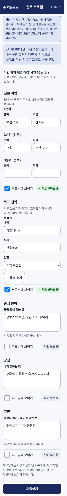 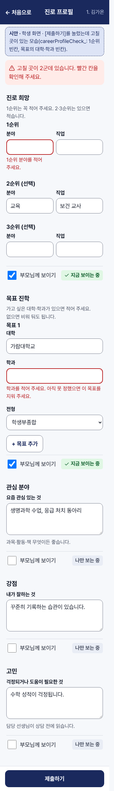 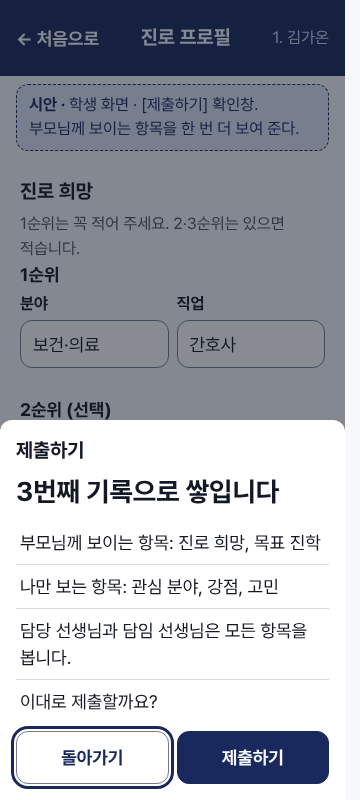

### `s-career-form` 진로 프로필 내기
- **위 안내**(`.notice.info`): "지난번에 낸 내용을 불러왔습니다. 바뀐 곳만 고쳐서 내면 새 기록으로 쌓이고, 지난 기록은 그대로 남습니다." 처음 내는 학생에게는 이 상자가 없다.
- **마감 한 줄:** "이번 학기 제출 마감: 4월 16일(금)" + "마감 뒤에도 생각이 바뀌면 언제든 다시 낼 수 있습니다." 마감일이 없으면 이 카드를 그리지 않는다.
- **카드 5장**, 항목 하나에 카드 하나. 카드 맨 아래에 그 항목의 **"부모님께 보이기"** 줄.

| 카드 | 칸 | 꼭? |
| --- | --- | --- |
| 진로 희망 | 1·2·3순위마다 분야, 직업(글 칸 2개) | 1순위 분야만 꼭 |
| 목표 진학 | 목표마다 대학, 학과, 전형(고르기: 학생부교과·학생부종합·논술·정시·아직 모름). [+ 목표 추가] | 없어도 됨. 적었으면 대학·학과 꼭 |
| 관심 분야 | 여러 줄 글 "요즘 관심 있는 것" | 선택 |
| 강점 | 여러 줄 글 "내가 잘하는 것" | 선택 |
| 고민 | 여러 줄 글 "걱정되거나 도움이 필요한 것". 도움말 "담당 선생님이 상담 전에 읽습니다." | 선택 |

- **"부모님께 보이기" 줄:** 체크 칸(`.check`) + 지금 상태 꼬리표. 켜져 있으면 초록 "지금 보이는 중", 꺼져 있으면 회색 "나만 보는 중". **기본은 꺼짐.** 새로 낼 때는 지난 기록의 켜짐·꺼짐을 그대로 이어받아 보여 준다(결정 89).
- **맨 아래 한 줄:** "부모님께는 가장 최근에 낸 기록에서 "보이기"를 켠 항목만 보입니다. 선생님 말씀(피드백)은 부모님께 보이지 않습니다."
- **아래 바:** [제출하기].
- **오류**(`s-career-error`): 맨 위 "고칠 곳이 n군데 있습니다. 빨간 칸을 확인해 주세요." + 칸 아래 "1순위 분야를 적어 주세요.", "학과를 적어 주세요. 아직 못 정했으면 이 목표를 지워 주세요.", 순위가 겹치면 "같은 내용을 두 순위에 적었습니다. 하나를 고쳐 주세요.", 글이 길면 "글이 너무 깁니다. n자 안으로 줄여 주세요."
- **확인 시트**(`s-career-confirm`): 제목 "제출하기", 맨 위 "3번째 기록으로 쌓입니다", 줄 "부모님께 보이는 항목: …", "나만 보는 항목: …", "담당 선생님과 담임 선생님은 모든 항목을 봅니다.", "이대로 제출할까요?" / [돌아가기] [제출하기]. 낸 뒤 알림 "제출했습니다."

### `s-career-view` 내 진로 프로필

  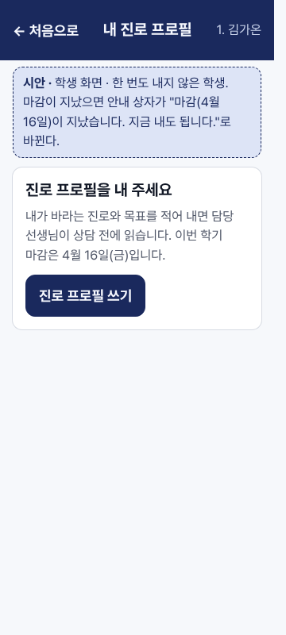

- **기록 넘기기**(‹ 3번째 기록 (가장 최근) · 4월 12일(월)에 냄 ›): 지난 기록을 넘겨 본다. 첫 기록에서는 ‹, 가장 최근에서는 ›가 꺼진다.
- **항목 카드 5장**(읽기) + "부모님께 보이기" 줄. 이 줄은 **가장 최근 기록에서만** 나온다(지난 기록은 부모님께 보이지 않으므로 고를 것이 없다).
- **켤 때:** 확인창 없이 바로 켜지고 알림 "부모님께 보입니다."
- **끌 때**(`s-career-off`, 결정 92): 확인 시트. 제목 "보이기 끄기", 맨 위 항목 이름, 줄 "끄면 부모님 화면에서 바로 사라집니다.", **"이미 보신 내용은 되돌릴 수 없습니다."**, "부모님께 보이기를 끌까요?" / [돌아가기] [보이기 끄기]. 끈 뒤 알림 "부모님께 보이지 않습니다."
- **선생님 말씀 카드:** 피드백을 최근 것부터. "○○ 선생님 · 날짜" + 글. 아래 한 줄 "선생님 말씀은 나와 선생님만 봅니다. 부모님께는 보이지 않습니다."(결정 91). 없으면 카드를 그리지 않는다.
- **아래 바:** [고쳐서 다시 내기] → `s-career-form`.
- **빈 상태**(`s-career-empty`): 살구 한 칸(`.card.todo`) "진로 프로필을 내 주세요" + 설명 + [진로 프로필 쓰기]. 마감이 지났으면 설명이 "마감(4월 16일(금))이 지났습니다. 지금 내도 됩니다."
- 학사생이 아니게 된 뒤(결정 97): 보기만. 아래 바와 "부모님께 보이기" 체크 칸을 그리지 않고 맨 위에 "학사를 나간 뒤에는 고칠 수 없습니다. 기록은 계속 볼 수 있습니다."

## 2. 학생 — 상담 신청 (F17, 결정 95·96)

  

### `s-counsel-form` 상담 신청 입력
- **위 안내:** "이야기하고 싶은 날과 주제를 알려 주세요. 선생님이 날짜를 정하면 이 화면에서 알려 드립니다."
- **만날 선생님**(읽기만): 담당 선생님 이름 + "담당 선생님께 신청합니다."
- **만나고 싶은 날:** 날짜 칸 3개(희망 날짜 1 / 2 (선택) / 3 (선택)), 오늘 이후만. 안내 "1개 이상, 3개까지 고를 수 있습니다. 오늘 이후 날짜만 됩니다."
- **무엇에 대해 이야기할까요?** 칩 5개 중 하나: 생활·학습·진로·진학·기타.
- **하고 싶은 말 (선택):** 여러 줄 글. 도움말 **"담당 선생님만 읽습니다."**(담임에게는 메모가 가지 않는다, 결정 96).
- **아래 바:** [신청하기] → 확인 시트(제목 "신청하기", 맨 위 "진로 상담 · 박선생 선생님", 희망 날짜·메모 줄) → 알림 "신청했습니다."
- **오류:** "오늘(4월 12일) 이후 날짜를 골라 주세요.", "같은 날짜를 두 번 고를 수 없습니다. 다른 날로 고쳐 주세요.", "희망 날짜를 하나 이상 골라 주세요.", "주제를 하나 골라 주세요."
- 열린 신청이 있는데 이 화면에 들어오면(주소로 직접): 칸 대신 "진행 중인 신청이 있어 새로 신청할 수 없습니다." + [내 상담 신청 보기].

### `s-counsel-list` 내 상담 신청

  

- **구역 "진행 중":** 신청·확정 상태(많아야 1건, 결정 95). 카드에 "주제 상담" + 상태 꼬리표, 신청이면 희망 날짜와 "선생님이 날짜를 정하면 알려 드립니다.", [신청 취소].
- **날짜가 정해지면**(`s-counsel-fixed`): 맨 위 한 칸(`.card.key`) "4월 14일(수)에 상담합니다" + "진로 상담 · 박선생 선생님" + "못 가게 되면 미리 취소해 주세요." + [신청 취소].
- **구역 "지난 신청":** 완료(상담한 날·선생님, [상담 기록 보기]), 반려(**선생님 말씀** 상자에 반려 사유 — 학생에게 보인다), 취소("내가 취소했습니다.").
- **아래 바:** [+ 새 상담 신청]. 열린 신청이 있으면 **꺼져 있고**, 맨 위 안내가 이유를 말한다: "진행 중인 신청이 있어 새로 신청할 수 없습니다. 선생님이 처리하거나 내가 취소하면 다시 신청할 수 있습니다."
- **취소 확인**(`s-counsel-cancel`): 제목 "신청 취소", 줄 "취소한 신청은 목록에 "취소"로 남습니다.", "취소한 뒤에는 새로 신청할 수 있습니다.", "이 신청을 취소할까요?" / [돌아가기] [신청 취소].
- **빈 상태:** "아직 상담 신청이 없습니다. 아래 [+ 새 상담 신청]을 눌러 시작해 주세요."
- 상태 꼬리표: 신청 = 주의색(`requested`), 확정·완료 = 초록(`confirmed`), 반려·취소 = 회색 줄 그음(`canceled`).

## 3. 학생 — 내 상담 기록 (결정 90·94)

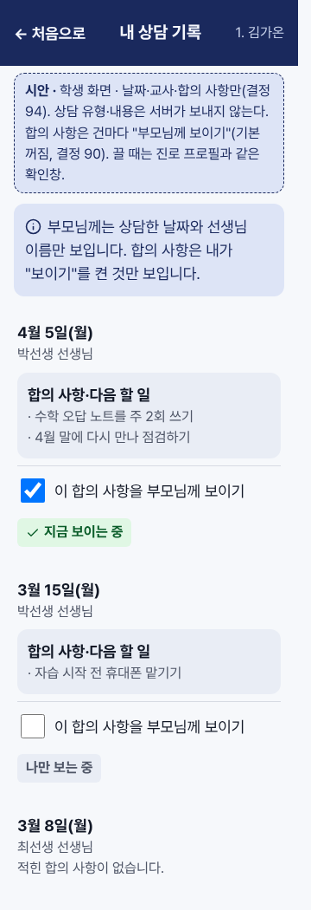 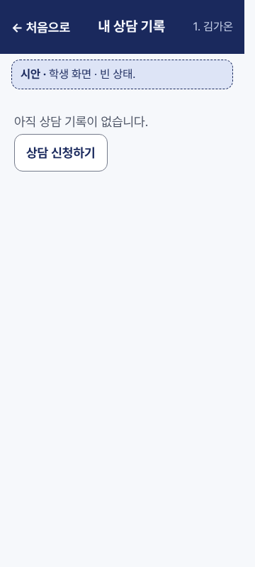

- **위 안내:** "부모님께는 상담한 날짜와 선생님 이름만 보입니다. 합의 사항은 내가 "보이기"를 켠 것만 보입니다."
- **상담 한 건에 카드 하나:** 날짜, 선생님 이름, **합의 사항·다음 할 일** 상자. 상담 유형과 내용은 없다(서버가 보내지 않는다, 결정 94).
- 합의 사항이 있으면 카드 아래 체크 칸 **"이 합의 사항을 부모님께 보이기"**(건마다, 기본 꺼짐, 결정 90) + 상태 꼬리표. 끌 때는 1절과 같은 확인 시트(맨 위 줄만 "4월 5일(월) 상담의 합의 사항").
- 합의 사항이 없는 상담: "적힌 합의 사항이 없습니다." 체크 칸 없음.
- **빈 상태:** "아직 상담 기록이 없습니다." + [상담 신청하기].

## 4. 학생 — 탐구 기록 (F16, 결정 93)

  

### `s-inquiry-list` 내 탐구 기록
- **위 한 줄:** "탐구발견 앱에서 받은 주제는 AI가 제안한 것입니다. 선생님과 이야기해 보고 진행해 주세요."
- **기록 한 건에 카드 하나:** 출처 꼬리표 **"AI 제안 · ChatGPT / 연결 예시 / 기본 추천"**(늘 붙인다), 관심 표시가 있으면 "관심 표시", 주제 제목(굵게), 중심 질문, "과목 · 성취기준 코드 2개 · 기록한 날".
- **진행:** 접힌 모습은 상태 꼬리표(관심 = 회색, 진행 중 = 주의색, 완료 = 초록) + [진행 적기]. 누르면 그 카드 안에서 펼쳐진다: 진행 상태(3개 중 하나: 관심·진행 중·완료), 결과물 링크 (선택)(도움말 "http:// 또는 https:// 로 시작하는 주소만 됩니다."), 메모 (선택), [저장]. 알림 "저장했습니다."
- **선생님 말씀:** 그 기록에 달린 피드백(있을 때만).
- **"부모님께 보이기"** 줄: 기록마다, 기본 꺼짐. 끌 때는 1절과 같은 확인 시트.
- **아래 바:** [기록 파일 올리기].
- **빈 상태:** "아직 올린 탐구 기록이 없습니다. 탐구발견 앱에서 [기록 파일 받기]로 받은 파일을 올려 주세요."
- 오류: "주소는 http:// 또는 https:// 로 시작해야 합니다.", "메모가 너무 깁니다. n자 안으로 줄여 주세요."

### `s-inquiry-pick` → `-preview` 기록 파일 올리기

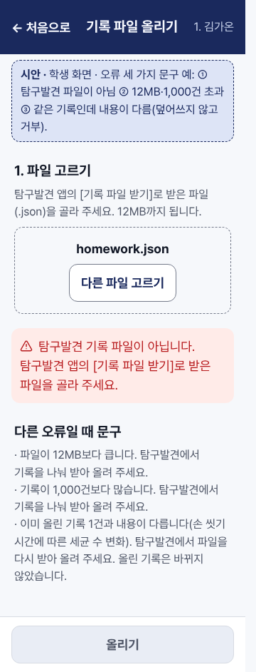 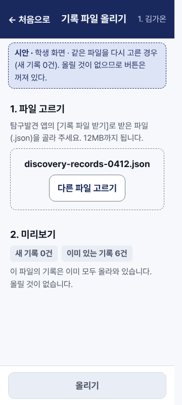

- **1. 파일 고르기:** 안내 "탐구발견 앱의 [기록 파일 받기]로 받은 파일(.json)을 골라 주세요. 12MB까지 됩니다." + [파일 고르기](고른 뒤에는 파일 이름 + [다른 파일 고르기]).
- **2. 미리보기**(아직 저장하지 않음): 꼬리표 **"새 기록 n건"**(초록) · **"이미 있는 기록 n건"**(회색), "이미 있는 기록은 다시 저장하지 않습니다. 내가 적은 진행 상태·메모는 그대로입니다.", 새 기록의 제목 목록.
- **이름이 다를 때**(결정 93): 주의 상자(`.notice.warn`) "파일 속 이름(○○○)이 내 이름(○○○)과 다릅니다. 내 기록이 맞나요?" + 체크 칸 **"내 기록이 맞습니다"** + "맞다고 표시하면 담당 선생님 화면에 "이름 다름"이 함께 나옵니다." 체크해야 [올리기]가 켜진다. 이름이 같으면 이 상자가 없다. 어느 쪽이든 기록은 로그인한 내 계정에 저장된다.
- **아래 바:** [n건 올리기]. 미리보기 전, 새 기록 0건, 이름 확인 전에는 꺼져 있다. 올린 뒤 알림 "4건을 올렸습니다." → 목록으로.
- **오류 문구**(`s-inquiry-error`):
  - "탐구발견 기록 파일이 아닙니다. 탐구발견 앱의 [기록 파일 받기]로 받은 파일을 골라 주세요."
  - "파일이 12MB보다 큽니다. 탐구발견에서 기록을 나눠 받아 올려 주세요."
  - "기록이 1,000건보다 많습니다. 탐구발견에서 기록을 나눠 받아 올려 주세요."
  - "이미 올린 기록 n건과 내용이 다릅니다(제목). 탐구발견에서 파일을 다시 받아 올려 주세요. 올린 기록은 바뀌지 않았습니다."
- **같은 파일을 다시 고르면**(`s-inquiry-done`): "새 기록 0건 · 이미 있는 기록 6건", "이 파일의 기록은 이미 모두 올라와 있습니다. 올릴 것이 없습니다."

### `s-home` 학생 홈에 더해지는 칸

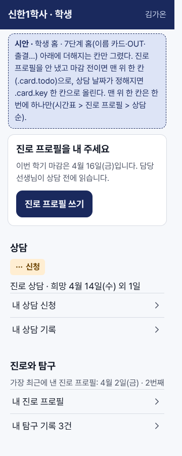

- 진로 프로필을 안 냈으면 맨 위 한 칸(`.card.todo`) "진로 프로필을 내 주세요". 상담 날짜가 정해졌으면 `.card.key` "4월 14일(수)에 상담합니다". **맨 위 한 칸은 한 번에 하나**(시간표 > 진로 프로필 > 상담 순).
- 카드 "상담": 열린 신청 한 줄 + [내 상담 신청] [내 상담 기록]. 카드 "진로와 탐구": 최근 제출 한 줄 + [내 진로 프로필] [내 탐구 기록 n건].

## 5. 학부모 — 진로와 상담 (결정 89~92)

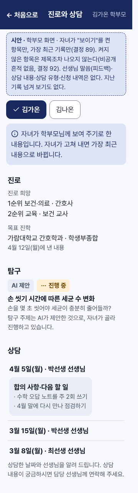 

- 자녀가 둘 이상이면 위에 자녀 칩.
- **위 안내:** "자녀가 학부모님께 보여 주기로 한 내용입니다. 자녀가 고쳐 내면 가장 최근 내용으로 바뀝니다."
- **진로:** 자녀가 켠 항목만, 가장 최근 기록만. **켜지 않은 항목은 제목조차 나오지 않는다.** 아래 "4월 12일(월)에 낸 내용". 지난 기록 넘기기 없음. 선생님 말씀(피드백) 없음.
- **탐구:** 자녀가 켠 기록만. "AI 제안" 꼬리표 + 진행 상태, 제목, 중심 질문, "탐구 주제는 AI가 제안한 것으로, 자녀가 골라 진행하고 있습니다." 메모·링크는 자녀가 그 기록을 켰을 때 함께 나온다.
- **상담:** 한 줄에 "날짜 · ○○ 선생님". 자녀가 켠 합의 사항만 아래 상자로. 켜지 않은 상담은 날짜·선생님 줄뿐이고 **"비공개" 같은 표시가 없다.** 아래 "상담한 날짜와 선생님을 알려 드립니다. 상담 내용이 궁금하시면 담당 선생님께 연락해 주세요."
- **빈 상태**(`p-empty`, 결정 92): 진로와 탐구 "지금은 보여 드릴 진로·탐구 기록이 없습니다." + "자녀가 학부모님께 보여 주기로 한 기록이 생기면 여기에 나옵니다." / 상담 "이번 학기에 상담한 기록이 없습니다."
  - 자녀가 아직 안 냈을 때, 냈지만 켜지 않았을 때, 켰다가 껐을 때 **모두 같은 문구.** "비공개", "숨김", "공개 0건", "공개가 꺼졌습니다" 같은 말을 쓰지 않는다.
  - 진로만 있고 탐구가 없으면 탐구 카드를 그리지 않는다(빈 카드로 "없음"을 따로 알리지 않는다).

## 6. 교사

### `t-home` 홈의 할 일

- "오늘 처리할 것"(`UI.todoList`)에 두 줄: **상담 신청 n건**(도움말 "가장 빠른 희망 날짜 …"), **진로 프로필 미제출 n명**(도움말 "마감 …  지남"). 0이면 줄이 없다.
- 미제출은 마감일에 입실이었던 학생만 세고, 입실 뒤 14일은 세지 않으며, 퇴실한 학생은 뺀다(결정 98).
- 담임 홈에는 이 두 줄을 넣지 않는다(처리하는 사람이 아니다). 참고 카드에 바로가기만.
- 관리자 홈에는 "탐구 원본 정리 대상 n명"(8절).

### `t-career` 담당 학생 진로 프로필 (결정 91·98)

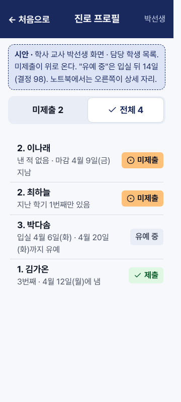  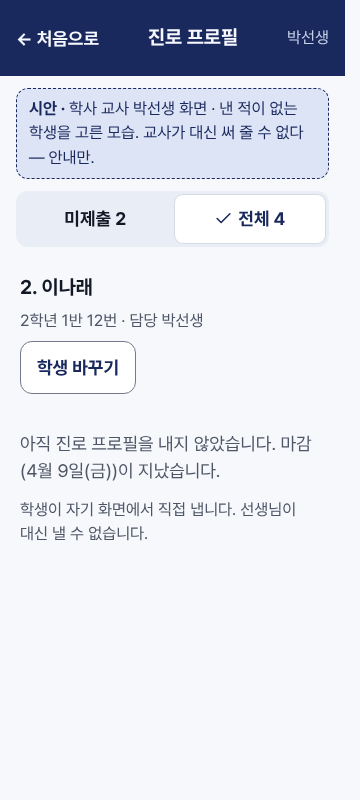

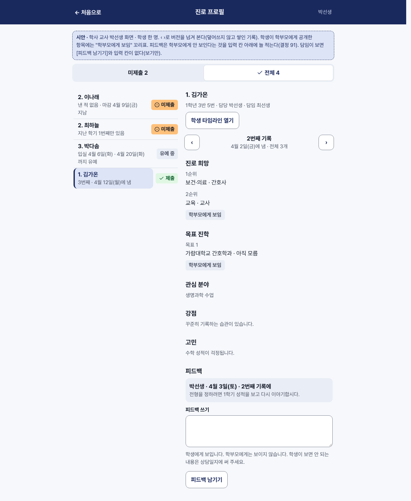

- **위:** 보기 고르기 [미제출 n] [전체 n].
- **목록**(`.ld-list`): "학년. 이름" + 한 줄(몇 번째·낸 날 / "낸 적 없음 · 마감 … 지남" / "입실 … · …까지 유예") + 꼬리표(미제출 = 살구 `todo`, 유예 중 = 회색, 제출 = 초록). 미제출이 위.
- **상세:** 학생 머리 카드([학생 타임라인 열기]), **기록 넘기기**(‹ 2번째 기록 · 4월 2일(금)에 냄 · 전체 3개 ›), 항목 카드 5장. 학생이 학부모에게 켠 항목에는 회색 꼬리표 **"학부모에게 보임"**.
- **피드백 카드:** 지난 피드백(쓴 사람·날짜·몇 번째 기록에) + 글 칸 "피드백 쓰기" + [피드백 남기기]. 글 칸 아래 늘: **"학생에게 보입니다. 학부모에게는 보이지 않습니다. 학생이 보면 안 되는 내용은 상담일지에 써 주세요."** 알림 "피드백을 남겼습니다." 잘못 썼으면 [취소 처리](사유) — 지우지 않는다.
- **담임·관리자:** 같은 화면, 글 칸과 [피드백 남기기]가 없다(쓰는 사람은 담당교사).
- **미제출 학생:** "아직 진로 프로필을 내지 않았습니다. 마감(…)이 지났습니다." + "학생이 자기 화면에서 직접 냅니다. 선생님이 대신 낼 수 없습니다."
- 빈 상태(담당 학생 없음): "이번 운영 기간에 담당하는 학생이 없습니다."
- 휴대폰: 목록 → 학생을 누르면 상세([학생 바꾸기]로 돌아감). 노트북(840px 이상): 목록 | 상세.

### `t-req` 상담 신청 처리 (결정 95·96)

 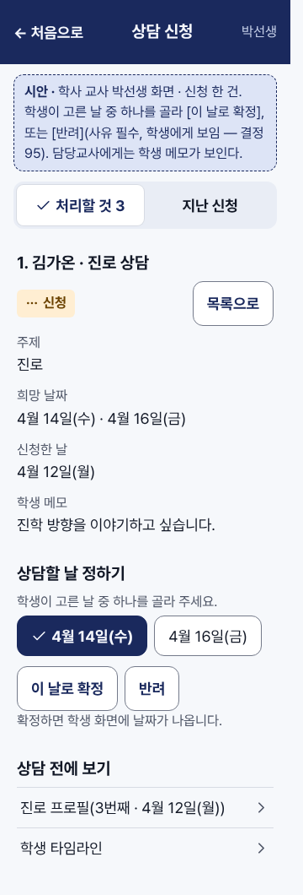 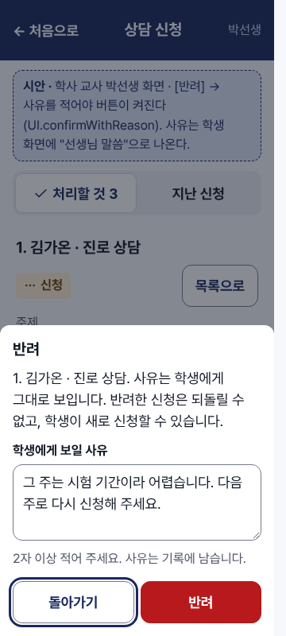

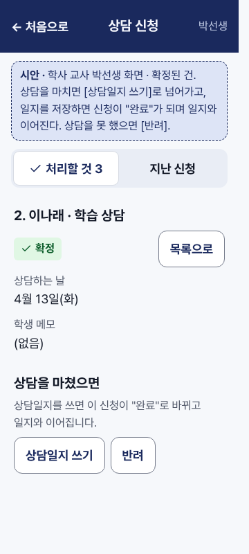 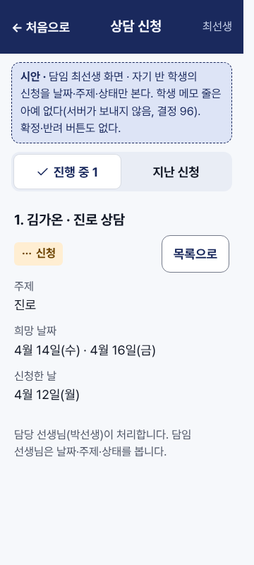

- **위:** [처리할 것 n] [지난 신청]. 목록 한 줄 "학년. 이름 · 주제" + "희망 … 외 n일" 또는 "…에 상담" + 꼬리표.
- **신청 한 건(담당교사):** 주제, 희망 날짜, 신청한 날, **학생 메모**. "상담할 날 정하기": 학생이 고른 날이 칩으로(하나 고름) → [이 날로 확정] / [반려]. "확정하면 학생 화면에 날짜가 나옵니다." 아래 "상담 전에 보기": 진로 프로필·학생 타임라인 바로가기.
- **반려**(`t-req-reject`, `UI.confirmWithReason`): "사유는 학생에게 그대로 보입니다. 반려한 신청은 되돌릴 수 없고, 학생이 새로 신청할 수 있습니다." 칸 이름 "학생에게 보일 사유", 2자 이상이어야 [반려]가 켜진다.
- **확정된 건**(`t-req-fixed`): 상담하는 날, 메모. "상담을 마쳤으면": [상담일지 쓰기] → `t-note`. 일지를 저장하면 신청이 "완료"가 되고 일지와 이어진다. 못 했으면 [반려].
- **담임이 볼 때**(`t-req-homeroom`, 결정 96): 주제·희망 날짜·신청한 날·상태만. **학생 메모 줄이 아예 없다**(서버가 보내지 않는다. "메모는 볼 수 없습니다" 같은 줄도 넣지 않는다). 확정·반려 버튼 없음. 아래 "담당 선생님(○○○)이 처리합니다. 담임 선생님은 날짜·주제·상태를 봅니다."
- 알림: "4월 14일(수)로 확정했습니다.", "반려했습니다." 그사이 학생이 취소했으면 "학생이 이 신청을 취소했습니다. 목록을 새로 불러옵니다."
- 빈 상태: "처리할 상담 신청이 없습니다."

### `t-note` 상담일지 쓰기에 더해지는 칸

2단계 상담일지 화면에 네 가지가 더해진다.
1. **이어진 신청 안내**(신청에서 넘어왔을 때만): "1. 김가온의 진로 상담 신청(4월 14일(수) 확정)에서 넘어왔습니다. 저장하면 신청이 "완료"로 바뀝니다."
2. **유형**에 진로·진학.
3. **참고한 진로 프로필**(유형이 진로·진학일 때만): 프로필 버전 고르기(기본 = 가장 최근, "참고하지 않음"도 있음) + 그 버전의 진로 희망·목표 진학·탐구 기록 요약 + [학생 타임라인 열기]. 프로필이 없으면 "이 학생은 아직 진로 프로필을 내지 않았습니다."
4. **합의 사항·다음 할 일** 칸: 도움말 "학생에게 보입니다. 학생이 "부모님께 보이기"를 켜면 학부모도 봅니다." 내용 칸의 도움말은 "교사만 봅니다. 학생·학부모에게 보이지 않습니다."

### `t-timeline` 학생 타임라인

- **머리 카드:** 학생, 반·번호·담당·담임·운영 기간, 요약 꼬리표(OUT, 진로 프로필 몇 번째, 탐구 n건).
- **보기 칩:** 전체·진로·탐구·상담·OUT·출결.
- **줄:** 왼쪽 날짜, 오른쪽 종류 꼬리표 + 제목(굵게) + 한두 줄. 최근 것부터.

| 종류 | 제목 | 아래 줄 |
| --- | --- | --- |
| 진로 프로필 | "n번째 기록을 냄" | 바뀐 칸 한 줄(예: 전형이 "아직 모름" → "학생부종합") |
| 상담 신청 | "주제 상담 신청" | 희망 날짜(담임에게는 메모 없음) |
| 상담 | "○○○ · 유형 상담" | "합의: …"(내용은 싣지 않는다. 담당교사는 줄을 눌러 상담일지로) |
| 탐구 | 주제 제목 또는 "기록 파일 올림 · 새 기록 n건" | 진행 상태·피드백 수. 파일 이름이 달랐으면 꼬리표 **"이름 다름"**(결정 93) |
| OUT | "1OUT · 항목" | 없음 |
| 출결 | "n월 출결 요약" | 출석·지각·조퇴·결석·학원·가정 수 |

- 빈 상태: "아직 기록이 없습니다."
- 못 보는 사람(담당 아님·출결 담당·근무표 담당자): 화면 자체가 열리지 않는다(권한 없음 화면).

## 7. 새 부품 제안 (구현은 코딩 세션)

시안에서는 화면 파일 안에 작은 스타일로 그렸다. 여러 화면이 같이 쓰므로 `UI.*`로 올리기를 제안한다.

| 제안 | 무엇 | 쓰는 곳 |
| --- | --- | --- |
| `UI.shareCheck({label, on, onchange})` | "부모님께 보이기" 체크 칸 + 상태 꼬리표("지금 보이는 중"/"나만 보는 중") 한 줄. 끌 때 확인 시트(결정 92 문구)를 안에서 띄운다 | 진로 프로필, 상담 기록, 탐구 기록 |
| `UI.versionNav({index, total, label, onchange})` | ‹ n번째 기록 · 낸 날 › | 학생·교사 진로 프로필 |
| `UI.timeline(items)` | 날짜 칸 + 꼬리표·제목·한두 줄 목록 | 학생 타임라인 |
| `.fb`(말씀 상자) | 옅은 회색 상자. 선생님 말씀·합의 사항·반려 사유 | 학생·학부모·교사 화면 |

색은 모두 지금 토큰만 쓴다. 살구색은 "미제출" 꼬리표, 홈의 처리할 건수, "진로 프로필을 내 주세요" 한 칸에만.

## 8. 관리자 — 탐구 원본 정리 (결정 100)

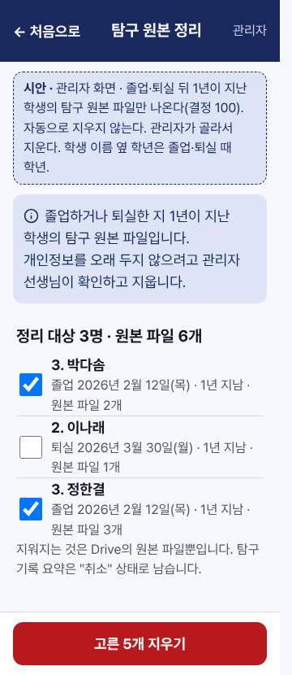 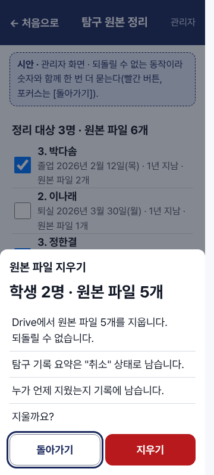 

- **위 안내:** "졸업하거나 퇴실한 지 1년이 지난 학생의 탐구 원본 파일입니다. 개인정보를 오래 두지 않으려고 관리자 선생님이 확인하고 지웁니다."
- **목록:** 학생마다 체크 칸 + "졸업/퇴실 날짜 · 1년 지남 · 원본 파일 n개". 카드 제목 "정리 대상 n명 · 원본 파일 n개". 아래 "지워지는 것은 Drive의 원본 파일뿐입니다. 탐구 기록 요약은 "취소" 상태로 남습니다."
- **아래 바:** 빨간 [고른 n개 지우기]. 고른 것이 없으면 꺼짐.
- **확인 시트:** 제목 "원본 파일 지우기", 맨 위 "학생 n명 · 원본 파일 n개", 줄 "Drive에서 원본 파일 n개를 지웁니다. 되돌릴 수 없습니다.", "탐구 기록 요약은 "취소" 상태로 남습니다.", "누가 언제 지웠는지 기록에 남습니다.", "지울까요?" / [돌아가기] [지우기]. 포커스는 [돌아가기].
- 알림 "원본 파일 5개를 지웠습니다." 일부만 지워졌으면 "5개 중 4개를 지웠습니다. 남은 1개는 다시 눌러 주세요."
- **빈 상태:** "지금 정리할 탐구 원본 파일이 없습니다." + "졸업·퇴실 뒤 1년이 지난 학생이 생기면 여기에 나옵니다."
- 자동으로 지우지 않는다. 관리자만 본다.

## 9. 정해 주실 것·알릴 것

1. **상태 이름 "신청".** `writing.md` 7절은 교사가 아직 안 본 상태를 "요청"으로 쓰기로 했는데, 상담은 규칙 초안대로 "신청"(신청·확정·완료·반려·취소)으로 그렸다. 메뉴 이름이 "상담 신청"이라 "신청"이 자연스럽다고 봤다. 특이사항의 "요청"과 맞출지 정해 주세요.
2. **"부모님"과 "학부모님".** 학생 화면은 "부모님께 보이기", 학부모 화면 문장은 `writing.md`대로 "학부모님"으로 썼다.
3. **교사 화면의 "학부모에게 보임" 꼬리표.** 학생이 무엇을 공개했는지 담당교사·담임이 보는 것으로 그렸다(공개 판정표에 따로 금지가 없다). 보이지 않아야 하면 꼬리표만 빼면 된다.
4. **확정 뒤 상담을 못 한 경우**를 [반려] 하나로 처리했다(규칙 초안의 상태 전이 "확정 → 반려"). 문구가 어색하면 버튼 이름을 "상담 안 함"처럼 따로 둘 수 있다.
5. **타임라인의 "바뀐 칸 한 줄"**(전형이 … → …)은 규칙 함수 `s6Timeline_` 초안에 없다. 어렵다면 "n번째 기록을 냄"만 둔다.
6. **출결 결과의 "미인정" 꼬리표**를 살구색에서 주의색(1OUT과 같은 계열)으로 바꿨다(`src/ui/screen_results.html` 한 줄, 총괄 판단). 이 PR에서 `src/`가 바뀐 곳은 이것뿐이다.
7. 미리보기 도구(`design/preview/stage2.js`)가 글꼴 링크를 바깥으로 내보내지 않고 받아 둔 파일로 답하게 했다. 예전 시안 스크립트도 같은 길로 돈다.
