# 6단계(상담·진로진학, F15~F17) 화면 시안과 설명서 (D24)

> **시안입니다.** 실제 화면 코드는 바꾸지 않았습니다(`src/` 변경은 출결 결과 꼬리표 한 줄뿐, 맨 아래 9절). 사진은 미리보기 도구로 그린 정적 화면이고 이름·날짜·글은 모두 가짜입니다(학생 "1. 김가온", 담당 박선생, 담임 최선생, 가짜 오늘 2027년 4월 12일(월)).
> 근거: 결정 88(감색 면 + 살구 신호), 결정 89~101, `docs/plan/stage6.md`, `docs/plan/stage6-rules-draft.md` 2절 공개 판정표, PRD 5절 F15~F17, `docs/design/writing.md`.
> 이수 계획과 '교육과정 올리기'는 결정 102 뒤에 더했습니다(10·11절, D25). 결정 103의 답은 본문에 반영했습니다(9절).
> 다시 찍기: `[PRETENDARD_DIR=…] node design/preview/stage6b.js [화면 id…]` → `design/preview/out/stage6b/`. 화면 코드: `design/preview/stage6b-screens.js`.
> 사진은 화면마다 `photos/<id>-360.png`(휴대폰)과 `photos/<id>-1280.png`(노트북) 두 장이 있습니다. 아래에는 필요한 것만 붙였습니다.

## 0. 화면 목록

| id | 화면 | 누가 | 만드는 작업 |
| --- | --- | --- | --- |
| `s-home` | 학생 홈에 더해지는 칸 | 학생 | C49·C50·C52 |
| `s-career-form` `-error` `-confirm` | 진로 프로필 내기 | 학생 | C50 |
| `s-career-view` `-off` `-empty` | 내 진로 프로필(보기·공개 끄기·안 냄) | 학생 | C50 |
| `s-counsel-form` `-error` | 상담 신청 입력 | 학생 | C49 |
| `s-counsel-list` `-fixed` `-empty` `-cancel` | 내 상담 신청 | 학생 | C49 |
| `s-notes` `-empty` | 내 상담 기록 | 학생 | C49 |
| `s-inquiry-list` `-empty` | 내 탐구 기록 | 학생 | C52 |
| `s-inquiry-pick` `-preview` `-error` `-done` | 기록 파일 올리기 | 학생 | C52 |
| `p-career` `p-empty` | 진로와 상담 | 학부모 | C49·C50·C52 |
| `t-home` | 홈의 할 일 | 담당교사 | C49·C50 |
| `t-career-list` `t-career` `t-career-missing` | 담당 학생 진로 프로필 | 담당교사·담임·관리자 | C50 |
| `t-req-list` `t-req` `-reject` `-fixed` `-homeroom` | 상담 신청 처리 | 담당교사(담임은 보기만) | C49 |
| `t-note` `-confirm` | 상담일지 쓰기(더해지는 칸, 저장 확인) | 담당교사 | C49 |
| `t-timeline` `-former` `-homeroom` `-empty` `-pick` `-hr-home` | 학생 타임라인(지금 담당·전 담당·담임·빈 상태·들어가는 길) | 담당교사·전 담당·담임·관리자 | C53 |
| `a-cleanup` `-confirm` `-empty` | 탐구 원본 정리 | 관리자 | C52 |
| `s-plan` `s-plan-edit` `-error` `-empty` | 이수 계획 | 학생 | C51 |
| `p-plan` | 이수 계획(공개된 과목) | 학부모 | C51 |
| `t-plan-list` `t-plan` `-confirm` | 담당 학생 이수 계획 | 담당교사·담임·관리자 | C51 |
| `a-curr-pick` `-preview` `-replace` `-error` `-confirm` `-recs` | 교육과정 올리기 | 관리자 | C51 |

모든 화면에 공통: 머리줄 왼쪽 [← 처음으로], 불러오는 중 "불러오는 중입니다…", 불러오기 실패 "불러오지 못했습니다. 화면을 다시 열어 주세요.", 저장 실패 "저장하지 못했습니다. 잠시 뒤 다시 눌러 보고, 또 안 되면 담당 선생님께 알려 주세요."(교사 화면은 "관리자 선생님께"). 학생·학부모 화면은 `body.tone-soft`.

## 1. 학생 — 진로 프로필 (F15, 결정 89·91·92)

**누가:** 학생. **일:** 진로 프로필을 써서 낸다, 무엇을 부모님께 보일지 고른다. **가장 눈에 띌 것:** 아래 바의 [제출하기].

  

### `s-career-form` 진로 프로필 내기
- **위 안내**(`.notice.info`): "지난번에 낸 내용을 불러왔습니다. 바뀐 곳만 고쳐서 내면 새 기록으로 쌓이고, 지난 기록은 그대로 남습니다." 처음 내는 학생에게는 이 상자가 없다.
- **마감 한 줄:** "이번 학기 제출 마감: 4월 16일(금)" + "마감 뒤에도 생각이 바뀌면 언제든 다시 낼 수 있습니다." 마감일이 없으면 이 카드를 그리지 않는다.
- **카드 5장**, 항목 하나에 카드 하나. 카드 맨 아래에 그 항목의 **"부모님께 보이기"** 줄.

| 카드 | 칸 | 꼭? |
| --- | --- | --- |
| 진로 희망 | 1·2·3순위마다 분야, 직업(글 칸 2개) | 1순위 분야만 꼭 |
| 목표 진학 | 목표마다 대학, 학과, 전형(고르기: 학생부교과·학생부종합·논술·정시·아직 모름). [+ 목표 추가] | 없어도 됨. 적었으면 대학·학과 꼭 |
| 관심 분야 | 여러 줄 글 "요즘 관심 있는 것" | 선택 |
| 강점 | 여러 줄 글 "내가 잘하는 것" | 선택 |
| 고민 | 여러 줄 글 "걱정되거나 도움이 필요한 것". 도움말 "담당 선생님이 상담 전에 읽습니다." | 선택 |

- **지금 상태 한 줄**(마감 카드 아래, 고쳐 낼 때만): "지금 부모님께 보이는 항목: 진로 희망, 목표 진학"(없으면 "지금 부모님께 보이는 항목이 없습니다.") + "아래에서 "부모님께 보이기"를 바꿔도 [제출하기]를 눌러야 바뀝니다."
- **"부모님께 보이기" 줄(입력 화면):** 체크 칸(`.check`) + 꼬리표. 켜면 주의색 **"제출하면 보임"**, 끄면 회색 **"제출해도 나만 봄"**. 아직 내지 않았으므로 **"지금 보이는 중"이라고 하지 않는다**(D26 — 체크만 바꾸고 나가면 학부모 화면은 그대로이기 때문). **기본은 꺼짐.** 새로 낼 때는 지난 기록의 켜짐·꺼짐을 그대로 이어받아 보여 준다(결정 89). 입력 화면에서 끌 때는 확인 시트가 없다(제출 확인 시트가 항목을 다시 보여 준다).
- **맨 아래 한 줄:** "부모님께는 가장 최근에 낸 기록에서 "보이기"를 켠 항목만 보입니다. 선생님 말씀(피드백)은 부모님께 보이지 않습니다."
- **아래 바:** [제출하기].
- **오류**(`s-career-error`): 맨 위 "고칠 곳이 n군데 있습니다. 빨간 칸을 확인해 주세요." + 칸 아래 "1순위 분야를 적어 주세요.", "학과를 적어 주세요. 아직 못 정했으면 이 목표를 지워 주세요.", 순위가 겹치면 "같은 내용을 두 순위에 적었습니다. 하나를 고쳐 주세요.", 글이 길면 "글이 너무 깁니다. n자 안으로 줄여 주세요."
- **확인 시트**(`s-career-confirm`): 제목 "제출하기", 맨 위 "3번째 기록으로 쌓입니다", 줄 "부모님께 보이는 항목: …", "나만 보는 항목: …", "담당 선생님과 담임 선생님은 모든 항목을 봅니다.", "이대로 제출할까요?" / [돌아가기] [제출하기]. 낸 뒤 알림 "제출했습니다."

### `s-career-view` 내 진로 프로필

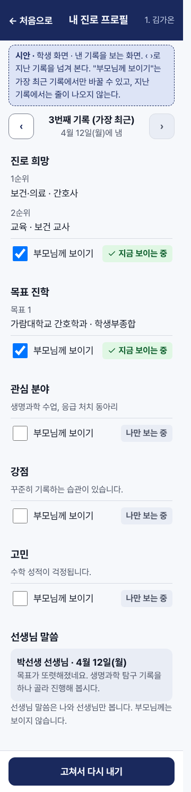 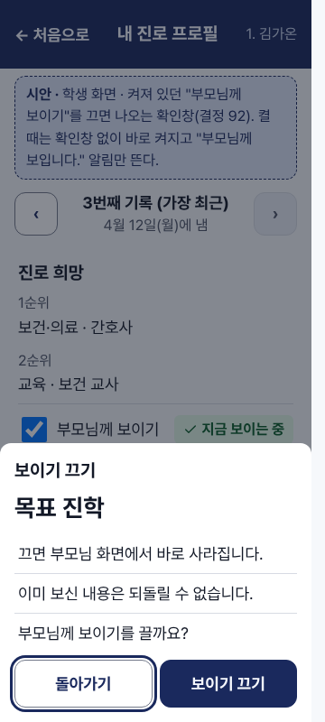 

- **기록 넘기기**(‹ 3번째 기록 (가장 최근) · 4월 12일(월)에 냄 ›): 지난 기록을 넘겨 본다. 첫 기록에서는 ‹, 가장 최근에서는 ›가 꺼진다.
- **항목 카드 5장**(읽기) + "부모님께 보이기" 줄. 이 줄은 **가장 최근 기록에서만** 나온다(지난 기록은 부모님께 보이지 않으므로 고를 것이 없다).
- **켤 때:** 확인창 없이 바로 켜지고 알림 "부모님께 보입니다."
- **끌 때**(`s-career-off`, 결정 92): 확인 시트. 제목 "보이기 끄기", 맨 위 항목 이름, 줄 "끄면 부모님 화면에서 바로 사라집니다.", **"이미 보신 내용은 되돌릴 수 없습니다."**, "부모님께 보이기를 끌까요?" / [돌아가기] [보이기 끄기]. 끈 뒤 알림 "부모님께 보이지 않습니다."
- **선생님 말씀 카드:** 피드백을 최근 것부터. "○○ 선생님 · 날짜" + 글. 아래 한 줄 "선생님 말씀은 나와 선생님만 봅니다. 부모님께는 보이지 않습니다."(결정 91). 없으면 카드를 그리지 않는다.
- **아래 바:** [고쳐서 다시 내기] → `s-career-form`.
- **빈 상태**(`s-career-empty`): 살구 한 칸(`.card.todo`) "진로 프로필을 내 주세요" + 설명 + [진로 프로필 쓰기]. 마감이 지났으면 설명이 "마감(4월 16일(금))이 지났습니다. 지금 내도 됩니다."
- 학사생이 아니게 된 뒤(결정 97): 보기만. 아래 바와 "부모님께 보이기" 체크 칸을 그리지 않고 맨 위에 "학사를 나간 뒤에는 고칠 수 없습니다. 기록은 계속 볼 수 있습니다."

## 2. 학생 — 상담 신청 (F17, 결정 95·96)

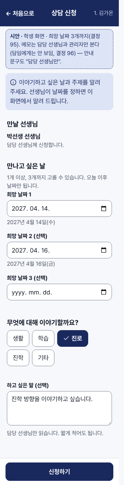 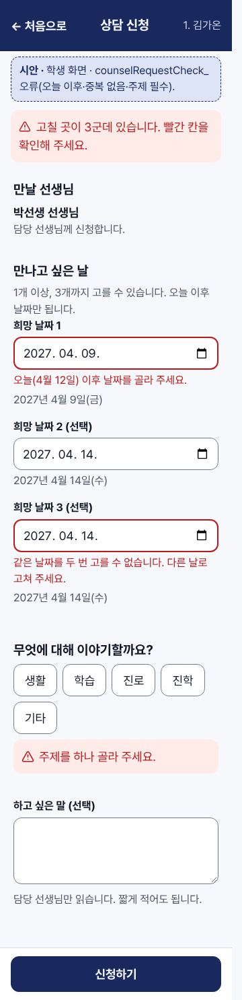 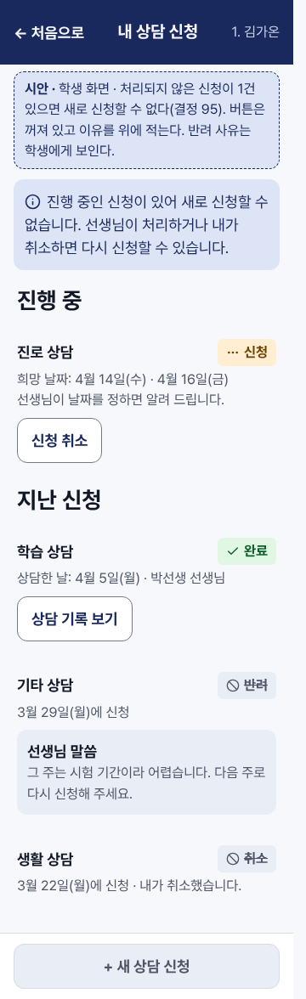

### `s-counsel-form` 상담 신청 입력
- **위 안내:** "이야기하고 싶은 날과 주제를 알려 주세요. 선생님이 날짜를 정하면 이 화면에서 알려 드립니다."
- **만날 선생님**(읽기만): 담당 선생님 이름 + "담당 선생님께 신청합니다."
- **만나고 싶은 날:** 날짜 칸 3개(희망 날짜 1 / 2 (선택) / 3 (선택)), 오늘 이후만. 안내 "1개 이상, 3개까지 고를 수 있습니다. 오늘 이후 날짜만 됩니다."
- **무엇에 대해 이야기할까요?** 칩 5개 중 하나: 생활·학습·진로·진학·기타.
- **하고 싶은 말 (선택):** 여러 줄 글. 도움말 **"담당 선생님만 읽습니다."**(담임에게는 메모가 가지 않는다, 결정 96).
- **아래 바:** [신청하기] → 확인 시트(제목 "신청하기", 맨 위 "진로 상담 · 박선생 선생님", 희망 날짜·메모 줄) → 알림 "신청했습니다."
- **오류:** "오늘(4월 12일) 이후 날짜를 골라 주세요.", "같은 날짜를 두 번 고를 수 없습니다. 다른 날로 고쳐 주세요.", "희망 날짜를 하나 이상 골라 주세요.", "주제를 하나 골라 주세요."
- 열린 신청이 있는데 이 화면에 들어오면(주소로 직접): 칸 대신 "진행 중인 신청이 있어 새로 신청할 수 없습니다." + [내 상담 신청 보기].

### `s-counsel-list` 내 상담 신청

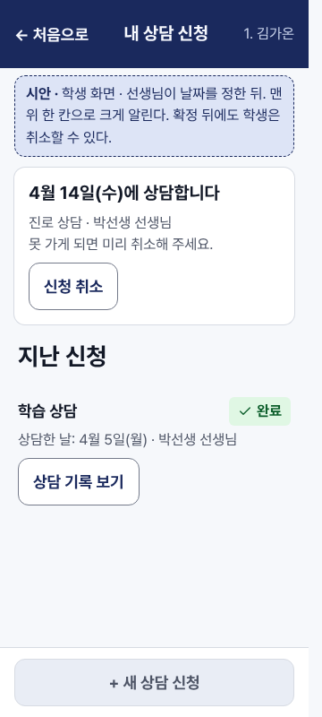 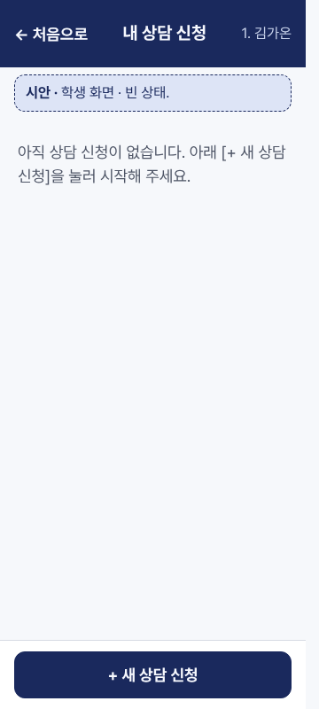 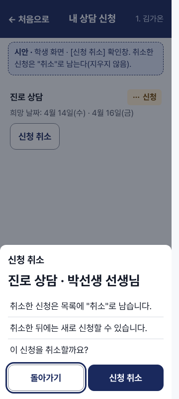

- **구역 "진행 중":** 신청·확정 상태(많아야 1건, 결정 95). 카드에 "주제 상담" + 상태 꼬리표, 신청이면 희망 날짜와 "선생님이 날짜를 정하면 알려 드립니다.", [신청 취소].
- **날짜가 정해지면**(`s-counsel-fixed`): 맨 위 한 칸(`.card.key`) "4월 14일(수)에 상담합니다" + "진로 상담 · 박선생 선생님" + "못 가게 되면 미리 취소해 주세요." + [신청 취소].
- **구역 "지난 신청":** 완료(상담한 날·선생님, [상담 기록 보기]), 반려(**선생님 말씀** 상자에 반려 사유 — 학생에게 보인다), 취소("내가 취소했습니다.").
- **아래 바:** [+ 새 상담 신청]. 열린 신청이 있으면 **꺼져 있고**, 맨 위 안내가 이유를 말한다: "진행 중인 신청이 있어 새로 신청할 수 없습니다. 선생님이 처리하거나 내가 취소하면 다시 신청할 수 있습니다."
- **취소 확인**(`s-counsel-cancel`): 제목 "신청 취소", 줄 "취소한 신청은 목록에 "취소"로 남습니다.", "취소한 뒤에는 새로 신청할 수 있습니다.", "이 신청을 취소할까요?" / [돌아가기] [신청 취소].
- **빈 상태:** "아직 상담 신청이 없습니다. 아래 [+ 새 상담 신청]을 눌러 시작해 주세요."
- 상태 꼬리표: 신청 = 주의색(`requested`), 확정·완료 = 초록(`confirmed`), 반려·취소 = 회색 줄 그음(`canceled`).

## 3. 학생 — 내 상담 기록 (결정 90·94)

 

- **위 안내:** "부모님께는 상담한 날짜와 선생님 이름만 보입니다. 합의 사항은 내가 "보이기"를 켠 것만 보입니다."
- **상담 한 건에 카드 하나:** 날짜, 선생님 이름, **합의 사항·다음 할 일** 상자. 상담 유형과 내용은 없다(서버가 보내지 않는다, 결정 94).
- 합의 사항이 있으면 카드 아래 체크 칸 **"이 합의 사항을 부모님께 보이기"**(건마다, 기본 꺼짐, 결정 90) + 상태 꼬리표. 체크하는 순간 바로 저장된다. 끌 때는 1절과 같은 확인 시트(맨 위 줄만 "4월 5일(월) 상담의 합의 사항").
- 합의 사항이 없는 상담: "적힌 합의 사항이 없습니다." 체크 칸 없음.
- **빈 상태:** "아직 상담 기록이 없습니다." + [상담 신청하기].

## 4. 학생 — 탐구 기록 (F16, 결정 93)

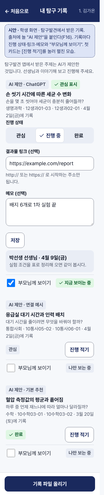 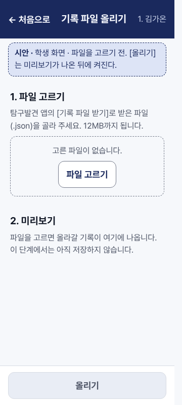 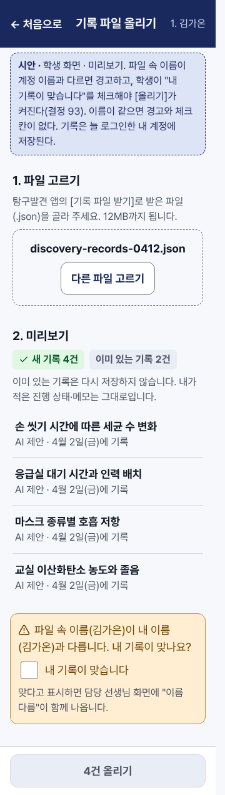

### `s-inquiry-list` 내 탐구 기록
- **위 한 줄:** "탐구발견 앱에서 받은 주제는 AI가 제안한 것입니다. 선생님과 이야기해 보고 진행해 주세요."
- **기록 한 건에 카드 하나:** 출처 꼬리표 **"AI 제안 · ChatGPT / 연결 예시 / 기본 추천"**(늘 붙인다), 관심 표시가 있으면 "관심 표시", 주제 제목(굵게), 중심 질문, "과목 · 성취기준 코드 2개 · 기록한 날".
- **진행:** 접힌 모습은 상태 꼬리표(관심 = 회색, 진행 중 = 주의색, 완료 = 초록) + [진행 적기]. 누르면 그 카드 안에서 펼쳐진다: 진행 상태(3개 중 하나: 관심·진행 중·완료), 결과물 링크 (선택)(도움말 "http:// 또는 https:// 로 시작하는 주소만 됩니다."), 메모 (선택), [저장]. 알림 "저장했습니다."
- **선생님 말씀:** 그 기록에 달린 피드백(있을 때만).
- **"부모님께 보이기"** 줄: 기록마다, 기본 꺼짐. 끌 때는 1절과 같은 확인 시트. **체크하는 순간 바로 저장된다**(꼬리표 "지금 보이는 중"이 사실이다). 펼친 진행 칸의 [저장]과는 따로 움직이므로, 진행 칸을 저장하지 않아도 보이기는 이미 바뀌어 있다.
- **아래 바:** [기록 파일 올리기].
- **빈 상태:** "아직 올린 탐구 기록이 없습니다. 탐구발견 앱에서 [기록 파일 받기]로 받은 파일을 올려 주세요."
- 오류: "주소는 http:// 또는 https:// 로 시작해야 합니다.", "메모가 너무 깁니다. n자 안으로 줄여 주세요."

### `s-inquiry-pick` → `-preview` 기록 파일 올리기

 

- **1. 파일 고르기:** 안내 "탐구발견 앱의 [기록 파일 받기]로 받은 파일(.json)을 골라 주세요. 12MB까지 됩니다." + [파일 고르기](고른 뒤에는 파일 이름 + [다른 파일 고르기]).
- **2. 미리보기**(아직 저장하지 않음): 꼬리표 **"새 기록 n건"**(초록) · **"이미 있는 기록 n건"**(회색), "이미 있는 기록은 다시 저장하지 않습니다. 내가 적은 진행 상태·메모는 그대로입니다.", 새 기록의 제목 목록.
- **이름이 다를 때**(결정 93): 주의 상자(`.notice.warn`) "파일 속 이름(○○○)이 내 이름(○○○)과 다릅니다. 내 기록이 맞나요?" + 체크 칸 **"내 기록이 맞습니다"** + "맞다고 표시하면 담당 선생님 화면에 "이름 다름"이 함께 나옵니다." 체크해야 [올리기]가 켜진다. 이름이 같으면 이 상자가 없다. 어느 쪽이든 기록은 로그인한 내 계정에 저장된다.
- **아래 바:** [n건 올리기]. 미리보기 전, 새 기록 0건, 이름 확인 전에는 꺼져 있다. 올린 뒤 알림 "4건을 올렸습니다." → 목록으로.
- **오류 문구**(`s-inquiry-error`):
  - "탐구발견 기록 파일이 아닙니다. 탐구발견 앱의 [기록 파일 받기]로 받은 파일을 골라 주세요."
  - "파일이 12MB보다 큽니다. 탐구발견에서 기록을 나눠 받아 올려 주세요."
  - "기록이 1,000건보다 많습니다. 탐구발견에서 기록을 나눠 받아 올려 주세요."
  - "이미 올린 기록 n건과 내용이 다릅니다(제목). 탐구발견에서 파일을 다시 받아 올려 주세요. 올린 기록은 바뀌지 않았습니다."
- **같은 파일을 다시 고르면**(`s-inquiry-done`): "새 기록 0건 · 이미 있는 기록 6건", "이 파일의 기록은 이미 모두 올라와 있습니다. 올릴 것이 없습니다."

### `s-home` 학생 홈에 더해지는 칸

- 진로 프로필을 안 냈으면 맨 위 한 칸(`.card.todo`) "진로 프로필을 내 주세요". 상담 날짜가 정해졌으면 `.card.key` "4월 14일(수)에 상담합니다". **맨 위 한 칸은 한 번에 하나**(시간표 > 진로 프로필 > 상담 순).
- 카드 "상담": 열린 신청 한 줄 + [내 상담 신청] [내 상담 기록]. 카드 "진로와 탐구": 최근 제출 한 줄 + [내 진로 프로필] [내 탐구 기록 n건].

## 5. 학부모 — 진로와 상담 (결정 89~92)

 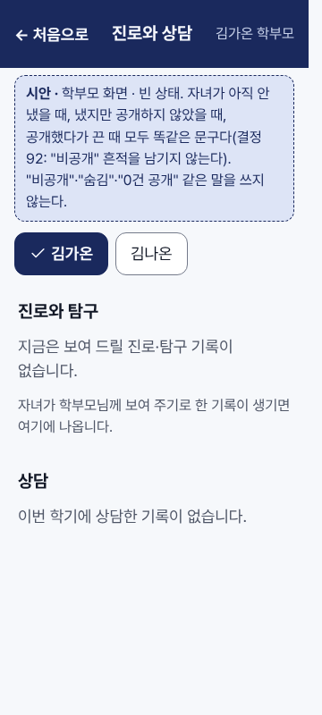

- 자녀가 둘 이상이면 위에 자녀 칩.
- **위 안내:** "자녀가 학부모님께 보여 주기로 한 내용입니다. 자녀가 고쳐 내면 가장 최근 내용으로 바뀝니다."
- **진로:** 자녀가 켠 항목만, 가장 최근 기록만. **켜지 않은 항목은 제목조차 나오지 않는다.** 아래 "4월 12일(월)에 낸 내용". **"n번째 기록" 같은 버전 표시는 학부모 화면 어디에도 없다**(서버가 버전 번호를 보내지 않는다. 낸 날만). 지난 기록 넘기기 없음. 선생님 말씀(피드백) 없음.
- **탐구:** 자녀가 켠 기록만. "AI 제안" 꼬리표 + 진행 상태, 제목, 중심 질문, "탐구 주제는 AI가 제안한 것으로, 자녀가 골라 진행하고 있습니다." 메모·링크는 자녀가 그 기록을 켰을 때 함께 나온다.
- **상담:** 한 줄에 "날짜 · ○○ 선생님". 자녀가 켠 합의 사항만 아래 상자로. 켜지 않은 상담은 날짜·선생님 줄뿐이고 **"비공개" 같은 표시가 없다.** 아래 "상담한 날짜와 선생님을 알려 드립니다. 상담 내용이 궁금하시면 담당 선생님께 연락해 주세요."
- **빈 상태**(`p-empty`, 결정 92): 진로와 탐구 "지금은 보여 드릴 진로·탐구 기록이 없습니다." + "자녀가 학부모님께 보여 주기로 한 기록이 생기면 여기에 나옵니다." / 상담 **"보여 드릴 상담 기록이 없습니다."**(없다고 단정하지 않는다 — 학부모에게 보이지 않게 한 상담이 있어도 같은 문구, D27). 빈 상태에서는 "상담한 날짜와 선생님을 알려 드립니다…" 안내 줄을 그리지 않는다
  - 자녀가 아직 안 냈을 때, 냈지만 켜지 않았을 때, 켰다가 껐을 때 **모두 같은 문구.** "비공개", "숨김", "공개 0건", "공개가 꺼졌습니다" 같은 말을 쓰지 않는다.
  - 진로만 있고 탐구가 없으면 탐구 카드를 그리지 않는다(빈 카드로 "없음"을 따로 알리지 않는다).

## 6. 교사

### `t-home` 홈의 할 일

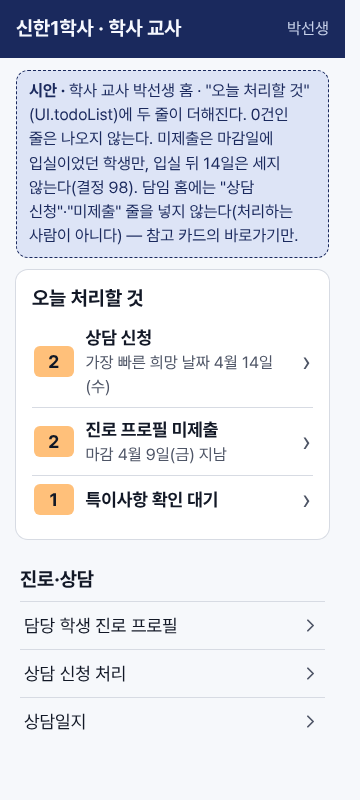

- "오늘 처리할 것"(`UI.todoList`)에 두 줄: **상담 신청 n건**(도움말 "가장 빠른 희망 날짜 …"), **진로 프로필 미제출 n명**(도움말 "마감 …  지남"). 0이면 줄이 없다.
- 미제출은 마감일에 입실이었던 학생만 세고, 입실 뒤 14일은 세지 않으며, 퇴실한 학생은 뺀다(결정 98).
- 담임 홈에는 이 두 줄을 넣지 않는다(처리하는 사람이 아니다). 참고 카드에 바로가기만.
- 관리자 홈에는 "탐구 원본 정리 대상 n명"(8절).

### `t-career` 담당 학생 진로 프로필 (결정 91·98)

 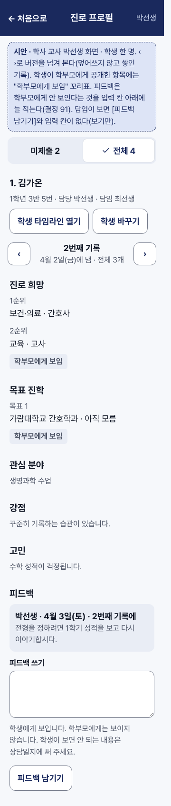 

- **위:** 보기 고르기 [미제출 n] [전체 n].
- **목록**(`.ld-list`): "학년. 이름" + 한 줄(몇 번째·낸 날 / "낸 적 없음 · 마감 … 지남" / "입실 … · …까지 유예") + 꼬리표(미제출 = 살구 `todo`, 유예 중 = 회색, 제출 = 초록). 미제출이 위.
- **상세:** 학생 머리 카드([학생 타임라인 열기]), **기록 넘기기**(‹ 2번째 기록 · 4월 2일(금)에 냄 · 전체 3개 ›), 항목 카드 5장. 학생이 학부모에게 켠 항목에는 회색 꼬리표 **"학부모에게 보임"**.
- **피드백 카드:** 지난 피드백(쓴 사람·날짜·몇 번째 기록에) + 글 칸 **"피드백 쓰기 (학생에게 보임)"**(누구에게 보이는지를 칸 이름에 적는다, D27) + [피드백 남기기]. 글 칸 아래 늘: **"학부모에게는 보이지 않습니다. 학생이 보면 안 되는 내용은 상담일지에 써 주세요."** 알림 "피드백을 남겼습니다." 잘못 썼으면 [취소 처리](사유) — 지우지 않는다.
- **담임·관리자:** 같은 화면, 글 칸과 [피드백 남기기]가 없다(쓰는 사람은 담당교사).
- **미제출 학생:** "아직 진로 프로필을 내지 않았습니다. 마감(…)이 지났습니다." + "학생이 자기 화면에서 직접 냅니다. 선생님이 대신 낼 수 없습니다."
- 빈 상태(담당 학생 없음): "이번 운영 기간에 담당하는 학생이 없습니다."
- 휴대폰: 목록 → 학생을 누르면 상세([학생 바꾸기]로 돌아감). 노트북(840px 이상): 목록 | 상세.

### `t-req` 상담 신청 처리 (결정 95·96)

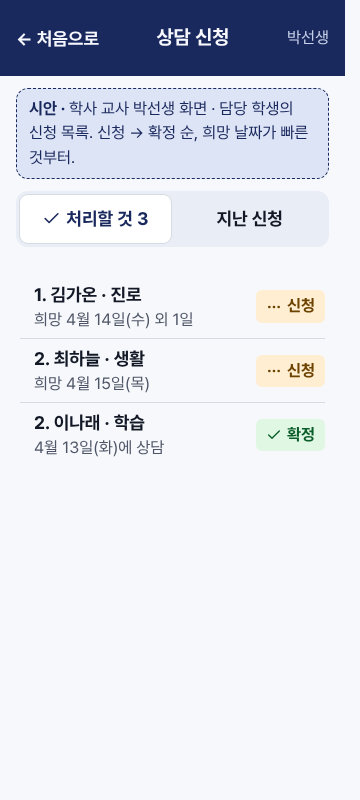  

 

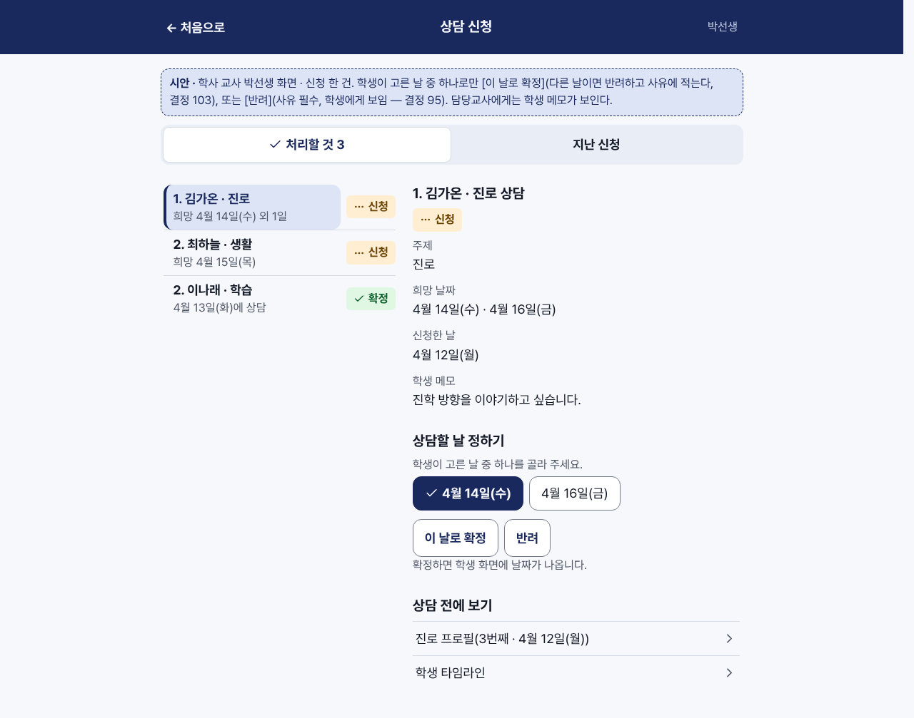

- **위:** [처리할 것 n] [지난 신청]. 목록 한 줄 "학년. 이름 · 주제" + "희망 … 외 n일" 또는 "…에 상담" + 꼬리표.
- **신청 한 건(담당교사):** 주제, 희망 날짜, 신청한 날, **학생 메모**. "상담할 날 정하기": 학생이 고른 날이 칩으로(하나 고름) → [이 날로 확정] / [반려]. 확정은 학생이 고른 날 중 하나로만 한다(다른 날이면 반려하고 사유에 적는다, 결정 103). "확정하면 학생 화면에 날짜가 나옵니다." 아래 "상담 전에 보기": 진로 프로필·학생 타임라인 바로가기.
- **반려**(`t-req-reject`, `UI.confirmWithReason`): "사유는 학생에게 그대로 보입니다. 반려한 신청은 되돌릴 수 없고, 학생이 새로 신청할 수 있습니다." 칸 이름 "학생에게 보일 사유", 2자 이상이어야 [반려]가 켜진다.
- **확정된 건**(`t-req-fixed`): 상담하는 날, 메모. "상담을 마쳤으면": [상담일지 쓰기] → `t-note`. 일지를 저장하면 신청이 "완료"가 되고 일지와 이어진다. 상담을 못 했으면 **[상담 못 함]** → 사유 입력(반려와 같은 시트, 제목만 "상담 못 함"). 상태는 "반려"가 되고 사유가 학생에게 보인다(결정 103).
- **담임이 볼 때**(`t-req-homeroom`, 결정 96): 주제·희망 날짜·신청한 날·상태만. **학생 메모 줄이 아예 없다**(서버가 보내지 않는다. "메모는 볼 수 없습니다" 같은 줄도 넣지 않는다). 확정·반려 버튼 없음. 아래 "담당 선생님(○○○)이 처리합니다. 담임 선생님은 날짜·주제·상태를 봅니다."
- 알림: "4월 14일(수)로 확정했습니다.", "반려했습니다." 그사이 학생이 취소했으면 "학생이 이 신청을 취소했습니다. 목록을 새로 불러옵니다."
- 빈 상태: "처리할 상담 신청이 없습니다."

### `t-note` 상담일지 쓰기에 더해지는 칸

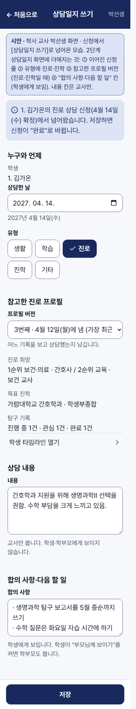 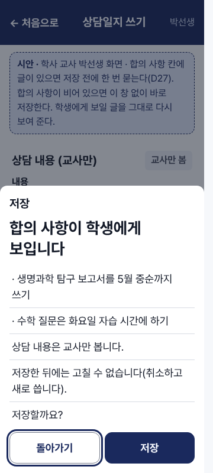

2단계 상담일지 화면에 네 가지가 더해진다.
1. **이어진 신청 안내**(신청에서 넘어왔을 때만): "1. 김가온의 진로 상담 신청(4월 14일(수) 확정)에서 넘어왔습니다. 저장하면 신청이 "완료"로 바뀝니다."
2. **유형:** 학습·생활·진로·진학·건강·가정·기타(결정 103). 신청에서 넘어오면 신청 주제와 같은 이름의 유형을 미리 골라 준다.
3. **참고한 진로 프로필**(유형이 진로·진학일 때만): 프로필 버전 고르기(기본 = 가장 최근, "참고하지 않음"도 있음) + 그 버전의 진로 희망·목표 진학·탐구 기록 요약 + [학생 타임라인 열기]. 프로필이 없으면 "이 학생은 아직 진로 프로필을 내지 않았습니다."
4. **합의 사항·다음 할 일** 칸.

**두 글 칸은 누구에게 보이는지를 제목 줄에 적는다(D27).** 도움말(칸 아래 작은 글씨)에만 두지 않는다.

| 칸 | 카드 제목 | 제목 줄 꼬리표 | 도움말 |
| --- | --- | --- | --- |
| 내용 | "상담 내용 (교사만)" | 회색 "교사만 봄" | "학생·학부모에게 보이지 않습니다. 저장한 뒤에는 고치지 않습니다(취소하고 새로 씁니다)." |
| 합의 사항 | "합의 사항·다음 할 일 (학생에게 보임)" | 주의색 "학생에게 보임" | "저장하면 학생 화면에 바로 나옵니다. 학생이 "부모님께 보이기"를 켜면 학부모도 봅니다. 민감한 내용은 위 상담 내용 칸에 적어 주세요." |

- **저장 확인**(`t-note-confirm`): 합의 사항 칸에 글이 있을 때만 뜬다. 제목 "저장", 맨 위 굵게 "합의 사항이 학생에게 보입니다", 줄: 합의 사항 글 그대로, "상담 내용은 교사만 봅니다.", "저장한 뒤에는 고칠 수 없습니다(취소하고 새로 씁니다).", "저장할까요?" / [돌아가기] [저장]. 합의 사항이 비어 있으면 이 창 없이 바로 저장한다.

### `t-timeline` 학생 타임라인 (결정 104)

한 학생의 기록을 운영 기간별로, 최근 것부터 한 줄씩 보는 화면이다. **보는 사람에 따라 보이는 기간과 할 수 있는 일이 다르다.**

| 보는 사람 | 보이는 기간 | 쓰기 | 화면에 드러내는 것 |
| --- | --- | --- | --- |
| 지금 담당교사 | 이번 기간 + 지난 기간 전부(전 담당 때의 기록, 상담 내용 포함) | 이번 기간 것만(피드백·신청 처리·상담일지) | 지난 기간 구분 줄에 "그때 담당 ○○○" |
| 전 담당교사 | 자기가 담당했던 기간만 | 못 함 | 맨 위 안내 + 머리 꼬리표 **"읽기 전용"** + 아래 "○○ 기간부터의 기록은 지금 담당 선생님이 봅니다." |
| 담임(자기 반, 이번 기간 등록) | 이번 기간만 | 못 함 | 맨 위 안내 + 머리 꼬리표 "보기만". 상담 신청 줄에 학생 메모 없음 |
| 관리자 | 전부 | 못 함(처리는 담당교사) | 지금 담당교사와 같은 모습에서 쓰는 단추만 없다 |
| 그 밖(담당 아님·출결 담당·근무표 담당자) | — | — | 화면이 열리지 않는다(권한 없음 화면) |

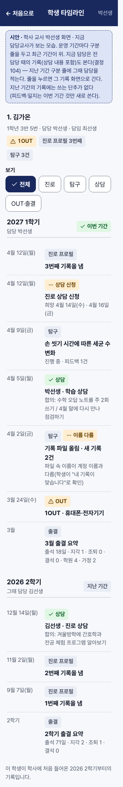 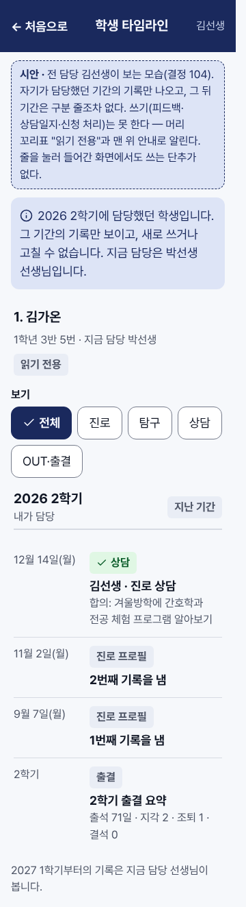 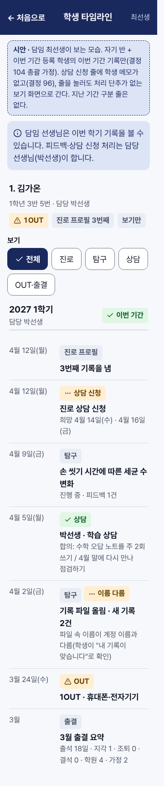

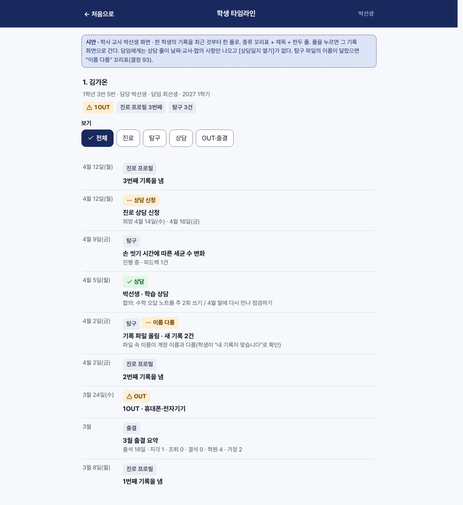

- **머리 카드:** "학년. 이름", 반·번호·담당(·담임), 요약 꼬리표(OUT, 진로 프로필 몇 번째, 탐구 n건). 전 담당에게는 "지금 담당 ○○○"과 "읽기 전용", 담임에게는 "보기만".
- **보기 칩:** 전체·진로·탐구·상담·OUT·출결.
- **기간 구분 줄:** 운영 기간 이름(굵게) + 아래 작은 글씨로 그 기간의 담당("담당 박선생" / "그때 담당 김선생" / 전 담당 본인에게는 "내가 담당") + 오른쪽 꼬리표("이번 기간" 초록 / "지난 기간" 회색). 굵은 밑줄로 줄 목록과 가른다. 최근 기간이 위. 보는 사람에게 안 보이는 기간은 구분 줄도 그리지 않는다.
- **줄:** 왼쪽 날짜, 오른쪽 종류 꼬리표 + 제목(굵게) + 한두 줄. 기간 안에서 최근 것부터. 줄을 누르면 그 기록 화면으로 간다(쓸 수 없는 사람에게는 쓰는 단추가 없는 보기 화면).
- 맨 아래 한 줄: 지금 담당 "이 학생이 학사에 처음 들어온 ○○ 기간부터의 기록입니다." / 전 담당 "○○ 기간부터의 기록은 지금 담당 선생님이 봅니다."

| 종류 | 제목 | 아래 줄 |
| --- | --- | --- |
| 진로 프로필 | "n번째 기록을 냄" | 없음(무엇이 바뀌었는지는 싣지 않는다, 결정 103) |
| 이수 계획 | "학기 · n과목을 고름" 또는 "n과목 확정" | 과목 이름 |
| 상담 신청 | "주제 상담 신청" | 희망 날짜(담임에게는 메모 없음) |
| 상담 | "○○○ · 유형 상담" | "합의: …"(내용은 싣지 않는다. 볼 수 있는 교사는 줄을 눌러 상담일지로) |
| 탐구 | 주제 제목 또는 "기록 파일 올림 · 새 기록 n건" | 진행 상태·피드백 수. 파일 이름이 달랐으면 꼬리표 **"이름 다름"**(결정 93) |
| OUT | "1OUT · 항목" | 없음 |
| 출결 | "n월 출결 요약"(지난 기간은 "n학기 출결 요약" 한 줄) | 출석·지각·조퇴·결석·학원·가정 수 |

**안내 문구**
- 전 담당: "2026 2학기에 담당했던 학생입니다. 그 기간의 기록만 보이고, 새로 쓰거나 고칠 수 없습니다. 지금 담당은 ○○○ 선생님입니다."
- 담임: "담임 선생님은 이번 학기 기록을 볼 수 있습니다. 피드백·상담 신청 처리는 담당 선생님(○○○)이 합니다."

#### 빈 상태·들어가는 길

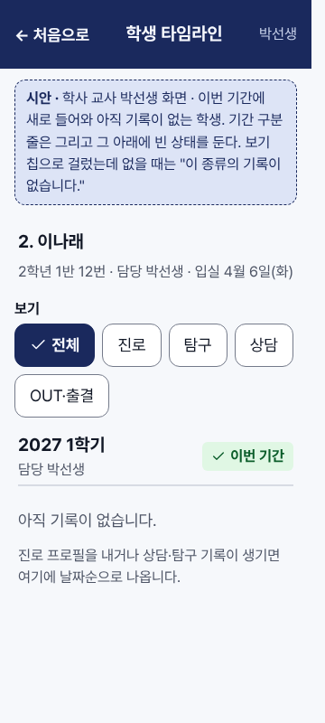 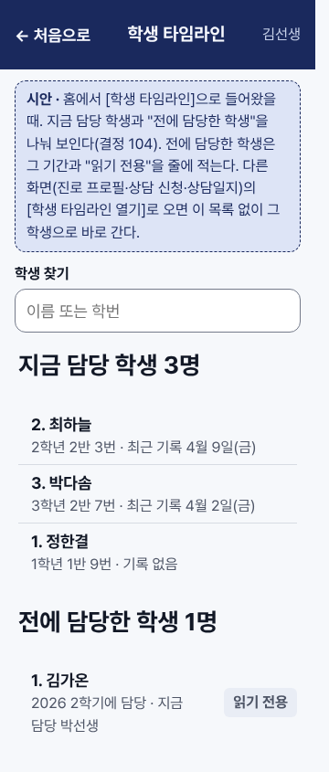 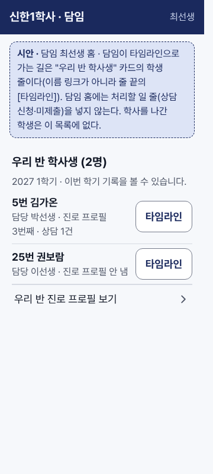

- **빈 상태**(`t-timeline-empty`): 기간 구분 줄은 그리고 그 아래 "아직 기록이 없습니다." + "진로 프로필을 내거나 상담·탐구 기록이 생기면 여기에 날짜순으로 나옵니다." 보기 칩으로 걸렀는데 없으면 "이 종류의 기록이 없습니다."
- **담당교사가 들어가는 길:** ① 진로 프로필·상담 신청 처리·상담일지의 한 명 보기에 있는 [학생 타임라인 열기](그 학생으로 바로) ② 홈의 [학생 타임라인] → **학생 고르기**(`t-timeline-pick`).
- **학생 고르기:** 위에 "학생 찾기", 구역 "지금 담당 학생 n명"(이름 + 반·번호 + 최근 기록 날짜 또는 "기록 없음"), 구역 **"전에 담당한 학생 n명"**(이름 + "2026 2학기에 담당 · 지금 담당 ○○○" + 꼬리표 "읽기 전용"). 전에 담당한 학생이 없으면 그 구역을 그리지 않는다. 노트북에서는 목록 | 타임라인 두 칸.
- **담임이 들어가는 길**(`t-timeline-hr-home`): 담임 홈의 "우리 반 학사생" 카드. 학생 줄(번호·이름, "담당 ○○○ · 진로 프로필 n번째 · 상담 n건") 끝의 **[타임라인]**. 학사를 나간 학생은 이 목록에 없다. 담임 홈에는 처리할 일 줄(상담 신청·미제출)을 넣지 않는다.
- **관리자:** 학생 찾기로 전체 학사생에서 고른다(구역 나눔 없음).
- 학사를 나간(퇴실·졸업) 학생: 그 기록이 생긴 기간의 담당이었던 교사와 관리자만 본다(결정 97). 전 담당 화면과 같은 모습이고 안내는 "학사를 나간 학생입니다. 담당했던 기간의 기록만 보이고, 새로 쓰거나 고칠 수 없습니다."

## 7. 새 부품 제안 (구현은 코딩 세션)

시안에서는 화면 파일 안에 작은 스타일로 그렸다. 여러 화면이 같이 쓰므로 `UI.*`로 올리기를 제안한다.

| 제안 | 무엇 | 쓰는 곳 |
| --- | --- | --- |
| `UI.shareCheck({label, on, onchange})` | "부모님께 보이기" 체크 칸 + 상태 꼬리표("지금 보이는 중"/"나만 보는 중") 한 줄. 끌 때 확인 시트(결정 92 문구)를 안에서 띄운다 | 진로 프로필, 상담 기록, 탐구 기록 |
| `UI.versionNav({index, total, label, onchange})` | ‹ n번째 기록 · 낸 날 › | 학생·교사 진로 프로필 |
| `UI.timeline(items)` | 날짜 칸 + 꼬리표·제목·한두 줄 목록 | 학생 타임라인 |
| `.fb`(말씀 상자) | 옅은 회색 상자. 선생님 말씀·합의 사항·반려 사유 | 학생·학부모·교사 화면 |

색은 모두 지금 토큰만 쓴다. 살구색은 "미제출" 꼬리표, 홈의 처리할 건수, "진로 프로필을 내 주세요" 한 칸에만.

## 8. 관리자 — 탐구 원본 정리 (결정 100)

  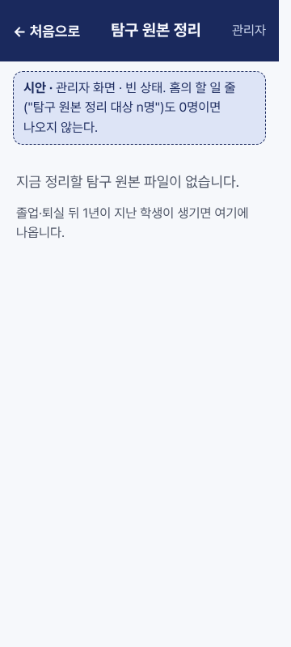

- **위 안내:** "졸업하거나 퇴실한 지 1년이 지난 학생의 탐구 원본 파일입니다. 개인정보를 오래 두지 않으려고 관리자 선생님이 확인하고 지웁니다."
- **목록:** 학생마다 체크 칸 + "졸업/퇴실 날짜 · 1년 지남 · 원본 파일 n개". 카드 제목 "정리 대상 n명 · 원본 파일 n개". 아래 "지워지는 것은 Drive의 원본 파일뿐입니다. 탐구 기록 요약은 "취소" 상태로 남습니다."
- **아래 바:** 빨간 [고른 n개 지우기]. 고른 것이 없으면 꺼짐.
- **확인 시트:** 제목 "원본 파일 지우기", 맨 위 "학생 n명 · 원본 파일 n개", 줄 "Drive에서 원본 파일 n개를 지웁니다. 되돌릴 수 없습니다.", "탐구 기록 요약은 "취소" 상태로 남습니다.", "누가 언제 지웠는지 기록에 남습니다.", "지울까요?" / [돌아가기] [지우기]. 포커스는 [돌아가기].
- 알림 "원본 파일 5개를 지웠습니다." 일부만 지워졌으면 "5개 중 4개를 지웠습니다. 남은 1개는 다시 눌러 주세요."
- **빈 상태:** "지금 정리할 탐구 원본 파일이 없습니다." + "졸업·퇴실 뒤 1년이 지난 학생이 생기면 여기에 나옵니다."
- 자동으로 지우지 않는다. 관리자만 본다.

## 9. 정해진 것 (결정 103)

1. 상담 상태 이름은 **"신청"**(특이사항의 "요청"과 다른 낱말).
2. 교사 화면의 **"학부모에게 보임"** 꼬리표는 둔다.
3. 확정 뒤 상담을 못 한 경우: 상태는 "반려" + 사유, **버튼 이름만 [상담 못 함]**.
4. 타임라인에 "무엇이 바뀌었는지 한 줄"은 **만들지 않는다.**
5. 확정은 학생이 고른 희망 날짜 중 하나로만. 상담일지 유형은 학습·생활·진로·진학·건강·가정·기타.
6. 새 부품 `UI.shareCheck`·`UI.versionNav`·`UI.timeline`은 승인 — 코딩 세션이 화면을 만들 때 `Components.html`에 넣는다.
7. 학생 화면은 "부모님께 보이기", 학부모 화면 문장은 "학부모님".

## 10. 이수 계획 (F15, 결정 99·102)

### 학생 — `s-plan` 내 이수 계획

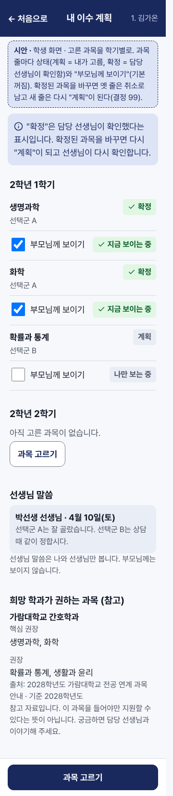 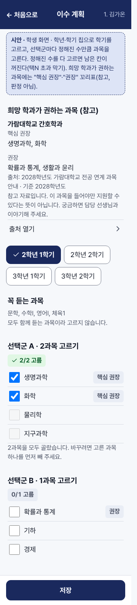 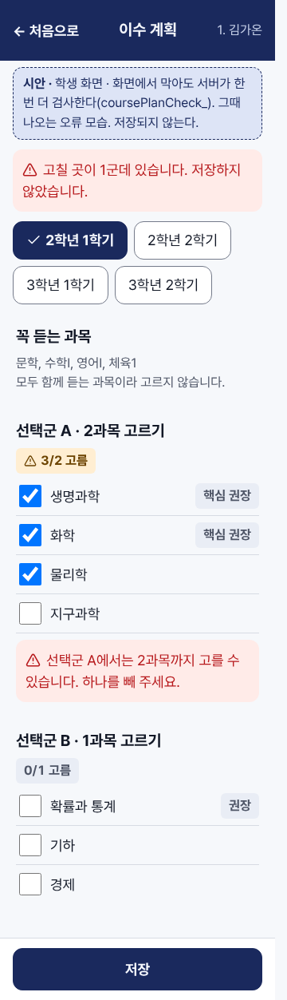

- **위 안내:** ""확정"은 담당 선생님이 확인했다는 표시입니다. 확정된 과목을 바꾸면 다시 "계획"이 되고 선생님이 다시 확인합니다."
- **학기마다 카드 하나.** 과목 한 줄: 과목 이름 + 상태 꼬리표(계획 = 회색, 확정 = 초록) + 선택군 이름 + **"부모님께 보이기"** 줄(과목마다, 기본 꺼짐. 체크하는 순간 바로 저장된다 — 고르기 화면(`s-plan-edit`)에는 보이기 줄을 두지 않는다. 끌 때는 1절과 같은 확인 시트).
- 고른 과목이 없는 학기: "아직 고른 과목이 없습니다." + [과목 고르기].
- **선생님 말씀** 카드(있을 때만) + "선생님 말씀은 나와 선생님만 봅니다. 부모님께는 보이지 않습니다."
- **희망 학과가 권하는 과목 (참고)** 카드: 가장 최근 진로 프로필의 목표 학과마다 대학·학과, 핵심 권장·권장 과목, "출처: … · 기준 2028학년도", "참고 자료입니다. 이 과목을 들어야만 지원할 수 있다는 뜻이 아닙니다. 궁금하면 담당 선생님과 이야기해 주세요.", [출처 열기]. 목표 진학이 없으면 "진로 프로필에 목표 학과를 적으면 그 학과가 권하는 과목이 여기에 나옵니다.", 자료에 없는 학과면 "이 학과의 권장 과목 자료가 없습니다."
- **아래 바:** [과목 고르기] → `s-plan-edit`.
- 교육과정에서 빠진 과목을 이미 골랐으면 그 줄에 회색 꼬리표 "교육과정에서 빠진 과목" + "다른 과목으로 바꿔 주세요."
- **빈 상태**(`s-plan-empty`): "아직 우리 학년의 교육과정이 올라오지 않았습니다." + "올라오면 여기에서 과목을 고를 수 있습니다. 급하면 담당 선생님께 알려 주세요." 아래 바 없음.

### 학생 — `s-plan-edit` 이수 계획 고르기

- **학년·학기 칩**(하나 고름): 편제표에 있는 학기만 나온다.
- **꼭 듣는 과목** 카드(읽기만): "모두 함께 듣는 과목이라 고르지 않습니다."
- **선택군마다 카드:** 제목 "선택군 A · 2과목 고르기", 꼬리표 "2/2 고름"(다 고르면 초록), 과목마다 체크 칸. 희망 학과가 권하는 과목에는 회색 꼬리표 **"핵심 권장"** 또는 **"권장"**.
- **정해진 수를 다 고르면 남은 칸이 꺼지고**(택N 초과 막기) 아래에 "2과목을 모두 골랐습니다. 바꾸려면 고른 과목 하나를 먼저 빼 주세요."
- **아래 바:** [저장]. 알림 "저장했습니다." 덜 고른 채로 저장해도 된다(나중에 이어서).
- **오류**(`s-plan-error`, 서버 검사 `coursePlanCheck_`): 맨 위 "고칠 곳이 1군데 있습니다. 저장하지 않았습니다." + 그 선택군 아래 "선택군 A에서는 2과목까지 고를 수 있습니다. 하나를 빼 주세요." 그 밖에 "이 과목은 우리 학년 교육과정에 없습니다. 화면을 다시 열어 주세요.", "같은 과목을 두 번 고를 수 없습니다."

### 학부모 — `p-plan`

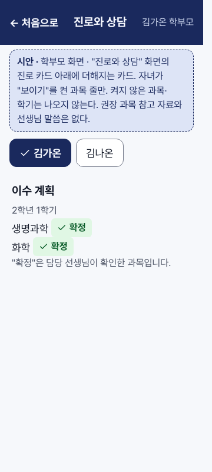

- "진로와 상담" 화면의 진로 카드 아래에 **이수 계획** 카드. 자녀가 켠 과목 줄만 학기별로, 상태 꼬리표와 함께. ""확정"은 담당 선생님이 확인한 과목입니다."
- 켠 과목이 없으면 카드를 그리지 않는다(빈 상태 문구는 5절 그대로). 권장 과목 참고 자료와 선생님 말씀은 없다.

### 교사 — `t-plan` 담당 학생 이수 계획

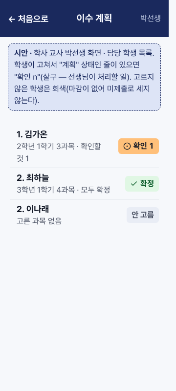 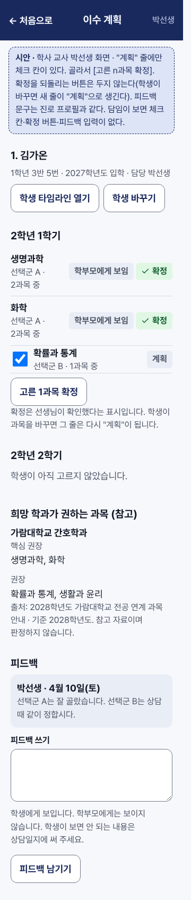 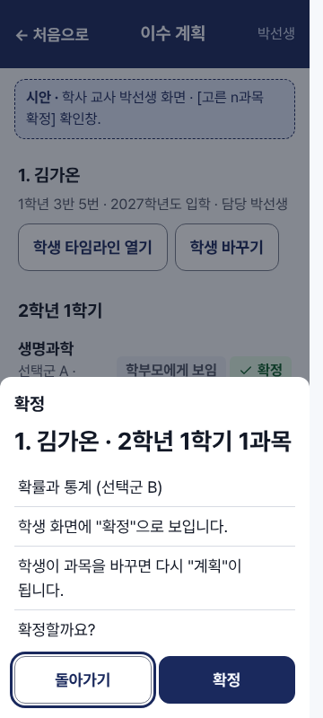

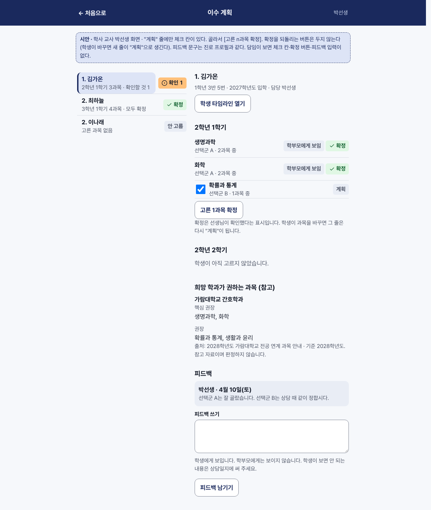

- **목록:** "학년. 이름" + "학기 n과목 · 확인할 것 n" + 꼬리표(확인 n = 살구 `todo`, 확정 = 초록, 안 고름 = 회색). 확인할 것이 있는 학생이 위.
- **상세:** 학생 머리 카드(입학년도 포함), 학기마다 카드. 과목 줄: 과목 이름 + "선택군 · n과목 중" + 꼬리표("학부모에게 보임", 계획/확정). **"계획" 줄에만 체크 칸** → [고른 n과목 확정]. 아래 "확정은 선생님이 확인했다는 표시입니다. 학생이 과목을 바꾸면 그 줄은 다시 "계획"이 됩니다."
- **확정 확인 시트:** 제목 "확정", 맨 위 "1. 김가온 · 2학년 1학기 1과목", 줄 과목 이름, "학생 화면에 "확정"으로 보입니다.", "학생이 과목을 바꾸면 다시 "계획"이 됩니다.", "확정할까요?" / [돌아가기] [확정]. 알림 "1과목을 확정했습니다."
- 확정을 되돌리는 버튼은 없다.
- **희망 학과가 권하는 과목 (참고)** 카드: 학생 화면과 같은 내용 + "참고 자료이며 판정하지 않습니다."
- **피드백** 카드: 진로 프로필과 같다(칸 이름 "피드백 쓰기 (학생에게 보임)", 도움말 "학부모에게는 보이지 않습니다. …").
- **담임·관리자:** 체크 칸, 확정 버튼, 피드백 입력이 없다(보기만).
- 홈의 할 일에 "이수 계획 확인 n명" 줄을 더한다(0이면 없음).

## 11. 관리자 — 교육과정 올리기 (결정 102)

명단 올리기와 같은 흐름: 종류 고르기 → 붙여 넣기 → 미리 보기 → 저장.

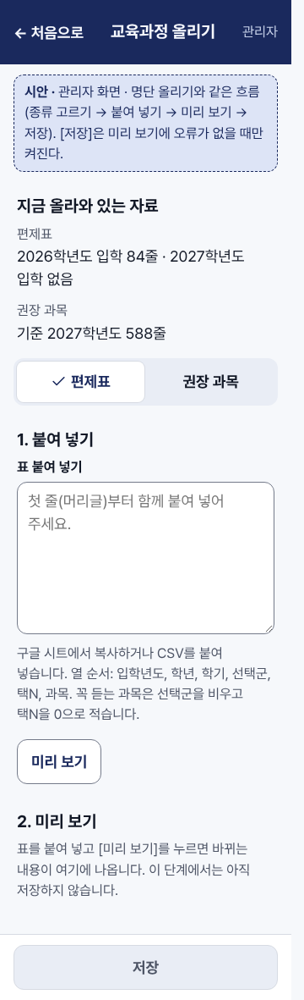 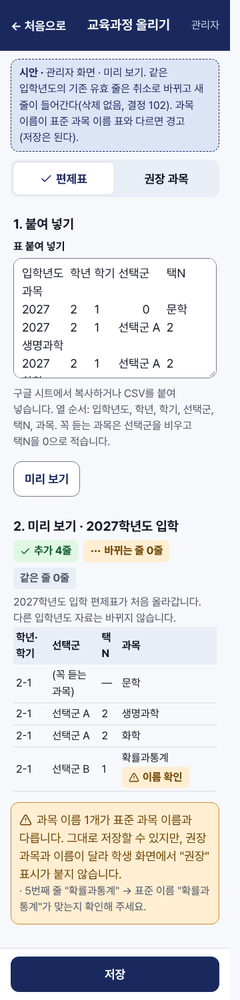 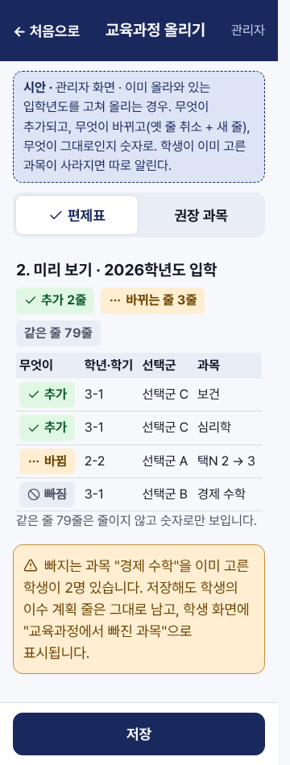

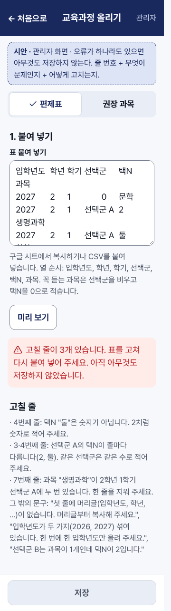 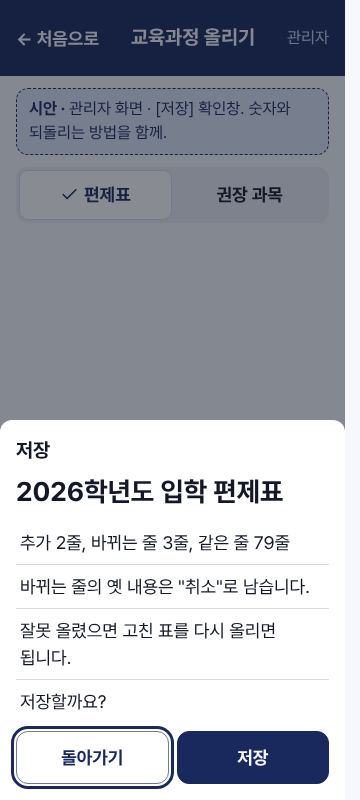 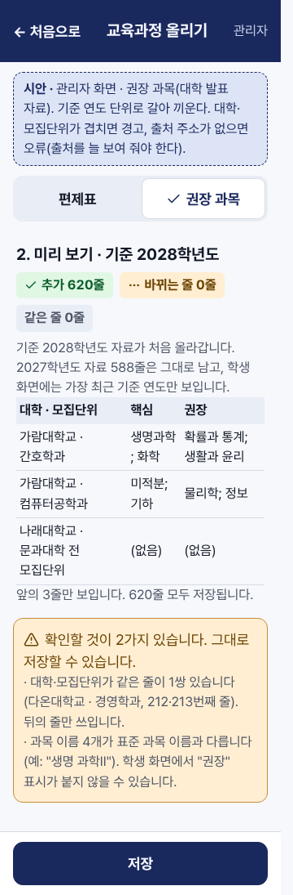

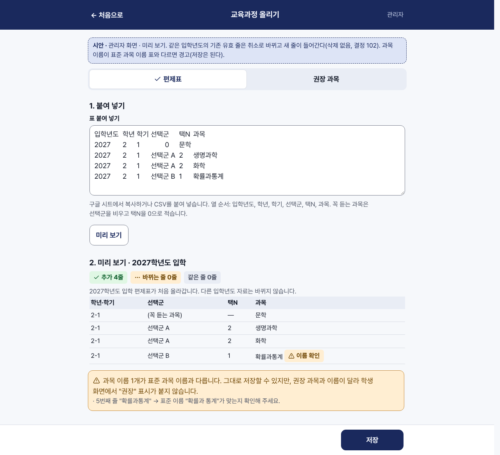

- **지금 올라와 있는 자료** 카드: 편제표는 입학년도마다 줄 수, 권장 과목은 기준 연도마다 줄 수.
- **올릴 자료**(둘 중 하나): 편제표 / 권장 과목.
- **1. 붙여 넣기:** 여러 줄 글 칸 "표 붙여 넣기"(안내 글 "첫 줄(머리글)부터 함께 붙여 넣어 주세요.") + [미리 보기].
  - 편제표 도움말: "구글 시트에서 복사하거나 CSV를 붙여 넣습니다. 열 순서: 입학년도, 학년, 학기, 선택군, 택N, 과목. 꼭 듣는 과목은 선택군을 비우고 택N을 0으로 적습니다."
  - 권장 과목 도움말: "… 열 순서: 기준 연도, 대학, 모집단위, 핵심 과목, 권장 과목, 출처 주소, 출처 제목, 비고. 과목이 여럿이면 ;로 나눕니다."
- **2. 미리 보기**(아직 저장하지 않음): 제목에 입학년도(또는 기준 연도), 꼬리표 **"추가 n줄"**(초록) · **"바뀌는 줄 n줄"**(주의색) · **"같은 줄 n줄"**(회색), 한 줄 설명, 표.
  - 처음 올리는 해: 모든 줄을 표로(많으면 앞의 몇 줄 + "앞의 3줄만 보입니다. 620줄 모두 저장됩니다.").
  - 다시 올리는 해(`a-curr-replace`): 추가·바뀜·빠짐 줄만 표로, 같은 줄은 숫자로만.
  - 한 번에 한 입학년도(기준 연도)만. 다른 해의 자료는 바뀌지 않는다고 적는다.
- **경고**(`.notice.warn`, 저장은 된다):
  - 과목 이름: "과목 이름 n개가 표준 과목 이름과 다릅니다. 그대로 저장할 수 있지만, 권장 과목과 이름이 달라 학생 화면에서 "권장" 표시가 붙지 않습니다." + 줄마다 "5번째 줄 "확률과통계" → 표준 이름 "확률과 통계"가 맞는지 확인해 주세요." 표의 그 칸에 꼬리표 "이름 확인".
  - 빠지는 과목을 고른 학생: "빠지는 과목 "…"을 이미 고른 학생이 n명 있습니다. 저장해도 학생의 이수 계획 줄은 그대로 남고, 학생 화면에 "교육과정에서 빠진 과목"으로 표시됩니다."
  - 권장 과목: "대학·모집단위가 같은 줄이 n쌍 있습니다(…). 뒤의 줄만 쓰입니다."
- **오류**(`a-curr-error`, 하나라도 있으면 아무것도 저장하지 않고 [저장]이 꺼진다): 맨 위 "고칠 줄이 n개 있습니다. 표를 고쳐 다시 붙여 넣어 주세요. 아직 아무것도 저장하지 않았습니다." + 줄 번호별 문구:
  - "4번째 줄: 택N "둘"은 숫자가 아닙니다. 2처럼 숫자로 적어 주세요."
  - "3·4번째 줄: 선택군 A의 택N이 줄마다 다릅니다. 같은 선택군은 같은 수로 적어 주세요."
  - "7번째 줄: 과목 "…"이 2학년 1학기 선택군 A에 두 번 있습니다. 한 줄을 지워 주세요."
  - "첫 줄에 머리글(입학년도, 학년, …)이 없습니다. 머리글부터 복사해 주세요."
  - "입학년도가 두 가지(2026, 2027) 섞여 있습니다. 한 번에 한 입학년도만 올려 주세요."
  - "선택군 B는 과목이 1개인데 택N이 2입니다."
  - 권장 과목: "n번째 줄: 출처 주소가 없습니다. 대학 발표 자료의 주소를 적어 주세요."
- **아래 바:** [저장] → 확인 시트: 제목 "저장", 맨 위 "2026학년도 입학 편제표", 줄 "추가 2줄, 바뀌는 줄 3줄, 같은 줄 79줄", "바뀌는 줄의 옛 내용은 "취소"로 남습니다.", "잘못 올렸으면 고친 표를 다시 올리면 됩니다.", "저장할까요?" / [돌아가기] [저장]. 알림 "저장했습니다. 추가 2줄, 바뀐 줄 3줄."
- 관리자만 본다.

## 12. 알릴 것

1. **"바뀌는 줄"의 뜻.** 결정 102는 "같은 입학년도의 기존 유효 줄은 취소로 바꾸고 새 줄을 쓴다"이다. 시안은 내용이 같은 줄을 "같은 줄"로 세어 건드리지 않는 것으로 그렸다(숫자가 관리자에게 뜻이 있으려면). 모두 취소 + 새로 쓰기로 구현한다면 꼬리표는 "새로 쓰는 줄 n · 취소되는 줄 n"으로 바꾸면 된다.
2. **빠지는 과목을 이미 고른 학생** 경고와 학생 화면의 "교육과정에서 빠진 과목" 표시는 규칙 초안에 없는 제안이다.
3. **홈의 "이수 계획 확인 n명"** 줄도 제안이다(분담표에 없음).
4. 권장 과목 꼬리표("핵심 권장"·"권장")는 과목 이름이 표준 이름과 같을 때만 붙는다 — 그래서 올릴 때 이름 경고를 둔다.
5. 출결 결과의 "미인정" 꼬리표는 D24에서 주의색으로 바꿨다(`src/` 변경은 그 한 줄뿐, 이번에는 없음).

## 13. "부모님께 보이기" 꼬리표의 원칙 (D26)

C50 구현 검토에서 찾은 시안의 잘못을 고쳤다. **꼬리표는 지금 사실인 것만 말한다.**

| 어디 | 체크하면 | 꼬리표 |
| --- | --- | --- |
| 진로 프로필 **보기**(`s-career-view`), 상담 기록(`s-notes`), 탐구 기록(`s-inquiry-list`), 이수 계획 **보기**(`s-plan`) | 바로 저장된다 | "지금 보이는 중" / "나만 보는 중" |
| 진로 프로필 **입력**(`s-career-form`) | [제출하기]를 눌러야 바뀐다 | "제출하면 보임" / "제출해도 나만 봄" + 맨 위 "지금 부모님께 보이는 항목: …" |
| 이수 계획 **고르기**(`s-plan-edit`), 탐구 **올리기**(`s-inquiry-pick`·`-preview`) | 보이기 줄이 없다 | — |

- `UI.shareCheck`는 꼬리표 문구를 바꿀 수 있어야 한다(입력 화면용 두 문구).

### 교사가 쓰는 글 칸 (D27)

**교사가 쓰는 글 칸은 누구에게 보이는지를 칸 제목(이름)에 적는다.** 칸 아래 도움말에만 두지 않는다.

| 칸 | 화면 | 제목·이름에 적는 말 |
| --- | --- | --- |
| 상담 내용 | `t-note` | "(교사만)" + 꼬리표 "교사만 봄" |
| 합의 사항·다음 할 일 | `t-note` | "(학생에게 보임)" + 꼬리표 "학생에게 보임" + 저장 확인 시트 |
| 피드백 | `t-career`·`t-plan` | "피드백 쓰기 (학생에게 보임)" |
| 반려·상담 못 함 사유 | `t-req-reject` | "학생에게 보일 사유"(처음부터 이렇게 그렸다) |

훑은 결과 빠진 곳은 피드백 칸 두 곳이었고 이번에 고쳤다. 학생의 "내 상담 신청" 완료 줄의 [상담 기록 보기]는 시안에 처음부터 있다(`s-counsel-list`).
- 학부모 화면에는 "n번째 기록" 같은 버전 표시가 없다(낸 날만). `p-career`·`p-plan`·`p-empty` 시안과 설명을 다시 확인했고 버전 표시는 없었다.
- 탐구 기록 카드는 [진행 적기]를 펼치면 [저장]이 생기는데, 보이기 체크는 그 [저장]과 따로 바로 저장된다. 헷갈리면 보이기 줄을 펼친 칸 밖(카드 맨 아래)에 두는 지금 자리를 지킨다.
