# 7단계 학생·학부모 화면 시안 (D13) — F14 포털 · F10 시설 일지 · F9 시간표

코딩A(C35 F10)·코딩B(C36 F14, C37 F9)가 이 문서와 시안을 보고 만든다. 시안 코드는 `design/preview/stage7-screens.js`(실행 `node design/preview/stage7.js` → `design/preview/out/stage7/<이름>-360.png`·`-1280.png`), 사진은 `docs/design/stage7-photos/`(360px, 관리자 표는 `-1280.png`도). 서버를 부르지 않고 이름·숫자는 모두 가짜다(학생 김가온 2학년 3반 5번, 동생 김나래, 담당 박선생, 가짜 오늘 2027-04-26(월)). 규칙은 `docs/design/rules.md`(이번에 **8절 "화면을 그리기 전 한 줄 계획과 점검"**을 더했다 — `docs/design/frontend-design-review.md`), 부품은 `docs/design/components.md`를 따른다. **정해지지 않은 것은 맨 아래 "미정·가정"에 모았다 — 코딩이 임의로 정하지 말고 총괄에게 묻는다.**

**이번 시안의 기준:** 교사 화면보다 쉬운 말, **학부모는 처음 쓰는 사람 기준**. 학교 말(퇴실 대상·OUT·사전 특이사항)에는 뜻을 한 줄 붙이고, 점(·)으로 이은 긴 줄은 줄을 나눈다. 홈 맨 위는 "지금 해야 할 일" 한 칸. 학생·학부모 응답에 넣지 않는 것: 다른 학생, 전화번호, 상담 **내용**, 교사 메모·OUT 입력자, 감사 기록(`docs/plan/stage7.md` 1절).

## 시안 이름 한눈에

| 이름 | 화면 | 누가 |
| --- | --- | --- |
| `student-home` | 학생 홈(맨 위 "시간표를 내 주세요") | 학생 |
| `student-home-out2` | 학생 홈 — 퇴실 대상일 때 | 학생 |
| `student-outs` | 내 OUT 자세히 | 학생 |
| `student-exceptions` | 내 출결 기록 전체 | 학생 |
| `parent-home` | 학부모 홈(자녀 전환 탭, 맨 위 "동의해 주세요") | 학부모 |
| `parent-home-nolink` | 학부모 첫 화면 — 연결된 자녀 없음 | 학부모 |
| `parent-counsel` | 상담 여부(날짜·교사만) | 학부모 |
| `facility-write` | 시설 일지 쓰기 | 학생 |
| `facility-write-conflict` | 시설 일지 — 시간 겹침 오류 | 학생 |
| `facility-mine` | 내가 쓴 시설 일지 | 학생 |
| `facility-cancel` | 시설 일지 취소 확인 | 학생 |
| `facility-duty-list` | 오늘 시설 일지(근무교사) | 그날 근무교사·관리자 |
| `facility-admin-total` | 시설 일지 누적표(학생 × 날짜) | 관리자 |
| `timetable-student` | 시간표 내기 | 학생 |
| `timetable-cell-sheet` | 시간표 칸 고르기 시트 | 학생 |
| `timetable-import-confirm` | [지난달 시간표 그대로 가져오기] 확인 | 학생 |
| `timetable-returned` | 돌려보내진 시간표 — 담당교사가 돌려보냄 | 학생 |
| `timetable-returned-parent` | 돌려보내진 시간표 — 부모가 돌려보냄 | 학생 |
| `timetable-submitted` | 낸 뒤 단계 | 학생 |
| `timetable-parent` | 학부모 동의 | 학부모 |
| `timetable-parent-decline` | 학부모 [동의하지 않습니다](사유 한 줄, 선택) | 학부모 |
| `timetable-teacher-list` | 담당교사 목록(미제출·동의 기다림·확인 필요) | 담당교사 |
| `timetable-teacher-confirm` | 담당교사 확인 시트 | 담당교사 |

## 1. F14 학생 홈

계획(규칙 8절) — **누가:** 학생(화면을 처음 보는 사람). **일:** 내 상태를 한눈에 보고 할 일을 한다. **가장 눈에 띌 것:** "시간표를 내 주세요" 한 칸(제출 기간이 아니면 이 칸이 없고 맨 아래에 기간 안내).

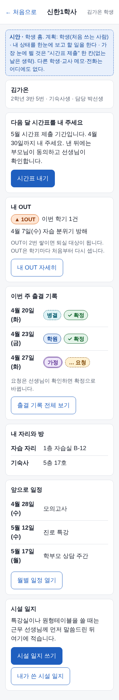 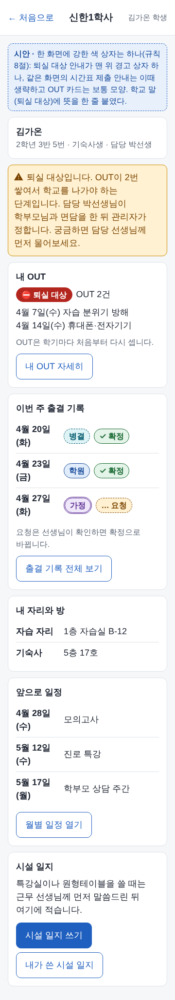

- **머리 카드:** 이름, "2학년 3반 5번 · 기숙사생 · 담당 박선생".
- **맨 위 한 칸**(`.card`): 제목이 하는 일("다음 달 시간표를 내 주세요"), 한두 줄 설명, 파랑 주 버튼 [시간표 내기]. 할 일이 없으면 이 칸을 그리지 않는다. **퇴실 대상이면 이 자리가 경고 상자 하나**(`.notice.warn`)로 바뀐다: "퇴실 대상입니다. OUT이 2번 쌓여서 학교를 나가야 하는 단계입니다. 담당 박선생님이 학부모님과 면담을 한 뒤 관리자가 정합니다. 궁금하면 담당 선생님께 먼저 물어보세요." — 한 화면에 강한 색은 이 상자 하나뿐이고 OUT 카드는 보통 모양이다(규칙 8절).
- **내 OUT:** 알약(`.pill.out-1` "▲ 1OUT" / `.pill.out-2` "⛔ 퇴실 대상") + 건수, 날짜·항목 한 줄씩(입력한 선생님·메모 없음), "OUT이 2번 쌓이면 퇴실 대상이 됩니다. OUT은 학기마다 처음부터 다시 셉니다.", [내 OUT 자세히](`student-outs`).
- **이번 주 출결 기록:** 날짜, 유형 알약(병·학·가)과 상태 알약(확정·요청). 사유 메모는 쓰지 않는다. 안내 "요청은 선생님이 확인하면 확정으로 바뀝니다." [출결 기록 전체 보기](`student-exceptions`).
- **내 자리와 방:** 자습 자리, 기숙사(없으면 줄을 지운다).
- **앞으로 일정:** 3건, [월별 일정 열기](F13 달력, 보기만).
- **시설 일지:** 한 줄 설명 + 주 버튼 [시설 일지 쓰기], 보조 [내가 쓴 시설 일지].
- 아래 바(`.actionbar`)는 없다(읽는 화면). 주 버튼은 맨 위 한 칸 또는 시설 일지 카드에 하나씩.

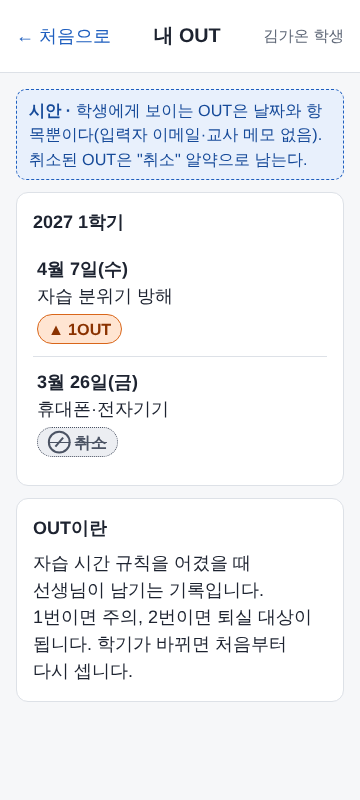 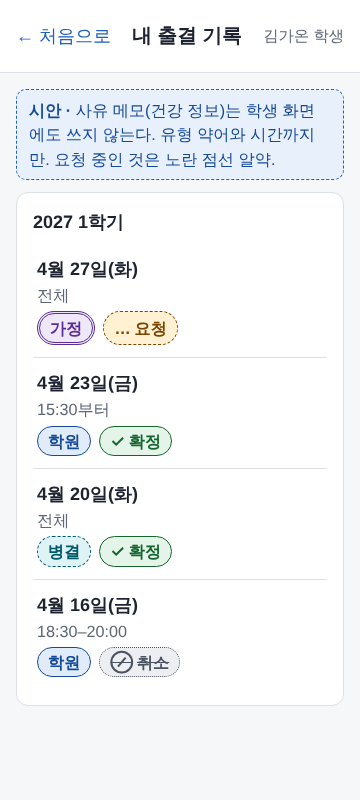

- `student-outs`: 학기 이름 아래 날짜·항목·알약 목록(취소된 OUT은 "취소" 알약으로 남음), 아래 설명 카드 "OUT이란".
- `student-exceptions`: 날짜 · 시간 · 유형 알약 + 상태 알약. 취소된 것도 "취소"로 남는다.

## 2. F14 학부모 홈

계획 — **누가:** 학부모(처음 쓰는 사람). **일:** 자녀의 학교 생활을 안심하고 확인한다. **가장 눈에 띌 것:** "시간표에 동의해 주세요" 한 칸(없으면 생략).

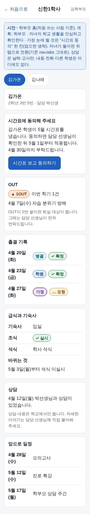

- **자녀 전환:** 머리 아래 탭 `nav.tabs`(김가온 · 김나래) — **지금 코드(`home_parent.html`)와 같은 모양 그대로**다. 자녀가 한 명이면 탭이 없다.
- 위에서 아래로: 자녀 카드(이름·학년반번호·담당) → (있을 때) "시간표에 동의해 주세요" 한 칸 → **OUT**(알약·건수·날짜·항목, "그때는 담당 선생님이 먼저 연락드립니다") → **출결 기록** → **급식과 기숙사**(기숙사 입실, 조식 실시, 석식 종류, "바뀌는 것: 5월 3일(월)부터 석식 미실시") → **상담**(날짜와 선생님 이름만 + "상담 내용은 학교에서만 봅니다.") → **앞으로 일정**.
- **상담은 날짜·교사만**(내용·유형·대상·학생 공개 여부 없음, `show_to_parent`가 참인 건만). 학교가 먼저 연락드릴 일과 부모가 물어볼 곳을 문장으로 알려 준다.
- 전화번호·다른 학생·교사 메모는 어디에도 없다.

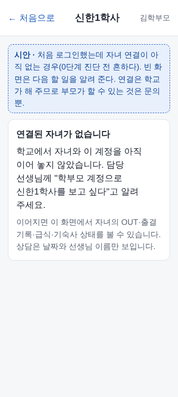 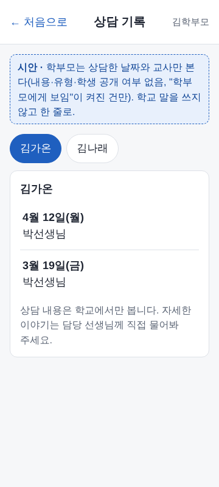

- `parent-home-nolink`: 연결된 자녀가 없을 때(0단계 진단 전 흔하다) — 카드 "연결된 자녀가 없습니다" + 부모가 할 일("담당 선생님께 알려 주세요")과 이어진 뒤에 볼 수 있는 것. 지금 코드의 빨간 오류 한 줄 대신 **빈 상태는 다음 할 일을 알려 준다**(규칙 5절).
- `parent-counsel`: 자녀 탭 + 날짜·선생님 목록 + 같은 안내.

## 3. F10 시설 사용 일지 (C35, 결정 83)

### 3-1. 학생이 쓰기

계획 — **누가:** 학생. **일:** 시설을 쓴 사실을 근무 선생님이 볼 수 있게 남긴다. **가장 눈에 띌 것:** 아래 바의 [일지 저장] 하나.

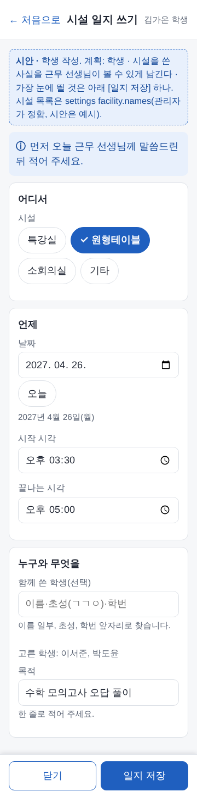 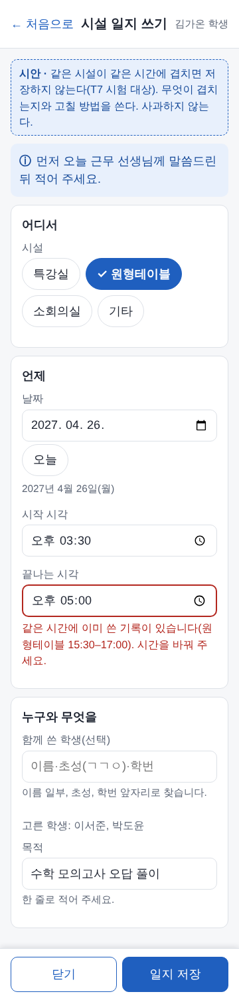

- 맨 위 안내 `.notice.info` "먼저 오늘 근무 선생님께 말씀드린 뒤 적어 주세요."
- 카드 **어디서**: **시설 칩**(`.chip`, 하나 고름. 목록은 settings `facility.names`(관리자가 정함), 시안은 예시) → 카드 **언제**: `UI.dateField`(바로가기 "오늘"), 시작 시각, 끝나는 시각(`input[type=time]`) → 카드 **누구와 무엇을**: `UI.studentPicker`(함께 쓴 학생, 선택, 고른 학생 줄), 목적(한 줄 100자).
- 아래 바: [닫기] · [일지 저장]. 같은 시설·시간이 겹치면 저장하지 않고 끝 시각 칸 아래 오류 "같은 시간에 이미 쓴 기록이 있습니다(원형테이블 15:30–17:00). 시간을 바꿔 주세요." — 사과하지 않고 무엇이 겹치는지와 고칠 방법.
- 시각 입력칸은 기기 설정을 따라 "오후 03:30"처럼 보일 수 있다(브라우저가 정한다). 저장·목록·확인 시트의 글자는 24시간 "15:30"이다.

### 3-2. 내 기록과 취소

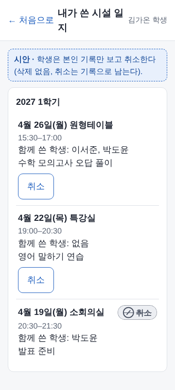 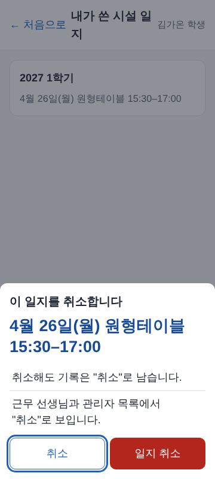

- 목록: 날짜 + 시설(굵게), 시간, "함께 쓴 학생: …", 목적, 줄마다 [취소]. 취소된 줄은 "취소" 알약이고 버튼이 없다.
- 취소는 `UI.confirmSheet` "이 일지를 취소합니다"(사유 없이 확인만, **삭제가 아니라 취소로 남는다**) — 학생이 본인 기록을 취소하는 가벼운 동작이라 사유는 받지 않는다(미정 3번).

### 3-3. 근무교사·관리자

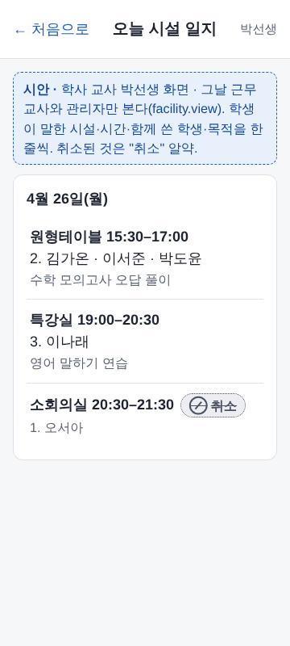 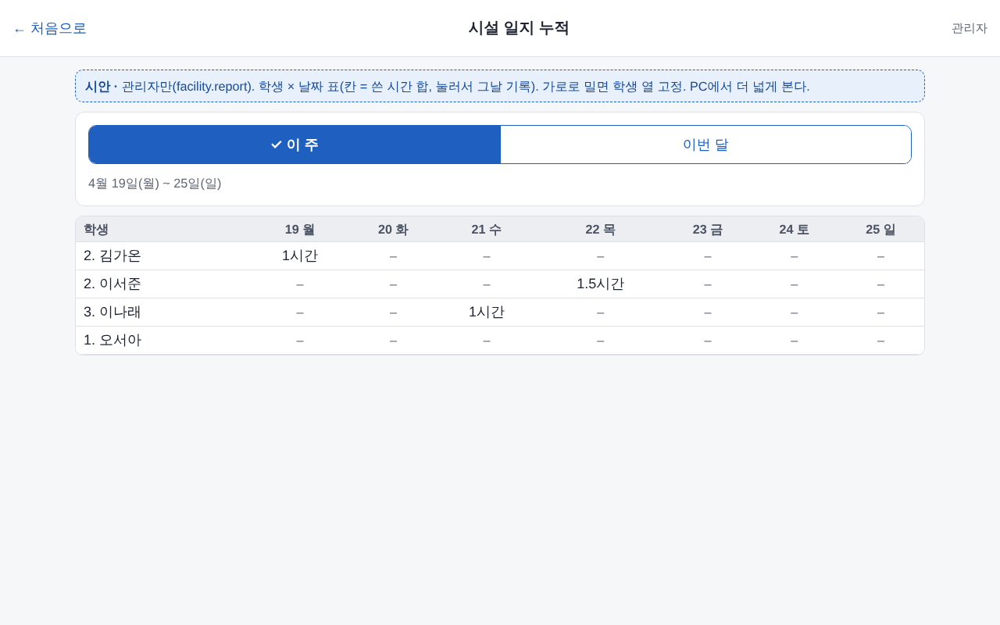

- `facility-duty-list`: 그날 근무교사와 관리자(`facility.view`)만. 시설별 줄: **시설 시간(굵게)**, "2. 김가온 · 이서준 · 박도윤", 목적, 취소된 것은 "취소" 알약.
- `facility-admin-total`: 관리자(`facility.report`)만. 학생 × 날짜 표(`table.data.rg`, 학생 열 고정, 칸 = 그날 쓴 시간 합, 없으면 "–"), 범위 [이 주 | 이번 달]. 표 칸을 누르면 그날 기록을 아래에 펼친다(이 시안에는 펼침을 그리지 않았다 — 미정 4번).

## 4. F9 학원·희망 자습 시간표 (C37, R23)

### 4-1. 학생 제출

계획 — **누가:** 학생. **일:** 다음 달 학원·집 공부 시간을 알린다. **가장 눈에 띌 것:** 아래 바의 [시간표 제출] 하나.

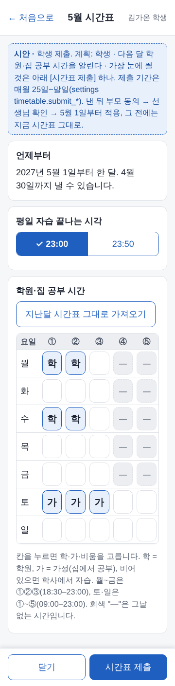 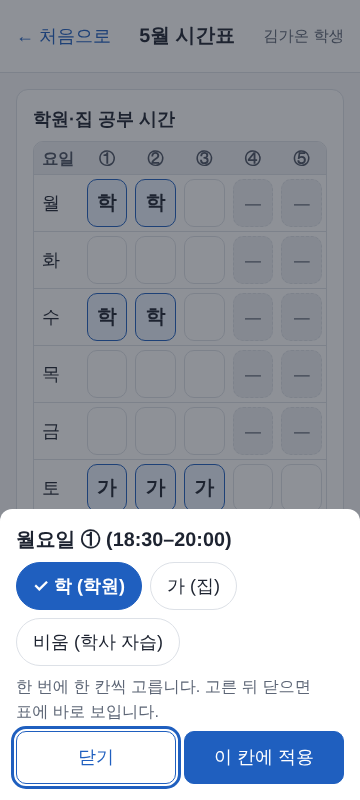

- 카드 **언제부터**("2027년 5월 1일부터 한 달. 4월 30일까지 낼 수 있습니다."), 카드 **평일 자습 끝나는 시각**(`UI.segmented` 23:00 / 23:50), 카드 **학원·집 공부 시간**: **요일(월~일) × 시간(①~⑤) 표**(`table.data.rg` + `.rg-cell`, 칸 48px). 칸이 비어 있으면 학사에서 자습, **학**(학원, 파랑)·**가**(가정, 보라) 칸은 `.has`로 보이고 글자(학·가)로도 알린다. 월~금은 ①②③(18:30–23:00)만 있고 ④⑤는 회색 점선 "—"(`.off`), 토·일은 ①~⑤(09:00–23:00).
- **[지난달 시간표 그대로 가져오기]**(결정): 표 카드 맨 위 보조 버튼(`.btn.secondary`) 하나. 누르면 확인 시트 `timetable-import-confirm` — "지난달 시간표를 가져옵니다" + 가져올 내용 한 줄 + "지금 표에 적은 것은 이 시간표로 바뀝니다." + "가져온 뒤에도 칸을 눌러 고칠 수 있고, [시간표 제출]을 눌러야 냅니다." → [가져오기]. 지난달 제출이 없으면 이 버튼을 그리지 않는다.

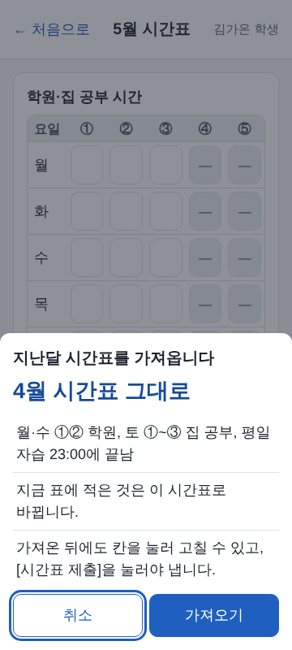
- 칸을 누르면 `UI.bottomSheet` "월요일 ① (18:30–20:00)": 칩 [학 (학원)] [가 (집)] [비움 (학사 자습)] → [이 칸에 적용]. 한 번에 한 칸씩 고른다. 여러 칸을 한꺼번에 고르는 입력은 만들지 않고 위 [지난달 시간표 그대로 가져오기]로 대신한다(결정).
- 제출 기간(매월 25일~말일, settings `timetable.submit_*`)이 아니면 이 화면은 "지금은 기간이 아닙니다"(학생 홈 맨 아래 안내와 같은 말).

### 4-2. 낸 뒤 단계 / 학부모 동의 / 교사 확인

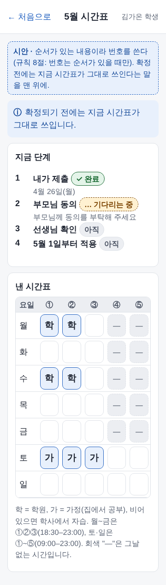

- **단계 4개는 순서가 있으므로 번호를 쓴다**(규칙 8절 "번호는 순서가 있을 때만"): 1 내가 제출(완료) → 2 부모님 동의(기다리는 중) → 3 선생님 확인(아직) → 4 5월 1일부터 적용(아직). 알약은 `.pill.s-confirmed`(완료)·`.s-requested`(기다리는 중)·`.mute`(아직). 맨 위 안내 `.notice.info` "확정되기 전에는 지금 시간표가 그대로 쓰입니다."
- 낸 시간표는 같은 표(읽기만)로 보인다. **돌려보내진 시간표**(결정): 교사 [돌려보내기]든 부모 [동의하지 않습니다]든 학생 화면 **맨 위에 돌려보낸 사람과 사유**(`.notice.warn` 하나, "담당 박선생님이 시간표를 돌려보냈습니다. 사유: …" / "부모님이 …"), 그 아래에 고칠 수 있는 표, 아래 바 [고쳐서 다시 내기]. 다시 내면 부모 동의부터 다시 시작한다(R23).

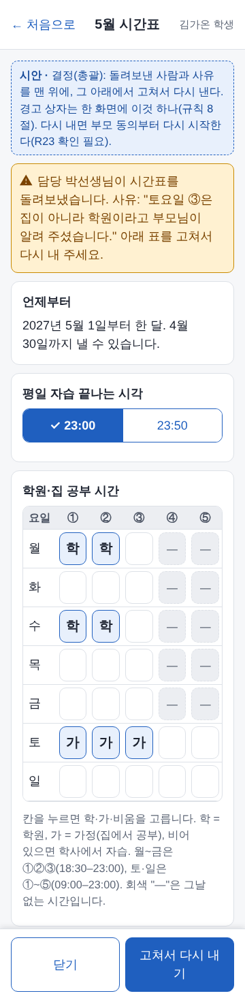 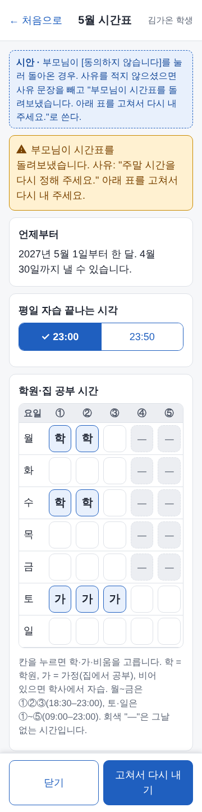

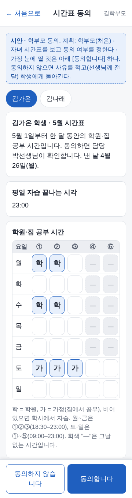

- `timetable-parent`: 자녀 탭(여럿이면) → "김가온 학생 · 5월 시간표"(설명 한두 줄) → 종료 시각 → 같은 표(읽기만). 아래 바: 보조 [동의하지 않습니다] · 주 **[동의합니다]**. 동의하면 담당교사에게 "확인 필요"로 간다.
- **[동의하지 않습니다]**(결정): 사유 **한 줄, 선택**을 받는 `UI.bottomSheet`(`timetable-parent-decline`) — "학생에게 시간표가 \"돌려보냄\"으로 돌아갑니다. 학생이 고쳐서 다시 내면 다시 동의를 부탁드립니다." 버튼 [돌아가기] · [학생에게 돌려보내기]. 사유를 적지 않아도 된다(`UI.confirmWithReason`은 사유가 필수라 쓰지 않는다).

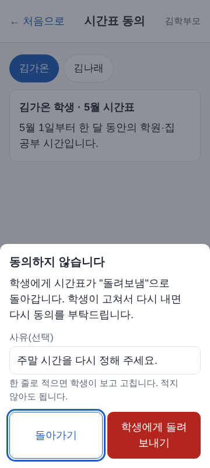

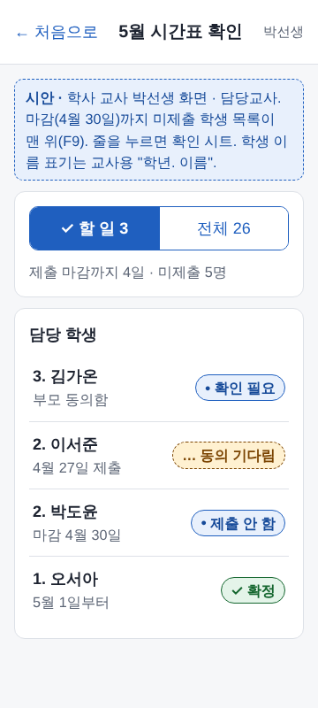 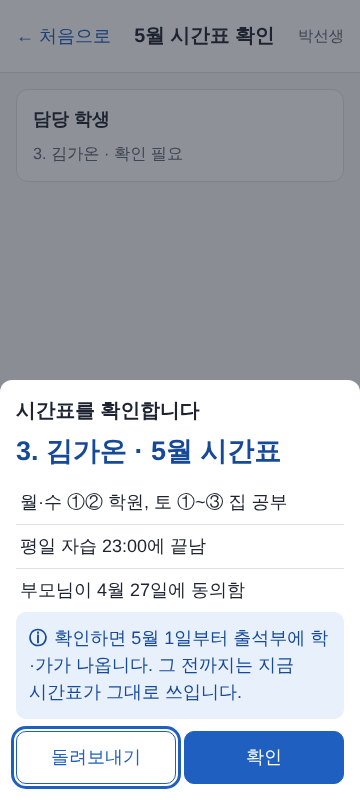

- `timetable-teacher-list`: 담당교사(자기 학생). 맨 위 [할 일 3 | 전체 26]과 "제출 마감까지 4일 · 미제출 5명"(마감까지 미제출 학생 목록이 F9 요구). 줄 = "3. 김가온" + 한 줄 설명 + 상태 알약(확인 필요 `todo` · 동의 기다림 `requested` · 제출 안 함 `todo` · 확정 `confirmed`). 줄을 누르면 확인 시트.
- `timetable-teacher-confirm`: `UI.bottomSheet` "시간표를 확인합니다": 리드 "3. 김가온 · 5월 시간표", 요약 3줄(학·가 요일, 종료 시각, 부모 동의일), 안내 "확인하면 5월 1일부터 출석부에 학·가가 나옵니다. 그 전까지는 지금 시간표가 그대로 쓰입니다.", 버튼 보조 [돌려보내기](사유 필수) · 주 [확인]. 확정되면 `fixed_schedules`에 반영(C37).

## 5. 권한 한눈에

| 화면 | 학생 | 학부모 | 담당교사 | 근무교사(그날) | 관리자 |
| --- | --- | --- | --- | --- | --- |
| 학생 홈·내 OUT·내 출결 | 본인 | — | — | — | — |
| 학부모 홈·상담 여부 | — | 연결된 자녀 | — | — | — |
| 시설 일지 쓰기·내 기록·취소 | 본인만 | — | — | — | — |
| 오늘 시설 일지 | — | — | — | ○ 그날 | ○ |
| 시설 일지 누적 | — | — | — | — | ○ |
| 시간표 제출 | 본인만 | — | — | — | — |
| 시간표 동의 | — | 연결된 자녀 | — | — | — |
| 시간표 확인 | — | — | ○ 담당 학생 | — | ○ |

서버 키(예정): `facility.write`(학생 본인)·`facility.view`(그날 근무교사·관리자)·`facility.report`(관리자)(`docs/plan/stage7.md` S7-0), 신원 판정은 `portalWho_()` 한 곳. **이 표는 화면 쪽 기본값이고 서버가 다르면 서버가 맞다**(차이는 총괄에게).

## 6. 컴포넌트·스타일

| 화면 | 쓰는 것 |
| --- | --- |
| 학생·학부모 홈 | `.card` `.notice.warn` `UI.statusPill` `.pill.out-1` `.pill.out-2` `.btn.secondary` `nav.tabs`(자녀 전환) |
| 시설 일지 쓰기 | `UI.field` `UI.dateField` `UI.studentPicker` `.chip` `UI.actionBar` `UI.confirmSheet` |
| 시설 일지 목록·누적 | `UI.statusPill` `.tablewrap` `table.data.rg` `UI.segmented` |
| 시간표 | `UI.segmented` `UI.bottomSheet` `UI.confirmWithReason` `UI.statusPill` `table.data.rg` `.rg-cell`(.has·.off) |

**새 스타일은 없다.** 5단계에서 더한 격자 스타일(`table.data.rg`·`.rg-cell`)을 시간표 표에 다시 쓴다.

## 7. 규칙 8절 점검 결과(이 시안에 대어 본 것)

| 점검 | 결과 |
| --- | --- |
| 무게가 다른 정보를 같은 카드로 줄줄이 나열 | 홈 맨 위 "해야 할 일" 한 칸만 강하게, 나머지 카드는 같은 보통 모양(읽는 정보라 같은 급). 퇴실 대상일 때는 경고 상자 하나 |
| 한 단어만 색·굵게 | 없음(강조는 알약·경고 상자 안에서만) |
| 점(·)으로 이은 긴 한 줄 | 머리 카드 한 줄("2학년 3반 5번 · 기숙사생 · 담당 박선생")만 남겼고 본문 안내는 모두 문장으로 풀었다 |
| 순서 없는 번호 | 시간표 단계 4개만 번호(순서가 있다) |
| 제목 아래 되풀이 설명 | 없음(설명은 뜻을 더하는 곳만) |
| 강한 색 상자가 한 화면에 둘 이상 | 없음(퇴실 대상 경고는 화면당 하나) |
| 큰 글씨(기기 글자 150%) | 19화면 모두 360px에서 가로 스크롤·잘림 없음(`html{font-size:27px}`로 확인, 실제 기기의 큰 글씨 설정과는 다를 수 있다) |

## 8. 결정됨 · 미정·가정·확인 못 한 것

**총괄 답(2026-11-19)으로 정해진 것** — 코딩은 아래대로 만든다:

1. 학생·학부모에게 **OUT 항목 이름은 보인다**(입력한 교사·메모는 없다).
2. **시설 일지 취소는 사유 없이 확인 시트만**(`facility-cancel`).
3. 시간표 일괄 입력은 **[지난달 시간표 그대로 가져오기] 버튼 하나**, 가져온 뒤 고친다(`timetable-import-confirm`).
4. **돌려보내진 시간표**: 맨 위에 돌려보낸 사람·사유, 아래에서 고쳐서 다시 낸다(`timetable-returned`·`timetable-returned-parent`).
5. 학부모 **[동의하지 않습니다]**: 사유 한 줄(선택) → 학생에게 "돌려보냄"으로 돌아간다(규칙 세션 R23에 같이 보냄, `timetable-parent-decline`).
6. **다시 낸 시간표는 학부모 동의·교사 확인을 처음부터 다시 받는다**(총괄, R23 보충에서 확정). 실제 화면에서도 그렇게 돈다(`docs/design/stage7-teacher-checks.md` D9~D12).

**아직 정해지지 않았거나 가정한 것:**

7. 관리자 누적표의 칸을 눌렀을 때 펼침(그날 기록)과 시설별 보기는 시안에 없다.
8. 제출 기간이 아닐 때의 학생 화면, 마감 지난 뒤 미제출 학생 화면은 그리지 않았다(말투만: 이유와 다음 기간을 한 줄로).
9. **학부모 홈의 "시간표 동의" 한 칸**은 동의할 시간표가 있을 때만 나온다(없으면 생략).
10. 시설 목록(`facility.names`) 기본값은 시안의 예시(특강실·원형테이블·소회의실·기타)이며 실제 이름은 관리자가 정한다.
11. 돌려보낸 뒤 학생이 마감 안에 못 고치면(마감 놓친 학생) 어떻게 되는지 — **총괄 확인 중**. 지금 동작은 마감 뒤 학생이 직접 낼 수 없고 지난 확정 시간표가 그대로 쓰인다.
12. **확인 못 한 것:** 실제 Apps Script·실제 휴대폰에서 돌려 본 것이 아니다(정적 시안). `input[type=time]`의 표시 방식(오전·오후)은 기기마다 다르다. 학부모 로그인 방식(0단계 진단)이 정해지기 전이라 첫 화면(`parent-home-nolink`)의 문구는 바뀔 수 있다.
