# 7단계 선생님 확인 체크리스트

> 7단계(학생·학부모 기능) 네 가지 — **A 학생(본인 것만 보임)**, **B 학부모(자녀 전환·다른 집 자녀·전화번호·상담 내용)**, **C 시설 일지(F10, C35)**, **D 시간표(F9, C37: 제출 → 학부모 동의 → 담당교사 확인)** — 를 선생님이 **0단계 진단 때 직접 눌러 보며** 확인하는 순서입니다. 형식은 `stage5-teacher-checks.md`와 같습니다.
> **사진은 정적 시안이 아니라 main 코드의 실제 화면**입니다(`design/preview/stage7-real.js`가 실제 `src/ui` 화면을 가짜 서버에 이어 붙여 **360px 휴대폰 폭**으로 찍음). 이름·숫자는 모두 가짜 데이터이고 날짜는 가짜 오늘 **2027-03-26(금)** 기준이라, 실제 Apps Script에서는 날짜와 이름이 다르게 보입니다. 모양과 문구가 같으면 통과입니다.

## 읽는 법

- 한 단계 = **누르는 것 → 이렇게 보이면 통과 → 사진 → 결과(○/×)** 입니다.
- ×가 나오면 **번호 + 한 줄**(예: "B6 다른 집 아이 이름이 탭에 보임")과 화면 사진을 총괄에게 보냅니다. 앱이 이상한 것이지 선생님이 잘못 누르신 것이 아닙니다.
- 컴퓨터 테스트(`npm test`)가 이미 확인한 것은 각 절 끝에 "이미 확인됨"으로 적었습니다. 여기서는 **실제 Apps Script에서만 보이는 것**(실제 로그인 계정, 계정별 화면, 휴대폰 화면, 시트에 남는 기록)을 봅니다.
- 이름은 모두 **가짜 데이터**입니다. 실제 학생·학부모 이름·전화번호로 시험하지 않습니다. 시험한 시설 일지·시간표는 끝에서 **취소**하거나 가짜 데이터 시트에서만 합니다(시범 운영 시트에서 하지 않습니다).
- **날짜 주의:** 시간표(D)는 **매달 25일~말일에만 제출**할 수 있습니다. 시험하는 날이 그 기간이 아니면 D2부터는 "지금은 시간표를 내는 기간이 아닙니다"가 나오는 것이 **정상**입니다. 그때는 시트 `settings`의 `timetable.submit_start_day`를 시험하는 날 이하로 바꿨다가(예: 오늘이 10일이면 `1`) **시험이 끝나면 `25`로 되돌립니다**(`timetable.submit_end_day`는 `last` 그대로).
- 쉬운 말로 적었습니다. 학생·학부모에게 안내할 말은 [`docs/plan/pilot-guide.md`](../plan/pilot-guide.md) 7절에 있습니다.

## 시험 계정 — 학생·학부모는 **역할을 바꿔 가며** 쓰지 않고, 아래 계정을 따로 둡니다

| 이름 | 어떤 계정 | 맡는 역할 | 쓰는 곳 |
| --- | --- | --- | --- |
| 소유자 | 선생님 계정 | 관리자 + 학사 교사 | 준비, C 누적표, D 확인 |
| 시험교사 | 시험용 gmail 1 | 학사 교사(**학생 A의 담당교사**) | C(그날 근무일 때), D 확인·돌려보내기 |
| 시험교사2 | 시험용 gmail 2 | 학사 교사(**담당이 아니고 그날 근무도 아님**) | "안 보여야 하는 교사" 확인 |
| 학생 A | 시험용 gmail 3 | 학생 — `students` 탭 `email` 칸에 이 gmail이 들어 있는 학생 | A, C, D |
| 학생 B | 시험용 gmail 4 | 학생 — **다른 학생**(학생 A와 **다른 집**) | A, D |
| 학부모 | 시험용 gmail 5 | 학부모 — `guardian_links`에 **자녀 둘**(학생 A 포함)이 연결 | B, D |
| 다른 집 학부모 | 시험용 gmail 6 | 학부모 — **학생 B만** 연결 | B, D |
| 연결 없는 학부모 | 시험용 gmail 7 | 학부모 — `guardian_links`에 **없음** | B |

계정은 편집기에서 `addUser(이메일, '이름', 'student' 또는 'parent' 또는 'hall_teacher')`로 만듭니다. **누구의 계정인지는 시트가 정합니다**: 학생은 `students` 탭 `email` 칸, 학부모는 `guardian_links` 탭 `parent_email` 칸이 로그인한 gmail과 같아야 합니다. 같은 gmail에 역할을 바꿔 쓰면 로그아웃·재접속이 필요하니 **계정을 따로** 두는 편이 쉽습니다. (0단계 진단 결과로 로그인 방식이 바뀌면 이 표의 "어떤 계정" 칸만 바뀝니다.)

## 0. 먼저 끝나 있어야 하는 것 (준비, 소유자, 약 15분)

| 번호 | 누가 | 할 일 | 이렇게 보이면 통과 | 사진 | 결과 |
| --- | --- | --- | --- | --- | --- |
| 0-1 | 소유자 | `clasp push` 뒤 편집기에서 `setup`을 **다시** 실행합니다 | 로그에 `[경고]`가 없고, 시트에 이번 기간의 **`facility_logs_(기간)` 탭**이 생겼다(두 번째 실행은 그대로 둔다). 시트 `settings`에 `facility.names`(시설 목록, 기본 "특강실,원형테이블"), `timetable.submit_start_day`(25), `timetable.submit_end_day`(last)가 있다 | | |
| 0-2 | 소유자 | 가짜 데이터가 들어 있는 **시험용 시트**인지 확인합니다(시범 운영 시트가 아니어야 합니다) | `students`에 가짜 학생들이 있고 `terms`에 이번 기간이 있다. **실제 학생 이름이 보이면 여기서 멈춥니다** | | |
| 0-3 | 소유자 | 위 "시험 계정" 표대로 `users`에 8개를 등록하고, `students`의 한 줄에 **학생 A의 gmail**, 다른 학생 줄에 **학생 B의 gmail**을 넣습니다. `guardian_links`에 **학부모 gmail**을 학생 A·그 형제(둘) 줄에, **다른 집 학부모 gmail**을 학생 B 줄에 넣습니다 | 학생 A로 로그인하면 **학생 홈**("신한1학사 · 학생")이 열린다. 학부모로 로그인하면 **학부모 홈**("신한1학사 · 학부모")이 열린다. **같은 줄이 두 번 있으면(같은 gmail이 두 학생에게) 안 됩니다** — 본인은 한 명이어야 합니다 | | |
| 0-4 | 소유자 | **시험교사를 학생 A의 담당교사로**(`enrollments`의 `teacher_email`), 근무표에서 **오늘 근무를 시험교사**로 해 둡니다(C 절에서 필요). 시험교사2는 근무표에 오늘 없어야 합니다 | 시험교사 홈에 "오늘 시설 일지 보기" 카드가 있고, 시험교사2 홈에는 **없다**(근무가 아니면 카드 없음) | | |
| 0-5 | 소유자 | 오늘이 시간표 제출 기간(25일~말일)이 아니면 읽는 법의 **날짜 주의**대로 `timetable.submit_start_day`를 바꿔 둡니다 | 학생 A 홈에 "다음 달 시간표를 내 주세요" 카드가 보인다 | | |

## A. 학생: 본인 것만 보인다 (F14, C36, 약 15분)

학생은 **자기 것만** 봅니다. 다른 학생의 이름·OUT·출결·전화번호는 어디에도 없어야 합니다. 학생 홈 맨 아래에는 시설 일지 카드가 있습니다.

| 번호 | 누가 | 누르는 것 | 이렇게 보이면 통과 | 사진 | 결과 |
| --- | --- | --- | --- | --- | --- |
| A1 | 학생 A | 접속하면 열리는 **홈**을 위에서 아래까지 봅니다 | 맨 위 카드에 **내 이름·학년 반 번호·담당 선생님 이름**. 아래로 내 OUT(몇 OUT·날짜·항목 이름), 이번 주 출결 기록, 내 자리와 방, 앞으로 일정, **시설 일지** 카드([시설 일지 쓰기]·[내가 쓴 시설 일지]). **다른 학생 이름은 한 군데도 없다** | 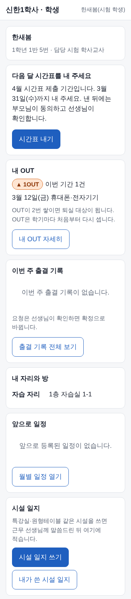 | |
| A2 | 학생 A | 내 OUT 카드를 봅니다 | "▲ 1OUT 이번 기간 1건", 날짜와 **항목 이름만**(예: "휴대폰·전자기기"). **입력한 교사 이름·메모는 없다**. "OUT이 2번 쌓이면 퇴실 대상이 됩니다. OUT은 학기마다 처음부터 다시 셉니다." | | |
| A3 | 학생 B | 학생 B로 접속해 홈을 봅니다 | 홈의 이름·OUT·출결·자리가 **학생 B 것**이고, **학생 A의 이름과 OUT은 없다**. 학생 A와 같은 모양의 화면인데 내용만 다르다 | 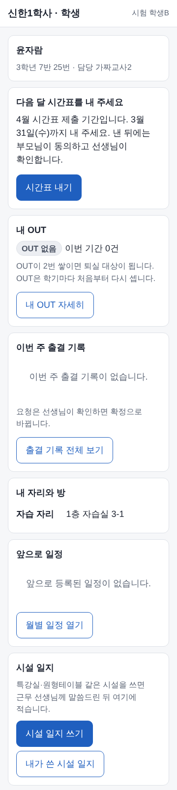 | |
| A4 | 학생 A | 주소 끝에 `?page=sheet`(출석부)나 `?page=outs`(OUT 목록)를 붙여 엽니다 | **권한이 없습니다** 화면("이 화면은 볼 수 있는 역할이 아닙니다. 처음으로 돌아가 주세요."). 출석부·OUT 목록 같은 교사 화면은 열리지 않는다 | 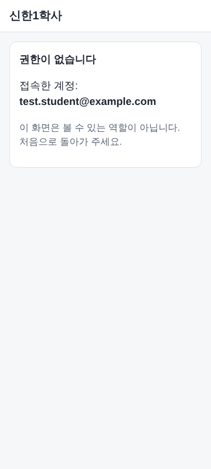 | |
| A5 | 학생 A | **[내 OUT 자세히]**를 누르고 [← 돌아가기]로 돌아옵니다 | 내 OUT 목록(날짜·항목·1OUT). 취소된 OUT은 "취소"로 남아 있고 합계에는 세지 않는다. 메모·입력한 교사는 없다. 돌아가기가 홈으로 돌려보낸다 | | |
| A6 | 학생 A | 홈의 **전화번호·이메일·교사 메모·상담 내용**을 찾아봅니다 | **어디에도 없다**(학생 홈에는 상담 줄 자체가 없다) | | |

> 이미 확인됨: 학생은 본인 id로만 조회, 남의 학생 id를 보내면 거부(denied 기록), 응답에 다른 학생 이름·이메일·전화·메모·상담 내용 없음, 취소 OUT은 합계에서 제외.
> 확인 못 한 것: **같은 gmail이 여러 학생 줄에 들어 있을 때**(본인 판정이 첫 줄로 정해진다), 실제 로그인 방식이 바뀌었을 때(0단계 진단 결과).

## B. 학부모: 자녀 전환, 다른 집 자녀는 안 보임, 전화번호·상담 내용 없음 (F14, C36, 약 20분)

학부모는 **연결된 자녀만** 봅니다. 자녀가 둘 이상이면 맨 위 **탭**으로 바꿉니다. 상담은 **날짜와 교사 이름**만 보이고 내용은 보이지 않습니다. 전화번호는 어느 화면에도 없습니다.

| 번호 | 누가 | 누르는 것 | 이렇게 보이면 통과 | 사진 | 결과 |
| --- | --- | --- | --- | --- | --- |
| B1 | 학부모 | 접속하면 열리는 **홈**을 봅니다 | 맨 위에 **자녀 이름 탭**(자녀 수만큼, 예: "한새봄", "한라온"). 첫 번째 탭이 파랗게 눌려 있고 아래에 그 자녀의 **이름·학년 반 번호·담당 선생님**, OUT, 출결 기록, 급식과 기숙사, 상담, 앞으로 일정이 나온다 |  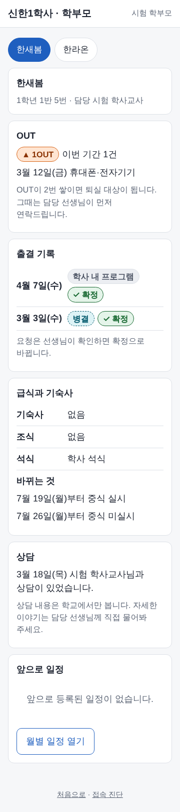 | |
| B2 | 학부모 | 두 번째 **자녀 탭**을 누릅니다 | 아래 내용이 **그 자녀 것으로 바뀐다**(이름·OUT·출결). 첫 자녀의 내용은 사라진다 | 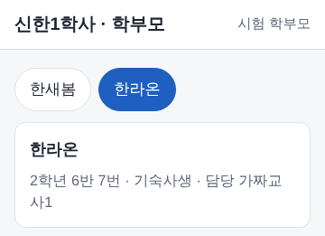 | |
| B3 | 학부모 | 탭 줄을 봅니다 | 탭은 **연결한 자녀뿐**이다. 다른 집 학생(학생 B)의 이름은 **없다** | | |
| B4 | 학부모 | **상담** 카드를 봅니다 | "3월 18일(목) 시험 학사교사님과 상담이 있었습니다." 처럼 **날짜와 교사 이름만**, 그리고 안내 "상담 내용은 학교에서만 봅니다. 자세한 이야기는 담당 선생님께 직접 물어봐 주세요." **유형(진로·생활)·내용·학생이 공개하지 않은 상담은 없다** | 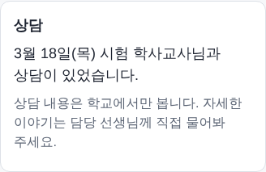 | |
| B5 | 학부모 | 화면 전체에서 **전화번호**(010…)와 교사 메모·상담 내용을 찾아봅니다 | **하나도 없다**. 보호자 전화번호는 시트에는 있지만 학부모 화면에는 나오지 않는다 | | |
| B6 | 다른 집 학부모 | 접속해 홈을 봅니다 | 탭·내용이 **학생 B만**이다. **학생 A와 형제의 이름·OUT은 없다** | 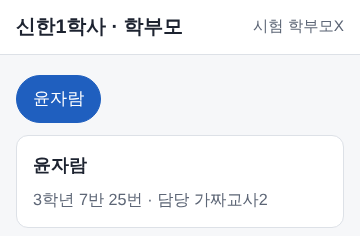 | |
| B7 | 연결 없는 학부모 | 접속해 홈을 봅니다 | 카드 **"연결된 자녀가 없습니다"**: "학교에 알려 주신 구글 계정과 자녀 정보가 아직 이어지지 않았습니다. 담당 선생님께 이 계정(로그인한 구글 계정)으로 자녀를 연결해 달라고 알려 주세요." | 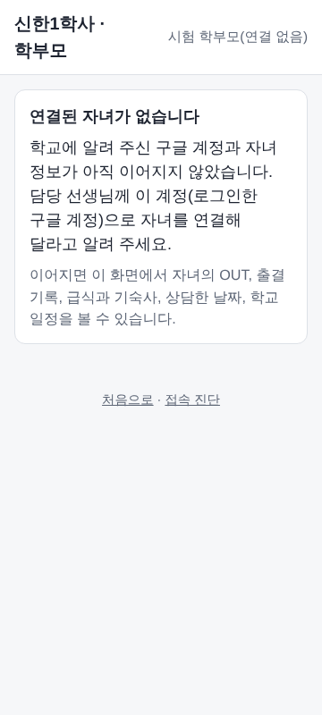 | |
| B8 | 학부모 | 주소 끝에 `?page=counsel`(상담일지)을 붙여 엽니다 | **권한 없음 화면**. 상담일지 화면은 교사만 연다 | 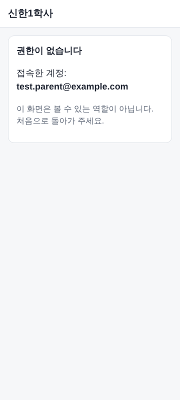 | |
| B9 | 소유자 | 시트를 보면서: 학부모 홈에 **상담 줄이 나온 날짜**가 별도 `신한1학사_상담일지` 시트의 `counsel_notes`에서 "학부모에게 보임"이 켜진 상담과 같은지 봅니다. 켜지 않은 상담은 학부모 홈에 **없는** 것을 확인합니다 | 학부모에게 보이도록 한 상담만 날짜·교사로 나온다. 상담 **내용**은 운영 시트가 아니라 별도 `신한1학사_상담일지`에만 있다 | | |

> 이미 확인됨: 학부모는 연결된 자녀 id만 조회(다른 집 자녀 id는 denied), 응답에 전화번호·상담 내용·교사 메모·이메일 없음, 상담은 날짜·교사만(학생이 공개한 것만), 연결 없는 학부모는 빈 목록.
> 확인 못 한 것: **실제 보호자 gmail 연결**(학부모 로그인 방식은 0단계 진단 결과에 달려 있음), 화면을 다른 사람에게 보여 주는 경우(앱이 막을 수 없음 — 안내서 7절에 적었다).

## C. 시설 일지 (F10, C35, 결정 83, 약 25분)

특강실·원형테이블 같은 시설을 쓰면 **근무 선생님께 말씀드린 뒤** 학생이 일지를 적습니다. 쓰기·취소는 **학생 본인만**, 그날 목록은 **그날 근무교사**와 관리자만, 누적표는 **관리자만** 봅니다. **지우지 않고 "취소"로 남깁니다.**

| 번호 | 누가 | 누르는 것 | 이렇게 보이면 통과 | 사진 | 결과 |
| --- | --- | --- | --- | --- | --- |
| C1 | 학생 A | 홈의 **[시설 일지 쓰기]** | 위에 [일지 쓰기 \| 내가 쓴 일지] 탭, 파란 안내 "먼저 오늘 근무 선생님께 말씀드린 뒤 적어 주세요.", 카드 **어디서**(시설 칩: 특강실·원형테이블), **언제**(날짜 기본 오늘 + [오늘], 시작·끝나는 시각), **누구와 무엇을**(함께 쓴 학생 찾기, 목적 선택 100자), 아래 바 [닫기]·**[일지 저장]** | 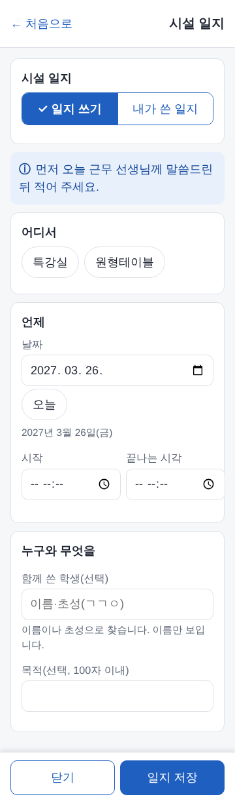 | |
| C2 | 학생 A | 시설 "특강실", 시작 15:30, 끝 17:00, 목적 "가짜: 탐구 토론"을 넣고 **[일지 저장]** | 알림 **"시설 일지를 저장했습니다."**, 화면이 [내가 쓴 일지]로 넘어가 방금 쓴 줄(**날짜 · 시설, 시간, 목적, [취소]**)이 맨 위에 있다 | 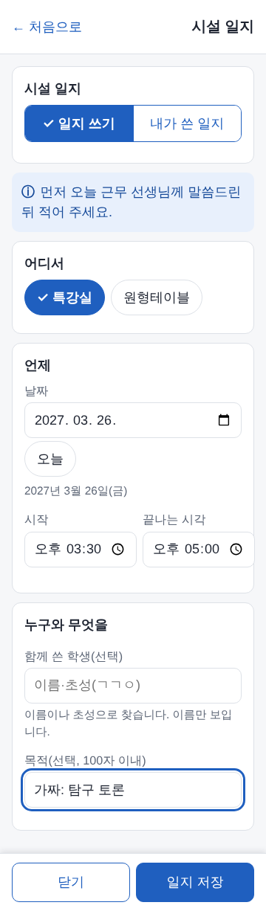 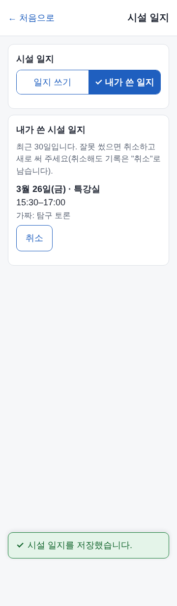 | |
| C3 | 학생 A | **함께 쓴 학생** 칸에 학생 B의 이름이나 초성(ㄱㄱㅇ)을 쳐 봅니다 | 찾아진 학생은 **이름만**(학번·전화·학년 반은 없다). 그날 입실 중인 학사생만 찾는다. 없는 이름이면 "찾는 학생이 없습니다. 이름을 다시 확인해 주세요…" | | |
| C4 | 학생 A | 같은 시설에 **겹치는 시간**(예: 특강실 15:30–16:30)을 또 저장해 봅니다 | 저장되기 전에 안내 **"같은 시간에 이미 쓴 기록이 있습니다"**와 [그래도 저장](정말 같은 시간으로 저장하려면) — 모르고 두 번 쓰는 것을 막는다. [취소]를 누르고 시간을 바꿀 수 있다 | | |
| C5 | 학생 A | [내가 쓴 일지]에서 한 줄의 **[취소]** | 아래에서 올라오는 확인 시트 **"이 일지를 취소합니다"**(날짜·시설·시간, "삭제가 아니라 "취소"로 남습니다."), [취소]·**[일지 취소]**. 사유는 묻지 않는다 | 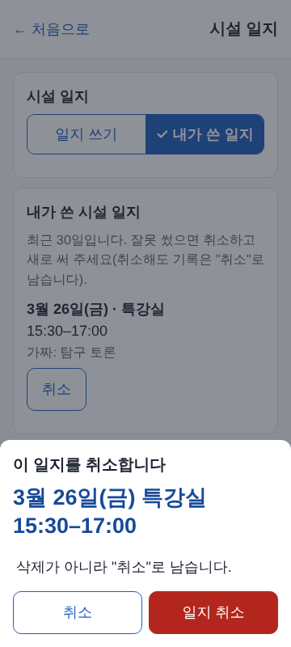 | |
| C6 | 학생 A | [일지 취소]를 누릅니다 | 알림 "일지를 취소했습니다." 줄이 **지워지지 않고 "취소" 알약**으로 바뀌고 [취소] 버튼이 없다 | 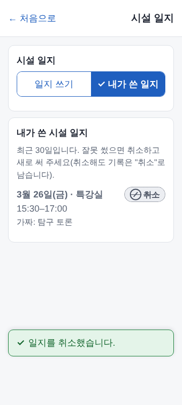 | |
| C7 | 소유자 | 시트 `facility_logs_(기간)`과 `audit_log`를 봅니다 | C6의 줄이 **지워지지 않고 `status`가 `취소`**로 남아 있고, `audit_log`에 저장·취소 줄이 있다. 줄에는 학생 id가 있다(이름은 없다) | | |
| C8 | 시험교사 | (오늘 근무) 홈의 **[오늘 시설 일지 보기]** | 위 "오늘 근무 선생님께 보이는 일지입니다." 아래에 **시설별 카드**: 시간, **학년 반 번호 이름**, 목적. 취소한 줄은 **"취소" 알약**으로 남는다(지워지지 않는다) | 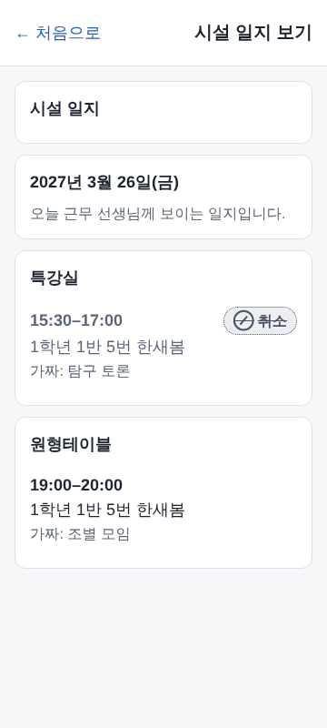 | |
| C9 | 시험교사2 | (오늘 근무 아님) 같은 화면을 엽니다(주소 끝 `?page=facilityday`) | 노란 안내 **"시설 일지는 그날 근무 선생님만 볼 수 있습니다."**만 있고 일지 목록은 없다 | 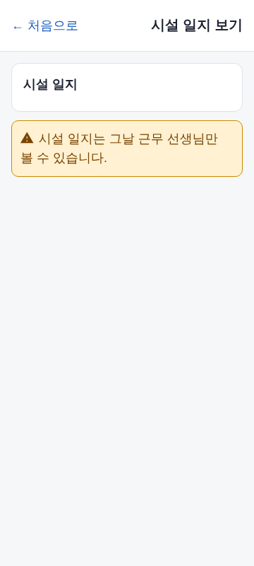 | |
| C10 | 소유자 | 홈의 **[누적표 보기]**(또는 주소 끝 `?page=facilityday&tab=stats`) | [그날 일지 \| **누적표**] 탭, 범위 [이 주 \| 이번 달] 와 [‹][›], "N명 · 합계 N시간 N분", 표(학생 × 날짜별 시설을 쓴 시간). 칸 아래 안내 "칸 = 그날 시설을 쓴 시간 합(함께 쓴 학생도 같은 시간으로 셉니다)…" | 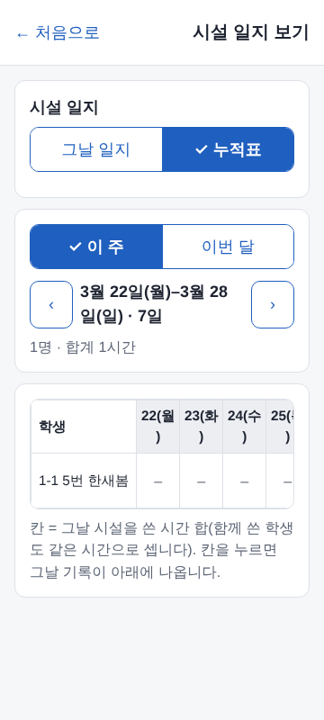 | |
| C11 | 학생 A | 주소 끝에 `?page=facilityday`를 붙여 엽니다 | **권한 없음 화면** — 학생은 그날 목록·누적표를 열 수 없다 | | |
| C12 | 시험교사(관리자 아님) | 주소 끝에 `?page=facilityday&tab=stats`를 붙여 엽니다 | 누적표는 **관리자만**이라 목록이 나오지 않아야 한다. **알려진 화면 문제:** 지금은 안내 없이 "불러오는 중…"만 계속 보입니다(서버는 거부하고 있어 **자료는 새지 않습니다**). 총괄에게 알렸고, 고쳐지면 "권한이 없습니다" 같은 안내가 나옵니다 | | |

> 이미 확인됨: 쓰기·취소는 학생 본인만(남의 일지 취소 거부), 쓰기는 락 안에서 한 줄 추가, 취소는 지우지 않고 `status` 취소 + `audit_log`, 같은 시설·겹치는 시간 경고, 함께 쓴 학생 검색은 이름만(id·학번·전화 없음), 그날 근무교사만 그날 목록(예비·교대로 넘긴 원래 근무자는 안 됨), 누적표는 관리자만, 응답에 이메일 없음.
> 확인 못 한 것: 실제 휴대폰에서 `input[type=time]`이 "오후 03:30"처럼 오전·오후로 보이는 기기가 있다(기기마다 다름). 누적표 칸을 눌러 그날 기록을 펼치는 기능은 아직 없다(후속).

## D. 시간표: 제출 → 학부모 동의 → 담당교사 확인 (F9, C37, R23, 약 40분)

학생이 **다음 달** 학원(학)·집(가) 시간표를 **매달 25일~말일**에 냅니다. 낸 뒤 **학부모가 동의**하고 **담당교사가 확인**해야 확정됩니다. **확정되기 전에는 지금 시간표가 그대로 쓰입니다**(출석부가 바뀌지 않는다). 부모가 **동의하지 않거나** 교사가 **돌려보내면** 학생이 고쳐서 다시 내고, **다시 낸 뒤에는 학부모 동의·교사 확인을 처음부터 다시 받습니다.**

| 번호 | 누가 | 누르는 것 | 이렇게 보이면 통과 | 사진 | 결과 |
| --- | --- | --- | --- | --- | --- |
| D1 | 학생 A | 홈의 **"다음 달 시간표를 내 주세요"** 카드에서 **[시간표 내기]** | 카드 안내 "4월 시간표 제출 기간입니다. 3월 31일(수)까지 내 주세요. 낸 뒤에는 부모님이 동의하고 선생님이 확인합니다." 그리고 시간표 화면이 열린다: "언제부터 2027년 4월 1일부터 한 달. 3월 31일(수)까지 낼 수 있습니다.", 카드 **학원·집 공부 시간**(요일 × ①②③… 칸 표, 칸마다 시작 시각) | 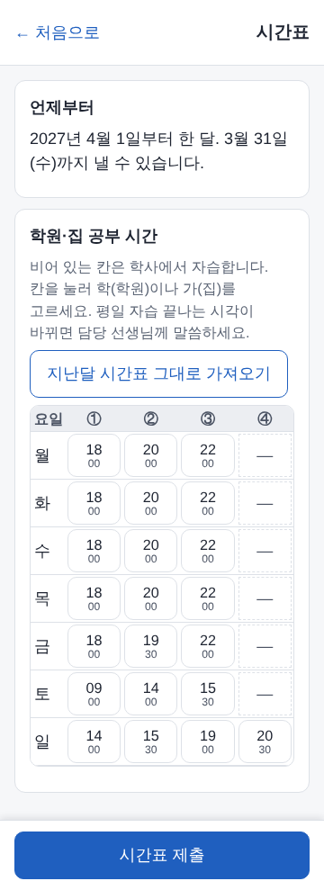 | |
| D2 | 학생 A | 표에서 칸 하나(예: 월요일 ②)를 누릅니다 | 아래에서 시트가 올라온다: 칩 **학 (학원) \| 가 (집) \| 비움 (학사 자습)**, [닫기]·**[이 칸에 적용]** | 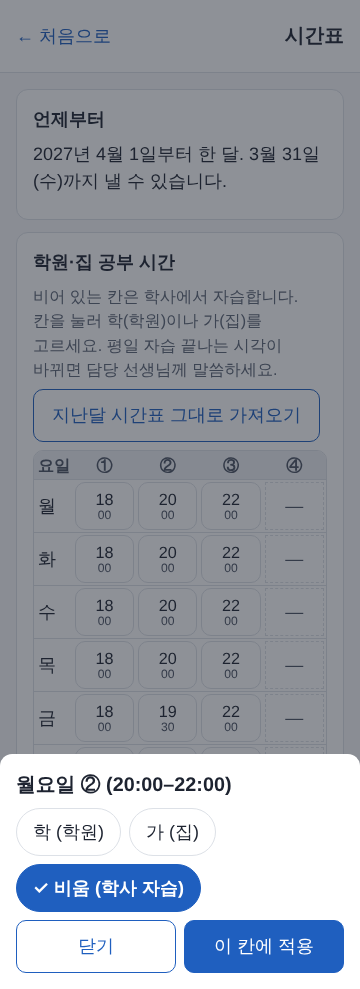 | |
| D3 | 학생 A | 월 ②는 "학 (학원)", 수 ③은 "가 (집)"으로 [이 칸에 적용]하고 아래 바를 봅니다 | 고른 칸에 **"학 학원"·"가 가정"** 글자가 나오고(색만으로 알리지 않는다), 비워 둔 칸은 학사 자습. 맨 아래 큰 버튼 **[시간표 제출]** | 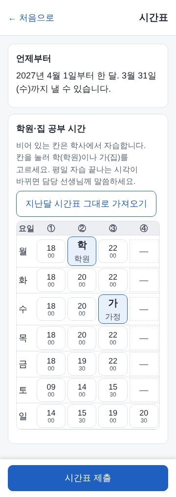 | |
| D4 | 학생 A | **[시간표 제출]** | 알림 **"시간표를 냈습니다."**, 화면이 바뀐다: 파란 안내 "확정되기 전에는 지금 시간표가 그대로 쓰입니다.", 단계 목록 **1. 내가 제출 완료 / 2. 부모님 동의 기다리는 중 / 3. 선생님 확인 아직 / 4. 4월 1일부터 적용 아직**, 아래 [고쳐서 다시 내기] | 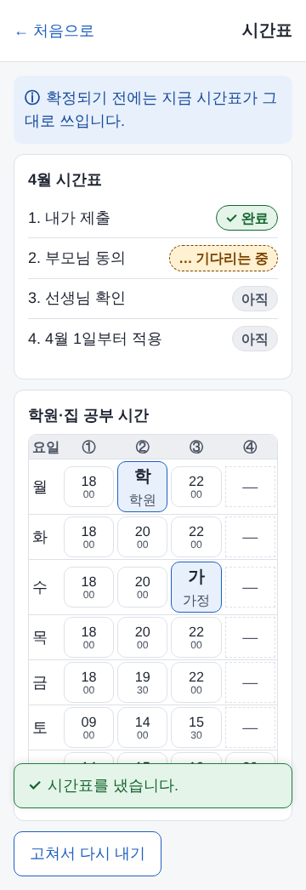 | |
| D5 | 학생 A | [← 처음으로]로 홈을 봅니다 | 위 **"다음 달 시간표를 내 주세요" 카드가 없어졌다**(이미 냈으므로) | 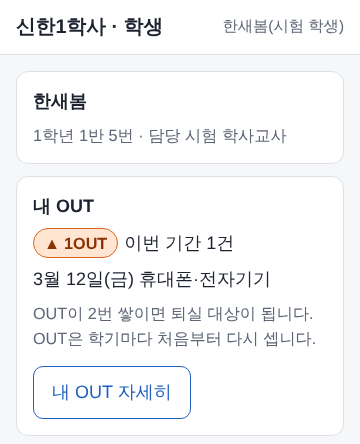 | |
| D6 | 학부모 | 접속해 홈에서 학생 A 탭의 **"시간표에 동의해 주세요" 카드**의 **[시간표 보고 동의하기]**를 누릅니다(주소로 열 때는 `?page=timetable&role=parent&student=…`) | 자녀 탭(둘이면)과 "한새봄 학생 · 4월 시간표": "동의하면 담당 선생님에게 "확인 필요"로 갑니다. 선생님이 확인한 뒤 4월 1일부터 적용됩니다." 학생이 낸 표(읽기만, 누를 수 없다), 맨 아래 **[동의하지 않습니다]·[동의합니다]** | 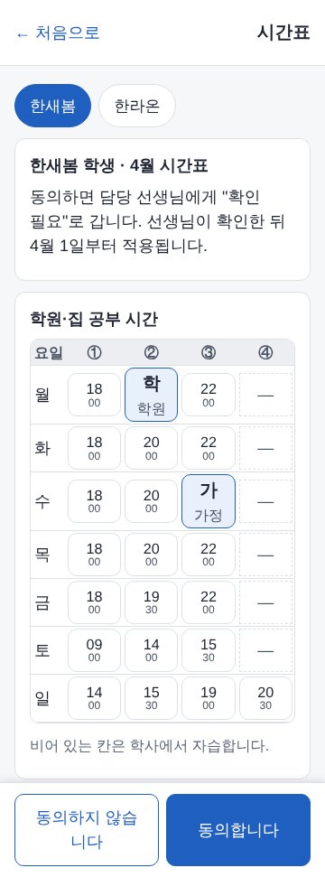 | |
| D7 | 다른 집 학부모 | 같은 주소(학생 A의 `student=` 값)로 열어 봅니다 | **학생 A의 시간표는 열리지 않는다.** 자기 자녀(학생 B)의 화면 "아직 학생이 낸 시간표가 없습니다."만 나온다. **학생 A 이름은 없다** | 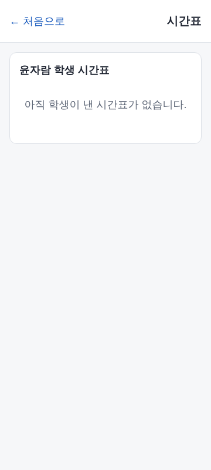 | |
| D8 | 학부모 | **[동의하지 않습니다]**를 누릅니다 | 아래 시트 **"동의하지 않습니다"**: "학생에게 시간표가 "돌려보냄"으로 돌아갑니다. 학생이 고쳐서 다시 내면 다시 동의를 부탁드립니다." 사유 칸 **"사유(적지 않아도 됩니다)"**(한 줄), [돌아가기]·**[학생에게 돌려보내기]** | 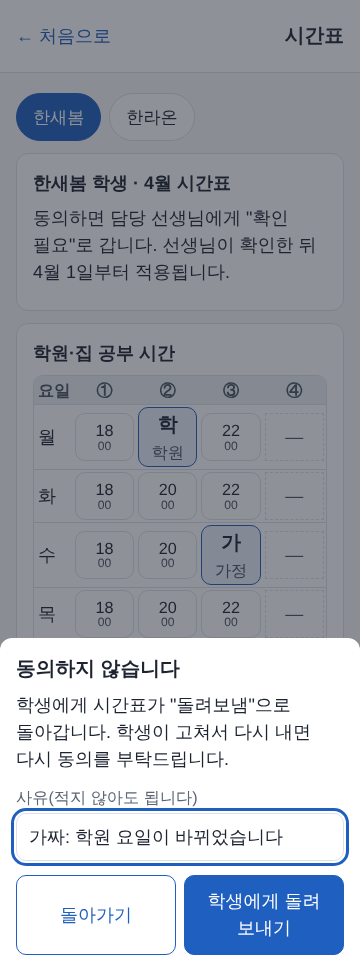 | |
| D9 | 학부모 | 사유에 "가짜: 학원 요일이 바뀌었습니다"를 적고 [학생에게 돌려보내기] | 알림 "학생에게 돌려보냈습니다.", 화면 글 **"학생에게 돌려보냈습니다. 학생이 고쳐서 다시 내면 다시 동의를 부탁드립니다."**, 하단 동의 버튼이 사라진다 | 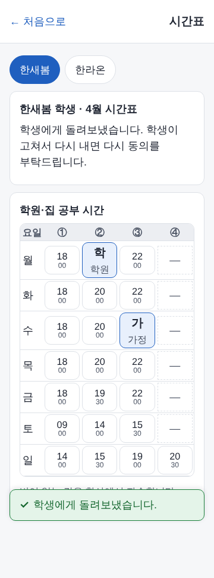 | |
| D10 | 학생 A | 홈을 봅니다 → **[시간표 열기]** | 홈에 노란 알림 **"4월 시간표가 돌려보내졌습니다. 고쳐서 3월 31일(수)까지 다시 내 주세요. 시간표 열기"**. 시간표 화면 맨 위에 **"부모님이 시간표에 동의하지 않았습니다. 사유: 가짜: 학원 요일이 바뀌었습니다 고쳐서 다시 내 주세요."**(돌려보낸 사람과 사유), 아래 표는 **내가 냈던 칸이 그대로 채워져 있고 바로 고칠 수 있다** | 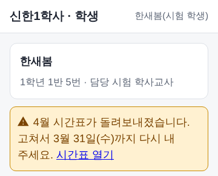 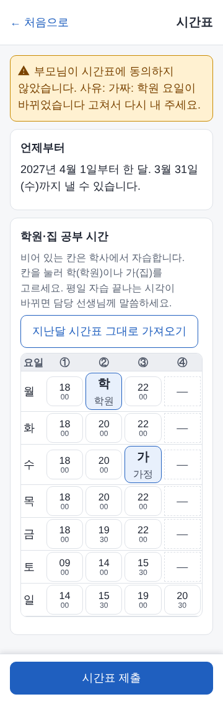 | |
| D11 | 학생 A | 칸 하나(예: 월 ③)를 "학 (학원)"으로 바꾸고 **[시간표 제출]** | 고친 칸이 보이고, 알림 "시간표를 냈습니다." 뒤 단계 목록이 다시 **부모님 동의 기다리는 중**이 된다(**동의·확인이 처음부터 다시** 시작) | 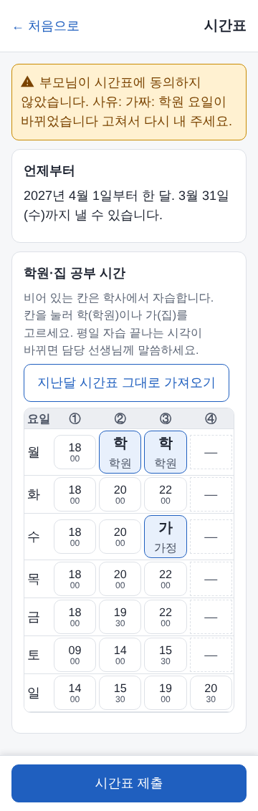 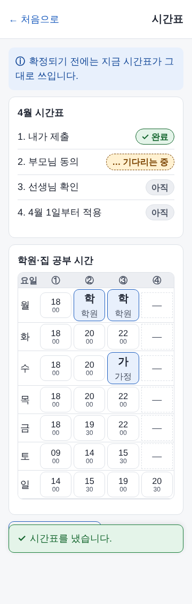 | |
| D12 | 학부모 | 다시 열어 **[동의합니다]** | 알림 "동의했습니다.", 글 **"동의하셨습니다. 담당 선생님이 확인하면 4월 1일부터 적용됩니다."**, 동의 버튼이 없다 | 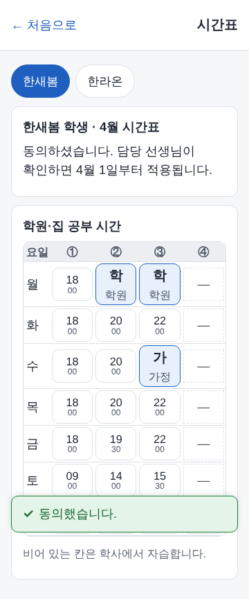 | |
| D13 | 시험교사2 | (학생 A의 담당이 아님) 홈 → 시간표(주소 `?page=timetable&role=hall_teacher`)를 엽니다 | 목록에 **자기 담당 학생만** 있다. **학생 A의 이름은 없다** | 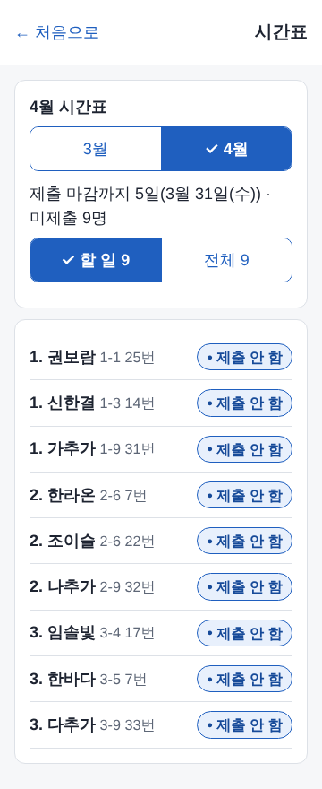 | |
| D14 | 시험교사 | (학생 A의 담당) 홈의 **[시간표 열기]** | 카드 "4월 시간표"([3월 \| 4월] 탭, "제출 마감까지 N일(3월 31일(수)) · 미제출 N명", [할 일 N \| 전체 N]). 목록에 학생 A가 **"확인 필요"**(학부모 동의가 끝난 상태) 알약으로 나온다. **학부모가 아직 동의하지 않았으면 "동의 기다림"**으로 나오고, 누르면 시트에 [닫기]만 있어 **확인도 돌려보내기도 할 수 없다**. 아직 안 낸 학생은 "제출 안 함" | 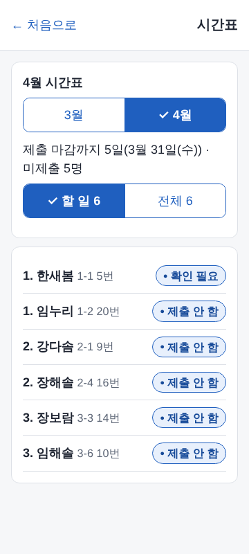 | |
| D15 | 시험교사 | 학생 A 줄을 누릅니다 | 아래 시트 **"시간표를 확인합니다"**: "학(학원): 월" "가(집): 수" "부모 동의: 3월 26일(금)", 안내 "확인하면 4월 1일부터 출석부에 학·가가 나옵니다. 그 전까지는 지금 시간표가 그대로 쓰입니다.", [돌려보내기]·**[확인]** | 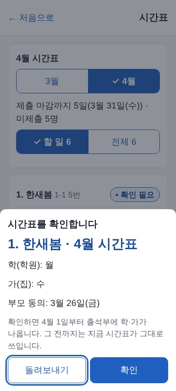 | |
| D16 | 시험교사 | **[확인]** | 알림 **"확인했습니다."**, 목록에서 학생 A가 **"확정"** 알약이 된다 | 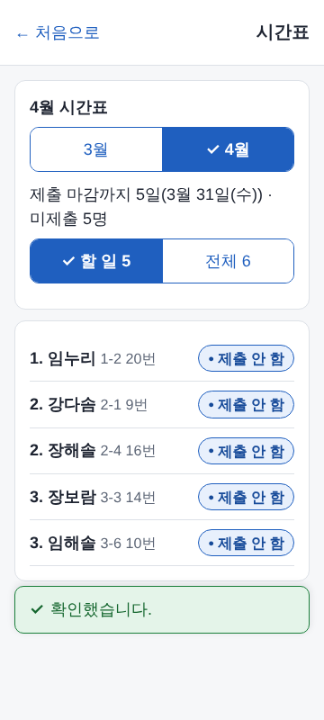 | |
| D17 | 학생 A | 시간표 화면을 다시 엽니다 | 단계 목록 **모두 "완료"**, 맨 아래 **"4. 4월 1일부터 적용 확정"**. 표는 읽기만 | 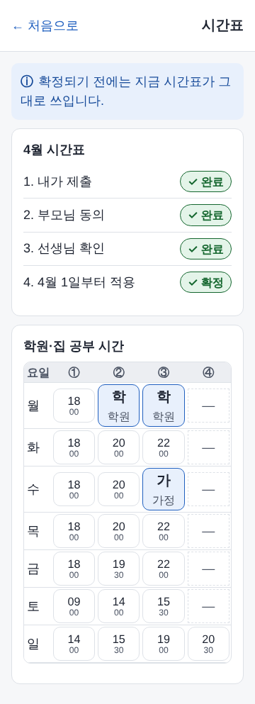 | |
| D18 | 소유자 | **확정 전에는 지금 시간표 유지:** 학생 A가 처음 제출한 뒤부터 교사 확인 전(D4~D15)에 **출결 담당**으로 4월 첫 월요일 출석부를 열어 학생 A의 칸을 봅니다. D16에서 확인한 뒤 같은 칸을 다시 봅니다 | **확인 전**(제출·동의만 한 상태)에는 4월 칸이 **3월 확정 시간표대로**이고, **확인한 뒤**부터 새 시간표(4월 1일부터)로 바뀐다. 3월 시간표가 없는 학생은 학·가가 없는 칸이다 | | |
| D19 | 시험교사 | 학생 A로 D11~D12를 한 번 더 해서 **동의까지 받은 뒤**, 담당교사가 학생 A 줄 → **[돌려보내기]** → 사유를 **한 글자만** 적고 확정해 봅니다 | 한 글자면 "돌려보내는 사유를 2자 이상 100자 안으로 적어 주세요."로 돌려보내지지 않는다(버튼이 먼저 막힐 수도 있다). 두 글자 이상이면 알림 "돌려보냈습니다."이고, 학생 A 홈과 시간표 맨 위에 **"담당 ○○님이 시간표를 돌려보냈습니다. 사유: …"**가 뜬다 | | |
| D20 | 학생 A | 마감(3월 31일)이 **지난 뒤**(또는 `timetable.submit_end_day`를 어제로 바꾼 뒤) 안 낸 달의 시간표를 엽니다 | **"지금은 시간표를 내는 기간이 아닙니다"** 카드 + 다음에 낼 수 있는 기간. 낼 수 없다. **마감 놓친 학생을 어떻게 할지는 총괄 확인 중** — 지금은 지난 확정 시간표가 그대로 쓰입니다 | | |
| D21 | 소유자 | 시트 `fixed_schedules`와 `audit_log`를 봅니다 | 새 시간표 줄이 `month`(2027-04), `weekday`, `blocks`, `code`(학·가), `status`(제출 → 동의 → 확정)로 남고, 돌려보낸 줄은 **지워지지 않고 `취소`**다. 돌려보낸 사람·사유는 `audit_log`(`timetable:return`)에 있다(이메일이 아니라 이름) | | |
| D22 | 학부모 → 학생 | 학생 A·학부모 두 창에서 **동시에**: 학생이 [고쳐서 다시 내기]로 고치는 중에 학부모가 [동의합니다]를 누릅니다 | 먼저 처리된 쪽이 맞다. 나중 쪽에는 **"지금 상태(…)에서는 동의할 수 없습니다"** 같은 거부 안내가 나오고 화면을 새로 불러와야 한다(상태는 서버가 락 안에서 다시 판정). 또 학부모가 **동의하기 전에 교사가 확인**을 누르면 "지금 상태(제출)에서는 확인할 수 없습니다"로 막힌다 | | |

> 이미 확인됨: 제출 기간(25일~말일) 밖 제출 거부, 상태 기계(제출 → 동의 → 확정, 돌려보냄), **확정 전에는 출석부가 앞 달 시간표 유지**(R23), 학생은 본인만 제출, 학부모는 연결된 자녀만 동의·동의하지 않음, 담당교사(자기 학생)·관리자만 확인·돌려보냄(시험교사2·근무교사는 거부), 낡은 상태에서의 동의·확인은 거부, 다시 낸 시간표는 동의·확인이 처음부터, 지난달 가져오기, 응답에 이메일 없음.
> 확인 못 한 것: **실제 출석부 인쇄 모양**(D18은 화면에서 칸만 본다), **한 달에 일부 요일만 확정되는 경우**(행마다 확정하는 중이면 앞 달 유지로 가정, R3), **[지난달 시간표 그대로 가져오기] 버튼**은 지난달에 확정된 시간표가 있을 때만 의미가 있다(이번 사진에는 3월을 미리 확정해 둔 상태라 보이지만, 처음 쓰는 달은 "지난달에 확정된 시간표가 없습니다."로 거부된다).

## 아직 열려 있는 결정 (총괄 확인 중)

| 무엇 | 지금 앱이 하는 것 | 알릴 곳 |
| --- | --- | --- |
| **마감을 놓친 학생**을 어떻게 할지 | 마감 뒤에는 학생이 직접 낼 수 없고(D20), 안 낸 달은 **지난 확정 시간표가 그대로** 쓰인다. 교사 목록에는 "제출 안 함"으로 남는다 | 총괄 |
| **돌려보낸 사유를 학생에게 보일지** | 지금은 **보인다**(D10: 교사든 부모든 사유가 학생 화면 맨 위에 나온다). 학부모가 사유를 적지 않으면 사유 없이 "동의하지 않았습니다"만 나온다 | 총괄 |

## 결과 적는 법

- 모두 ○면 "7단계 확인 통과"라고 총괄에게 알립니다.
- ×는 **번호 + 한 줄 + 사진**으로 적습니다(예: "A3 학생 B 화면에 학생 A 이름이 보임", "B5 학부모 화면에 전화번호가 보임", "D7 다른 집 학부모가 시간표를 봄").
- 가짜 데이터가 모자라 단계를 못 따라 하면 번호와 "데이터 부족"이라고 적어 주세요. 총괄이 가짜 데이터를 보강합니다.
- **A3·A4·B3·B5·B6·D7·D13·C9·C11**(안 보여야 하는 사람에게 안 보이는지), **B4**(상담은 날짜·교사만), **D4~D5·D15·D18**(확정 전에는 지금 시간표 유지)은 컴퓨터 테스트가 흉내만 낸 것이라 **꼭 눈으로** 봐 주세요.
- 시험이 끝나면 `timetable.submit_start_day`를 `25`로 되돌리고, 시험으로 낸 시설 일지·시간표는 가짜 데이터 시트에서만 하고 시범 운영 시트에서는 하지 않습니다(CLAUDE.md 1).
